<!-- Generated from the associated DOCX. Equations are source-faithful MathML transformed from Word OMML. -->

# An Online Stability Indicator for Real-Time Hybrid Simulation  Emphasizing Physical Substructure Degradation

Mohamed Gomaa,2,  Edwin D. Patino, Juan Nicolas Villamizar2, Johnny W. Condori Uribe, Shirley J. Dyke

# Abstract

Real-time hybrid simulation (RTHS) has become increasingly important as an experimental tool for evaluating system-level structural response under realistic loading while averting the cost and impracticality of full-scale testing. Recent advances in real-time processing, high-quality sensing, and servo-hydraulic control techniques have accelerated RTHS adoption and enabled more complex experiments. However, a key barrier to reliable RTHS execution remains the potential loss of stability as the physical substructure evolves during testing, particularly under stiffness degradation. This paper addresses this challenge by first formulating a typical RTHS framework and transfer-system dynamics, then analyzing stability under a parameterized degradation of the physical substructure and presenting a computational procedure for determining the critical damage level. Building on this analysis, an online stability indicator based on the normalized coprime factor (NCF) margin is presented and simplified for efficient evaluation in single-input-single-output (SISO) settings. A controller-switching strategy is also demonstrated to support practical intervention during an experiment by transitioning from a high-performance controller to a high-robustness controller as stability margins diminish. The switching boundary is formulated using Lyapunov stability criteria to ensure closed-loop stability during the transition. The approach is demonstrated on a modified version of a well-established benchmark problem. Using virtual real-time hybrid simulation (vRTHS), the proposed indicator is shown to provide a timely warning of diminishing robustness, enabling a smooth controller transition that successfully maintains stable operation and response accuracy under progressive degradation.

**Keywords:** real-time hybrid simulation; stability indicator; normalized coprime factor; structural degradation; controller switching

# 1-Introduction

Despite the remarkable advances in computational modeling and simulation tools, experimental testing remains indispensable to provide sufficient understanding of complex structural systems. Computational models often rely on idealized assumptions and simplifications, and their applicability may be limited when dealing with new, untested innovations. Experimental calibration and validation may be required before they are likely to be adopted for predicting the response to new inputs [1].

The ideal experiment to provide the most realistic test conditions and accurate results would be a full-scale, real-time experiment. However, such a test is often infeasible due to the cost, time, scale, and physical constraints, especially for structural applications. These constraints inspired civil engineering researchers to embark on a multi-decade effort to establish cost-effective testing methods that provide meaningful data for understanding behavior, validating models, and capturing the full spectrum of responses up to failure. One testing method that has been a fundamental part of civil engineering research since the early 20th century is the quasi-static technique [2]. With this approach, a predefined loading input is applied to a structural component (e.g., a building column or bridge pier) at a slow rate to allow close observation of the evolution of damage and to determine the hysteretic behavior without the need for high-performance actuators. As a result of its nature, the quasi-static technique has some major limitations: 1) it focuses on obtaining component-level rather than structure-level information, and thus it neglects the interaction between the component being tested and the rest of the structure; 2) it requires a predefined loading protocol, which helps in understanding some of the mechanical component properties, but it may not reflect the actual, or the full range, of structural behavior during the real situation; and, 3) its inherently slow loading rate prevents it from capturing rate-dependent phenomena [3].

These shortcomings motivated a new, cost-effective and efficient experimental technique to evaluate the dynamic performance of large civil structures. Hybrid simulation (HS) has emerged to fill this role, finding its way into structural engineering in the late 1960s [4]. In HS, the structure under investigation is partitioned into two parts: a physical substructure and a numerical substructure. Typically, the physical substructure includes the more complex components of the system, while the numerical substructure models the portions that are well-understood. The interaction between the two substructures is maintained by a transfer system, comprising servo-hydraulic actuators, sensors, and controllers, that enforce compatibility conditions at their interface [5].

As a natural evolution of HS, real-time hybrid simulation (RTHS) was developed to capture rate-dependent properties of systems. Despite being a powerful and versatile testing methodology, RTHS posed new challenges to the research community, as the accuracy of the results is strongly influenced by the performance of the transfer system. Good performance requires both appropriate selection of the hardware and careful design of the controllers, which typically need to be customized to meet the test objectives and account for the unique dynamics of each experiment [6], [7]. Inadequate controller design may not only compromise the accuracy of the results, but also induce instability in the system, potentially creating safety hazards or damaging costly equipment.

To address these challenges, significant research has been carried out to establish the knowledge to improve a transfer system’s performance and stability. For instance, Dyke et al. [8] presented a substantial insight into understanding the physical substructure dynamics as they explained control-structure interaction and showed that actuators have an implicit feedback interaction path. Further, Carrion [6] and Maghareh et al. [9] studied transfer system modelling and developed a parametric model that describes the physical substructure dynamics, thereby laying the foundation for subsequent analytical investigations. Recognizing the need for collaborative progress and to provide a shared testbed that helps researchers standardize the evaluation process of diverse algorithms, benchmark problems were proposed for single-degree-of-freedom [10] and multi-degree-of-freedom [11] controlled substructures. These benchmarks have engaged a wide research community and led to notable advances in the field, with several studies demonstrating successful and effective implementations [12], [13], [14], [15], [16]. Additionally, more studies extended the framework to incorporate nonlinear experimental components, confirming the versatility of RTHS in capturing complex behaviors [17].

The promising use of RTHS has motivated extensive stability studies to empower researchers to execute more complex experiments. Foundational work to study the RTHS stability analytically was established by Gawthrop et al. [18] and Mercan & Ricles [19], who used delay differential equations to determine system delay margins. These initial works, however, were limited by the simplifying assumption that the experimental substructure had stiffness and damping only. This limitation was addressed by Chi et al. [20], Wallace et al. [21], and Kyrychko et al. [22], who extended the study to include single degree of freedom (SDOF) physical substructures with both stiffness and mass properties. Additionally, they studied the instability mechanism that arises based on the physical substructure properties. To broaden the scope of the investigation, Gao & You [23] and Zhu et al. [24] extended the delay-based indicators to multi-degree-of-freedom (MDOF) systems in their stability studies. Maghareh et al. [5] leveraged the critical delay and derived an efficient eigenvalue-based solution providing a means for selecting among multiple partitioning schemes. To address the need for real-time monitoring, Gálmez & Fermandois [25] and Ahmadizadeh & Mosqueda [26] studied an efficient, energy-based stability indicator for online monitoring. By relying on observed signals during the experiment, it avoids dependence on an explicit model of the transfer system and can be implemented with minimal overhead. However, since it is not predictive and relies on observed data, it cannot provide a tunable lead-time margin for safety interventions. It is therefore well-suited as a secondary safety layer alongside primary predictive indicator aware of the system dynamics.

One common assumption in the aforementioned RTHS stability studies is the reduction of the entire transfer system, including actuator dynamics and potential disruptions, to a lumped pure time delay effect. While being convenient for analysis and design, this model is an approximation and may fail to capture fundamentally different instability mechanisms, such as gain amplification driven by unmodeled dynamics or stiffness degradation.

Recognizing these limitations, Tang et al. [27] developed a gain-margin-based stability boundary predictor that explicitly accounts for high-order servo-hydraulic transfer-system dynamics with simultaneously varying magnitude and phase, showing that the common pure-delay assumption has a low-frequency validity limit and validating the new method experimentally on a shaking-table test. Moreover, H. Zhou et al. [28] proposed a relative stability indicator for RTHS that relies on two quantitative robustness measures, critical delay for phase tolerance and critical gain, and validated it by numerical and physical SDOF tests. In these studies, the physical substructure parameters are not constant over the course of the experiment, however, the stability indicators are evaluated using a pre-identified loop model and are not updated online as the dynamics evolve. Moreover, extending these methods to multi-input-multi-output (MIMO) systems is non-trivial, particularly for coupled MDOF systems where complex actuator interactions complicate the analysis. Table 1~~1~~ provides a comparative summary of the RTHS stability indicators in literature, highlighting their capabilities across the selected evaluation criteria.

As shown in Table 1~~1~~, most prior work adopts a lumped pure time-delay representation of the transfer system, which is referred to in this study as a low-fidelity representation. While this simplification enables stability assessment of the numerical substructure loop (shown in purple in Figure 1, it does not capture the dynamics of the outer controller loop (shown in blue in Figure 2, and therefore cannot evaluate its stability. Depending on the system dynamics and the disruption type, the outer controller loop can be the governing stability constraint. In this study, we present an example where physical-substructure degradation destabilizes the system while monitoring the global loop of the numerical substructure indicates enhanced robustness, motivating the importance of investigating the stability of the outer controller loop by employing high-fidelity models for the transfer system.

Although gain and delay margins are informative for offline experiment design and partitioning selection, computing them online for high-fidelity transfer system models is inherently challenging due to the computational burden of tracking multiple crossover frequencies and maintaining numerical stability in real time. Furthermore, extending these indicators to MIMO configurations introduces additional complications, as the standard loop-at-a-time extension, which perturbs one input/output channel while holding the others nominal, can be overly optimistic, as it ignores coupled, simultaneous variations across channels [32]. On the other hand, energy-based indicators are largely observation-driven, as they are computed from measured response histories and error accumulation rather than explicit model-based predictions. Consequently, they provide limited ability to define a tunable lead time for proactive intervention.

To address these gaps, we propose an online stability indicator with a focus on the internal stability of the transfer system and its robustness against unmodeled disruptions. In establishing the indicator, special attention is given to physical system degradation, considering it as the most prevalent disruption to the plant during an RTHS experiment. An analytical solution quantifying the system's robustness to such degradation is presented, and the indicator's performance is illustrated through an example that is adapted from the RTHS benchmark problem. The proposed framework further integrates this online indicator with a controller-switching strategy to enable proactive intervention as robustness decreases. The switching boundary is established using Lyapunov stability criteria to preserve closed-loop stability during the transition.

The paper is structured to sequentially develop and demonstrate the proposed framework. Section 2 establishes the RTHS problem formulation and the high-fidelity transfer-system model used throughout the study. Section 3 investigates the effect of physical-substructure degradation on outer-loop stability and derives the corresponding degradation-dependent stability boundary. Section 4 provides the technical background on classical and modern robustness measures and uses this progression to introduce and formulate the NCF-based online stability indicator. Section 5 develops the controller-switching framework and examines the stability of the transition using Lyapunov criteria. Section 6 demonstrates the complete framework through an illustrative vRTHS example involving nonlinear specimen degradation and controller switching. Finally, Section 7 summarizes the main findings and conclusions.

# 2-Problem Formulation

The fundamental concept of RTHS is to partition a reference structural model into two substructures. Therefore, an RTHS consists of several major components, including: (i) a numerical substructure that can be evaluated in real-time on a computer; (ii) a physical substructure excited by actuators and instrumented with sensors; and, (iii) a transfer system, comprising the controller, servo-valve and actuator hydraulics, that enforces compatibility and equilibrium interface by synchronizing the physical substructure's response with the numerical evaluated response. Figure 1 illustrates a typical RTHS scheme where the numerical substructure is subjected to a ground acceleration, <mml:math xmlns:mml="http://www.w3.org/1998/Math/MathML" xmlns:m="http://schemas.openxmlformats.org/officeDocument/2006/math"><mml:msub><mml:mrow><mml:mi>a</mml:mi></mml:mrow><mml:mrow><mml:mi>g</mml:mi></mml:mrow></mml:msub><mml:mfenced separators="|"><mml:mrow><mml:mi>t</mml:mi></mml:mrow></mml:mfenced></mml:math>, where <mml:math xmlns:mml="http://www.w3.org/1998/Math/MathML" xmlns:m="http://schemas.openxmlformats.org/officeDocument/2006/math"><mml:msub><mml:mrow><mml:mi>d</mml:mi></mml:mrow><mml:mrow><mml:mi>d</mml:mi></mml:mrow></mml:msub></mml:math> is the calculated desired displacement from the numerical model, and <mml:math xmlns:mml="http://www.w3.org/1998/Math/MathML" xmlns:m="http://schemas.openxmlformats.org/officeDocument/2006/math"><mml:msub><mml:mrow><mml:mi>f</mml:mi></mml:mrow><mml:mrow><mml:mi>e</mml:mi></mml:mrow></mml:msub></mml:math> is the measured force from the physical substructure, while Figure 2 provides a closer look inside the transfer system block. Although seismic excitation is used for illustration in this study, the proposed framework is not restricted to earthquake loading and can be applied to other external excitations, such as wind loading, by modifying the corresponding input to the numerical substructure.

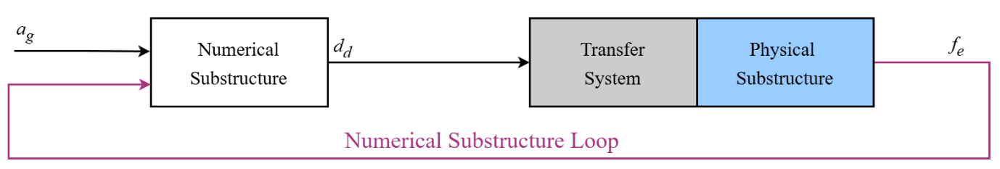

Figure 1~~1~~: A block diagram illustrating the main components of a typical RTHS test

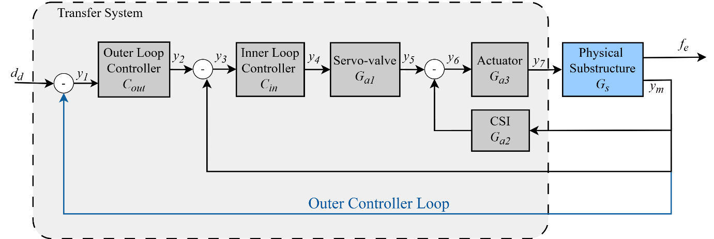

Figure 2~~2~~: A block diagram decomposing the dynamics of the transfer system

To define the numerical substructure block, the following equation of motion of the reference model is used:

<mml:math xmlns:mml="http://www.w3.org/1998/Math/MathML" xmlns:m="http://schemas.openxmlformats.org/officeDocument/2006/math"><mml:mtable><mml:mtr><mml:mtd><mml:mrow><mml:maligngroup/><mml:msub><mml:mrow><mml:mi mathvariant="bold">M</mml:mi></mml:mrow><mml:mrow><mml:mi mathvariant="bold">r</mml:mi></mml:mrow></mml:msub><mml:mover accent="true"><mml:mrow><mml:mi mathvariant="normal">x</mml:mi></mml:mrow><mml:mo>¨</mml:mo></mml:mover><mml:mfenced separators="|"><mml:mrow><mml:mi mathvariant="normal">t</mml:mi></mml:mrow></mml:mfenced><mml:mo>+</mml:mo><mml:msub><mml:mrow><mml:mi mathvariant="bold">C</mml:mi></mml:mrow><mml:mrow><mml:mi mathvariant="bold">r</mml:mi></mml:mrow></mml:msub><mml:mover accent="true"><mml:mrow><mml:mi mathvariant="normal">x</mml:mi></mml:mrow><mml:mo>˙</mml:mo></mml:mover><mml:mfenced separators="|"><mml:mrow><mml:mi mathvariant="normal">t</mml:mi></mml:mrow></mml:mfenced><mml:mo>+</mml:mo><mml:msub><mml:mrow><mml:mi mathvariant="bold">K</mml:mi></mml:mrow><mml:mrow><mml:mi mathvariant="bold">r</mml:mi></mml:mrow></mml:msub><mml:mi>x</mml:mi><mml:mfenced separators="|"><mml:mrow><mml:mi mathvariant="normal">t</mml:mi></mml:mrow></mml:mfenced><mml:mo>=</mml:mo><mml:mo>-</mml:mo><mml:msub><mml:mrow><mml:mi mathvariant="bold">M</mml:mi></mml:mrow><mml:mrow><mml:mi mathvariant="bold">r</mml:mi></mml:mrow></mml:msub><mml:mi>Γ</mml:mi><mml:msub><mml:mrow><mml:mi>a</mml:mi></mml:mrow><mml:mrow><mml:mi>g</mml:mi></mml:mrow></mml:msub><mml:mfenced separators="|"><mml:mrow><mml:mi mathvariant="normal">t</mml:mi></mml:mrow></mml:mfenced><mml:mo>#</mml:mo><mml:mfenced separators="|"><mml:mrow><mml:mi mathvariant="normal"> </mml:mi><mml:mi mathvariant="normal">S</mml:mi><mml:mi mathvariant="normal">E</mml:mi><mml:mi mathvariant="normal">Q</mml:mi><mml:mi mathvariant="normal"> </mml:mi><mml:mi mathvariant="normal">E</mml:mi><mml:mi mathvariant="normal">q</mml:mi><mml:mi mathvariant="normal">u</mml:mi><mml:mi mathvariant="normal">a</mml:mi><mml:mi mathvariant="normal">t</mml:mi><mml:mi mathvariant="normal">i</mml:mi><mml:mi mathvariant="normal">o</mml:mi><mml:mi mathvariant="normal">n</mml:mi><mml:mi mathvariant="normal"> </mml:mi><mml:mo>\</mml:mo><mml:mi mathvariant="normal">*</mml:mi><mml:mi mathvariant="normal"> </mml:mi><mml:mi mathvariant="normal">A</mml:mi><mml:mi mathvariant="normal">R</mml:mi><mml:mi mathvariant="normal">A</mml:mi><mml:mi mathvariant="normal">B</mml:mi><mml:mi mathvariant="normal">I</mml:mi><mml:mi mathvariant="normal">C</mml:mi><mml:mi mathvariant="normal"> </mml:mi><mml:mo>\</mml:mo><mml:mi mathvariant="normal">*</mml:mi><mml:mi mathvariant="normal"> </mml:mi><mml:mi mathvariant="normal">M</mml:mi><mml:mi mathvariant="normal">E</mml:mi><mml:mi mathvariant="normal">R</mml:mi><mml:mi mathvariant="normal">G</mml:mi><mml:mi mathvariant="normal">E</mml:mi><mml:mi mathvariant="normal">F</mml:mi><mml:mi mathvariant="normal">O</mml:mi><mml:mi mathvariant="normal">R</mml:mi><mml:mi mathvariant="normal">M</mml:mi><mml:mi mathvariant="normal">A</mml:mi><mml:mi mathvariant="normal">T</mml:mi><mml:mi mathvariant="normal"> </mml:mi><mml:mn>1</mml:mn></mml:mrow></mml:mfenced></mml:mrow></mml:mtd></mml:mtr></mml:mtable></mml:math>

where <mml:math xmlns:mml="http://www.w3.org/1998/Math/MathML" xmlns:m="http://schemas.openxmlformats.org/officeDocument/2006/math"><mml:msub><mml:mrow><mml:mi mathvariant="bold">M</mml:mi></mml:mrow><mml:mrow><mml:mi mathvariant="bold">r</mml:mi></mml:mrow></mml:msub></mml:math>, <mml:math xmlns:mml="http://www.w3.org/1998/Math/MathML" xmlns:m="http://schemas.openxmlformats.org/officeDocument/2006/math"><mml:msub><mml:mrow><mml:mi mathvariant="bold">C</mml:mi></mml:mrow><mml:mrow><mml:mi mathvariant="bold">r</mml:mi></mml:mrow></mml:msub></mml:math>, and <mml:math xmlns:mml="http://www.w3.org/1998/Math/MathML" xmlns:m="http://schemas.openxmlformats.org/officeDocument/2006/math"><mml:msub><mml:mrow><mml:mi mathvariant="bold">K</mml:mi></mml:mrow><mml:mrow><mml:mi mathvariant="bold">r</mml:mi></mml:mrow></mml:msub></mml:math> are the mass, damping, and stiffness matrices, <mml:math xmlns:mml="http://www.w3.org/1998/Math/MathML" xmlns:m="http://schemas.openxmlformats.org/officeDocument/2006/math"><mml:mi mathvariant="normal">x</mml:mi><mml:mfenced separators="|"><mml:mrow><mml:mi mathvariant="normal">t</mml:mi></mml:mrow></mml:mfenced></mml:math>, <mml:math xmlns:mml="http://www.w3.org/1998/Math/MathML" xmlns:m="http://schemas.openxmlformats.org/officeDocument/2006/math"><mml:mover accent="true"><mml:mrow><mml:mi mathvariant="normal">x</mml:mi></mml:mrow><mml:mo>˙</mml:mo></mml:mover><mml:mfenced separators="|"><mml:mrow><mml:mi mathvariant="normal">t</mml:mi></mml:mrow></mml:mfenced></mml:math> and <mml:math xmlns:mml="http://www.w3.org/1998/Math/MathML" xmlns:m="http://schemas.openxmlformats.org/officeDocument/2006/math"><mml:mover accent="true"><mml:mrow><mml:mi mathvariant="normal">x</mml:mi></mml:mrow><mml:mo>¨</mml:mo></mml:mover><mml:mfenced separators="|"><mml:mrow><mml:mi mathvariant="normal">t</mml:mi></mml:mrow></mml:mfenced></mml:math> are the displacement, velocity, and acceleration vectors, <mml:math xmlns:mml="http://www.w3.org/1998/Math/MathML" xmlns:m="http://schemas.openxmlformats.org/officeDocument/2006/math"><mml:msub><mml:mrow><mml:mi>a</mml:mi></mml:mrow><mml:mrow><mml:mi>g</mml:mi></mml:mrow></mml:msub><mml:mfenced separators="|"><mml:mrow><mml:mi>t</mml:mi></mml:mrow></mml:mfenced></mml:math> is the ground acceleration, <mml:math xmlns:mml="http://www.w3.org/1998/Math/MathML" xmlns:m="http://schemas.openxmlformats.org/officeDocument/2006/math"><mml:mi mathvariant="bold">Γ</mml:mi></mml:math> is the influence vector mapping base motion to the active DOFs.

Then the partitioning is performed:

<mml:math xmlns:mml="http://www.w3.org/1998/Math/MathML" xmlns:m="http://schemas.openxmlformats.org/officeDocument/2006/math"><mml:mtable><mml:mtr><mml:mtd><mml:mrow><mml:maligngroup/><mml:msub><mml:mrow><mml:mi mathvariant="bold">M</mml:mi></mml:mrow><mml:mrow><mml:mi mathvariant="bold">r</mml:mi></mml:mrow></mml:msub><mml:mo>=</mml:mo><mml:msub><mml:mrow><mml:mi mathvariant="bold">M</mml:mi></mml:mrow><mml:mrow><mml:mi mathvariant="bold">n</mml:mi></mml:mrow></mml:msub><mml:mo>+</mml:mo><mml:msub><mml:mrow><mml:mi mathvariant="bold">M</mml:mi></mml:mrow><mml:mrow><mml:mi mathvariant="bold">e</mml:mi></mml:mrow></mml:msub><mml:mo>,</mml:mo><mml:mo> </mml:mo><mml:msub><mml:mrow><mml:mi mathvariant="bold">C</mml:mi></mml:mrow><mml:mrow><mml:mi mathvariant="bold">r</mml:mi></mml:mrow></mml:msub><mml:mo>=</mml:mo><mml:msub><mml:mrow><mml:mi mathvariant="bold">C</mml:mi></mml:mrow><mml:mrow><mml:mi mathvariant="bold">n</mml:mi></mml:mrow></mml:msub><mml:mo>+</mml:mo><mml:msub><mml:mrow><mml:mi mathvariant="bold">C</mml:mi></mml:mrow><mml:mrow><mml:mi mathvariant="bold">e</mml:mi></mml:mrow></mml:msub><mml:mo>,</mml:mo><mml:mo> </mml:mo><mml:msub><mml:mrow><mml:mi mathvariant="bold">K</mml:mi></mml:mrow><mml:mrow><mml:mi mathvariant="bold">r</mml:mi></mml:mrow></mml:msub><mml:mo>=</mml:mo><mml:msub><mml:mrow><mml:mi mathvariant="bold">K</mml:mi></mml:mrow><mml:mrow><mml:mi mathvariant="bold">n</mml:mi></mml:mrow></mml:msub><mml:mo>+</mml:mo><mml:msub><mml:mrow><mml:mi mathvariant="bold">K</mml:mi></mml:mrow><mml:mrow><mml:mi mathvariant="bold">e</mml:mi></mml:mrow></mml:msub><mml:mo>#</mml:mo><mml:mfenced separators="|"><mml:mrow><mml:mi mathvariant="normal"> </mml:mi><mml:mi mathvariant="normal">S</mml:mi><mml:mi mathvariant="normal">E</mml:mi><mml:mi mathvariant="normal">Q</mml:mi><mml:mi mathvariant="normal"> </mml:mi><mml:mi mathvariant="normal">E</mml:mi><mml:mi mathvariant="normal">q</mml:mi><mml:mi mathvariant="normal">u</mml:mi><mml:mi mathvariant="normal">a</mml:mi><mml:mi mathvariant="normal">t</mml:mi><mml:mi mathvariant="normal">i</mml:mi><mml:mi mathvariant="normal">o</mml:mi><mml:mi mathvariant="normal">n</mml:mi><mml:mi mathvariant="normal"> </mml:mi><mml:mo>\</mml:mo><mml:mi mathvariant="normal">*</mml:mi><mml:mi mathvariant="normal"> </mml:mi><mml:mi mathvariant="normal">A</mml:mi><mml:mi mathvariant="normal">R</mml:mi><mml:mi mathvariant="normal">A</mml:mi><mml:mi mathvariant="normal">B</mml:mi><mml:mi mathvariant="normal">I</mml:mi><mml:mi mathvariant="normal">C</mml:mi><mml:mi mathvariant="normal"> </mml:mi><mml:mo>\</mml:mo><mml:mi mathvariant="normal">*</mml:mi><mml:mi mathvariant="normal"> </mml:mi><mml:mi mathvariant="normal">M</mml:mi><mml:mi mathvariant="normal">E</mml:mi><mml:mi mathvariant="normal">R</mml:mi><mml:mi mathvariant="normal">G</mml:mi><mml:mi mathvariant="normal">E</mml:mi><mml:mi mathvariant="normal">F</mml:mi><mml:mi mathvariant="normal">O</mml:mi><mml:mi mathvariant="normal">R</mml:mi><mml:mi mathvariant="normal">M</mml:mi><mml:mi mathvariant="normal">A</mml:mi><mml:mi mathvariant="normal">T</mml:mi><mml:mi mathvariant="normal"> </mml:mi><mml:mn>2</mml:mn></mml:mrow></mml:mfenced></mml:mrow></mml:mtd></mml:mtr></mml:mtable></mml:math>

where the subscripts <mml:math xmlns:mml="http://www.w3.org/1998/Math/MathML" xmlns:m="http://schemas.openxmlformats.org/officeDocument/2006/math"><mml:mi>n</mml:mi></mml:math> and <mml:math xmlns:mml="http://www.w3.org/1998/Math/MathML" xmlns:m="http://schemas.openxmlformats.org/officeDocument/2006/math"><mml:mi>e</mml:mi></mml:math> denote the numerical and experimental substructures contributions, respectively. By substituting these into Equation (<mml:math xmlns:mml="http://www.w3.org/1998/Math/MathML" xmlns:m="http://schemas.openxmlformats.org/officeDocument/2006/math"><mml:mn>1</mml:mn><mml:mn>1</mml:mn></mml:math>) and rearranging:

<mml:math xmlns:mml="http://www.w3.org/1998/Math/MathML" xmlns:m="http://schemas.openxmlformats.org/officeDocument/2006/math"><mml:mtable><mml:mtr><mml:mtd><mml:mrow><mml:maligngroup/><mml:msub><mml:mrow><mml:mi mathvariant="bold">M</mml:mi></mml:mrow><mml:mrow><mml:mi mathvariant="bold">n</mml:mi></mml:mrow></mml:msub><mml:mover accent="true"><mml:mrow><mml:mi mathvariant="normal">x</mml:mi></mml:mrow><mml:mo>¨</mml:mo></mml:mover><mml:mo>+</mml:mo><mml:msub><mml:mrow><mml:mi mathvariant="bold">C</mml:mi></mml:mrow><mml:mrow><mml:mi mathvariant="bold">n</mml:mi></mml:mrow></mml:msub><mml:mover accent="true"><mml:mrow><mml:mi mathvariant="normal">x</mml:mi></mml:mrow><mml:mo>˙</mml:mo></mml:mover><mml:mo>+</mml:mo><mml:msub><mml:mrow><mml:mi mathvariant="bold">K</mml:mi></mml:mrow><mml:mrow><mml:mi mathvariant="bold">n</mml:mi></mml:mrow></mml:msub><mml:mi>x</mml:mi><mml:mo>=</mml:mo><mml:mo>-</mml:mo><mml:msub><mml:mrow><mml:mi mathvariant="bold">M</mml:mi></mml:mrow><mml:mrow><mml:mi mathvariant="bold">r</mml:mi></mml:mrow></mml:msub><mml:mi>Γ</mml:mi><mml:msub><mml:mrow><mml:mi>a</mml:mi></mml:mrow><mml:mrow><mml:mi>g</mml:mi></mml:mrow></mml:msub><mml:mo>-</mml:mo><mml:mfenced separators="|"><mml:mrow><mml:msub><mml:mrow><mml:mi mathvariant="bold">M</mml:mi></mml:mrow><mml:mrow><mml:mi mathvariant="bold">e</mml:mi></mml:mrow></mml:msub><mml:mover accent="true"><mml:mrow><mml:mi mathvariant="normal">x</mml:mi></mml:mrow><mml:mo>¨</mml:mo></mml:mover><mml:mo>+</mml:mo><mml:msub><mml:mrow><mml:mi mathvariant="bold">C</mml:mi></mml:mrow><mml:mrow><mml:mi mathvariant="bold">e</mml:mi></mml:mrow></mml:msub><mml:mover accent="true"><mml:mrow><mml:mi mathvariant="normal">x</mml:mi></mml:mrow><mml:mo>˙</mml:mo></mml:mover><mml:mo>+</mml:mo><mml:msub><mml:mrow><mml:mi mathvariant="bold">K</mml:mi></mml:mrow><mml:mrow><mml:mi mathvariant="bold">e</mml:mi></mml:mrow></mml:msub><mml:mi mathvariant="normal">x</mml:mi></mml:mrow></mml:mfenced><mml:mo>#</mml:mo><mml:mfenced separators="|"><mml:mrow><mml:mi mathvariant="normal"> </mml:mi><mml:mi mathvariant="normal">S</mml:mi><mml:mi mathvariant="normal">E</mml:mi><mml:mi mathvariant="normal">Q</mml:mi><mml:mi mathvariant="normal"> </mml:mi><mml:mi mathvariant="normal">E</mml:mi><mml:mi mathvariant="normal">q</mml:mi><mml:mi mathvariant="normal">u</mml:mi><mml:mi mathvariant="normal">a</mml:mi><mml:mi mathvariant="normal">t</mml:mi><mml:mi mathvariant="normal">i</mml:mi><mml:mi mathvariant="normal">o</mml:mi><mml:mi mathvariant="normal">n</mml:mi><mml:mi mathvariant="normal"> </mml:mi><mml:mo>\</mml:mo><mml:mi mathvariant="normal">*</mml:mi><mml:mi mathvariant="normal"> </mml:mi><mml:mi mathvariant="normal">A</mml:mi><mml:mi mathvariant="normal">R</mml:mi><mml:mi mathvariant="normal">A</mml:mi><mml:mi mathvariant="normal">B</mml:mi><mml:mi mathvariant="normal">I</mml:mi><mml:mi mathvariant="normal">C</mml:mi><mml:mi mathvariant="normal"> </mml:mi><mml:mo>\</mml:mo><mml:mi mathvariant="normal">*</mml:mi><mml:mi mathvariant="normal"> </mml:mi><mml:mi mathvariant="normal">M</mml:mi><mml:mi mathvariant="normal">E</mml:mi><mml:mi mathvariant="normal">R</mml:mi><mml:mi mathvariant="normal">G</mml:mi><mml:mi mathvariant="normal">E</mml:mi><mml:mi mathvariant="normal">F</mml:mi><mml:mi mathvariant="normal">O</mml:mi><mml:mi mathvariant="normal">R</mml:mi><mml:mi mathvariant="normal">M</mml:mi><mml:mi mathvariant="normal">A</mml:mi><mml:mi mathvariant="normal">T</mml:mi><mml:mi mathvariant="normal"> </mml:mi><mml:mn>3</mml:mn></mml:mrow></mml:mfenced></mml:mrow></mml:mtd></mml:mtr></mml:mtable></mml:math>

<mml:math xmlns:mml="http://www.w3.org/1998/Math/MathML" xmlns:m="http://schemas.openxmlformats.org/officeDocument/2006/math"><mml:mtable><mml:mtr><mml:mtd><mml:mrow><mml:maligngroup/><mml:msub><mml:mrow><mml:mi mathvariant="bold">M</mml:mi></mml:mrow><mml:mrow><mml:mi mathvariant="bold">n</mml:mi></mml:mrow></mml:msub><mml:msub><mml:mrow><mml:mover accent="true"><mml:mrow><mml:mi mathvariant="normal">x</mml:mi></mml:mrow><mml:mo>¨</mml:mo></mml:mover></mml:mrow><mml:mrow><mml:mi mathvariant="normal">n</mml:mi></mml:mrow></mml:msub><mml:mo>+</mml:mo><mml:msub><mml:mrow><mml:mi mathvariant="bold">C</mml:mi></mml:mrow><mml:mrow><mml:mi mathvariant="bold">n</mml:mi></mml:mrow></mml:msub><mml:msub><mml:mrow><mml:mover accent="true"><mml:mrow><mml:mi mathvariant="normal">x</mml:mi></mml:mrow><mml:mo>˙</mml:mo></mml:mover></mml:mrow><mml:mrow><mml:mi mathvariant="normal">n</mml:mi></mml:mrow></mml:msub><mml:mo>+</mml:mo><mml:msub><mml:mrow><mml:mi mathvariant="bold">K</mml:mi></mml:mrow><mml:mrow><mml:mi mathvariant="bold">n</mml:mi></mml:mrow></mml:msub><mml:msub><mml:mrow><mml:mi mathvariant="normal">x</mml:mi></mml:mrow><mml:mrow><mml:mi mathvariant="normal">n</mml:mi></mml:mrow></mml:msub><mml:mo>=</mml:mo><mml:mo>-</mml:mo><mml:msub><mml:mrow><mml:mi mathvariant="bold">M</mml:mi></mml:mrow><mml:mrow><mml:mi mathvariant="bold">r</mml:mi></mml:mrow></mml:msub><mml:mi>Γ</mml:mi><mml:msub><mml:mrow><mml:mi>a</mml:mi></mml:mrow><mml:mrow><mml:mi>g</mml:mi></mml:mrow></mml:msub><mml:mo>+</mml:mo><mml:msub><mml:mrow><mml:mi>f</mml:mi></mml:mrow><mml:mrow><mml:mi>e</mml:mi></mml:mrow></mml:msub><mml:mo>#</mml:mo><mml:mfenced separators="|"><mml:mrow><mml:mi mathvariant="normal"> </mml:mi><mml:mi mathvariant="normal">S</mml:mi><mml:mi mathvariant="normal">E</mml:mi><mml:mi mathvariant="normal">Q</mml:mi><mml:mi mathvariant="normal"> </mml:mi><mml:mi mathvariant="normal">E</mml:mi><mml:mi mathvariant="normal">q</mml:mi><mml:mi mathvariant="normal">u</mml:mi><mml:mi mathvariant="normal">a</mml:mi><mml:mi mathvariant="normal">t</mml:mi><mml:mi mathvariant="normal">i</mml:mi><mml:mi mathvariant="normal">o</mml:mi><mml:mi mathvariant="normal">n</mml:mi><mml:mi mathvariant="normal"> </mml:mi><mml:mo>\</mml:mo><mml:mi mathvariant="normal">*</mml:mi><mml:mi mathvariant="normal"> </mml:mi><mml:mi mathvariant="normal">A</mml:mi><mml:mi mathvariant="normal">R</mml:mi><mml:mi mathvariant="normal">A</mml:mi><mml:mi mathvariant="normal">B</mml:mi><mml:mi mathvariant="normal">I</mml:mi><mml:mi mathvariant="normal">C</mml:mi><mml:mi mathvariant="normal"> </mml:mi><mml:mo>\</mml:mo><mml:mi mathvariant="normal">*</mml:mi><mml:mi mathvariant="normal"> </mml:mi><mml:mi mathvariant="normal">M</mml:mi><mml:mi mathvariant="normal">E</mml:mi><mml:mi mathvariant="normal">R</mml:mi><mml:mi mathvariant="normal">G</mml:mi><mml:mi mathvariant="normal">E</mml:mi><mml:mi mathvariant="normal">F</mml:mi><mml:mi mathvariant="normal">O</mml:mi><mml:mi mathvariant="normal">R</mml:mi><mml:mi mathvariant="normal">M</mml:mi><mml:mi mathvariant="normal">A</mml:mi><mml:mi mathvariant="normal">T</mml:mi><mml:mi mathvariant="normal"> </mml:mi><mml:mn>4</mml:mn></mml:mrow></mml:mfenced></mml:mrow></mml:mtd></mml:mtr></mml:mtable></mml:math>

Equation (<mml:math xmlns:mml="http://www.w3.org/1998/Math/MathML" xmlns:m="http://schemas.openxmlformats.org/officeDocument/2006/math"><mml:mn>4</mml:mn><mml:mn>4</mml:mn></mml:math>) represents the cornerstone to model the numerical substructure block which actively computes the required responses to be imposed on the physical substructure. Realizing this response is where the transfer system is engaged to ensure precise tracking and maintain stability in this process.

The transfer-system formulation adopted here follows Maghareh et al. [29], where actuator-force feedback, oil column stiffness, and control-structure interaction are included in the transfer-system formulation through the lumped parameters <mml:math xmlns:mml="http://www.w3.org/1998/Math/MathML" xmlns:m="http://schemas.openxmlformats.org/officeDocument/2006/math"><mml:msub><mml:mrow><mml:mi>a</mml:mi></mml:mrow><mml:mrow><mml:mn>1</mml:mn></mml:mrow></mml:msub><mml:mo>,</mml:mo><mml:msub><mml:mrow><mml:mi>a</mml:mi></mml:mrow><mml:mrow><mml:mn>2</mml:mn></mml:mrow></mml:msub><mml:mo>,</mml:mo><mml:mi>a</mml:mi><mml:mi>n</mml:mi><mml:mi>d</mml:mi><mml:mi mathvariant="normal"> </mml:mi><mml:msub><mml:mrow><mml:mi>a</mml:mi></mml:mrow><mml:mrow><mml:mn>3</mml:mn></mml:mrow></mml:msub></mml:math>.

As shown in Figure 2~~2~~, the transfer system can be represented by five blocks that represent its dynamic behavior, as follows:

i) Servo-valve: connects the electrical and mechanical parts of the system as it regulates the flow of high-pressure hydraulic oil into the actuator chambers. Despite the fact that its behavior often involves nonlinearities and higher-order dynamics, it can often be simplified to first-order or second-order dynamics [6], [29], [30]. Thus, the servo-valve block <mml:math xmlns:mml="http://www.w3.org/1998/Math/MathML" xmlns:m="http://schemas.openxmlformats.org/officeDocument/2006/math"><mml:msub><mml:mrow><mml:mi>G</mml:mi></mml:mrow><mml:mrow><mml:mi>a</mml:mi><mml:mn>1</mml:mn></mml:mrow></mml:msub></mml:math> can be modeled in the frequency domain as:

<mml:math xmlns:mml="http://www.w3.org/1998/Math/MathML" xmlns:m="http://schemas.openxmlformats.org/officeDocument/2006/math"><mml:mtable><mml:mtr><mml:mtd><mml:mrow><mml:maligngroup/><mml:msub><mml:mrow><mml:mi>G</mml:mi></mml:mrow><mml:mrow><mml:mi>a</mml:mi><mml:mn>1</mml:mn></mml:mrow></mml:msub><mml:mfenced separators="|"><mml:mrow><mml:mi>s</mml:mi></mml:mrow></mml:mfenced><mml:mo>=</mml:mo><mml:mfrac><mml:mrow><mml:msub><mml:mrow><mml:mi>a</mml:mi></mml:mrow><mml:mrow><mml:mn>1</mml:mn></mml:mrow></mml:msub><mml:msub><mml:mrow><mml:mi>β</mml:mi></mml:mrow><mml:mrow><mml:mn>0</mml:mn></mml:mrow></mml:msub></mml:mrow><mml:mrow><mml:msup><mml:mrow><mml:mi>s</mml:mi></mml:mrow><mml:mrow><mml:mn>2</mml:mn></mml:mrow></mml:msup><mml:mo>+</mml:mo><mml:msub><mml:mrow><mml:mi>β</mml:mi></mml:mrow><mml:mrow><mml:mn>1</mml:mn></mml:mrow></mml:msub><mml:mi>s</mml:mi><mml:mo>+</mml:mo><mml:msub><mml:mrow><mml:mi>β</mml:mi></mml:mrow><mml:mrow><mml:mn>2</mml:mn></mml:mrow></mml:msub></mml:mrow></mml:mfrac><mml:mo>.</mml:mo><mml:mo>#</mml:mo><mml:mfenced separators="|"><mml:mrow><mml:mi mathvariant="normal"> </mml:mi><mml:mi mathvariant="normal">S</mml:mi><mml:mi mathvariant="normal">E</mml:mi><mml:mi mathvariant="normal">Q</mml:mi><mml:mi mathvariant="normal"> </mml:mi><mml:mi mathvariant="normal">E</mml:mi><mml:mi mathvariant="normal">q</mml:mi><mml:mi mathvariant="normal">u</mml:mi><mml:mi mathvariant="normal">a</mml:mi><mml:mi mathvariant="normal">t</mml:mi><mml:mi mathvariant="normal">i</mml:mi><mml:mi mathvariant="normal">o</mml:mi><mml:mi mathvariant="normal">n</mml:mi><mml:mi mathvariant="normal"> </mml:mi><mml:mo>\</mml:mo><mml:mi mathvariant="normal">*</mml:mi><mml:mi mathvariant="normal"> </mml:mi><mml:mi mathvariant="normal">A</mml:mi><mml:mi mathvariant="normal">R</mml:mi><mml:mi mathvariant="normal">A</mml:mi><mml:mi mathvariant="normal">B</mml:mi><mml:mi mathvariant="normal">I</mml:mi><mml:mi mathvariant="normal">C</mml:mi><mml:mi mathvariant="normal"> </mml:mi><mml:mo>\</mml:mo><mml:mi mathvariant="normal">*</mml:mi><mml:mi mathvariant="normal"> </mml:mi><mml:mi mathvariant="normal">M</mml:mi><mml:mi mathvariant="normal">E</mml:mi><mml:mi mathvariant="normal">R</mml:mi><mml:mi mathvariant="normal">G</mml:mi><mml:mi mathvariant="normal">E</mml:mi><mml:mi mathvariant="normal">F</mml:mi><mml:mi mathvariant="normal">O</mml:mi><mml:mi mathvariant="normal">R</mml:mi><mml:mi mathvariant="normal">M</mml:mi><mml:mi mathvariant="normal">A</mml:mi><mml:mi mathvariant="normal">T</mml:mi><mml:mi mathvariant="normal"> </mml:mi><mml:mn>5</mml:mn></mml:mrow></mml:mfenced></mml:mrow></mml:mtd></mml:mtr></mml:mtable></mml:math>

ii) Hydraulic actuator: converts the hydraulic energy into mechanical energy as a force or displacement that is imposed to the physical specimen. Assuming a double-ended linear actuator is used, its behavior can be represented using a first-order transfer function [6]. Thus, the actuator block <mml:math xmlns:mml="http://www.w3.org/1998/Math/MathML" xmlns:m="http://schemas.openxmlformats.org/officeDocument/2006/math"><mml:msub><mml:mrow><mml:mi>G</mml:mi></mml:mrow><mml:mrow><mml:mi>a</mml:mi><mml:mn>3</mml:mn></mml:mrow></mml:msub></mml:math> can be modeled as follows:

<mml:math xmlns:mml="http://www.w3.org/1998/Math/MathML" xmlns:m="http://schemas.openxmlformats.org/officeDocument/2006/math"><mml:mtable><mml:mtr><mml:mtd><mml:mrow><mml:maligngroup/><mml:msub><mml:mrow><mml:mi>G</mml:mi></mml:mrow><mml:mrow><mml:mi>a</mml:mi><mml:mn>3</mml:mn></mml:mrow></mml:msub><mml:mfenced separators="|"><mml:mrow><mml:mi>s</mml:mi></mml:mrow></mml:mfenced><mml:mo>=</mml:mo><mml:mfrac><mml:mrow><mml:mn>1</mml:mn></mml:mrow><mml:mrow><mml:mi>s</mml:mi><mml:mo>+</mml:mo><mml:msub><mml:mrow><mml:mi>a</mml:mi></mml:mrow><mml:mrow><mml:mn>3</mml:mn></mml:mrow></mml:msub></mml:mrow></mml:mfrac><mml:mo>#</mml:mo><mml:mfenced separators="|"><mml:mrow><mml:mi mathvariant="normal"> </mml:mi><mml:mi mathvariant="normal">S</mml:mi><mml:mi mathvariant="normal">E</mml:mi><mml:mi mathvariant="normal">Q</mml:mi><mml:mi mathvariant="normal"> </mml:mi><mml:mi mathvariant="normal">E</mml:mi><mml:mi mathvariant="normal">q</mml:mi><mml:mi mathvariant="normal">u</mml:mi><mml:mi mathvariant="normal">a</mml:mi><mml:mi mathvariant="normal">t</mml:mi><mml:mi mathvariant="normal">i</mml:mi><mml:mi mathvariant="normal">o</mml:mi><mml:mi mathvariant="normal">n</mml:mi><mml:mi mathvariant="normal"> </mml:mi><mml:mo>\</mml:mo><mml:mi mathvariant="normal">*</mml:mi><mml:mi mathvariant="normal"> </mml:mi><mml:mi mathvariant="normal">A</mml:mi><mml:mi mathvariant="normal">R</mml:mi><mml:mi mathvariant="normal">A</mml:mi><mml:mi mathvariant="normal">B</mml:mi><mml:mi mathvariant="normal">I</mml:mi><mml:mi mathvariant="normal">C</mml:mi><mml:mi mathvariant="normal"> </mml:mi><mml:mo>\</mml:mo><mml:mi mathvariant="normal">*</mml:mi><mml:mi mathvariant="normal"> </mml:mi><mml:mi mathvariant="normal">M</mml:mi><mml:mi mathvariant="normal">E</mml:mi><mml:mi mathvariant="normal">R</mml:mi><mml:mi mathvariant="normal">G</mml:mi><mml:mi mathvariant="normal">E</mml:mi><mml:mi mathvariant="normal">F</mml:mi><mml:mi mathvariant="normal">O</mml:mi><mml:mi mathvariant="normal">R</mml:mi><mml:mi mathvariant="normal">M</mml:mi><mml:mi mathvariant="normal">A</mml:mi><mml:mi mathvariant="normal">T</mml:mi><mml:mi mathvariant="normal"> </mml:mi><mml:mn>6</mml:mn></mml:mrow></mml:mfenced></mml:mrow></mml:mtd></mml:mtr></mml:mtable></mml:math>

iii) Control-structure interaction (CSI): represents the inherent physical coupling between the actuator and the experimental structure. As shown in [8], it can be represented by the following expression:

<mml:math xmlns:mml="http://www.w3.org/1998/Math/MathML" xmlns:m="http://schemas.openxmlformats.org/officeDocument/2006/math"><mml:mtable><mml:mtr><mml:mtd><mml:mrow><mml:maligngroup/><mml:msub><mml:mrow><mml:mi>G</mml:mi></mml:mrow><mml:mrow><mml:mi>a</mml:mi><mml:mn>2</mml:mn></mml:mrow></mml:msub><mml:mfenced separators="|"><mml:mrow><mml:mi>s</mml:mi></mml:mrow></mml:mfenced><mml:mo>=</mml:mo><mml:msub><mml:mrow><mml:mi>a</mml:mi></mml:mrow><mml:mrow><mml:mn>2</mml:mn></mml:mrow></mml:msub><mml:mi>s</mml:mi><mml:mo>#</mml:mo><mml:mfenced separators="|"><mml:mrow><mml:mi mathvariant="normal"> </mml:mi><mml:mi mathvariant="normal">S</mml:mi><mml:mi mathvariant="normal">E</mml:mi><mml:mi mathvariant="normal">Q</mml:mi><mml:mi mathvariant="normal"> </mml:mi><mml:mi mathvariant="normal">E</mml:mi><mml:mi mathvariant="normal">q</mml:mi><mml:mi mathvariant="normal">u</mml:mi><mml:mi mathvariant="normal">a</mml:mi><mml:mi mathvariant="normal">t</mml:mi><mml:mi mathvariant="normal">i</mml:mi><mml:mi mathvariant="normal">o</mml:mi><mml:mi mathvariant="normal">n</mml:mi><mml:mi mathvariant="normal"> </mml:mi><mml:mo>\</mml:mo><mml:mi mathvariant="normal">*</mml:mi><mml:mi mathvariant="normal"> </mml:mi><mml:mi mathvariant="normal">A</mml:mi><mml:mi mathvariant="normal">R</mml:mi><mml:mi mathvariant="normal">A</mml:mi><mml:mi mathvariant="normal">B</mml:mi><mml:mi mathvariant="normal">I</mml:mi><mml:mi mathvariant="normal">C</mml:mi><mml:mi mathvariant="normal"> </mml:mi><mml:mo>\</mml:mo><mml:mi mathvariant="normal">*</mml:mi><mml:mi mathvariant="normal"> </mml:mi><mml:mi mathvariant="normal">M</mml:mi><mml:mi mathvariant="normal">E</mml:mi><mml:mi mathvariant="normal">R</mml:mi><mml:mi mathvariant="normal">G</mml:mi><mml:mi mathvariant="normal">E</mml:mi><mml:mi mathvariant="normal">F</mml:mi><mml:mi mathvariant="normal">O</mml:mi><mml:mi mathvariant="normal">R</mml:mi><mml:mi mathvariant="normal">M</mml:mi><mml:mi mathvariant="normal">A</mml:mi><mml:mi mathvariant="normal">T</mml:mi><mml:mi mathvariant="normal"> </mml:mi><mml:mn>7</mml:mn></mml:mrow></mml:mfenced></mml:mrow></mml:mtd></mml:mtr></mml:mtable></mml:math>

iv) Inner loop controller: typically, a hardware-based proportional-integral-derivative (PID) controller provided with the servo-hydraulic system.

v) Outer loop controller: a user-defined controller where sophisticated control and compensation algorithms may be implemented. It should be executed on a real-time computer, taking in the target displacement from the numerical substructure and generating the command signal to send to the inner loop controller.

The inner- and outer-loop controllers are typically tuned sequentially: the inner loop is tuned first with the outer loop disconnected, and the outer loop is then closed and tuned to respond sufficiently slower than the inner loop. A systematic online procedure for this sequential tuning, based on time-domain metrics such as rise time, overshoot, settling time, and steady-state error, is presented in [31].

Finally, the physical substructure block represents the structural components that are being tested. For a single-degree-of-freedom (SDOF) linear structural system, the following expression can be used:

<mml:math xmlns:mml="http://www.w3.org/1998/Math/MathML" xmlns:m="http://schemas.openxmlformats.org/officeDocument/2006/math"><mml:mtable><mml:mtr><mml:mtd><mml:mrow><mml:maligngroup/><mml:msub><mml:mrow><mml:mi>G</mml:mi></mml:mrow><mml:mrow><mml:mi>s</mml:mi></mml:mrow></mml:msub><mml:mfenced separators="|"><mml:mrow><mml:mi>s</mml:mi></mml:mrow></mml:mfenced><mml:mo>=</mml:mo><mml:mfrac><mml:mrow><mml:mn>1</mml:mn></mml:mrow><mml:mrow><mml:mi>m</mml:mi><mml:msup><mml:mrow><mml:mi>s</mml:mi></mml:mrow><mml:mrow><mml:mn>2</mml:mn></mml:mrow></mml:msup><mml:mo>+</mml:mo><mml:mi>c</mml:mi><mml:mi>s</mml:mi><mml:mo>+</mml:mo><mml:mi>k</mml:mi></mml:mrow></mml:mfrac><mml:mo>#</mml:mo><mml:mfenced separators="|"><mml:mrow><mml:mi mathvariant="normal"> </mml:mi><mml:mi mathvariant="normal">S</mml:mi><mml:mi mathvariant="normal">E</mml:mi><mml:mi mathvariant="normal">Q</mml:mi><mml:mi mathvariant="normal"> </mml:mi><mml:mi mathvariant="normal">E</mml:mi><mml:mi mathvariant="normal">q</mml:mi><mml:mi mathvariant="normal">u</mml:mi><mml:mi mathvariant="normal">a</mml:mi><mml:mi mathvariant="normal">t</mml:mi><mml:mi mathvariant="normal">i</mml:mi><mml:mi mathvariant="normal">o</mml:mi><mml:mi mathvariant="normal">n</mml:mi><mml:mi mathvariant="normal"> </mml:mi><mml:mo>\</mml:mo><mml:mi mathvariant="normal">*</mml:mi><mml:mi mathvariant="normal"> </mml:mi><mml:mi mathvariant="normal">A</mml:mi><mml:mi mathvariant="normal">R</mml:mi><mml:mi mathvariant="normal">A</mml:mi><mml:mi mathvariant="normal">B</mml:mi><mml:mi mathvariant="normal">I</mml:mi><mml:mi mathvariant="normal">C</mml:mi><mml:mi mathvariant="normal"> </mml:mi><mml:mo>\</mml:mo><mml:mi mathvariant="normal">*</mml:mi><mml:mi mathvariant="normal"> </mml:mi><mml:mi mathvariant="normal">M</mml:mi><mml:mi mathvariant="normal">E</mml:mi><mml:mi mathvariant="normal">R</mml:mi><mml:mi mathvariant="normal">G</mml:mi><mml:mi mathvariant="normal">E</mml:mi><mml:mi mathvariant="normal">F</mml:mi><mml:mi mathvariant="normal">O</mml:mi><mml:mi mathvariant="normal">R</mml:mi><mml:mi mathvariant="normal">M</mml:mi><mml:mi mathvariant="normal">A</mml:mi><mml:mi mathvariant="normal">T</mml:mi><mml:mi mathvariant="normal"> </mml:mi><mml:mn>8</mml:mn></mml:mrow></mml:mfenced></mml:mrow></mml:mtd></mml:mtr></mml:mtable></mml:math>

where <mml:math xmlns:mml="http://www.w3.org/1998/Math/MathML" xmlns:m="http://schemas.openxmlformats.org/officeDocument/2006/math"><mml:mi>m</mml:mi></mml:math>, <mml:math xmlns:mml="http://www.w3.org/1998/Math/MathML" xmlns:m="http://schemas.openxmlformats.org/officeDocument/2006/math"><mml:mi>c</mml:mi></mml:math>, and <mml:math xmlns:mml="http://www.w3.org/1998/Math/MathML" xmlns:m="http://schemas.openxmlformats.org/officeDocument/2006/math"><mml:mi>k</mml:mi></mml:math>  are the mass, damping coefficient, and stiffness of the specimen, respectively.

The desired displacement <mml:math xmlns:mml="http://www.w3.org/1998/Math/MathML" xmlns:m="http://schemas.openxmlformats.org/officeDocument/2006/math"><mml:msub><mml:mrow><mml:mi>d</mml:mi></mml:mrow><mml:mrow><mml:mi>d</mml:mi></mml:mrow></mml:msub></mml:math> comes from the numerical substructure. The outer-loop error is <mml:math xmlns:mml="http://www.w3.org/1998/Math/MathML" xmlns:m="http://schemas.openxmlformats.org/officeDocument/2006/math"><mml:msub><mml:mrow><mml:mi>y</mml:mi></mml:mrow><mml:mrow><mml:mn>1</mml:mn></mml:mrow></mml:msub><mml:mo>=</mml:mo><mml:msub><mml:mrow><mml:mi>d</mml:mi></mml:mrow><mml:mrow><mml:mi>d</mml:mi></mml:mrow></mml:msub><mml:mo>-</mml:mo><mml:msub><mml:mrow><mml:mi>y</mml:mi></mml:mrow><mml:mrow><mml:mi>m</mml:mi></mml:mrow></mml:msub></mml:math>, its controller output <mml:math xmlns:mml="http://www.w3.org/1998/Math/MathML" xmlns:m="http://schemas.openxmlformats.org/officeDocument/2006/math"><mml:msub><mml:mrow><mml:mi>y</mml:mi></mml:mrow><mml:mrow><mml:mn>2</mml:mn></mml:mrow></mml:msub></mml:math> is the inner-loop displacement command, and <mml:math xmlns:mml="http://www.w3.org/1998/Math/MathML" xmlns:m="http://schemas.openxmlformats.org/officeDocument/2006/math"><mml:msub><mml:mrow><mml:mi>y</mml:mi></mml:mrow><mml:mrow><mml:mn>3</mml:mn></mml:mrow></mml:msub><mml:mo>=</mml:mo><mml:msub><mml:mrow><mml:mi>y</mml:mi></mml:mrow><mml:mrow><mml:mn>2</mml:mn></mml:mrow></mml:msub><mml:mo>-</mml:mo><mml:msub><mml:mrow><mml:mi>y</mml:mi></mml:mrow><mml:mrow><mml:mi>m</mml:mi></mml:mrow></mml:msub></mml:math> is the inner-loop error. The signal <mml:math xmlns:mml="http://www.w3.org/1998/Math/MathML" xmlns:m="http://schemas.openxmlformats.org/officeDocument/2006/math"><mml:msub><mml:mrow><mml:mi>y</mml:mi></mml:mrow><mml:mrow><mml:mn>4</mml:mn></mml:mrow></mml:msub></mml:math> commands the servo-valve. With the adopted lumped parameters, <mml:math xmlns:mml="http://www.w3.org/1998/Math/MathML" xmlns:m="http://schemas.openxmlformats.org/officeDocument/2006/math"><mml:msub><mml:mrow><mml:mi>y</mml:mi></mml:mrow><mml:mrow><mml:mn>5</mml:mn></mml:mrow></mml:msub></mml:math> is a scaled valve-flow signal and <mml:math xmlns:mml="http://www.w3.org/1998/Math/MathML" xmlns:m="http://schemas.openxmlformats.org/officeDocument/2006/math"><mml:msub><mml:mrow><mml:mi>y</mml:mi></mml:mrow><mml:mrow><mml:mn>6</mml:mn></mml:mrow></mml:msub><mml:mo>=</mml:mo><mml:msub><mml:mrow><mml:mi>y</mml:mi></mml:mrow><mml:mrow><mml:mn>5</mml:mn></mml:mrow></mml:msub><mml:mo>-</mml:mo><mml:msub><mml:mrow><mml:mi>a</mml:mi></mml:mrow><mml:mrow><mml:mn>2</mml:mn></mml:mrow></mml:msub><mml:msub><mml:mrow><mml:mover accent="true"><mml:mrow><mml:mi>y</mml:mi></mml:mrow><mml:mo>˙</mml:mo></mml:mover></mml:mrow><mml:mrow><mml:mi>m</mml:mi></mml:mrow></mml:msub></mml:math> accounts for CSI, while <mml:math xmlns:mml="http://www.w3.org/1998/Math/MathML" xmlns:m="http://schemas.openxmlformats.org/officeDocument/2006/math"><mml:msub><mml:mrow><mml:mi>y</mml:mi></mml:mrow><mml:mrow><mml:mn>7</mml:mn></mml:mrow></mml:msub></mml:math> is the resulting force applied on the specimen by the actuator. <mml:math xmlns:mml="http://www.w3.org/1998/Math/MathML" xmlns:m="http://schemas.openxmlformats.org/officeDocument/2006/math"><mml:msub><mml:mrow><mml:mi>G</mml:mi></mml:mrow><mml:mrow><mml:mi>s</mml:mi></mml:mrow></mml:msub></mml:math> maps <mml:math xmlns:mml="http://www.w3.org/1998/Math/MathML" xmlns:m="http://schemas.openxmlformats.org/officeDocument/2006/math"><mml:msub><mml:mrow><mml:mi>y</mml:mi></mml:mrow><mml:mrow><mml:mn>7</mml:mn></mml:mrow></mml:msub></mml:math> to the measured displacement <mml:math xmlns:mml="http://www.w3.org/1998/Math/MathML" xmlns:m="http://schemas.openxmlformats.org/officeDocument/2006/math"><mml:msub><mml:mrow><mml:mi>y</mml:mi></mml:mrow><mml:mrow><mml:mi>m</mml:mi></mml:mrow></mml:msub></mml:math> and has no feedthrough term, while the measured force <mml:math xmlns:mml="http://www.w3.org/1998/Math/MathML" xmlns:m="http://schemas.openxmlformats.org/officeDocument/2006/math"><mml:msub><mml:mrow><mml:mi>f</mml:mi></mml:mrow><mml:mrow><mml:mi>e</mml:mi></mml:mrow></mml:msub></mml:math> equals <mml:math xmlns:mml="http://www.w3.org/1998/Math/MathML" xmlns:m="http://schemas.openxmlformats.org/officeDocument/2006/math"><mml:msub><mml:mrow><mml:mi>y</mml:mi></mml:mrow><mml:mrow><mml:mn>7</mml:mn></mml:mrow></mml:msub></mml:math> and is therefore a pure feedthrough of the actuator force [10].

Moreover, the transfer function of a degraded physical substructure can be defined as:

<mml:math xmlns:mml="http://www.w3.org/1998/Math/MathML" xmlns:m="http://schemas.openxmlformats.org/officeDocument/2006/math"><mml:mtable><mml:mtr><mml:mtd><mml:mrow><mml:maligngroup/><mml:msub><mml:mrow><mml:mi>G</mml:mi></mml:mrow><mml:mrow><mml:mi>s</mml:mi></mml:mrow></mml:msub><mml:mfenced separators="|"><mml:mrow><mml:mi>s</mml:mi><mml:mo>,</mml:mo><mml:mi mathvariant="normal">α</mml:mi></mml:mrow></mml:mfenced><mml:mo>=</mml:mo><mml:mfrac><mml:mrow><mml:mn>1</mml:mn></mml:mrow><mml:mrow><mml:mi>m</mml:mi><mml:msup><mml:mrow><mml:mi>s</mml:mi></mml:mrow><mml:mrow><mml:mn>2</mml:mn></mml:mrow></mml:msup><mml:mo>+</mml:mo><mml:mn>2</mml:mn><mml:mi mathvariant="normal">ζ</mml:mi><mml:msqrt><mml:mi>m</mml:mi><mml:mfenced separators="|"><mml:mrow><mml:mi mathvariant="normal">α</mml:mi><mml:mi>k</mml:mi></mml:mrow></mml:mfenced></mml:msqrt><mml:mi>s</mml:mi><mml:mo>+</mml:mo><mml:mi mathvariant="normal">α</mml:mi><mml:mi>k</mml:mi></mml:mrow></mml:mfrac><mml:mo>#</mml:mo><mml:mfenced separators="|"><mml:mrow><mml:mi mathvariant="normal"> </mml:mi><mml:mi mathvariant="normal">S</mml:mi><mml:mi mathvariant="normal">E</mml:mi><mml:mi mathvariant="normal">Q</mml:mi><mml:mi mathvariant="normal"> </mml:mi><mml:mi mathvariant="normal">E</mml:mi><mml:mi mathvariant="normal">q</mml:mi><mml:mi mathvariant="normal">u</mml:mi><mml:mi mathvariant="normal">a</mml:mi><mml:mi mathvariant="normal">t</mml:mi><mml:mi mathvariant="normal">i</mml:mi><mml:mi mathvariant="normal">o</mml:mi><mml:mi mathvariant="normal">n</mml:mi><mml:mi mathvariant="normal"> </mml:mi><mml:mo>\</mml:mo><mml:mi mathvariant="normal">*</mml:mi><mml:mi mathvariant="normal"> </mml:mi><mml:mi mathvariant="normal">A</mml:mi><mml:mi mathvariant="normal">R</mml:mi><mml:mi mathvariant="normal">A</mml:mi><mml:mi mathvariant="normal">B</mml:mi><mml:mi mathvariant="normal">I</mml:mi><mml:mi mathvariant="normal">C</mml:mi><mml:mi mathvariant="normal"> </mml:mi><mml:mo>\</mml:mo><mml:mi mathvariant="normal">*</mml:mi><mml:mi mathvariant="normal"> </mml:mi><mml:mi mathvariant="normal">M</mml:mi><mml:mi mathvariant="normal">E</mml:mi><mml:mi mathvariant="normal">R</mml:mi><mml:mi mathvariant="normal">G</mml:mi><mml:mi mathvariant="normal">E</mml:mi><mml:mi mathvariant="normal">F</mml:mi><mml:mi mathvariant="normal">O</mml:mi><mml:mi mathvariant="normal">R</mml:mi><mml:mi mathvariant="normal">M</mml:mi><mml:mi mathvariant="normal">A</mml:mi><mml:mi mathvariant="normal">T</mml:mi><mml:mi mathvariant="normal"> </mml:mi><mml:mn>9</mml:mn></mml:mrow></mml:mfenced></mml:mrow></mml:mtd></mml:mtr></mml:mtable></mml:math>

where <mml:math xmlns:mml="http://www.w3.org/1998/Math/MathML" xmlns:m="http://schemas.openxmlformats.org/officeDocument/2006/math"><mml:mi mathvariant="normal"> </mml:mi><mml:mi>α</mml:mi></mml:math> is a degradation factor ranging from 1 for a healthy structure to 0 for a completely damaged structure, and <mml:math xmlns:mml="http://www.w3.org/1998/Math/MathML" xmlns:m="http://schemas.openxmlformats.org/officeDocument/2006/math"><mml:mi>ζ</mml:mi></mml:math> is the damping ratio. Note that the degradation factor relates specifically to the loss in stiffness. This simplified stiffness-degradation model is needed to obtain a theoretical formulation of the stability boundary. In practice, degradation may also change other properties, particularly damping. However, increased damping has been shown to improve RTHS stability [32]. Therefore, neglecting any additional damping introduced by degradation represents a conservative assumption with respect to this effect.

To address the nonlinear and time-varying nature of structural degradation, a short-window linear approximation is used to keep the analysis tractable and suitable for online evaluation. Although this method may not be accurate during brief intervals where properties change rapidly, it is typically accurate before and after such events, and during periods where degradation evolves slowly.

With the real-time hybrid simulation (RTHS) framework blocks defined, a vRTHS is performed to evaluate various stability indicators. This analysis considers a three-story reference building where a portion of the first story acts as the physical substructure represented by an SDOF frame. More details on this study are provided in section 6. The stability analysis begins by simulating a healthy structure (<mml:math xmlns:mml="http://www.w3.org/1998/Math/MathML" xmlns:m="http://schemas.openxmlformats.org/officeDocument/2006/math"><mml:mi>α</mml:mi><mml:mo>=</mml:mo><mml:mn>1</mml:mn></mml:math>) and then progressively reducing the degradation factor, <mml:math xmlns:mml="http://www.w3.org/1998/Math/MathML" xmlns:m="http://schemas.openxmlformats.org/officeDocument/2006/math"><mml:mi>α</mml:mi></mml:math>​, to simulate the accumulation of damage. The level of specimen degradation is increased in this way to allow the system to approach an instability and illustrate the target behavior.

To motivate the need for an alternative stability metric and to establish a baseline for comparison, three potential stability indicators (SIs) are evaluated, including: (i) numerical critical time delay (<mml:math xmlns:mml="http://www.w3.org/1998/Math/MathML" xmlns:m="http://schemas.openxmlformats.org/officeDocument/2006/math"><mml:msub><mml:mrow><mml:mi mathvariant="normal">τ</mml:mi></mml:mrow><mml:mrow><mml:mi>c</mml:mi><mml:mi>r</mml:mi><mml:mo>,</mml:mo><mml:mi>N</mml:mi></mml:mrow></mml:msub></mml:math>), defined as the maximum time delay that can be added to the numerical substructure's feedback loop before the system becomes unstable. Its evaluation typically relies on a simplified model where the entire transfer system is represented as a lumped pure time delay, as depicted in Figure 3 [5]. (ii) physical critical time delay (<mml:math xmlns:mml="http://www.w3.org/1998/Math/MathML" xmlns:m="http://schemas.openxmlformats.org/officeDocument/2006/math"><mml:msub><mml:mrow><mml:mi mathvariant="normal">τ</mml:mi></mml:mrow><mml:mrow><mml:mi>c</mml:mi><mml:mi>r</mml:mi><mml:mo>,</mml:mo><mml:mi>P</mml:mi></mml:mrow></mml:msub></mml:math>), defined as the maximum time delay that can be added to the outer loop controller's feedback loop (indicated in blue in Figure 2~~2~~) before instability occurs, and (iii) the physical controller gain margin (<mml:math xmlns:mml="http://www.w3.org/1998/Math/MathML" xmlns:m="http://schemas.openxmlformats.org/officeDocument/2006/math"><mml:mi mathvariant="normal">G</mml:mi><mml:msub><mml:mrow><mml:mi>M</mml:mi></mml:mrow><mml:mrow><mml:mi>P</mml:mi></mml:mrow></mml:msub></mml:math>), which represents the maximum constant gain that can be applied to the outer loop controller's feedback loop. The outcome of these indicators during progressive structural damage is illustrated in Figure 4. The horizontal axis represents the degradation factor, <mml:math xmlns:mml="http://www.w3.org/1998/Math/MathML" xmlns:m="http://schemas.openxmlformats.org/officeDocument/2006/math"><mml:mi>α</mml:mi></mml:math> , while the vertical axis shows each SI's value, normalized by its initial value for the healthy structure. Normalization is used to focus the analysis on the qualitative behavior and sensitivity of each indicator to degradation, rather than their absolute magnitudes.

Interpreting Figure 4 reveals that both critical time delay indicators ( <mml:math xmlns:mml="http://www.w3.org/1998/Math/MathML" xmlns:m="http://schemas.openxmlformats.org/officeDocument/2006/math"><mml:msub><mml:mrow><mml:mi>τ</mml:mi></mml:mrow><mml:mrow><mml:mi>c</mml:mi><mml:mi>r</mml:mi><mml:mo>,</mml:mo><mml:mi>N</mml:mi></mml:mrow></mml:msub></mml:math> and <mml:math xmlns:mml="http://www.w3.org/1998/Math/MathML" xmlns:m="http://schemas.openxmlformats.org/officeDocument/2006/math"><mml:msub><mml:mrow><mml:mi mathvariant="normal">τ</mml:mi></mml:mrow><mml:mrow><mml:mi>c</mml:mi><mml:mi>r</mml:mi><mml:mo>,</mml:mo><mml:mi>P</mml:mi></mml:mrow></mml:msub></mml:math>) fail to accurately reflect the growing risk of instability arising from structural damage. Specifically, <mml:math xmlns:mml="http://www.w3.org/1998/Math/MathML" xmlns:m="http://schemas.openxmlformats.org/officeDocument/2006/math"><mml:msub><mml:mrow><mml:mi>τ</mml:mi></mml:mrow><mml:mrow><mml:mi>c</mml:mi><mml:mi>r</mml:mi><mml:mo>,</mml:mo><mml:mi>N</mml:mi></mml:mrow></mml:msub></mml:math> exhibits misleading behavior as its normalized value increases with damage, falsely suggesting enhanced stability, while <mml:math xmlns:mml="http://www.w3.org/1998/Math/MathML" xmlns:m="http://schemas.openxmlformats.org/officeDocument/2006/math"><mml:msub><mml:mrow><mml:mi mathvariant="normal">τ</mml:mi></mml:mrow><mml:mrow><mml:mi>c</mml:mi><mml:mi>r</mml:mi><mml:mo>,</mml:mo><mml:mi>P</mml:mi></mml:mrow></mml:msub></mml:math> remained nearly constant until exhibiting an abrupt drop, offering no advance warning. In contrast, the <mml:math xmlns:mml="http://www.w3.org/1998/Math/MathML" xmlns:m="http://schemas.openxmlformats.org/officeDocument/2006/math"><mml:mi> </mml:mi><mml:mi>G</mml:mi><mml:msub><mml:mrow><mml:mi>M</mml:mi></mml:mrow><mml:mrow><mml:mi>P</mml:mi></mml:mrow></mml:msub></mml:math> exhibits a more gradual decrease before the onset of instability, suggesting that the instability triggered by the degradation is closer to being caused by a gain amplification in the outer controller loop than a time delay, a mechanism that delay margins struggle to detect. To further illustrate this behavior, Figure 5~~5~~ shows the corresponding open-loop gain and phase responses of <mml:math xmlns:mml="http://www.w3.org/1998/Math/MathML" xmlns:m="http://schemas.openxmlformats.org/officeDocument/2006/math"><mml:msub><mml:mrow><mml:mi>H</mml:mi></mml:mrow><mml:mrow><mml:msub><mml:mrow><mml:mi>y</mml:mi></mml:mrow><mml:mrow><mml:mi>m</mml:mi></mml:mrow></mml:msub><mml:msub><mml:mrow><mml:mi>y</mml:mi></mml:mrow><mml:mrow><mml:mn>1</mml:mn></mml:mrow></mml:msub></mml:mrow></mml:msub></mml:math>, highlighting how the outer-loop dynamics evolve with physical substructure degradation and can lead to instabilities.

Based on our observations in the laboratory, this instability is caused by the controller being initially tuned to both overcome the specimen's relatively high stiffness and also achieve the required tracking performance. As the specimen degrades and loses stiffness, it becomes easier to move, so the same corrective control action is likely to overshoot more and produce a larger displacement response than under the original stiffness condition. The extent of this response amplification is influenced by the specimen mass, and the resulting interaction between the degraded specimen and the transfer system, which includes this controller, can eventually drive the system toward instability. It's important to note that, despite being observed experimentally, these behaviors are not universal, as the dominant instability mechanism and the performance of each indicator can change substantially depending on the specific dynamics of the transfer system and the physical substructure.

This study aims to present an online stability indicator for quantifying the system's robustness against different instability mechanisms driven by unmodeled dynamics or unforeseen disruptions, while also aiming to provide a sufficient time frame for effective intervention before instability occurs. To address a notable gap in the literature, this study focuses on the transfer system's internal stability, giving special consideration to physical system degradation, as it can manifest during an experiment in various forms, including, but not limited to, excessive specimen damage, the activation of unintended structural failure mechanisms, or the mechanical failure of test set-up components such as fasteners. Additionally, a controller switching strategy is proposed to leverage the stability indicator for real-time corrective action when degradation threatens system stability.

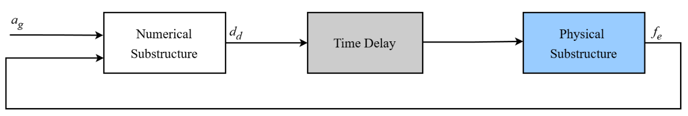

Figure 3~~3~~ A block diagram illustrating the critical time delay stability indicator simplification

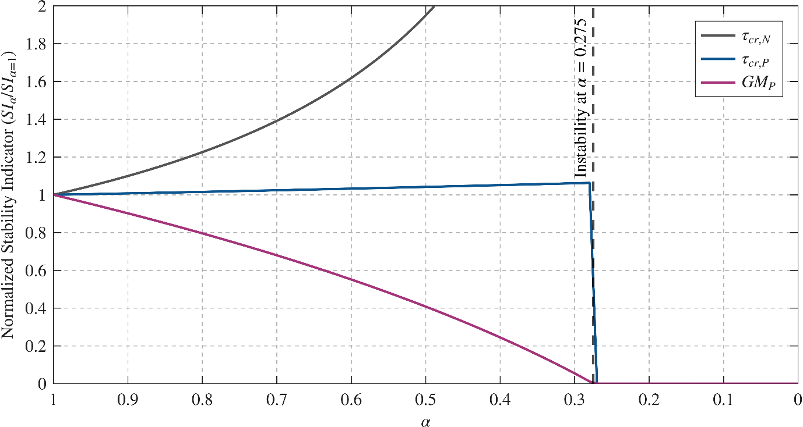

Figure 4~~4~~: Evolution of the normalized stability indicators as a function of the physical substructure degradation factor

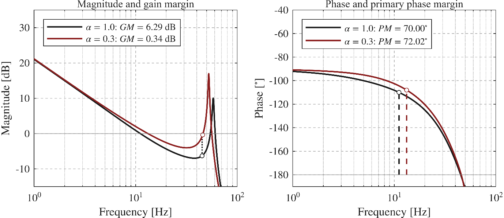

Figure 5~~5~~: Evolution of the outer-loop magnitude and phase responses for Controller A at α = 1.0 and 0.3, with the corresponding gain and phase margins

# 3-Stability Analysis of RTHS Under Structural Degradation

Physical substructure degradation constitutes a prevalent and often unavoidable phenomenon in realistic RTHS experiments. Such degradation can arise in various forms including gradual processes (e.g., steel bar yielding or fastener loosening) or more abrupt processes (e.g., concrete fracture or fastener rupture). As previously demonstrated in Figure 4~~4~~, this degradation in physical substructure can drive the system toward instability through mechanisms that are not adequately captured by traditional time delay metrics. In this section, a closed-form solution for the instability boundary is provided as a function of the structural degradation ratio. Subsequently, this framework is leveraged to investigate the relationship between the physical substructure's initial dynamics and its capacity to tolerate damage before the onset of instability. The following derivation assumes the specimen dynamics can be approximated as linear within short windows of time using an equivalent stiffness, noting that real damage can alter more than a reduction in stiffness and those additional effects are not modeled explicitly but are treated as unmodeled dynamics. Alongside this assumption, the specimen mass is assumed to be constant over the test duration.

To derive the stability boundary, the system is simplified by reducing the block diagram of the transfer system demonstrated in Figure 2~~2~~. By focusing on an SDOF physical substructure subjected to damage, the definition of <mml:math xmlns:mml="http://www.w3.org/1998/Math/MathML" xmlns:m="http://schemas.openxmlformats.org/officeDocument/2006/math"><mml:msub><mml:mrow><mml:mi>G</mml:mi></mml:mrow><mml:mrow><mml:mi>s</mml:mi></mml:mrow></mml:msub><mml:mfenced separators="|"><mml:mrow><mml:mi>s</mml:mi><mml:mo>,</mml:mo><mml:mi>α</mml:mi></mml:mrow></mml:mfenced></mml:math> given in Equation <mml:math xmlns:mml="http://www.w3.org/1998/Math/MathML" xmlns:m="http://schemas.openxmlformats.org/officeDocument/2006/math"><mml:mn>9</mml:mn><mml:mn>9</mml:mn></mml:math> can be utilized. Starting from the innermost loop and moving outwards, for completeness, intermediate transfer functions are defined.

First, define

<mml:math xmlns:mml="http://www.w3.org/1998/Math/MathML" xmlns:m="http://schemas.openxmlformats.org/officeDocument/2006/math"><mml:mtable><mml:mtr><mml:mtd><mml:mrow><mml:maligngroup/><mml:msub><mml:mrow><mml:mi>H</mml:mi></mml:mrow><mml:mrow><mml:msub><mml:mrow><mml:mi>y</mml:mi></mml:mrow><mml:mrow><mml:mi>m</mml:mi></mml:mrow></mml:msub><mml:mo>,</mml:mo><mml:msub><mml:mrow><mml:mi>y</mml:mi></mml:mrow><mml:mrow><mml:mn>6</mml:mn></mml:mrow></mml:msub></mml:mrow></mml:msub><mml:mfenced separators="|"><mml:mrow><mml:mi>s</mml:mi><mml:mo>,</mml:mo><mml:mi>α</mml:mi></mml:mrow></mml:mfenced><mml:mo>=</mml:mo><mml:msub><mml:mrow><mml:mi>G</mml:mi></mml:mrow><mml:mrow><mml:mi>s</mml:mi></mml:mrow></mml:msub><mml:mfenced separators="|"><mml:mrow><mml:mi>s</mml:mi><mml:mo>,</mml:mo><mml:mi>α</mml:mi></mml:mrow></mml:mfenced><mml:msub><mml:mrow><mml:mi>G</mml:mi></mml:mrow><mml:mrow><mml:msub><mml:mrow><mml:mi>a</mml:mi></mml:mrow><mml:mrow><mml:mn>3</mml:mn></mml:mrow></mml:msub></mml:mrow></mml:msub><mml:mfenced separators="|"><mml:mrow><mml:mi>s</mml:mi></mml:mrow></mml:mfenced><mml:mo>#</mml:mo><mml:mfenced separators="|"><mml:mrow><mml:mi mathvariant="normal"> </mml:mi><mml:mi mathvariant="normal">S</mml:mi><mml:mi mathvariant="normal">E</mml:mi><mml:mi mathvariant="normal">Q</mml:mi><mml:mi mathvariant="normal"> </mml:mi><mml:mi mathvariant="normal">E</mml:mi><mml:mi mathvariant="normal">q</mml:mi><mml:mi mathvariant="normal">u</mml:mi><mml:mi mathvariant="normal">a</mml:mi><mml:mi mathvariant="normal">t</mml:mi><mml:mi mathvariant="normal">i</mml:mi><mml:mi mathvariant="normal">o</mml:mi><mml:mi mathvariant="normal">n</mml:mi><mml:mi mathvariant="normal"> </mml:mi><mml:mo>\</mml:mo><mml:mi mathvariant="normal">*</mml:mi><mml:mi mathvariant="normal"> </mml:mi><mml:mi mathvariant="normal">A</mml:mi><mml:mi mathvariant="normal">R</mml:mi><mml:mi mathvariant="normal">A</mml:mi><mml:mi mathvariant="normal">B</mml:mi><mml:mi mathvariant="normal">I</mml:mi><mml:mi mathvariant="normal">C</mml:mi><mml:mi mathvariant="normal"> </mml:mi><mml:mo>\</mml:mo><mml:mi mathvariant="normal">*</mml:mi><mml:mi mathvariant="normal"> </mml:mi><mml:mi mathvariant="normal">M</mml:mi><mml:mi mathvariant="normal">E</mml:mi><mml:mi mathvariant="normal">R</mml:mi><mml:mi mathvariant="normal">G</mml:mi><mml:mi mathvariant="normal">E</mml:mi><mml:mi mathvariant="normal">F</mml:mi><mml:mi mathvariant="normal">O</mml:mi><mml:mi mathvariant="normal">R</mml:mi><mml:mi mathvariant="normal">M</mml:mi><mml:mi mathvariant="normal">A</mml:mi><mml:mi mathvariant="normal">T</mml:mi><mml:mi mathvariant="normal"> </mml:mi><mml:mn>10</mml:mn></mml:mrow></mml:mfenced></mml:mrow></mml:mtd></mml:mtr></mml:mtable></mml:math>

then the CSI loop can be reduced to:

<mml:math xmlns:mml="http://www.w3.org/1998/Math/MathML" xmlns:m="http://schemas.openxmlformats.org/officeDocument/2006/math"><mml:mtable><mml:mtr><mml:mtd><mml:mrow><mml:maligngroup/><mml:msub><mml:mrow><mml:mi>H</mml:mi></mml:mrow><mml:mrow><mml:msub><mml:mrow><mml:mi>y</mml:mi></mml:mrow><mml:mrow><mml:mi>m</mml:mi></mml:mrow></mml:msub><mml:mi> </mml:mi><mml:msub><mml:mrow><mml:mi>y</mml:mi></mml:mrow><mml:mrow><mml:mn>5</mml:mn></mml:mrow></mml:msub></mml:mrow></mml:msub><mml:mfenced separators="|"><mml:mrow><mml:mi>s</mml:mi><mml:mo>,</mml:mo><mml:mi>α</mml:mi></mml:mrow></mml:mfenced><mml:mo>=</mml:mo><mml:mfrac><mml:mrow><mml:msub><mml:mrow><mml:mi>H</mml:mi></mml:mrow><mml:mrow><mml:msub><mml:mrow><mml:mi>y</mml:mi></mml:mrow><mml:mrow><mml:mi>m</mml:mi></mml:mrow></mml:msub><mml:mi> </mml:mi><mml:msub><mml:mrow><mml:mi>y</mml:mi></mml:mrow><mml:mrow><mml:mn>6</mml:mn></mml:mrow></mml:msub></mml:mrow></mml:msub><mml:mfenced separators="|"><mml:mrow><mml:mi>s</mml:mi><mml:mo>,</mml:mo><mml:mi>α</mml:mi></mml:mrow></mml:mfenced></mml:mrow><mml:mrow><mml:mn>1</mml:mn><mml:mo>+</mml:mo><mml:msub><mml:mrow><mml:mi>H</mml:mi></mml:mrow><mml:mrow><mml:msub><mml:mrow><mml:mi>y</mml:mi></mml:mrow><mml:mrow><mml:mi>m</mml:mi></mml:mrow></mml:msub><mml:mi> </mml:mi><mml:msub><mml:mrow><mml:mi>y</mml:mi></mml:mrow><mml:mrow><mml:mn>6</mml:mn></mml:mrow></mml:msub></mml:mrow></mml:msub><mml:mfenced separators="|"><mml:mrow><mml:mi>s</mml:mi><mml:mo>,</mml:mo><mml:mi>α</mml:mi></mml:mrow></mml:mfenced><mml:msub><mml:mrow><mml:mi>G</mml:mi></mml:mrow><mml:mrow><mml:msub><mml:mrow><mml:mi>a</mml:mi></mml:mrow><mml:mrow><mml:mn>2</mml:mn></mml:mrow></mml:msub></mml:mrow></mml:msub><mml:mfenced separators="|"><mml:mrow><mml:mi>s</mml:mi></mml:mrow></mml:mfenced></mml:mrow></mml:mfrac><mml:mo>#</mml:mo><mml:mfenced separators="|"><mml:mrow><mml:mi mathvariant="normal"> </mml:mi><mml:mi mathvariant="normal">S</mml:mi><mml:mi mathvariant="normal">E</mml:mi><mml:mi mathvariant="normal">Q</mml:mi><mml:mi mathvariant="normal"> </mml:mi><mml:mi mathvariant="normal">E</mml:mi><mml:mi mathvariant="normal">q</mml:mi><mml:mi mathvariant="normal">u</mml:mi><mml:mi mathvariant="normal">a</mml:mi><mml:mi mathvariant="normal">t</mml:mi><mml:mi mathvariant="normal">i</mml:mi><mml:mi mathvariant="normal">o</mml:mi><mml:mi mathvariant="normal">n</mml:mi><mml:mi mathvariant="normal"> </mml:mi><mml:mo>\</mml:mo><mml:mi mathvariant="normal">*</mml:mi><mml:mi mathvariant="normal"> </mml:mi><mml:mi mathvariant="normal">A</mml:mi><mml:mi mathvariant="normal">R</mml:mi><mml:mi mathvariant="normal">A</mml:mi><mml:mi mathvariant="normal">B</mml:mi><mml:mi mathvariant="normal">I</mml:mi><mml:mi mathvariant="normal">C</mml:mi><mml:mi mathvariant="normal"> </mml:mi><mml:mo>\</mml:mo><mml:mi mathvariant="normal">*</mml:mi><mml:mi mathvariant="normal"> </mml:mi><mml:mi mathvariant="normal">M</mml:mi><mml:mi mathvariant="normal">E</mml:mi><mml:mi mathvariant="normal">R</mml:mi><mml:mi mathvariant="normal">G</mml:mi><mml:mi mathvariant="normal">E</mml:mi><mml:mi mathvariant="normal">F</mml:mi><mml:mi mathvariant="normal">O</mml:mi><mml:mi mathvariant="normal">R</mml:mi><mml:mi mathvariant="normal">M</mml:mi><mml:mi mathvariant="normal">A</mml:mi><mml:mi mathvariant="normal">T</mml:mi><mml:mi mathvariant="normal"> </mml:mi><mml:mn>11</mml:mn></mml:mrow></mml:mfenced></mml:mrow></mml:mtd></mml:mtr></mml:mtable></mml:math>

which expands to:

<mml:math xmlns:mml="http://www.w3.org/1998/Math/MathML" xmlns:m="http://schemas.openxmlformats.org/officeDocument/2006/math"><mml:mtable><mml:mtr><mml:mtd><mml:mrow><mml:maligngroup/><mml:msub><mml:mrow><mml:mi>H</mml:mi></mml:mrow><mml:mrow><mml:msub><mml:mrow><mml:mi>y</mml:mi></mml:mrow><mml:mrow><mml:mi>m</mml:mi></mml:mrow></mml:msub><mml:mi> </mml:mi><mml:msub><mml:mrow><mml:mi>y</mml:mi></mml:mrow><mml:mrow><mml:mn>5</mml:mn></mml:mrow></mml:msub></mml:mrow></mml:msub><mml:mfenced separators="|"><mml:mrow><mml:mi>s</mml:mi><mml:mo>,</mml:mo><mml:mi>α</mml:mi></mml:mrow></mml:mfenced><mml:mo>=</mml:mo><mml:mfrac><mml:mrow><mml:msub><mml:mrow><mml:mi>G</mml:mi></mml:mrow><mml:mrow><mml:mi>s</mml:mi></mml:mrow></mml:msub><mml:mfenced separators="|"><mml:mrow><mml:mi>s</mml:mi><mml:mo>,</mml:mo><mml:mi>α</mml:mi></mml:mrow></mml:mfenced><mml:msub><mml:mrow><mml:mi>G</mml:mi></mml:mrow><mml:mrow><mml:mi>a</mml:mi><mml:mn>3</mml:mn></mml:mrow></mml:msub><mml:mfenced separators="|"><mml:mrow><mml:mi>s</mml:mi></mml:mrow></mml:mfenced></mml:mrow><mml:mrow><mml:mn>1</mml:mn><mml:mo>+</mml:mo><mml:msub><mml:mrow><mml:mi>G</mml:mi></mml:mrow><mml:mrow><mml:mi>s</mml:mi></mml:mrow></mml:msub><mml:mfenced separators="|"><mml:mrow><mml:mi>s</mml:mi><mml:mo>,</mml:mo><mml:mi>α</mml:mi></mml:mrow></mml:mfenced><mml:msub><mml:mrow><mml:mi>G</mml:mi></mml:mrow><mml:mrow><mml:mi>a</mml:mi><mml:mn>3</mml:mn></mml:mrow></mml:msub><mml:mfenced separators="|"><mml:mrow><mml:mi>s</mml:mi></mml:mrow></mml:mfenced><mml:msub><mml:mrow><mml:mi>G</mml:mi></mml:mrow><mml:mrow><mml:mi>a</mml:mi><mml:mn>2</mml:mn></mml:mrow></mml:msub><mml:mfenced separators="|"><mml:mrow><mml:mi>s</mml:mi></mml:mrow></mml:mfenced></mml:mrow></mml:mfrac><mml:mo>#</mml:mo><mml:mfenced separators="|"><mml:mrow><mml:mi mathvariant="normal"> </mml:mi><mml:mi mathvariant="normal">S</mml:mi><mml:mi mathvariant="normal">E</mml:mi><mml:mi mathvariant="normal">Q</mml:mi><mml:mi mathvariant="normal"> </mml:mi><mml:mi mathvariant="normal">E</mml:mi><mml:mi mathvariant="normal">q</mml:mi><mml:mi mathvariant="normal">u</mml:mi><mml:mi mathvariant="normal">a</mml:mi><mml:mi mathvariant="normal">t</mml:mi><mml:mi mathvariant="normal">i</mml:mi><mml:mi mathvariant="normal">o</mml:mi><mml:mi mathvariant="normal">n</mml:mi><mml:mi mathvariant="normal"> </mml:mi><mml:mo>\</mml:mo><mml:mi mathvariant="normal">*</mml:mi><mml:mi mathvariant="normal"> </mml:mi><mml:mi mathvariant="normal">A</mml:mi><mml:mi mathvariant="normal">R</mml:mi><mml:mi mathvariant="normal">A</mml:mi><mml:mi mathvariant="normal">B</mml:mi><mml:mi mathvariant="normal">I</mml:mi><mml:mi mathvariant="normal">C</mml:mi><mml:mi mathvariant="normal"> </mml:mi><mml:mo>\</mml:mo><mml:mi mathvariant="normal">*</mml:mi><mml:mi mathvariant="normal"> </mml:mi><mml:mi mathvariant="normal">M</mml:mi><mml:mi mathvariant="normal">E</mml:mi><mml:mi mathvariant="normal">R</mml:mi><mml:mi mathvariant="normal">G</mml:mi><mml:mi mathvariant="normal">E</mml:mi><mml:mi mathvariant="normal">F</mml:mi><mml:mi mathvariant="normal">O</mml:mi><mml:mi mathvariant="normal">R</mml:mi><mml:mi mathvariant="normal">M</mml:mi><mml:mi mathvariant="normal">A</mml:mi><mml:mi mathvariant="normal">T</mml:mi><mml:mi mathvariant="normal"> </mml:mi><mml:mn>12</mml:mn></mml:mrow></mml:mfenced></mml:mrow></mml:mtd></mml:mtr></mml:mtable></mml:math>

Including the inner loop controller path,

<mml:math xmlns:mml="http://www.w3.org/1998/Math/MathML" xmlns:m="http://schemas.openxmlformats.org/officeDocument/2006/math"><mml:mtable><mml:mtr><mml:mtd><mml:mrow><mml:maligngroup/><mml:msub><mml:mrow><mml:mi>H</mml:mi></mml:mrow><mml:mrow><mml:msub><mml:mrow><mml:mi>y</mml:mi></mml:mrow><mml:mrow><mml:mi>m</mml:mi></mml:mrow></mml:msub><mml:msub><mml:mrow><mml:mi>y</mml:mi></mml:mrow><mml:mrow><mml:mn>3</mml:mn></mml:mrow></mml:msub></mml:mrow></mml:msub><mml:mfenced separators="|"><mml:mrow><mml:mi>s</mml:mi><mml:mo>,</mml:mo><mml:mi>α</mml:mi></mml:mrow></mml:mfenced><mml:mo>=</mml:mo><mml:msub><mml:mrow><mml:mi>H</mml:mi></mml:mrow><mml:mrow><mml:msub><mml:mrow><mml:mi>y</mml:mi></mml:mrow><mml:mrow><mml:mi>m</mml:mi></mml:mrow></mml:msub><mml:msub><mml:mrow><mml:mi>y</mml:mi></mml:mrow><mml:mrow><mml:mn>5</mml:mn></mml:mrow></mml:msub></mml:mrow></mml:msub><mml:mfenced separators="|"><mml:mrow><mml:mi>s</mml:mi><mml:mo>,</mml:mo><mml:mi>α</mml:mi></mml:mrow></mml:mfenced><mml:msub><mml:mrow><mml:mi>G</mml:mi></mml:mrow><mml:mrow><mml:mi>a</mml:mi><mml:mn>1</mml:mn></mml:mrow></mml:msub><mml:mfenced separators="|"><mml:mrow><mml:mi>s</mml:mi></mml:mrow></mml:mfenced><mml:msub><mml:mrow><mml:mi>C</mml:mi></mml:mrow><mml:mrow><mml:mi>i</mml:mi><mml:mi>n</mml:mi></mml:mrow></mml:msub><mml:mfenced separators="|"><mml:mrow><mml:mi>s</mml:mi></mml:mrow></mml:mfenced><mml:mo>#</mml:mo><mml:mfenced separators="|"><mml:mrow><mml:mi mathvariant="normal"> </mml:mi><mml:mi mathvariant="normal">S</mml:mi><mml:mi mathvariant="normal">E</mml:mi><mml:mi mathvariant="normal">Q</mml:mi><mml:mi mathvariant="normal"> </mml:mi><mml:mi mathvariant="normal">E</mml:mi><mml:mi mathvariant="normal">q</mml:mi><mml:mi mathvariant="normal">u</mml:mi><mml:mi mathvariant="normal">a</mml:mi><mml:mi mathvariant="normal">t</mml:mi><mml:mi mathvariant="normal">i</mml:mi><mml:mi mathvariant="normal">o</mml:mi><mml:mi mathvariant="normal">n</mml:mi><mml:mi mathvariant="normal"> </mml:mi><mml:mo>\</mml:mo><mml:mi mathvariant="normal">*</mml:mi><mml:mi mathvariant="normal"> </mml:mi><mml:mi mathvariant="normal">A</mml:mi><mml:mi mathvariant="normal">R</mml:mi><mml:mi mathvariant="normal">A</mml:mi><mml:mi mathvariant="normal">B</mml:mi><mml:mi mathvariant="normal">I</mml:mi><mml:mi mathvariant="normal">C</mml:mi><mml:mi mathvariant="normal"> </mml:mi><mml:mo>\</mml:mo><mml:mi mathvariant="normal">*</mml:mi><mml:mi mathvariant="normal"> </mml:mi><mml:mi mathvariant="normal">M</mml:mi><mml:mi mathvariant="normal">E</mml:mi><mml:mi mathvariant="normal">R</mml:mi><mml:mi mathvariant="normal">G</mml:mi><mml:mi mathvariant="normal">E</mml:mi><mml:mi mathvariant="normal">F</mml:mi><mml:mi mathvariant="normal">O</mml:mi><mml:mi mathvariant="normal">R</mml:mi><mml:mi mathvariant="normal">M</mml:mi><mml:mi mathvariant="normal">A</mml:mi><mml:mi mathvariant="normal">T</mml:mi><mml:mi mathvariant="normal"> </mml:mi><mml:mn>13</mml:mn></mml:mrow></mml:mfenced></mml:mrow></mml:mtd></mml:mtr></mml:mtable></mml:math>

and explicitly,

<mml:math xmlns:mml="http://www.w3.org/1998/Math/MathML" xmlns:m="http://schemas.openxmlformats.org/officeDocument/2006/math"><mml:mtable><mml:mtr><mml:mtd><mml:mrow><mml:maligngroup/><mml:msub><mml:mrow><mml:mi>H</mml:mi></mml:mrow><mml:mrow><mml:msub><mml:mrow><mml:mi>y</mml:mi></mml:mrow><mml:mrow><mml:mi>m</mml:mi></mml:mrow></mml:msub><mml:msub><mml:mrow><mml:mi>y</mml:mi></mml:mrow><mml:mrow><mml:mn>3</mml:mn></mml:mrow></mml:msub></mml:mrow></mml:msub><mml:mfenced separators="|"><mml:mrow><mml:mi>s</mml:mi><mml:mo>,</mml:mo><mml:mi mathvariant="normal">α</mml:mi></mml:mrow></mml:mfenced><mml:mo>=</mml:mo><mml:mfrac><mml:mrow><mml:msub><mml:mrow><mml:mi>C</mml:mi></mml:mrow><mml:mrow><mml:mi>i</mml:mi><mml:mi>n</mml:mi></mml:mrow></mml:msub><mml:mfenced separators="|"><mml:mrow><mml:mi>s</mml:mi></mml:mrow></mml:mfenced><mml:msub><mml:mrow><mml:mi>G</mml:mi></mml:mrow><mml:mrow><mml:mi>a</mml:mi><mml:mn>1</mml:mn></mml:mrow></mml:msub><mml:mfenced separators="|"><mml:mrow><mml:mi>s</mml:mi></mml:mrow></mml:mfenced><mml:msub><mml:mrow><mml:mi>G</mml:mi></mml:mrow><mml:mrow><mml:mi>s</mml:mi></mml:mrow></mml:msub><mml:mfenced separators="|"><mml:mrow><mml:mi>s</mml:mi><mml:mo>,</mml:mo><mml:mi mathvariant="normal">α</mml:mi></mml:mrow></mml:mfenced><mml:msub><mml:mrow><mml:mi>G</mml:mi></mml:mrow><mml:mrow><mml:mi>a</mml:mi><mml:mn>3</mml:mn></mml:mrow></mml:msub><mml:mfenced separators="|"><mml:mrow><mml:mi>s</mml:mi></mml:mrow></mml:mfenced></mml:mrow><mml:mrow><mml:mn>1</mml:mn><mml:mo>+</mml:mo><mml:msub><mml:mrow><mml:mi>G</mml:mi></mml:mrow><mml:mrow><mml:mi>s</mml:mi></mml:mrow></mml:msub><mml:mfenced separators="|"><mml:mrow><mml:mi>s</mml:mi><mml:mo>,</mml:mo><mml:mi mathvariant="normal">α</mml:mi></mml:mrow></mml:mfenced><mml:msub><mml:mrow><mml:mi>G</mml:mi></mml:mrow><mml:mrow><mml:mi>a</mml:mi><mml:mn>3</mml:mn></mml:mrow></mml:msub><mml:mfenced separators="|"><mml:mrow><mml:mi>s</mml:mi></mml:mrow></mml:mfenced><mml:msub><mml:mrow><mml:mi>G</mml:mi></mml:mrow><mml:mrow><mml:mi>a</mml:mi><mml:mn>2</mml:mn></mml:mrow></mml:msub><mml:mfenced separators="|"><mml:mrow><mml:mi>s</mml:mi></mml:mrow></mml:mfenced></mml:mrow></mml:mfrac><mml:mo>#</mml:mo><mml:mfenced separators="|"><mml:mrow><mml:mi mathvariant="normal"> </mml:mi><mml:mi mathvariant="normal">S</mml:mi><mml:mi mathvariant="normal">E</mml:mi><mml:mi mathvariant="normal">Q</mml:mi><mml:mi mathvariant="normal"> </mml:mi><mml:mi mathvariant="normal">E</mml:mi><mml:mi mathvariant="normal">q</mml:mi><mml:mi mathvariant="normal">u</mml:mi><mml:mi mathvariant="normal">a</mml:mi><mml:mi mathvariant="normal">t</mml:mi><mml:mi mathvariant="normal">i</mml:mi><mml:mi mathvariant="normal">o</mml:mi><mml:mi mathvariant="normal">n</mml:mi><mml:mi mathvariant="normal"> </mml:mi><mml:mo>\</mml:mo><mml:mi mathvariant="normal">*</mml:mi><mml:mi mathvariant="normal"> </mml:mi><mml:mi mathvariant="normal">A</mml:mi><mml:mi mathvariant="normal">R</mml:mi><mml:mi mathvariant="normal">A</mml:mi><mml:mi mathvariant="normal">B</mml:mi><mml:mi mathvariant="normal">I</mml:mi><mml:mi mathvariant="normal">C</mml:mi><mml:mi mathvariant="normal"> </mml:mi><mml:mo>\</mml:mo><mml:mi mathvariant="normal">*</mml:mi><mml:mi mathvariant="normal"> </mml:mi><mml:mi mathvariant="normal">M</mml:mi><mml:mi mathvariant="normal">E</mml:mi><mml:mi mathvariant="normal">R</mml:mi><mml:mi mathvariant="normal">G</mml:mi><mml:mi mathvariant="normal">E</mml:mi><mml:mi mathvariant="normal">F</mml:mi><mml:mi mathvariant="normal">O</mml:mi><mml:mi mathvariant="normal">R</mml:mi><mml:mi mathvariant="normal">M</mml:mi><mml:mi mathvariant="normal">A</mml:mi><mml:mi mathvariant="normal">T</mml:mi><mml:mi mathvariant="normal"> </mml:mi><mml:mn>14</mml:mn></mml:mrow></mml:mfenced></mml:mrow></mml:mtd></mml:mtr></mml:mtable></mml:math>

Then <mml:math xmlns:mml="http://www.w3.org/1998/Math/MathML" xmlns:m="http://schemas.openxmlformats.org/officeDocument/2006/math"><mml:mi mathvariant="normal">T</mml:mi><mml:mfenced separators="|"><mml:mrow><mml:mi mathvariant="normal">s</mml:mi><mml:mo>,</mml:mo><mml:mi mathvariant="normal">α</mml:mi></mml:mrow></mml:mfenced></mml:math> is defined by adding the unity gain feedback to the inner loop controller,

<mml:math xmlns:mml="http://www.w3.org/1998/Math/MathML" xmlns:m="http://schemas.openxmlformats.org/officeDocument/2006/math"><mml:mtable><mml:mtr><mml:mtd><mml:mrow><mml:maligngroup/><mml:mi>T</mml:mi><mml:mfenced separators="|"><mml:mrow><mml:mi>s</mml:mi><mml:mo>,</mml:mo><mml:mi>α</mml:mi></mml:mrow></mml:mfenced><mml:mo>≔</mml:mo><mml:msub><mml:mrow><mml:mi>H</mml:mi></mml:mrow><mml:mrow><mml:msub><mml:mrow><mml:mi>y</mml:mi></mml:mrow><mml:mrow><mml:mi>m</mml:mi></mml:mrow></mml:msub><mml:msub><mml:mrow><mml:mi>y</mml:mi></mml:mrow><mml:mrow><mml:mn>2</mml:mn></mml:mrow></mml:msub></mml:mrow></mml:msub><mml:mfenced separators="|"><mml:mrow><mml:mi>s</mml:mi><mml:mo>,</mml:mo><mml:mi>α</mml:mi></mml:mrow></mml:mfenced><mml:mo>=</mml:mo><mml:mfrac><mml:mrow><mml:msub><mml:mrow><mml:mi>H</mml:mi></mml:mrow><mml:mrow><mml:msub><mml:mrow><mml:mi>y</mml:mi></mml:mrow><mml:mrow><mml:mi>m</mml:mi></mml:mrow></mml:msub><mml:msub><mml:mrow><mml:mi>y</mml:mi></mml:mrow><mml:mrow><mml:mn>3</mml:mn></mml:mrow></mml:msub></mml:mrow></mml:msub><mml:mfenced separators="|"><mml:mrow><mml:mi>s</mml:mi><mml:mo>,</mml:mo><mml:mi>α</mml:mi></mml:mrow></mml:mfenced></mml:mrow><mml:mrow><mml:mn>1</mml:mn><mml:mo>+</mml:mo><mml:msub><mml:mrow><mml:mi>H</mml:mi></mml:mrow><mml:mrow><mml:msub><mml:mrow><mml:mi>y</mml:mi></mml:mrow><mml:mrow><mml:mi>m</mml:mi></mml:mrow></mml:msub><mml:msub><mml:mrow><mml:mi>y</mml:mi></mml:mrow><mml:mrow><mml:mn>3</mml:mn></mml:mrow></mml:msub></mml:mrow></mml:msub><mml:mfenced separators="|"><mml:mrow><mml:mi>s</mml:mi><mml:mo>,</mml:mo><mml:mi>α</mml:mi></mml:mrow></mml:mfenced></mml:mrow></mml:mfrac><mml:mo>#</mml:mo><mml:mfenced separators="|"><mml:mrow><mml:mi mathvariant="normal"> </mml:mi><mml:mi mathvariant="normal">S</mml:mi><mml:mi mathvariant="normal">E</mml:mi><mml:mi mathvariant="normal">Q</mml:mi><mml:mi mathvariant="normal"> </mml:mi><mml:mi mathvariant="normal">E</mml:mi><mml:mi mathvariant="normal">q</mml:mi><mml:mi mathvariant="normal">u</mml:mi><mml:mi mathvariant="normal">a</mml:mi><mml:mi mathvariant="normal">t</mml:mi><mml:mi mathvariant="normal">i</mml:mi><mml:mi mathvariant="normal">o</mml:mi><mml:mi mathvariant="normal">n</mml:mi><mml:mi mathvariant="normal"> </mml:mi><mml:mo>\</mml:mo><mml:mi mathvariant="normal">*</mml:mi><mml:mi mathvariant="normal"> </mml:mi><mml:mi mathvariant="normal">A</mml:mi><mml:mi mathvariant="normal">R</mml:mi><mml:mi mathvariant="normal">A</mml:mi><mml:mi mathvariant="normal">B</mml:mi><mml:mi mathvariant="normal">I</mml:mi><mml:mi mathvariant="normal">C</mml:mi><mml:mi mathvariant="normal"> </mml:mi><mml:mo>\</mml:mo><mml:mi mathvariant="normal">*</mml:mi><mml:mi mathvariant="normal"> </mml:mi><mml:mi mathvariant="normal">M</mml:mi><mml:mi mathvariant="normal">E</mml:mi><mml:mi mathvariant="normal">R</mml:mi><mml:mi mathvariant="normal">G</mml:mi><mml:mi mathvariant="normal">E</mml:mi><mml:mi mathvariant="normal">F</mml:mi><mml:mi mathvariant="normal">O</mml:mi><mml:mi mathvariant="normal">R</mml:mi><mml:mi mathvariant="normal">M</mml:mi><mml:mi mathvariant="normal">A</mml:mi><mml:mi mathvariant="normal">T</mml:mi><mml:mi mathvariant="normal"> </mml:mi><mml:mn>15</mml:mn></mml:mrow></mml:mfenced></mml:mrow></mml:mtd></mml:mtr></mml:mtable></mml:math>

which yields

<mml:math xmlns:mml="http://www.w3.org/1998/Math/MathML" xmlns:m="http://schemas.openxmlformats.org/officeDocument/2006/math"><mml:mtable><mml:mtr><mml:mtd><mml:mrow><mml:maligngroup/><mml:mi>T</mml:mi><mml:mfenced separators="|"><mml:mrow><mml:mi>s</mml:mi><mml:mo>,</mml:mo><mml:mi>α</mml:mi></mml:mrow></mml:mfenced><mml:mo>=</mml:mo><mml:mfrac><mml:mrow><mml:msub><mml:mrow><mml:mi>C</mml:mi></mml:mrow><mml:mrow><mml:mtext>in</mml:mtext></mml:mrow></mml:msub><mml:mfenced separators="|"><mml:mrow><mml:mi>s</mml:mi></mml:mrow></mml:mfenced><mml:mo> </mml:mo><mml:msub><mml:mrow><mml:mi>G</mml:mi></mml:mrow><mml:mrow><mml:mi>a</mml:mi><mml:mn>1</mml:mn></mml:mrow></mml:msub><mml:mfenced separators="|"><mml:mrow><mml:mi>s</mml:mi></mml:mrow></mml:mfenced><mml:mo> </mml:mo><mml:msub><mml:mrow><mml:mi>G</mml:mi></mml:mrow><mml:mrow><mml:mi>s</mml:mi></mml:mrow></mml:msub><mml:mfenced separators="|"><mml:mrow><mml:mi>s</mml:mi><mml:mo>,</mml:mo><mml:mi>α</mml:mi></mml:mrow></mml:mfenced><mml:mo> </mml:mo><mml:msub><mml:mrow><mml:mi>G</mml:mi></mml:mrow><mml:mrow><mml:mi>a</mml:mi><mml:mn>3</mml:mn></mml:mrow></mml:msub><mml:mfenced separators="|"><mml:mrow><mml:mi>s</mml:mi></mml:mrow></mml:mfenced></mml:mrow><mml:mrow><mml:mn>1</mml:mn><mml:mo> </mml:mo><mml:mo>+</mml:mo><mml:mo> </mml:mo><mml:msub><mml:mrow><mml:mi>G</mml:mi></mml:mrow><mml:mrow><mml:mi>s</mml:mi></mml:mrow></mml:msub><mml:mfenced separators="|"><mml:mrow><mml:mi>s</mml:mi><mml:mo>,</mml:mo><mml:mi>α</mml:mi></mml:mrow></mml:mfenced><mml:mo> </mml:mo><mml:msub><mml:mrow><mml:mi>G</mml:mi></mml:mrow><mml:mrow><mml:mi>a</mml:mi><mml:mn>3</mml:mn></mml:mrow></mml:msub><mml:mfenced separators="|"><mml:mrow><mml:mi>s</mml:mi></mml:mrow></mml:mfenced><mml:mo> </mml:mo><mml:msub><mml:mrow><mml:mi>G</mml:mi></mml:mrow><mml:mrow><mml:mi>a</mml:mi><mml:mn>2</mml:mn></mml:mrow></mml:msub><mml:mfenced separators="|"><mml:mrow><mml:mi>s</mml:mi></mml:mrow></mml:mfenced><mml:mo> </mml:mo><mml:mo>+</mml:mo><mml:mo> </mml:mo><mml:msub><mml:mrow><mml:mi>C</mml:mi></mml:mrow><mml:mrow><mml:mtext>in</mml:mtext></mml:mrow></mml:msub><mml:mfenced separators="|"><mml:mrow><mml:mi>s</mml:mi></mml:mrow></mml:mfenced><mml:mo> </mml:mo><mml:msub><mml:mrow><mml:mi>G</mml:mi></mml:mrow><mml:mrow><mml:mi>a</mml:mi><mml:mn>1</mml:mn></mml:mrow></mml:msub><mml:mfenced separators="|"><mml:mrow><mml:mi>s</mml:mi></mml:mrow></mml:mfenced><mml:mo> </mml:mo><mml:msub><mml:mrow><mml:mi>G</mml:mi></mml:mrow><mml:mrow><mml:mi>s</mml:mi></mml:mrow></mml:msub><mml:mfenced separators="|"><mml:mrow><mml:mi>s</mml:mi><mml:mo>,</mml:mo><mml:mi>α</mml:mi></mml:mrow></mml:mfenced><mml:mo> </mml:mo><mml:msub><mml:mrow><mml:mi>G</mml:mi></mml:mrow><mml:mrow><mml:mi>a</mml:mi><mml:mn>3</mml:mn></mml:mrow></mml:msub><mml:mfenced separators="|"><mml:mrow><mml:mi>s</mml:mi></mml:mrow></mml:mfenced></mml:mrow></mml:mfrac><mml:mo>#</mml:mo><mml:mfenced separators="|"><mml:mrow><mml:mi mathvariant="normal"> </mml:mi><mml:mi mathvariant="normal">S</mml:mi><mml:mi mathvariant="normal">E</mml:mi><mml:mi mathvariant="normal">Q</mml:mi><mml:mi mathvariant="normal"> </mml:mi><mml:mi mathvariant="normal">E</mml:mi><mml:mi mathvariant="normal">q</mml:mi><mml:mi mathvariant="normal">u</mml:mi><mml:mi mathvariant="normal">a</mml:mi><mml:mi mathvariant="normal">t</mml:mi><mml:mi mathvariant="normal">i</mml:mi><mml:mi mathvariant="normal">o</mml:mi><mml:mi mathvariant="normal">n</mml:mi><mml:mi mathvariant="normal"> </mml:mi><mml:mo>\</mml:mo><mml:mi mathvariant="normal">*</mml:mi><mml:mi mathvariant="normal"> </mml:mi><mml:mi mathvariant="normal">A</mml:mi><mml:mi mathvariant="normal">R</mml:mi><mml:mi mathvariant="normal">A</mml:mi><mml:mi mathvariant="normal">B</mml:mi><mml:mi mathvariant="normal">I</mml:mi><mml:mi mathvariant="normal">C</mml:mi><mml:mi mathvariant="normal"> </mml:mi><mml:mo>\</mml:mo><mml:mi mathvariant="normal">*</mml:mi><mml:mi mathvariant="normal"> </mml:mi><mml:mi mathvariant="normal">M</mml:mi><mml:mi mathvariant="normal">E</mml:mi><mml:mi mathvariant="normal">R</mml:mi><mml:mi mathvariant="normal">G</mml:mi><mml:mi mathvariant="normal">E</mml:mi><mml:mi mathvariant="normal">F</mml:mi><mml:mi mathvariant="normal">O</mml:mi><mml:mi mathvariant="normal">R</mml:mi><mml:mi mathvariant="normal">M</mml:mi><mml:mi mathvariant="normal">A</mml:mi><mml:mi mathvariant="normal">T</mml:mi><mml:mi mathvariant="normal"> </mml:mi><mml:mn>16</mml:mn></mml:mrow></mml:mfenced></mml:mrow></mml:mtd></mml:mtr></mml:mtable></mml:math>

The transfer system operates under a unity gain feedback scheme with an open-loop transfer function of <mml:math xmlns:mml="http://www.w3.org/1998/Math/MathML" xmlns:m="http://schemas.openxmlformats.org/officeDocument/2006/math"><mml:mi mathvariant="normal">L</mml:mi><mml:mfenced separators="|"><mml:mrow><mml:mi mathvariant="normal">s</mml:mi><mml:mo>,</mml:mo><mml:mi mathvariant="normal">α</mml:mi></mml:mrow></mml:mfenced><mml:mo>=</mml:mo><mml:msub><mml:mrow><mml:mi mathvariant="normal">C</mml:mi></mml:mrow><mml:mrow><mml:mi mathvariant="normal">o</mml:mi><mml:mi mathvariant="normal">u</mml:mi><mml:mi mathvariant="normal">t</mml:mi></mml:mrow></mml:msub><mml:mfenced separators="|"><mml:mrow><mml:mi mathvariant="normal">s</mml:mi></mml:mrow></mml:mfenced><mml:mi mathvariant="normal">T</mml:mi><mml:mfenced separators="|"><mml:mrow><mml:mi mathvariant="normal">s</mml:mi><mml:mo>,</mml:mo><mml:mi mathvariant="normal">α</mml:mi></mml:mrow></mml:mfenced></mml:math>. The resulting closed-loop transfer function is <mml:math xmlns:mml="http://www.w3.org/1998/Math/MathML" xmlns:m="http://schemas.openxmlformats.org/officeDocument/2006/math"><mml:msub><mml:mrow><mml:mi>H</mml:mi></mml:mrow><mml:mrow><mml:mi>c</mml:mi><mml:mi>l</mml:mi></mml:mrow></mml:msub><mml:mfenced separators="|"><mml:mrow><mml:mi>s</mml:mi><mml:mo>,</mml:mo><mml:mi>α</mml:mi></mml:mrow></mml:mfenced><mml:mo>=</mml:mo><mml:mrow><mml:mrow><mml:mi>L</mml:mi><mml:mfenced separators="|"><mml:mrow><mml:mi>s</mml:mi><mml:mo>,</mml:mo><mml:mi>α</mml:mi></mml:mrow></mml:mfenced></mml:mrow><mml:mo>/</mml:mo><mml:mrow><mml:mfenced open="[" close="]" separators="|"><mml:mrow><mml:mn>1</mml:mn><mml:mi> </mml:mi><mml:mo>+</mml:mo><mml:mi> </mml:mi><mml:mi>L</mml:mi><mml:mfenced separators="|"><mml:mrow><mml:mi>s</mml:mi><mml:mo>,</mml:mo><mml:mi>α</mml:mi></mml:mrow></mml:mfenced></mml:mrow></mml:mfenced></mml:mrow></mml:mrow></mml:math>. Since <mml:math xmlns:mml="http://www.w3.org/1998/Math/MathML" xmlns:m="http://schemas.openxmlformats.org/officeDocument/2006/math"><mml:mn>1</mml:mn><mml:mi> </mml:mi><mml:mo>+</mml:mo><mml:mi> </mml:mi><mml:mi>L</mml:mi><mml:mfenced separators="|"><mml:mrow><mml:mi>s</mml:mi><mml:mo>,</mml:mo><mml:mi>α</mml:mi></mml:mrow></mml:mfenced></mml:math> is its denominator, the closed-loop poles are the values of s that satisfy the characteristic equation:

<mml:math xmlns:mml="http://www.w3.org/1998/Math/MathML" xmlns:m="http://schemas.openxmlformats.org/officeDocument/2006/math"><mml:mtable><mml:mtr><mml:mtd><mml:mrow><mml:maligngroup/><mml:mn>1</mml:mn><mml:mo>+</mml:mo><mml:mi>L</mml:mi><mml:mfenced separators="|"><mml:mrow><mml:mi>s</mml:mi><mml:mo>,</mml:mo><mml:mi>α</mml:mi></mml:mrow></mml:mfenced><mml:mo>=</mml:mo><mml:mn>0</mml:mn><mml:mo>#</mml:mo><mml:mfenced separators="|"><mml:mrow><mml:mi mathvariant="normal"> </mml:mi><mml:mi mathvariant="normal">S</mml:mi><mml:mi mathvariant="normal">E</mml:mi><mml:mi mathvariant="normal">Q</mml:mi><mml:mi mathvariant="normal"> </mml:mi><mml:mi mathvariant="normal">E</mml:mi><mml:mi mathvariant="normal">q</mml:mi><mml:mi mathvariant="normal">u</mml:mi><mml:mi mathvariant="normal">a</mml:mi><mml:mi mathvariant="normal">t</mml:mi><mml:mi mathvariant="normal">i</mml:mi><mml:mi mathvariant="normal">o</mml:mi><mml:mi mathvariant="normal">n</mml:mi><mml:mi mathvariant="normal"> </mml:mi><mml:mo>\</mml:mo><mml:mi mathvariant="normal">*</mml:mi><mml:mi mathvariant="normal"> </mml:mi><mml:mi mathvariant="normal">A</mml:mi><mml:mi mathvariant="normal">R</mml:mi><mml:mi mathvariant="normal">A</mml:mi><mml:mi mathvariant="normal">B</mml:mi><mml:mi mathvariant="normal">I</mml:mi><mml:mi mathvariant="normal">C</mml:mi><mml:mi mathvariant="normal"> </mml:mi><mml:mo>\</mml:mo><mml:mi mathvariant="normal">*</mml:mi><mml:mi mathvariant="normal"> </mml:mi><mml:mi mathvariant="normal">M</mml:mi><mml:mi mathvariant="normal">E</mml:mi><mml:mi mathvariant="normal">R</mml:mi><mml:mi mathvariant="normal">G</mml:mi><mml:mi mathvariant="normal">E</mml:mi><mml:mi mathvariant="normal">F</mml:mi><mml:mi mathvariant="normal">O</mml:mi><mml:mi mathvariant="normal">R</mml:mi><mml:mi mathvariant="normal">M</mml:mi><mml:mi mathvariant="normal">A</mml:mi><mml:mi mathvariant="normal">T</mml:mi><mml:mi mathvariant="normal"> </mml:mi><mml:mn>17</mml:mn></mml:mrow></mml:mfenced></mml:mrow></mml:mtd></mml:mtr></mml:mtable></mml:math>

The system is stable if and only if all roots of Equation (17) lie strictly in the left half of the complex plane. Instability arises if any root has a positive real part, indicating the presence of an unstable mode in the structural response.

Expanding the expression for <mml:math xmlns:mml="http://www.w3.org/1998/Math/MathML" xmlns:m="http://schemas.openxmlformats.org/officeDocument/2006/math"><mml:mn>1</mml:mn><mml:mo>+</mml:mo><mml:mi>L</mml:mi><mml:mfenced separators="|"><mml:mrow><mml:mi>s</mml:mi><mml:mo>,</mml:mo><mml:mi mathvariant="normal">α</mml:mi></mml:mrow></mml:mfenced></mml:math> provides the system's full characteristic equation,

<mml:math xmlns:mml="http://www.w3.org/1998/Math/MathML" xmlns:m="http://schemas.openxmlformats.org/officeDocument/2006/math"><mml:mtable><mml:mtr><mml:mtd><mml:mrow><mml:maligngroup/><mml:mn>1</mml:mn><mml:mo>+</mml:mo><mml:mi>L</mml:mi><mml:mfenced separators="|"><mml:mrow><mml:mi>s</mml:mi><mml:mo>,</mml:mo><mml:mi>α</mml:mi></mml:mrow></mml:mfenced><mml:mo>=</mml:mo></mml:mrow></mml:mtd></mml:mtr><mml:mtr><mml:mtd><mml:mrow><mml:maligngroup/><mml:mfrac><mml:mrow><mml:mn>1</mml:mn><mml:mo>+</mml:mo><mml:msub><mml:mrow><mml:mi>G</mml:mi></mml:mrow><mml:mrow><mml:mi>s</mml:mi></mml:mrow></mml:msub><mml:mfenced separators="|"><mml:mrow><mml:mi>s</mml:mi><mml:mo>,</mml:mo><mml:mi mathvariant="normal">α</mml:mi></mml:mrow></mml:mfenced><mml:msub><mml:mrow><mml:mi>G</mml:mi></mml:mrow><mml:mrow><mml:mi>a</mml:mi><mml:mn>3</mml:mn></mml:mrow></mml:msub><mml:mfenced separators="|"><mml:mrow><mml:mi>s</mml:mi></mml:mrow></mml:mfenced><mml:msub><mml:mrow><mml:mi>G</mml:mi></mml:mrow><mml:mrow><mml:mi>a</mml:mi><mml:mn>2</mml:mn></mml:mrow></mml:msub><mml:mfenced separators="|"><mml:mrow><mml:mi>s</mml:mi></mml:mrow></mml:mfenced><mml:mo>+</mml:mo><mml:msub><mml:mrow><mml:mi>C</mml:mi></mml:mrow><mml:mrow><mml:mi>i</mml:mi><mml:mi>n</mml:mi></mml:mrow></mml:msub><mml:mfenced separators="|"><mml:mrow><mml:mi>s</mml:mi></mml:mrow></mml:mfenced><mml:msub><mml:mrow><mml:mi>G</mml:mi></mml:mrow><mml:mrow><mml:mi>a</mml:mi><mml:mn>1</mml:mn></mml:mrow></mml:msub><mml:mfenced separators="|"><mml:mrow><mml:mi>s</mml:mi></mml:mrow></mml:mfenced><mml:msub><mml:mrow><mml:mi>G</mml:mi></mml:mrow><mml:mrow><mml:mi>s</mml:mi></mml:mrow></mml:msub><mml:mfenced separators="|"><mml:mrow><mml:mi>s</mml:mi><mml:mo>,</mml:mo><mml:mi mathvariant="normal">α</mml:mi></mml:mrow></mml:mfenced><mml:msub><mml:mrow><mml:mi>G</mml:mi></mml:mrow><mml:mrow><mml:mi>a</mml:mi><mml:mn>3</mml:mn></mml:mrow></mml:msub><mml:mfenced separators="|"><mml:mrow><mml:mi>s</mml:mi></mml:mrow></mml:mfenced><mml:mo>+</mml:mo><mml:msub><mml:mrow><mml:mi>C</mml:mi></mml:mrow><mml:mrow><mml:mi>o</mml:mi><mml:mi>u</mml:mi><mml:mi>t</mml:mi></mml:mrow></mml:msub><mml:mfenced separators="|"><mml:mrow><mml:mi>s</mml:mi></mml:mrow></mml:mfenced><mml:msub><mml:mrow><mml:mi>C</mml:mi></mml:mrow><mml:mrow><mml:mi>i</mml:mi><mml:mi>n</mml:mi></mml:mrow></mml:msub><mml:mfenced separators="|"><mml:mrow><mml:mi>s</mml:mi></mml:mrow></mml:mfenced><mml:msub><mml:mrow><mml:mi>G</mml:mi></mml:mrow><mml:mrow><mml:mi>a</mml:mi><mml:mn>1</mml:mn></mml:mrow></mml:msub><mml:mfenced separators="|"><mml:mrow><mml:mi>s</mml:mi></mml:mrow></mml:mfenced><mml:msub><mml:mrow><mml:mi>G</mml:mi></mml:mrow><mml:mrow><mml:mi>s</mml:mi></mml:mrow></mml:msub><mml:mfenced separators="|"><mml:mrow><mml:mi>s</mml:mi><mml:mo>,</mml:mo><mml:mi mathvariant="normal">α</mml:mi></mml:mrow></mml:mfenced><mml:msub><mml:mrow><mml:mi>G</mml:mi></mml:mrow><mml:mrow><mml:mi>a</mml:mi><mml:mn>3</mml:mn></mml:mrow></mml:msub><mml:mfenced separators="|"><mml:mrow><mml:mi>s</mml:mi></mml:mrow></mml:mfenced></mml:mrow><mml:mrow><mml:mn>1</mml:mn><mml:mo>+</mml:mo><mml:msub><mml:mrow><mml:mi>G</mml:mi></mml:mrow><mml:mrow><mml:mi>s</mml:mi></mml:mrow></mml:msub><mml:mfenced separators="|"><mml:mrow><mml:mi>s</mml:mi><mml:mo>,</mml:mo><mml:mi mathvariant="normal">α</mml:mi></mml:mrow></mml:mfenced><mml:msub><mml:mrow><mml:mi>G</mml:mi></mml:mrow><mml:mrow><mml:mi>a</mml:mi><mml:mn>3</mml:mn></mml:mrow></mml:msub><mml:mfenced separators="|"><mml:mrow><mml:mi>s</mml:mi></mml:mrow></mml:mfenced><mml:msub><mml:mrow><mml:mi>G</mml:mi></mml:mrow><mml:mrow><mml:mi>a</mml:mi><mml:mn>2</mml:mn></mml:mrow></mml:msub><mml:mfenced separators="|"><mml:mrow><mml:mi>s</mml:mi></mml:mrow></mml:mfenced><mml:mo>+</mml:mo><mml:msub><mml:mrow><mml:mi>C</mml:mi></mml:mrow><mml:mrow><mml:mi>i</mml:mi><mml:mi>n</mml:mi></mml:mrow></mml:msub><mml:mfenced separators="|"><mml:mrow><mml:mi>s</mml:mi></mml:mrow></mml:mfenced><mml:msub><mml:mrow><mml:mi>G</mml:mi></mml:mrow><mml:mrow><mml:mi>a</mml:mi><mml:mn>1</mml:mn></mml:mrow></mml:msub><mml:mfenced separators="|"><mml:mrow><mml:mi>s</mml:mi></mml:mrow></mml:mfenced><mml:msub><mml:mrow><mml:mi>G</mml:mi></mml:mrow><mml:mrow><mml:mi>s</mml:mi></mml:mrow></mml:msub><mml:mfenced separators="|"><mml:mrow><mml:mi>s</mml:mi><mml:mo>,</mml:mo><mml:mi mathvariant="normal">α</mml:mi></mml:mrow></mml:mfenced><mml:msub><mml:mrow><mml:mi>G</mml:mi></mml:mrow><mml:mrow><mml:mi>a</mml:mi><mml:mn>3</mml:mn></mml:mrow></mml:msub><mml:mfenced separators="|"><mml:mrow><mml:mi>s</mml:mi></mml:mrow></mml:mfenced></mml:mrow></mml:mfrac><mml:mo>#</mml:mo><mml:mfenced separators="|"><mml:mrow><mml:mi mathvariant="normal"> </mml:mi><mml:mi mathvariant="normal">S</mml:mi><mml:mi mathvariant="normal">E</mml:mi><mml:mi mathvariant="normal">Q</mml:mi><mml:mi mathvariant="normal"> </mml:mi><mml:mi mathvariant="normal">E</mml:mi><mml:mi mathvariant="normal">q</mml:mi><mml:mi mathvariant="normal">u</mml:mi><mml:mi mathvariant="normal">a</mml:mi><mml:mi mathvariant="normal">t</mml:mi><mml:mi mathvariant="normal">i</mml:mi><mml:mi mathvariant="normal">o</mml:mi><mml:mi mathvariant="normal">n</mml:mi><mml:mi mathvariant="normal"> </mml:mi><mml:mo>\</mml:mo><mml:mi mathvariant="normal">*</mml:mi><mml:mi mathvariant="normal"> </mml:mi><mml:mi mathvariant="normal">A</mml:mi><mml:mi mathvariant="normal">R</mml:mi><mml:mi mathvariant="normal">A</mml:mi><mml:mi mathvariant="normal">B</mml:mi><mml:mi mathvariant="normal">I</mml:mi><mml:mi mathvariant="normal">C</mml:mi><mml:mi mathvariant="normal"> </mml:mi><mml:mo>\</mml:mo><mml:mi mathvariant="normal">*</mml:mi><mml:mi mathvariant="normal"> </mml:mi><mml:mi mathvariant="normal">M</mml:mi><mml:mi mathvariant="normal">E</mml:mi><mml:mi mathvariant="normal">R</mml:mi><mml:mi mathvariant="normal">G</mml:mi><mml:mi mathvariant="normal">E</mml:mi><mml:mi mathvariant="normal">F</mml:mi><mml:mi mathvariant="normal">O</mml:mi><mml:mi mathvariant="normal">R</mml:mi><mml:mi mathvariant="normal">M</mml:mi><mml:mi mathvariant="normal">A</mml:mi><mml:mi mathvariant="normal">T</mml:mi><mml:mi mathvariant="normal"> </mml:mi><mml:mn>18</mml:mn></mml:mrow></mml:mfenced></mml:mrow></mml:mtd></mml:mtr></mml:mtable></mml:math>

To find the system's poles, the numerator is set to zero and the equation is solved. This approach implicitly ignores poles that are canceled by zeros. These specific poles correspond to the stability of the inner loops (the inner loop controller and CSI loops). Therefore, assuming these loops are already stable, the numerator is set to zero and we factor the expression, which gives:

<mml:math xmlns:mml="http://www.w3.org/1998/Math/MathML" xmlns:m="http://schemas.openxmlformats.org/officeDocument/2006/math"><mml:mtable><mml:mtr><mml:mtd><mml:mrow><mml:maligngroup/><mml:mn>1</mml:mn><mml:mo>+</mml:mo><mml:msub><mml:mrow><mml:mi>G</mml:mi></mml:mrow><mml:mrow><mml:mi>s</mml:mi></mml:mrow></mml:msub><mml:mfenced separators="|"><mml:mrow><mml:mi>s</mml:mi><mml:mo>,</mml:mo><mml:mi mathvariant="normal">α</mml:mi></mml:mrow></mml:mfenced><mml:mfenced open="[" close="]" separators="|"><mml:mrow><mml:msub><mml:mrow><mml:mi>G</mml:mi></mml:mrow><mml:mrow><mml:mi>a</mml:mi><mml:mn>3</mml:mn></mml:mrow></mml:msub><mml:mfenced separators="|"><mml:mrow><mml:mi>s</mml:mi></mml:mrow></mml:mfenced><mml:msub><mml:mrow><mml:mi>G</mml:mi></mml:mrow><mml:mrow><mml:mi>a</mml:mi><mml:mn>2</mml:mn></mml:mrow></mml:msub><mml:mfenced separators="|"><mml:mrow><mml:mi>s</mml:mi></mml:mrow></mml:mfenced><mml:mo>+</mml:mo><mml:msub><mml:mrow><mml:mi>C</mml:mi></mml:mrow><mml:mrow><mml:mi>i</mml:mi><mml:mi>n</mml:mi></mml:mrow></mml:msub><mml:mfenced separators="|"><mml:mrow><mml:mi>s</mml:mi></mml:mrow></mml:mfenced><mml:msub><mml:mrow><mml:mi>G</mml:mi></mml:mrow><mml:mrow><mml:mi>a</mml:mi><mml:mn>1</mml:mn></mml:mrow></mml:msub><mml:mfenced separators="|"><mml:mrow><mml:mi>s</mml:mi></mml:mrow></mml:mfenced><mml:msub><mml:mrow><mml:mi>G</mml:mi></mml:mrow><mml:mrow><mml:mi>a</mml:mi><mml:mn>3</mml:mn></mml:mrow></mml:msub><mml:mfenced separators="|"><mml:mrow><mml:mi>s</mml:mi></mml:mrow></mml:mfenced><mml:mo>+</mml:mo><mml:msub><mml:mrow><mml:mi>C</mml:mi></mml:mrow><mml:mrow><mml:mi>o</mml:mi><mml:mi>u</mml:mi><mml:mi>t</mml:mi></mml:mrow></mml:msub><mml:mfenced separators="|"><mml:mrow><mml:mi>s</mml:mi></mml:mrow></mml:mfenced><mml:msub><mml:mrow><mml:mi>C</mml:mi></mml:mrow><mml:mrow><mml:mi>i</mml:mi><mml:mi>n</mml:mi></mml:mrow></mml:msub><mml:mfenced separators="|"><mml:mrow><mml:mi>s</mml:mi></mml:mrow></mml:mfenced><mml:msub><mml:mrow><mml:mi>G</mml:mi></mml:mrow><mml:mrow><mml:mi>a</mml:mi><mml:mn>1</mml:mn></mml:mrow></mml:msub><mml:mfenced separators="|"><mml:mrow><mml:mi>s</mml:mi></mml:mrow></mml:mfenced><mml:msub><mml:mrow><mml:mi>G</mml:mi></mml:mrow><mml:mrow><mml:mi>a</mml:mi><mml:mn>3</mml:mn></mml:mrow></mml:msub><mml:mfenced separators="|"><mml:mrow><mml:mi>s</mml:mi></mml:mrow></mml:mfenced></mml:mrow></mml:mfenced><mml:mo>=</mml:mo><mml:mn>0</mml:mn><mml:mo>#</mml:mo><mml:mfenced separators="|"><mml:mrow><mml:mi mathvariant="normal"> </mml:mi><mml:mi mathvariant="normal">S</mml:mi><mml:mi mathvariant="normal">E</mml:mi><mml:mi mathvariant="normal">Q</mml:mi><mml:mi mathvariant="normal"> </mml:mi><mml:mi mathvariant="normal">E</mml:mi><mml:mi mathvariant="normal">q</mml:mi><mml:mi mathvariant="normal">u</mml:mi><mml:mi mathvariant="normal">a</mml:mi><mml:mi mathvariant="normal">t</mml:mi><mml:mi mathvariant="normal">i</mml:mi><mml:mi mathvariant="normal">o</mml:mi><mml:mi mathvariant="normal">n</mml:mi><mml:mi mathvariant="normal"> </mml:mi><mml:mo>\</mml:mo><mml:mi mathvariant="normal">*</mml:mi><mml:mi mathvariant="normal"> </mml:mi><mml:mi mathvariant="normal">A</mml:mi><mml:mi mathvariant="normal">R</mml:mi><mml:mi mathvariant="normal">A</mml:mi><mml:mi mathvariant="normal">B</mml:mi><mml:mi mathvariant="normal">I</mml:mi><mml:mi mathvariant="normal">C</mml:mi><mml:mi mathvariant="normal"> </mml:mi><mml:mo>\</mml:mo><mml:mi mathvariant="normal">*</mml:mi><mml:mi mathvariant="normal"> </mml:mi><mml:mi mathvariant="normal">M</mml:mi><mml:mi mathvariant="normal">E</mml:mi><mml:mi mathvariant="normal">R</mml:mi><mml:mi mathvariant="normal">G</mml:mi><mml:mi mathvariant="normal">E</mml:mi><mml:mi mathvariant="normal">F</mml:mi><mml:mi mathvariant="normal">O</mml:mi><mml:mi mathvariant="normal">R</mml:mi><mml:mi mathvariant="normal">M</mml:mi><mml:mi mathvariant="normal">A</mml:mi><mml:mi mathvariant="normal">T</mml:mi><mml:mi mathvariant="normal"> </mml:mi><mml:mn>19</mml:mn></mml:mrow></mml:mfenced></mml:mrow></mml:mtd></mml:mtr></mml:mtable></mml:math>

For clarity, the bracketed term is defined as <mml:math xmlns:mml="http://www.w3.org/1998/Math/MathML" xmlns:m="http://schemas.openxmlformats.org/officeDocument/2006/math"><mml:mi>Y</mml:mi><mml:mfenced separators="|"><mml:mrow><mml:mi>s</mml:mi></mml:mrow></mml:mfenced></mml:math>:

<mml:math xmlns:mml="http://www.w3.org/1998/Math/MathML" xmlns:m="http://schemas.openxmlformats.org/officeDocument/2006/math"><mml:mtable><mml:mtr><mml:mtd><mml:mrow><mml:maligngroup/><mml:mi>Y</mml:mi><mml:mfenced separators="|"><mml:mrow><mml:mi>s</mml:mi></mml:mrow></mml:mfenced><mml:mo>≔</mml:mo><mml:msub><mml:mrow><mml:mi>G</mml:mi></mml:mrow><mml:mrow><mml:mi>a</mml:mi><mml:mn>3</mml:mn></mml:mrow></mml:msub><mml:mfenced separators="|"><mml:mrow><mml:mi>s</mml:mi></mml:mrow></mml:mfenced><mml:mfenced open="[" close="]" separators="|"><mml:mrow><mml:msub><mml:mrow><mml:mi>G</mml:mi></mml:mrow><mml:mrow><mml:mi>a</mml:mi><mml:mn>2</mml:mn></mml:mrow></mml:msub><mml:mfenced separators="|"><mml:mrow><mml:mi>s</mml:mi></mml:mrow></mml:mfenced><mml:mo>+</mml:mo><mml:msub><mml:mrow><mml:mi>C</mml:mi></mml:mrow><mml:mrow><mml:mi>i</mml:mi><mml:mi>n</mml:mi></mml:mrow></mml:msub><mml:mfenced separators="|"><mml:mrow><mml:mi>s</mml:mi></mml:mrow></mml:mfenced><mml:msub><mml:mrow><mml:mi>G</mml:mi></mml:mrow><mml:mrow><mml:mi>a</mml:mi><mml:mn>1</mml:mn></mml:mrow></mml:msub><mml:mfenced separators="|"><mml:mrow><mml:mi>s</mml:mi></mml:mrow></mml:mfenced><mml:mfenced separators="|"><mml:mrow><mml:msub><mml:mrow><mml:mi>C</mml:mi></mml:mrow><mml:mrow><mml:mi>o</mml:mi><mml:mi>u</mml:mi><mml:mi>t</mml:mi></mml:mrow></mml:msub><mml:mfenced separators="|"><mml:mrow><mml:mi>s</mml:mi></mml:mrow></mml:mfenced><mml:mo>+</mml:mo><mml:mn>1</mml:mn></mml:mrow></mml:mfenced></mml:mrow></mml:mfenced><mml:mo>#</mml:mo><mml:mfenced separators="|"><mml:mrow><mml:mi mathvariant="normal"> </mml:mi><mml:mi mathvariant="normal">S</mml:mi><mml:mi mathvariant="normal">E</mml:mi><mml:mi mathvariant="normal">Q</mml:mi><mml:mi mathvariant="normal"> </mml:mi><mml:mi mathvariant="normal">E</mml:mi><mml:mi mathvariant="normal">q</mml:mi><mml:mi mathvariant="normal">u</mml:mi><mml:mi mathvariant="normal">a</mml:mi><mml:mi mathvariant="normal">t</mml:mi><mml:mi mathvariant="normal">i</mml:mi><mml:mi mathvariant="normal">o</mml:mi><mml:mi mathvariant="normal">n</mml:mi><mml:mi mathvariant="normal"> </mml:mi><mml:mo>\</mml:mo><mml:mi mathvariant="normal">*</mml:mi><mml:mi mathvariant="normal"> </mml:mi><mml:mi mathvariant="normal">A</mml:mi><mml:mi mathvariant="normal">R</mml:mi><mml:mi mathvariant="normal">A</mml:mi><mml:mi mathvariant="normal">B</mml:mi><mml:mi mathvariant="normal">I</mml:mi><mml:mi mathvariant="normal">C</mml:mi><mml:mi mathvariant="normal"> </mml:mi><mml:mo>\</mml:mo><mml:mi mathvariant="normal">*</mml:mi><mml:mi mathvariant="normal"> </mml:mi><mml:mi mathvariant="normal">M</mml:mi><mml:mi mathvariant="normal">E</mml:mi><mml:mi mathvariant="normal">R</mml:mi><mml:mi mathvariant="normal">G</mml:mi><mml:mi mathvariant="normal">E</mml:mi><mml:mi mathvariant="normal">F</mml:mi><mml:mi mathvariant="normal">O</mml:mi><mml:mi mathvariant="normal">R</mml:mi><mml:mi mathvariant="normal">M</mml:mi><mml:mi mathvariant="normal">A</mml:mi><mml:mi mathvariant="normal">T</mml:mi><mml:mi mathvariant="normal"> </mml:mi><mml:mn>20</mml:mn></mml:mrow></mml:mfenced></mml:mrow></mml:mtd></mml:mtr></mml:mtable></mml:math>

This step allows the stability boundary condition to be expressed in the following simplified form:

<mml:math xmlns:mml="http://www.w3.org/1998/Math/MathML" xmlns:m="http://schemas.openxmlformats.org/officeDocument/2006/math"><mml:mtable><mml:mtr><mml:mtd><mml:mrow><mml:maligngroup/><mml:mn>1</mml:mn><mml:mo>+</mml:mo><mml:msub><mml:mrow><mml:mi>G</mml:mi></mml:mrow><mml:mrow><mml:mi>s</mml:mi></mml:mrow></mml:msub><mml:mfenced separators="|"><mml:mrow><mml:mi>s</mml:mi><mml:mo>,</mml:mo><mml:mi mathvariant="normal">α</mml:mi></mml:mrow></mml:mfenced><mml:mi>Y</mml:mi><mml:mfenced separators="|"><mml:mrow><mml:mi>s</mml:mi></mml:mrow></mml:mfenced><mml:mo>=</mml:mo><mml:mn>0</mml:mn><mml:mo>#</mml:mo><mml:mfenced separators="|"><mml:mrow><mml:mi mathvariant="normal"> </mml:mi><mml:mi mathvariant="normal">S</mml:mi><mml:mi mathvariant="normal">E</mml:mi><mml:mi mathvariant="normal">Q</mml:mi><mml:mi mathvariant="normal"> </mml:mi><mml:mi mathvariant="normal">E</mml:mi><mml:mi mathvariant="normal">q</mml:mi><mml:mi mathvariant="normal">u</mml:mi><mml:mi mathvariant="normal">a</mml:mi><mml:mi mathvariant="normal">t</mml:mi><mml:mi mathvariant="normal">i</mml:mi><mml:mi mathvariant="normal">o</mml:mi><mml:mi mathvariant="normal">n</mml:mi><mml:mi mathvariant="normal"> </mml:mi><mml:mo>\</mml:mo><mml:mi mathvariant="normal">*</mml:mi><mml:mi mathvariant="normal"> </mml:mi><mml:mi mathvariant="normal">A</mml:mi><mml:mi mathvariant="normal">R</mml:mi><mml:mi mathvariant="normal">A</mml:mi><mml:mi mathvariant="normal">B</mml:mi><mml:mi mathvariant="normal">I</mml:mi><mml:mi mathvariant="normal">C</mml:mi><mml:mi mathvariant="normal"> </mml:mi><mml:mo>\</mml:mo><mml:mi mathvariant="normal">*</mml:mi><mml:mi mathvariant="normal"> </mml:mi><mml:mi mathvariant="normal">M</mml:mi><mml:mi mathvariant="normal">E</mml:mi><mml:mi mathvariant="normal">R</mml:mi><mml:mi mathvariant="normal">G</mml:mi><mml:mi mathvariant="normal">E</mml:mi><mml:mi mathvariant="normal">F</mml:mi><mml:mi mathvariant="normal">O</mml:mi><mml:mi mathvariant="normal">R</mml:mi><mml:mi mathvariant="normal">M</mml:mi><mml:mi mathvariant="normal">A</mml:mi><mml:mi mathvariant="normal">T</mml:mi><mml:mi mathvariant="normal"> </mml:mi><mml:mn>21</mml:mn></mml:mrow></mml:mfenced></mml:mrow></mml:mtd></mml:mtr></mml:mtable></mml:math>

A key strength of this formulation lies in its decoupling of the degradation-dependent physical specimen, which is a function of <mml:math xmlns:mml="http://www.w3.org/1998/Math/MathML" xmlns:m="http://schemas.openxmlformats.org/officeDocument/2006/math"><mml:mi>α</mml:mi></mml:math>, from the rest of the transfer system components, encapsulated in the composite function <mml:math xmlns:mml="http://www.w3.org/1998/Math/MathML" xmlns:m="http://schemas.openxmlformats.org/officeDocument/2006/math"><mml:mi>Y</mml:mi><mml:mfenced separators="|"><mml:mrow><mml:mi>s</mml:mi></mml:mrow></mml:mfenced></mml:math>. This analytical separation allows solving for the stability boundary in terms of the degradation factor, <mml:math xmlns:mml="http://www.w3.org/1998/Math/MathML" xmlns:m="http://schemas.openxmlformats.org/officeDocument/2006/math"><mml:mi>α</mml:mi></mml:math>, directly.

By substituting <mml:math xmlns:mml="http://www.w3.org/1998/Math/MathML" xmlns:m="http://schemas.openxmlformats.org/officeDocument/2006/math"><mml:msub><mml:mrow><mml:mi>G</mml:mi></mml:mrow><mml:mrow><mml:mi>s</mml:mi></mml:mrow></mml:msub><mml:mfenced separators="|"><mml:mrow><mml:mi>s</mml:mi><mml:mo>,</mml:mo><mml:mi>α</mml:mi></mml:mrow></mml:mfenced></mml:math> into this equation, the stability condition can be expressed in terms of the structural parameters, as

<mml:math xmlns:mml="http://www.w3.org/1998/Math/MathML" xmlns:m="http://schemas.openxmlformats.org/officeDocument/2006/math"><mml:mtable><mml:mtr><mml:mtd><mml:mrow><mml:maligngroup/><mml:mn>1</mml:mn><mml:mo>+</mml:mo><mml:mfrac><mml:mrow><mml:mi>Y</mml:mi><mml:mfenced separators="|"><mml:mrow><mml:mi>s</mml:mi></mml:mrow></mml:mfenced></mml:mrow><mml:mrow><mml:mi>m</mml:mi><mml:msup><mml:mrow><mml:mi>s</mml:mi></mml:mrow><mml:mrow><mml:mn>2</mml:mn></mml:mrow></mml:msup><mml:mo>+</mml:mo><mml:mn>2</mml:mn><mml:mi>ζ</mml:mi><mml:msqrt><mml:mi>m</mml:mi><mml:mfenced separators="|"><mml:mrow><mml:mi>α</mml:mi><mml:mi>k</mml:mi></mml:mrow></mml:mfenced></mml:msqrt><mml:mo> </mml:mo><mml:mi>s</mml:mi><mml:mo>+</mml:mo><mml:mi>α</mml:mi><mml:mi>k</mml:mi></mml:mrow></mml:mfrac><mml:mo>=</mml:mo><mml:mn>0</mml:mn><mml:mo>#</mml:mo><mml:mfenced separators="|"><mml:mrow><mml:mi mathvariant="normal"> </mml:mi><mml:mi mathvariant="normal">S</mml:mi><mml:mi mathvariant="normal">E</mml:mi><mml:mi mathvariant="normal">Q</mml:mi><mml:mi mathvariant="normal"> </mml:mi><mml:mi mathvariant="normal">E</mml:mi><mml:mi mathvariant="normal">q</mml:mi><mml:mi mathvariant="normal">u</mml:mi><mml:mi mathvariant="normal">a</mml:mi><mml:mi mathvariant="normal">t</mml:mi><mml:mi mathvariant="normal">i</mml:mi><mml:mi mathvariant="normal">o</mml:mi><mml:mi mathvariant="normal">n</mml:mi><mml:mi mathvariant="normal"> </mml:mi><mml:mo>\</mml:mo><mml:mi mathvariant="normal">*</mml:mi><mml:mi mathvariant="normal"> </mml:mi><mml:mi mathvariant="normal">A</mml:mi><mml:mi mathvariant="normal">R</mml:mi><mml:mi mathvariant="normal">A</mml:mi><mml:mi mathvariant="normal">B</mml:mi><mml:mi mathvariant="normal">I</mml:mi><mml:mi mathvariant="normal">C</mml:mi><mml:mi mathvariant="normal"> </mml:mi><mml:mo>\</mml:mo><mml:mi mathvariant="normal">*</mml:mi><mml:mi mathvariant="normal"> </mml:mi><mml:mi mathvariant="normal">M</mml:mi><mml:mi mathvariant="normal">E</mml:mi><mml:mi mathvariant="normal">R</mml:mi><mml:mi mathvariant="normal">G</mml:mi><mml:mi mathvariant="normal">E</mml:mi><mml:mi mathvariant="normal">F</mml:mi><mml:mi mathvariant="normal">O</mml:mi><mml:mi mathvariant="normal">R</mml:mi><mml:mi mathvariant="normal">M</mml:mi><mml:mi mathvariant="normal">A</mml:mi><mml:mi mathvariant="normal">T</mml:mi><mml:mi mathvariant="normal"> </mml:mi><mml:mn>22</mml:mn></mml:mrow></mml:mfenced></mml:mrow></mml:mtd></mml:mtr></mml:mtable></mml:math>

This step leads us to the final form of the characteristic equation, which is denoted as <mml:math xmlns:mml="http://www.w3.org/1998/Math/MathML" xmlns:m="http://schemas.openxmlformats.org/officeDocument/2006/math"><mml:mi>C</mml:mi><mml:mi>E</mml:mi><mml:mfenced separators="|"><mml:mrow><mml:mi>s</mml:mi><mml:mo>,</mml:mo><mml:mi>α</mml:mi></mml:mrow></mml:mfenced></mml:math>:

<mml:math xmlns:mml="http://www.w3.org/1998/Math/MathML" xmlns:m="http://schemas.openxmlformats.org/officeDocument/2006/math"><mml:mtable><mml:mtr><mml:mtd><mml:mrow><mml:maligngroup/><mml:mi>C</mml:mi><mml:mi>E</mml:mi><mml:mfenced separators="|"><mml:mrow><mml:mi>s</mml:mi><mml:mo>,</mml:mo><mml:mi>α</mml:mi></mml:mrow></mml:mfenced><mml:mo>=</mml:mo><mml:mi>m</mml:mi><mml:msup><mml:mrow><mml:mi>s</mml:mi></mml:mrow><mml:mrow><mml:mn>2</mml:mn></mml:mrow></mml:msup><mml:mo>+</mml:mo><mml:mn>2</mml:mn><mml:mi>ζ</mml:mi><mml:msqrt><mml:mi>m</mml:mi><mml:mfenced separators="|"><mml:mrow><mml:mi>α</mml:mi><mml:mi>k</mml:mi></mml:mrow></mml:mfenced></mml:msqrt><mml:mi>s</mml:mi><mml:mo>+</mml:mo><mml:mi>α</mml:mi><mml:mi>k</mml:mi><mml:mo>+</mml:mo><mml:mi>Y</mml:mi><mml:mfenced separators="|"><mml:mrow><mml:mi>s</mml:mi></mml:mrow></mml:mfenced><mml:mo>=</mml:mo><mml:mn>0</mml:mn><mml:mo>#</mml:mo><mml:mfenced separators="|"><mml:mrow><mml:mi mathvariant="normal"> </mml:mi><mml:mi mathvariant="normal">S</mml:mi><mml:mi mathvariant="normal">E</mml:mi><mml:mi mathvariant="normal">Q</mml:mi><mml:mi mathvariant="normal"> </mml:mi><mml:mi mathvariant="normal">E</mml:mi><mml:mi mathvariant="normal">q</mml:mi><mml:mi mathvariant="normal">u</mml:mi><mml:mi mathvariant="normal">a</mml:mi><mml:mi mathvariant="normal">t</mml:mi><mml:mi mathvariant="normal">i</mml:mi><mml:mi mathvariant="normal">o</mml:mi><mml:mi mathvariant="normal">n</mml:mi><mml:mi mathvariant="normal"> </mml:mi><mml:mo>\</mml:mo><mml:mi mathvariant="normal">*</mml:mi><mml:mi mathvariant="normal"> </mml:mi><mml:mi mathvariant="normal">A</mml:mi><mml:mi mathvariant="normal">R</mml:mi><mml:mi mathvariant="normal">A</mml:mi><mml:mi mathvariant="normal">B</mml:mi><mml:mi mathvariant="normal">I</mml:mi><mml:mi mathvariant="normal">C</mml:mi><mml:mi mathvariant="normal"> </mml:mi><mml:mo>\</mml:mo><mml:mi mathvariant="normal">*</mml:mi><mml:mi mathvariant="normal"> </mml:mi><mml:mi mathvariant="normal">M</mml:mi><mml:mi mathvariant="normal">E</mml:mi><mml:mi mathvariant="normal">R</mml:mi><mml:mi mathvariant="normal">G</mml:mi><mml:mi mathvariant="normal">E</mml:mi><mml:mi mathvariant="normal">F</mml:mi><mml:mi mathvariant="normal">O</mml:mi><mml:mi mathvariant="normal">R</mml:mi><mml:mi mathvariant="normal">M</mml:mi><mml:mi mathvariant="normal">A</mml:mi><mml:mi mathvariant="normal">T</mml:mi><mml:mi mathvariant="normal"> </mml:mi><mml:mn>23</mml:mn></mml:mrow></mml:mfenced></mml:mrow></mml:mtd></mml:mtr></mml:mtable></mml:math>

Since controllers are typically designed based on a healthy system, the poles initially lie in the left-half complex plane. The experiment begins with <mml:math xmlns:mml="http://www.w3.org/1998/Math/MathML" xmlns:m="http://schemas.openxmlformats.org/officeDocument/2006/math"><mml:mi>α</mml:mi><mml:mo>=</mml:mo><mml:mn>1</mml:mn></mml:math> (the undamaged state), and as damage accumulates (<mml:math xmlns:mml="http://www.w3.org/1998/Math/MathML" xmlns:m="http://schemas.openxmlformats.org/officeDocument/2006/math"><mml:mi>α</mml:mi></mml:math> decreases), the poles shift gradually towards the imaginary axis. Instability occurs when a pole reaches this axis (<mml:math xmlns:mml="http://www.w3.org/1998/Math/MathML" xmlns:m="http://schemas.openxmlformats.org/officeDocument/2006/math"><mml:mi mathvariant="normal">R</mml:mi><mml:mi mathvariant="normal">e</mml:mi><mml:mfenced separators="|"><mml:mrow><mml:mi mathvariant="normal">s</mml:mi></mml:mrow></mml:mfenced><mml:mo>=</mml:mo><mml:mn>0</mml:mn></mml:math>), providing a condition to solve for the degradation factor, <mml:math xmlns:mml="http://www.w3.org/1998/Math/MathML" xmlns:m="http://schemas.openxmlformats.org/officeDocument/2006/math"><mml:mi>α</mml:mi></mml:math>, and the corresponding oscillation frequency, <mml:math xmlns:mml="http://www.w3.org/1998/Math/MathML" xmlns:m="http://schemas.openxmlformats.org/officeDocument/2006/math"><mml:mi>ω</mml:mi></mml:math>. The critical degradation ratio, <mml:math xmlns:mml="http://www.w3.org/1998/Math/MathML" xmlns:m="http://schemas.openxmlformats.org/officeDocument/2006/math"><mml:msub><mml:mrow><mml:mi>α</mml:mi></mml:mrow><mml:mrow><mml:mi>c</mml:mi><mml:mi>r</mml:mi></mml:mrow></mml:msub></mml:math> ​, is thus defined as the maximum value of <mml:math xmlns:mml="http://www.w3.org/1998/Math/MathML" xmlns:m="http://schemas.openxmlformats.org/officeDocument/2006/math"><mml:mi>α</mml:mi></mml:math>  for which the equation <mml:math xmlns:mml="http://www.w3.org/1998/Math/MathML" xmlns:m="http://schemas.openxmlformats.org/officeDocument/2006/math"><mml:mi mathvariant="normal">C</mml:mi><mml:mi mathvariant="normal">E</mml:mi><mml:mfenced separators="|"><mml:mrow><mml:mi>j</mml:mi><mml:mi mathvariant="normal">ω</mml:mi><mml:mo>,</mml:mo><mml:mi mathvariant="normal">α</mml:mi></mml:mrow></mml:mfenced></mml:math> has a real solution for <mml:math xmlns:mml="http://www.w3.org/1998/Math/MathML" xmlns:m="http://schemas.openxmlformats.org/officeDocument/2006/math"><mml:mi>ω</mml:mi></mml:math>, that is

<mml:math xmlns:mml="http://www.w3.org/1998/Math/MathML" xmlns:m="http://schemas.openxmlformats.org/officeDocument/2006/math"><mml:mtable><mml:mtr><mml:mtd><mml:mrow><mml:maligngroup/><mml:msub><mml:mrow><mml:mi>α</mml:mi></mml:mrow><mml:mrow><mml:mi>c</mml:mi><mml:mi>r</mml:mi></mml:mrow></mml:msub><mml:mo>=</mml:mo><mml:mrow><mml:mrow><mml:mi mathvariant="italic">max</mml:mi></mml:mrow><mml:mo>⁡</mml:mo><mml:mrow><mml:mo>{</mml:mo></mml:mrow></mml:mrow><mml:mi>α</mml:mi><mml:mo>∈</mml:mo><mml:mfenced close="]" separators="|"><mml:mrow><mml:mn>0,1</mml:mn></mml:mrow></mml:mfenced><mml:mo>∣</mml:mo><mml:mo>∃</mml:mo><mml:mo> </mml:mo><mml:mi>ω</mml:mi><mml:mo>∈</mml:mo><mml:mi>R</mml:mi><mml:mo>:</mml:mo><mml:mi> </mml:mi><mml:mi>C</mml:mi><mml:mi>E</mml:mi><mml:mfenced separators="|"><mml:mrow><mml:mi>j</mml:mi><mml:mi>ω</mml:mi><mml:mo>,</mml:mo><mml:mi>α</mml:mi></mml:mrow></mml:mfenced><mml:mo>=</mml:mo><mml:mn>0</mml:mn><mml:mo>}</mml:mo><mml:mo>.</mml:mo><mml:mo>#</mml:mo><mml:mfenced separators="|"><mml:mrow><mml:mi mathvariant="normal"> </mml:mi><mml:mi mathvariant="normal">S</mml:mi><mml:mi mathvariant="normal">E</mml:mi><mml:mi mathvariant="normal">Q</mml:mi><mml:mi mathvariant="normal"> </mml:mi><mml:mi mathvariant="normal">E</mml:mi><mml:mi mathvariant="normal">q</mml:mi><mml:mi mathvariant="normal">u</mml:mi><mml:mi mathvariant="normal">a</mml:mi><mml:mi mathvariant="normal">t</mml:mi><mml:mi mathvariant="normal">i</mml:mi><mml:mi mathvariant="normal">o</mml:mi><mml:mi mathvariant="normal">n</mml:mi><mml:mi mathvariant="normal"> </mml:mi><mml:mo>\</mml:mo><mml:mi mathvariant="normal">*</mml:mi><mml:mi mathvariant="normal"> </mml:mi><mml:mi mathvariant="normal">A</mml:mi><mml:mi mathvariant="normal">R</mml:mi><mml:mi mathvariant="normal">A</mml:mi><mml:mi mathvariant="normal">B</mml:mi><mml:mi mathvariant="normal">I</mml:mi><mml:mi mathvariant="normal">C</mml:mi><mml:mi mathvariant="normal"> </mml:mi><mml:mo>\</mml:mo><mml:mi mathvariant="normal">*</mml:mi><mml:mi mathvariant="normal"> </mml:mi><mml:mi mathvariant="normal">M</mml:mi><mml:mi mathvariant="normal">E</mml:mi><mml:mi mathvariant="normal">R</mml:mi><mml:mi mathvariant="normal">G</mml:mi><mml:mi mathvariant="normal">E</mml:mi><mml:mi mathvariant="normal">F</mml:mi><mml:mi mathvariant="normal">O</mml:mi><mml:mi mathvariant="normal">R</mml:mi><mml:mi mathvariant="normal">M</mml:mi><mml:mi mathvariant="normal">A</mml:mi><mml:mi mathvariant="normal">T</mml:mi><mml:mi mathvariant="normal"> </mml:mi><mml:mn>24</mml:mn></mml:mrow></mml:mfenced></mml:mrow></mml:mtd></mml:mtr></mml:mtable></mml:math>

## 3.1-Computational Approach to Determine Critical Damage Ratio <mml:math xmlns:mml="http://www.w3.org/1998/Math/MathML" xmlns:m="http://schemas.openxmlformats.org/officeDocument/2006/math"><mml:msub><mml:mrow><mml:mi mathvariant="bold">α</mml:mi></mml:mrow><mml:mrow><mml:mi mathvariant="bold">c</mml:mi><mml:mi mathvariant="bold">r</mml:mi></mml:mrow></mml:msub></mml:math>

To determine the value of <mml:math xmlns:mml="http://www.w3.org/1998/Math/MathML" xmlns:m="http://schemas.openxmlformats.org/officeDocument/2006/math"><mml:msub><mml:mrow><mml:mi>α</mml:mi></mml:mrow><mml:mrow><mml:mi>c</mml:mi><mml:mi>r</mml:mi></mml:mrow></mml:msub></mml:math> that satisfies the previously defined condition, the characteristic equation at <mml:math xmlns:mml="http://www.w3.org/1998/Math/MathML" xmlns:m="http://schemas.openxmlformats.org/officeDocument/2006/math"><mml:mi>s</mml:mi><mml:mo>=</mml:mo><mml:mi>j</mml:mi><mml:msub><mml:mrow><mml:mi mathvariant="normal">ω</mml:mi></mml:mrow><mml:mrow><mml:mi>c</mml:mi><mml:mi>r</mml:mi></mml:mrow></mml:msub></mml:math> is evaluated. A complex expression equals zero if and only if both its real and imaginary parts are simultaneously zero. Substituting <mml:math xmlns:mml="http://www.w3.org/1998/Math/MathML" xmlns:m="http://schemas.openxmlformats.org/officeDocument/2006/math"><mml:mi>s</mml:mi><mml:mo>=</mml:mo><mml:mi>j</mml:mi><mml:msub><mml:mrow><mml:mi>ω</mml:mi></mml:mrow><mml:mrow><mml:mi>c</mml:mi><mml:mi>r</mml:mi></mml:mrow></mml:msub></mml:math> into the characteristic equation yields:

<mml:math xmlns:mml="http://www.w3.org/1998/Math/MathML" xmlns:m="http://schemas.openxmlformats.org/officeDocument/2006/math"><mml:mtable><mml:mtr><mml:mtd><mml:mrow><mml:maligngroup/><mml:mi>C</mml:mi><mml:mi>E</mml:mi><mml:mfenced separators="|"><mml:mrow><mml:mi>j</mml:mi><mml:msub><mml:mrow><mml:mi>ω</mml:mi></mml:mrow><mml:mrow><mml:mi>c</mml:mi><mml:mi>r</mml:mi></mml:mrow></mml:msub><mml:mo>,</mml:mo><mml:mi>α</mml:mi></mml:mrow></mml:mfenced><mml:mo>=</mml:mo><mml:mo>-</mml:mo><mml:mi>m</mml:mi><mml:msubsup><mml:mrow><mml:mi>ω</mml:mi></mml:mrow><mml:mrow><mml:mi>c</mml:mi><mml:mi>r</mml:mi></mml:mrow><mml:mrow><mml:mn>2</mml:mn></mml:mrow></mml:msubsup><mml:mo>+</mml:mo><mml:mi>j</mml:mi><mml:mfenced separators="|"><mml:mrow><mml:mn>2</mml:mn><mml:mi>ζ</mml:mi><mml:msub><mml:mrow><mml:mi>ω</mml:mi></mml:mrow><mml:mrow><mml:mi>c</mml:mi><mml:mi>r</mml:mi></mml:mrow></mml:msub><mml:msqrt><mml:mi>m</mml:mi><mml:mi>α</mml:mi><mml:mi>k</mml:mi></mml:msqrt></mml:mrow></mml:mfenced><mml:mo>+</mml:mo><mml:mi>α</mml:mi><mml:mi>k</mml:mi><mml:mo>+</mml:mo><mml:mi>Y</mml:mi><mml:mfenced separators="|"><mml:mrow><mml:mi>j</mml:mi><mml:msub><mml:mrow><mml:mi>ω</mml:mi></mml:mrow><mml:mrow><mml:mi>c</mml:mi><mml:mi>r</mml:mi></mml:mrow></mml:msub></mml:mrow></mml:mfenced><mml:mo>=</mml:mo><mml:mn>0</mml:mn><mml:mo>.</mml:mo><mml:mo>#</mml:mo><mml:mfenced separators="|"><mml:mrow><mml:mi mathvariant="normal"> </mml:mi><mml:mi mathvariant="normal">S</mml:mi><mml:mi mathvariant="normal">E</mml:mi><mml:mi mathvariant="normal">Q</mml:mi><mml:mi mathvariant="normal"> </mml:mi><mml:mi mathvariant="normal">E</mml:mi><mml:mi mathvariant="normal">q</mml:mi><mml:mi mathvariant="normal">u</mml:mi><mml:mi mathvariant="normal">a</mml:mi><mml:mi mathvariant="normal">t</mml:mi><mml:mi mathvariant="normal">i</mml:mi><mml:mi mathvariant="normal">o</mml:mi><mml:mi mathvariant="normal">n</mml:mi><mml:mi mathvariant="normal"> </mml:mi><mml:mo>\</mml:mo><mml:mi mathvariant="normal">*</mml:mi><mml:mi mathvariant="normal"> </mml:mi><mml:mi mathvariant="normal">A</mml:mi><mml:mi mathvariant="normal">R</mml:mi><mml:mi mathvariant="normal">A</mml:mi><mml:mi mathvariant="normal">B</mml:mi><mml:mi mathvariant="normal">I</mml:mi><mml:mi mathvariant="normal">C</mml:mi><mml:mi mathvariant="normal"> </mml:mi><mml:mo>\</mml:mo><mml:mi mathvariant="normal">*</mml:mi><mml:mi mathvariant="normal"> </mml:mi><mml:mi mathvariant="normal">M</mml:mi><mml:mi mathvariant="normal">E</mml:mi><mml:mi mathvariant="normal">R</mml:mi><mml:mi mathvariant="normal">G</mml:mi><mml:mi mathvariant="normal">E</mml:mi><mml:mi mathvariant="normal">F</mml:mi><mml:mi mathvariant="normal">O</mml:mi><mml:mi mathvariant="normal">R</mml:mi><mml:mi mathvariant="normal">M</mml:mi><mml:mi mathvariant="normal">A</mml:mi><mml:mi mathvariant="normal">T</mml:mi><mml:mi mathvariant="normal"> </mml:mi><mml:mn>25</mml:mn></mml:mrow></mml:mfenced></mml:mrow></mml:mtd></mml:mtr></mml:mtable></mml:math>

Let <mml:math xmlns:mml="http://www.w3.org/1998/Math/MathML" xmlns:m="http://schemas.openxmlformats.org/officeDocument/2006/math"><mml:mi>Y</mml:mi><mml:mfenced separators="|"><mml:mrow><mml:mi>j</mml:mi><mml:mi>ω</mml:mi></mml:mrow></mml:mfenced><mml:mo>=</mml:mo><mml:mi>R</mml:mi><mml:mi>e</mml:mi><mml:mo>{</mml:mo><mml:mi>Y</mml:mi><mml:mfenced separators="|"><mml:mrow><mml:mi>j</mml:mi><mml:mi>ω</mml:mi></mml:mrow></mml:mfenced><mml:mo>}</mml:mo><mml:mo>+</mml:mo><mml:mi>j</mml:mi><mml:mo> </mml:mo><mml:mi>I</mml:mi><mml:mi>m</mml:mi><mml:mo>{</mml:mo><mml:mi>Y</mml:mi><mml:mfenced separators="|"><mml:mrow><mml:mi>j</mml:mi><mml:mi>ω</mml:mi></mml:mrow></mml:mfenced><mml:mo>}</mml:mo></mml:math>*.* By separating Equation (<mml:math xmlns:mml="http://www.w3.org/1998/Math/MathML" xmlns:m="http://schemas.openxmlformats.org/officeDocument/2006/math"><mml:mn>25</mml:mn><mml:mn>25</mml:mn></mml:math>) into its real and imaginary components, a system of two real equations with two unknowns, <mml:math xmlns:mml="http://www.w3.org/1998/Math/MathML" xmlns:m="http://schemas.openxmlformats.org/officeDocument/2006/math"><mml:mi>ω</mml:mi></mml:math> and <mml:math xmlns:mml="http://www.w3.org/1998/Math/MathML" xmlns:m="http://schemas.openxmlformats.org/officeDocument/2006/math"><mml:mi>α</mml:mi></mml:math> is obtained. The real component equation is:

<mml:math xmlns:mml="http://www.w3.org/1998/Math/MathML" xmlns:m="http://schemas.openxmlformats.org/officeDocument/2006/math"><mml:mtable><mml:mtr><mml:mtd><mml:mrow><mml:maligngroup/><mml:mo>-</mml:mo><mml:mi>m</mml:mi><mml:msubsup><mml:mrow><mml:mi>ω</mml:mi></mml:mrow><mml:mrow><mml:mi>c</mml:mi><mml:mi>r</mml:mi></mml:mrow><mml:mrow><mml:mn>2</mml:mn></mml:mrow></mml:msubsup><mml:mo>+</mml:mo><mml:mi>α</mml:mi><mml:mi>k</mml:mi><mml:mo>+</mml:mo><mml:mi>R</mml:mi><mml:mi>e</mml:mi><mml:mo>{</mml:mo><mml:mi>Y</mml:mi><mml:mfenced separators="|"><mml:mrow><mml:mi>j</mml:mi><mml:msub><mml:mrow><mml:mi>ω</mml:mi></mml:mrow><mml:mrow><mml:mi>c</mml:mi><mml:mi>r</mml:mi></mml:mrow></mml:msub></mml:mrow></mml:mfenced><mml:mo>}</mml:mo><mml:mo>=</mml:mo><mml:mn>0</mml:mn><mml:mo>.</mml:mo><mml:mo>#</mml:mo><mml:mfenced separators="|"><mml:mrow><mml:mi mathvariant="normal"> </mml:mi><mml:mi mathvariant="normal">S</mml:mi><mml:mi mathvariant="normal">E</mml:mi><mml:mi mathvariant="normal">Q</mml:mi><mml:mi mathvariant="normal"> </mml:mi><mml:mi mathvariant="normal">E</mml:mi><mml:mi mathvariant="normal">q</mml:mi><mml:mi mathvariant="normal">u</mml:mi><mml:mi mathvariant="normal">a</mml:mi><mml:mi mathvariant="normal">t</mml:mi><mml:mi mathvariant="normal">i</mml:mi><mml:mi mathvariant="normal">o</mml:mi><mml:mi mathvariant="normal">n</mml:mi><mml:mi mathvariant="normal"> </mml:mi><mml:mo>\</mml:mo><mml:mi mathvariant="normal">*</mml:mi><mml:mi mathvariant="normal"> </mml:mi><mml:mi mathvariant="normal">A</mml:mi><mml:mi mathvariant="normal">R</mml:mi><mml:mi mathvariant="normal">A</mml:mi><mml:mi mathvariant="normal">B</mml:mi><mml:mi mathvariant="normal">I</mml:mi><mml:mi mathvariant="normal">C</mml:mi><mml:mi mathvariant="normal"> </mml:mi><mml:mo>\</mml:mo><mml:mi mathvariant="normal">*</mml:mi><mml:mi mathvariant="normal"> </mml:mi><mml:mi mathvariant="normal">M</mml:mi><mml:mi mathvariant="normal">E</mml:mi><mml:mi mathvariant="normal">R</mml:mi><mml:mi mathvariant="normal">G</mml:mi><mml:mi mathvariant="normal">E</mml:mi><mml:mi mathvariant="normal">F</mml:mi><mml:mi mathvariant="normal">O</mml:mi><mml:mi mathvariant="normal">R</mml:mi><mml:mi mathvariant="normal">M</mml:mi><mml:mi mathvariant="normal">A</mml:mi><mml:mi mathvariant="normal">T</mml:mi><mml:mi mathvariant="normal"> </mml:mi><mml:mn>26</mml:mn></mml:mrow></mml:mfenced></mml:mrow></mml:mtd></mml:mtr></mml:mtable></mml:math>

Solving this for <mml:math xmlns:mml="http://www.w3.org/1998/Math/MathML" xmlns:m="http://schemas.openxmlformats.org/officeDocument/2006/math"><mml:mi>α</mml:mi></mml:math>:

<mml:math xmlns:mml="http://www.w3.org/1998/Math/MathML" xmlns:m="http://schemas.openxmlformats.org/officeDocument/2006/math"><mml:mtable><mml:mtr><mml:mtd><mml:mrow><mml:maligngroup/><mml:mi>α</mml:mi><mml:mo>=</mml:mo><mml:mfrac><mml:mrow><mml:mi>m</mml:mi><mml:msubsup><mml:mrow><mml:mi>ω</mml:mi></mml:mrow><mml:mrow><mml:mi>c</mml:mi><mml:mi>r</mml:mi></mml:mrow><mml:mrow><mml:mn>2</mml:mn></mml:mrow></mml:msubsup><mml:mo>-</mml:mo><mml:mi>R</mml:mi><mml:mi>e</mml:mi><mml:mo>{</mml:mo><mml:mi>Y</mml:mi><mml:mfenced separators="|"><mml:mrow><mml:mi>j</mml:mi><mml:msub><mml:mrow><mml:mi>ω</mml:mi></mml:mrow><mml:mrow><mml:mi>c</mml:mi><mml:mi>r</mml:mi></mml:mrow></mml:msub></mml:mrow></mml:mfenced><mml:mo>}</mml:mo></mml:mrow><mml:mrow><mml:mi>k</mml:mi></mml:mrow></mml:mfrac><mml:mo>#</mml:mo><mml:mfenced separators="|"><mml:mrow><mml:mi mathvariant="normal"> </mml:mi><mml:mi mathvariant="normal">S</mml:mi><mml:mi mathvariant="normal">E</mml:mi><mml:mi mathvariant="normal">Q</mml:mi><mml:mi mathvariant="normal"> </mml:mi><mml:mi mathvariant="normal">E</mml:mi><mml:mi mathvariant="normal">q</mml:mi><mml:mi mathvariant="normal">u</mml:mi><mml:mi mathvariant="normal">a</mml:mi><mml:mi mathvariant="normal">t</mml:mi><mml:mi mathvariant="normal">i</mml:mi><mml:mi mathvariant="normal">o</mml:mi><mml:mi mathvariant="normal">n</mml:mi><mml:mi mathvariant="normal"> </mml:mi><mml:mo>\</mml:mo><mml:mi mathvariant="normal">*</mml:mi><mml:mi mathvariant="normal"> </mml:mi><mml:mi mathvariant="normal">A</mml:mi><mml:mi mathvariant="normal">R</mml:mi><mml:mi mathvariant="normal">A</mml:mi><mml:mi mathvariant="normal">B</mml:mi><mml:mi mathvariant="normal">I</mml:mi><mml:mi mathvariant="normal">C</mml:mi><mml:mi mathvariant="normal"> </mml:mi><mml:mo>\</mml:mo><mml:mi mathvariant="normal">*</mml:mi><mml:mi mathvariant="normal"> </mml:mi><mml:mi mathvariant="normal">M</mml:mi><mml:mi mathvariant="normal">E</mml:mi><mml:mi mathvariant="normal">R</mml:mi><mml:mi mathvariant="normal">G</mml:mi><mml:mi mathvariant="normal">E</mml:mi><mml:mi mathvariant="normal">F</mml:mi><mml:mi mathvariant="normal">O</mml:mi><mml:mi mathvariant="normal">R</mml:mi><mml:mi mathvariant="normal">M</mml:mi><mml:mi mathvariant="normal">A</mml:mi><mml:mi mathvariant="normal">T</mml:mi><mml:mi mathvariant="normal"> </mml:mi><mml:mn>27</mml:mn></mml:mrow></mml:mfenced></mml:mrow></mml:mtd></mml:mtr></mml:mtable></mml:math>

Note that a system is susceptible to degradation-induced instability only if <mml:math xmlns:mml="http://www.w3.org/1998/Math/MathML" xmlns:m="http://schemas.openxmlformats.org/officeDocument/2006/math"><mml:msub><mml:mrow><mml:mi>α</mml:mi></mml:mrow><mml:mrow><mml:mi>c</mml:mi><mml:mi>r</mml:mi></mml:mrow></mml:msub><mml:mo>∈</mml:mo><mml:mfenced separators="|"><mml:mrow><mml:mn>0,1</mml:mn></mml:mrow></mml:mfenced></mml:math>. If all solutions for <mml:math xmlns:mml="http://www.w3.org/1998/Math/MathML" xmlns:m="http://schemas.openxmlformats.org/officeDocument/2006/math"><mml:mi>α</mml:mi></mml:math> fall below zero, the system can tolerate any physical level of specimen degradation without losing stability.

The imaginary component equation is:

<mml:math xmlns:mml="http://www.w3.org/1998/Math/MathML" xmlns:m="http://schemas.openxmlformats.org/officeDocument/2006/math"><mml:mtable><mml:mtr><mml:mtd><mml:mrow><mml:maligngroup/><mml:mn>2</mml:mn><mml:mi>ζ</mml:mi><mml:msub><mml:mrow><mml:mi>ω</mml:mi></mml:mrow><mml:mrow><mml:mi>c</mml:mi><mml:mi>r</mml:mi></mml:mrow></mml:msub><mml:mi> </mml:mi><mml:msqrt><mml:mi>m</mml:mi><mml:mi>α</mml:mi><mml:mi>k</mml:mi></mml:msqrt><mml:mo>+</mml:mo><mml:mi>I</mml:mi><mml:mi>m</mml:mi><mml:mo>{</mml:mo><mml:mi>Y</mml:mi><mml:mfenced separators="|"><mml:mrow><mml:mi>j</mml:mi><mml:msub><mml:mrow><mml:mi>ω</mml:mi></mml:mrow><mml:mrow><mml:mi>c</mml:mi><mml:mi>r</mml:mi></mml:mrow></mml:msub></mml:mrow></mml:mfenced><mml:mo>}</mml:mo><mml:mo>=</mml:mo><mml:mn>0</mml:mn><mml:mo>.</mml:mo><mml:mo>#</mml:mo><mml:mfenced separators="|"><mml:mrow><mml:mi mathvariant="normal"> </mml:mi><mml:mi mathvariant="normal">S</mml:mi><mml:mi mathvariant="normal">E</mml:mi><mml:mi mathvariant="normal">Q</mml:mi><mml:mi mathvariant="normal"> </mml:mi><mml:mi mathvariant="normal">E</mml:mi><mml:mi mathvariant="normal">q</mml:mi><mml:mi mathvariant="normal">u</mml:mi><mml:mi mathvariant="normal">a</mml:mi><mml:mi mathvariant="normal">t</mml:mi><mml:mi mathvariant="normal">i</mml:mi><mml:mi mathvariant="normal">o</mml:mi><mml:mi mathvariant="normal">n</mml:mi><mml:mi mathvariant="normal"> </mml:mi><mml:mo>\</mml:mo><mml:mi mathvariant="normal">*</mml:mi><mml:mi mathvariant="normal"> </mml:mi><mml:mi mathvariant="normal">A</mml:mi><mml:mi mathvariant="normal">R</mml:mi><mml:mi mathvariant="normal">A</mml:mi><mml:mi mathvariant="normal">B</mml:mi><mml:mi mathvariant="normal">I</mml:mi><mml:mi mathvariant="normal">C</mml:mi><mml:mi mathvariant="normal"> </mml:mi><mml:mo>\</mml:mo><mml:mi mathvariant="normal">*</mml:mi><mml:mi mathvariant="normal"> </mml:mi><mml:mi mathvariant="normal">M</mml:mi><mml:mi mathvariant="normal">E</mml:mi><mml:mi mathvariant="normal">R</mml:mi><mml:mi mathvariant="normal">G</mml:mi><mml:mi mathvariant="normal">E</mml:mi><mml:mi mathvariant="normal">F</mml:mi><mml:mi mathvariant="normal">O</mml:mi><mml:mi mathvariant="normal">R</mml:mi><mml:mi mathvariant="normal">M</mml:mi><mml:mi mathvariant="normal">A</mml:mi><mml:mi mathvariant="normal">T</mml:mi><mml:mi mathvariant="normal"> </mml:mi><mml:mn>28</mml:mn></mml:mrow></mml:mfenced></mml:mrow></mml:mtd></mml:mtr></mml:mtable></mml:math>

Squaring both sides and solving for <mml:math xmlns:mml="http://www.w3.org/1998/Math/MathML" xmlns:m="http://schemas.openxmlformats.org/officeDocument/2006/math"><mml:mi>α</mml:mi></mml:math>:

<mml:math xmlns:mml="http://www.w3.org/1998/Math/MathML" xmlns:m="http://schemas.openxmlformats.org/officeDocument/2006/math"><mml:mtable><mml:mtr><mml:mtd><mml:mrow><mml:maligngroup/><mml:mi>α</mml:mi><mml:mo>=</mml:mo><mml:mfrac><mml:mrow><mml:msup><mml:mrow><mml:mfenced separators="|"><mml:mrow><mml:mi>I</mml:mi><mml:mi>m</mml:mi><mml:mo>{</mml:mo><mml:mi>Y</mml:mi><mml:mfenced separators="|"><mml:mrow><mml:mi>j</mml:mi><mml:msub><mml:mrow><mml:mi>ω</mml:mi></mml:mrow><mml:mrow><mml:mi>c</mml:mi><mml:mi>r</mml:mi></mml:mrow></mml:msub></mml:mrow></mml:mfenced><mml:mo>}</mml:mo></mml:mrow></mml:mfenced></mml:mrow><mml:mrow><mml:mn>2</mml:mn></mml:mrow></mml:msup></mml:mrow><mml:mrow><mml:mn>4</mml:mn><mml:msup><mml:mrow><mml:mi>ζ</mml:mi></mml:mrow><mml:mrow><mml:mn>2</mml:mn></mml:mrow></mml:msup><mml:msubsup><mml:mrow><mml:mi>ω</mml:mi></mml:mrow><mml:mrow><mml:mi>c</mml:mi><mml:mi>r</mml:mi></mml:mrow><mml:mrow><mml:mn>2</mml:mn></mml:mrow></mml:msubsup><mml:mi>m</mml:mi><mml:mi>k</mml:mi></mml:mrow></mml:mfrac><mml:mo>#</mml:mo><mml:mfenced separators="|"><mml:mrow><mml:mi mathvariant="normal"> </mml:mi><mml:mi mathvariant="normal">S</mml:mi><mml:mi mathvariant="normal">E</mml:mi><mml:mi mathvariant="normal">Q</mml:mi><mml:mi mathvariant="normal"> </mml:mi><mml:mi mathvariant="normal">E</mml:mi><mml:mi mathvariant="normal">q</mml:mi><mml:mi mathvariant="normal">u</mml:mi><mml:mi mathvariant="normal">a</mml:mi><mml:mi mathvariant="normal">t</mml:mi><mml:mi mathvariant="normal">i</mml:mi><mml:mi mathvariant="normal">o</mml:mi><mml:mi mathvariant="normal">n</mml:mi><mml:mi mathvariant="normal"> </mml:mi><mml:mo>\</mml:mo><mml:mi mathvariant="normal">*</mml:mi><mml:mi mathvariant="normal"> </mml:mi><mml:mi mathvariant="normal">A</mml:mi><mml:mi mathvariant="normal">R</mml:mi><mml:mi mathvariant="normal">A</mml:mi><mml:mi mathvariant="normal">B</mml:mi><mml:mi mathvariant="normal">I</mml:mi><mml:mi mathvariant="normal">C</mml:mi><mml:mi mathvariant="normal"> </mml:mi><mml:mo>\</mml:mo><mml:mi mathvariant="normal">*</mml:mi><mml:mi mathvariant="normal"> </mml:mi><mml:mi mathvariant="normal">M</mml:mi><mml:mi mathvariant="normal">E</mml:mi><mml:mi mathvariant="normal">R</mml:mi><mml:mi mathvariant="normal">G</mml:mi><mml:mi mathvariant="normal">E</mml:mi><mml:mi mathvariant="normal">F</mml:mi><mml:mi mathvariant="normal">O</mml:mi><mml:mi mathvariant="normal">R</mml:mi><mml:mi mathvariant="normal">M</mml:mi><mml:mi mathvariant="normal">A</mml:mi><mml:mi mathvariant="normal">T</mml:mi><mml:mi mathvariant="normal"> </mml:mi><mml:mn>29</mml:mn></mml:mrow></mml:mfenced></mml:mrow></mml:mtd></mml:mtr></mml:mtable></mml:math>

Note that a system is susceptible to degradation-induced instability only if <mml:math xmlns:mml="http://www.w3.org/1998/Math/MathML" xmlns:m="http://schemas.openxmlformats.org/officeDocument/2006/math"><mml:msub><mml:mrow><mml:mi mathvariant="normal">α</mml:mi></mml:mrow><mml:mrow><mml:mi>c</mml:mi><mml:mi>r</mml:mi></mml:mrow></mml:msub><mml:mo>∈</mml:mo><mml:mfenced separators="|"><mml:mrow><mml:mn>0,1</mml:mn></mml:mrow></mml:mfenced></mml:math>. If all solutions for <mml:math xmlns:mml="http://www.w3.org/1998/Math/MathML" xmlns:m="http://schemas.openxmlformats.org/officeDocument/2006/math"><mml:mi mathvariant="normal">α</mml:mi></mml:math> fall below zero, the system can tolerate any physically realizable level of specimen degradation without losing stability. By equating the two expressions for <mml:math xmlns:mml="http://www.w3.org/1998/Math/MathML" xmlns:m="http://schemas.openxmlformats.org/officeDocument/2006/math"><mml:mi>α</mml:mi></mml:math>

<mml:math xmlns:mml="http://www.w3.org/1998/Math/MathML" xmlns:m="http://schemas.openxmlformats.org/officeDocument/2006/math"><mml:mtable><mml:mtr><mml:mtd><mml:mrow><mml:maligngroup/><mml:mfrac><mml:mrow><mml:mi>m</mml:mi><mml:msubsup><mml:mrow><mml:mi>ω</mml:mi></mml:mrow><mml:mrow><mml:mi>c</mml:mi><mml:mi>r</mml:mi></mml:mrow><mml:mrow><mml:mn>2</mml:mn></mml:mrow></mml:msubsup><mml:mo>-</mml:mo><mml:mi> </mml:mi><mml:mi>R</mml:mi><mml:mi>e</mml:mi><mml:mo>{</mml:mo><mml:mi>Y</mml:mi><mml:mfenced separators="|"><mml:mrow><mml:mi>j</mml:mi><mml:msub><mml:mrow><mml:mi>ω</mml:mi></mml:mrow><mml:mrow><mml:mi>c</mml:mi><mml:mi>r</mml:mi></mml:mrow></mml:msub></mml:mrow></mml:mfenced><mml:mo>}</mml:mo></mml:mrow><mml:mrow><mml:mi>k</mml:mi></mml:mrow></mml:mfrac><mml:mo>=</mml:mo><mml:mfrac><mml:mrow><mml:msup><mml:mrow><mml:mfenced separators="|"><mml:mrow><mml:mi>I</mml:mi><mml:mi>m</mml:mi><mml:mo>{</mml:mo><mml:mi>Y</mml:mi><mml:mfenced separators="|"><mml:mrow><mml:mi>j</mml:mi><mml:msub><mml:mrow><mml:mi>ω</mml:mi></mml:mrow><mml:mrow><mml:mi>c</mml:mi><mml:mi>r</mml:mi></mml:mrow></mml:msub></mml:mrow></mml:mfenced><mml:mo>}</mml:mo></mml:mrow></mml:mfenced></mml:mrow><mml:mrow><mml:mn>2</mml:mn></mml:mrow></mml:msup></mml:mrow><mml:mrow><mml:mn>4</mml:mn><mml:msup><mml:mrow><mml:mi>ζ</mml:mi></mml:mrow><mml:mrow><mml:mn>2</mml:mn></mml:mrow></mml:msup><mml:mi>m</mml:mi><mml:mi>k</mml:mi><mml:msubsup><mml:mrow><mml:mi>ω</mml:mi></mml:mrow><mml:mrow><mml:mi>c</mml:mi><mml:mi>r</mml:mi></mml:mrow><mml:mrow><mml:mn>2</mml:mn></mml:mrow></mml:msubsup></mml:mrow></mml:mfrac><mml:mo>#</mml:mo><mml:mfenced separators="|"><mml:mrow><mml:mi mathvariant="normal"> </mml:mi><mml:mi mathvariant="normal">S</mml:mi><mml:mi mathvariant="normal">E</mml:mi><mml:mi mathvariant="normal">Q</mml:mi><mml:mi mathvariant="normal"> </mml:mi><mml:mi mathvariant="normal">E</mml:mi><mml:mi mathvariant="normal">q</mml:mi><mml:mi mathvariant="normal">u</mml:mi><mml:mi mathvariant="normal">a</mml:mi><mml:mi mathvariant="normal">t</mml:mi><mml:mi mathvariant="normal">i</mml:mi><mml:mi mathvariant="normal">o</mml:mi><mml:mi mathvariant="normal">n</mml:mi><mml:mi mathvariant="normal"> </mml:mi><mml:mo>\</mml:mo><mml:mi mathvariant="normal">*</mml:mi><mml:mi mathvariant="normal"> </mml:mi><mml:mi mathvariant="normal">A</mml:mi><mml:mi mathvariant="normal">R</mml:mi><mml:mi mathvariant="normal">A</mml:mi><mml:mi mathvariant="normal">B</mml:mi><mml:mi mathvariant="normal">I</mml:mi><mml:mi mathvariant="normal">C</mml:mi><mml:mi mathvariant="normal"> </mml:mi><mml:mo>\</mml:mo><mml:mi mathvariant="normal">*</mml:mi><mml:mi mathvariant="normal"> </mml:mi><mml:mi mathvariant="normal">M</mml:mi><mml:mi mathvariant="normal">E</mml:mi><mml:mi mathvariant="normal">R</mml:mi><mml:mi mathvariant="normal">G</mml:mi><mml:mi mathvariant="normal">E</mml:mi><mml:mi mathvariant="normal">F</mml:mi><mml:mi mathvariant="normal">O</mml:mi><mml:mi mathvariant="normal">R</mml:mi><mml:mi mathvariant="normal">M</mml:mi><mml:mi mathvariant="normal">A</mml:mi><mml:mi mathvariant="normal">T</mml:mi><mml:mi mathvariant="normal"> </mml:mi><mml:mn>30</mml:mn></mml:mrow></mml:mfenced></mml:mrow></mml:mtd></mml:mtr></mml:mtable></mml:math>

Rearranging terms leads to the key equation:

<mml:math xmlns:mml="http://www.w3.org/1998/Math/MathML" xmlns:m="http://schemas.openxmlformats.org/officeDocument/2006/math"><mml:mtable><mml:mtr><mml:mtd><mml:mrow><mml:maligngroup/><mml:mn>4</mml:mn><mml:msup><mml:mrow><mml:mi>ζ</mml:mi></mml:mrow><mml:mrow><mml:mn>2</mml:mn></mml:mrow></mml:msup><mml:mi>m</mml:mi><mml:msubsup><mml:mrow><mml:mi>ω</mml:mi></mml:mrow><mml:mrow><mml:mi>c</mml:mi><mml:mi>r</mml:mi></mml:mrow><mml:mrow><mml:mn>2</mml:mn></mml:mrow></mml:msubsup><mml:mfenced separators="|"><mml:mrow><mml:mi>m</mml:mi><mml:msubsup><mml:mrow><mml:mi>ω</mml:mi></mml:mrow><mml:mrow><mml:mi>c</mml:mi><mml:mi>r</mml:mi></mml:mrow><mml:mrow><mml:mn>2</mml:mn></mml:mrow></mml:msubsup><mml:mo>-</mml:mo><mml:mi>R</mml:mi><mml:mi>e</mml:mi><mml:mfenced open="{" close="}" separators="|"><mml:mrow><mml:mi>Y</mml:mi><mml:mfenced separators="|"><mml:mrow><mml:mi>j</mml:mi><mml:msub><mml:mrow><mml:mi>ω</mml:mi></mml:mrow><mml:mrow><mml:mi>c</mml:mi><mml:mi>r</mml:mi></mml:mrow></mml:msub></mml:mrow></mml:mfenced></mml:mrow></mml:mfenced></mml:mrow></mml:mfenced><mml:mo>=</mml:mo><mml:msup><mml:mrow><mml:mfenced separators="|"><mml:mrow><mml:mi>I</mml:mi><mml:mi>m</mml:mi><mml:mfenced close="}" separators="|"><mml:mrow><mml:mi>Y</mml:mi><mml:mfenced separators="|"><mml:mrow><mml:mi>j</mml:mi><mml:msub><mml:mrow><mml:mi>ω</mml:mi></mml:mrow><mml:mrow><mml:mi>c</mml:mi><mml:mi>r</mml:mi></mml:mrow></mml:msub></mml:mrow></mml:mfenced></mml:mrow></mml:mfenced></mml:mrow></mml:mfenced></mml:mrow><mml:mrow><mml:mn>2</mml:mn></mml:mrow></mml:msup><mml:mo>#</mml:mo><mml:mfenced separators="|"><mml:mrow><mml:mi mathvariant="normal"> </mml:mi><mml:mi mathvariant="normal">S</mml:mi><mml:mi mathvariant="normal">E</mml:mi><mml:mi mathvariant="normal">Q</mml:mi><mml:mi mathvariant="normal"> </mml:mi><mml:mi mathvariant="normal">E</mml:mi><mml:mi mathvariant="normal">q</mml:mi><mml:mi mathvariant="normal">u</mml:mi><mml:mi mathvariant="normal">a</mml:mi><mml:mi mathvariant="normal">t</mml:mi><mml:mi mathvariant="normal">i</mml:mi><mml:mi mathvariant="normal">o</mml:mi><mml:mi mathvariant="normal">n</mml:mi><mml:mi mathvariant="normal"> </mml:mi><mml:mo>\</mml:mo><mml:mi mathvariant="normal">*</mml:mi><mml:mi mathvariant="normal"> </mml:mi><mml:mi mathvariant="normal">A</mml:mi><mml:mi mathvariant="normal">R</mml:mi><mml:mi mathvariant="normal">A</mml:mi><mml:mi mathvariant="normal">B</mml:mi><mml:mi mathvariant="normal">I</mml:mi><mml:mi mathvariant="normal">C</mml:mi><mml:mi mathvariant="normal"> </mml:mi><mml:mo>\</mml:mo><mml:mi mathvariant="normal">*</mml:mi><mml:mi mathvariant="normal"> </mml:mi><mml:mi mathvariant="normal">M</mml:mi><mml:mi mathvariant="normal">E</mml:mi><mml:mi mathvariant="normal">R</mml:mi><mml:mi mathvariant="normal">G</mml:mi><mml:mi mathvariant="normal">E</mml:mi><mml:mi mathvariant="normal">F</mml:mi><mml:mi mathvariant="normal">O</mml:mi><mml:mi mathvariant="normal">R</mml:mi><mml:mi mathvariant="normal">M</mml:mi><mml:mi mathvariant="normal">A</mml:mi><mml:mi mathvariant="normal">T</mml:mi><mml:mi mathvariant="normal"> </mml:mi><mml:mn>31</mml:mn></mml:mrow></mml:mfenced></mml:mrow></mml:mtd></mml:mtr></mml:mtable></mml:math>

Although this equation contains complex-valued terms, it has only one real unknown, <mml:math xmlns:mml="http://www.w3.org/1998/Math/MathML" xmlns:m="http://schemas.openxmlformats.org/officeDocument/2006/math"><mml:msub><mml:mrow><mml:mi mathvariant="normal">ω</mml:mi></mml:mrow><mml:mrow><mml:mi>c</mml:mi><mml:mi>r</mml:mi></mml:mrow></mml:msub></mml:math> This greatly simplifies the numerical solution process, as standard root-finding algorithms can be applied directly to identify the candidate critical frequencies within the frequency range of interest. Here, candidate roots were bracketed by sign changes on a logarithmic frequency grid and refined using MATLAB's fzero function, which combines bisection, secant and inverse quadratic interpolation steps [33]. Moreover, the formulation is computationally more stable and less prone to convergence issues.

## 3.2-Linking Structural Properties to RTHS Robustness

To investigate the relationship between the initial properties of a physical substructure and its damage tolerance, a parametric study is conducted on a family of structural specimens. These specimens are defined by varying the mass (<mml:math xmlns:mml="http://www.w3.org/1998/Math/MathML" xmlns:m="http://schemas.openxmlformats.org/officeDocument/2006/math"><mml:mi>m</mml:mi></mml:math>) and stiffness (<mml:math xmlns:mml="http://www.w3.org/1998/Math/MathML" xmlns:m="http://schemas.openxmlformats.org/officeDocument/2006/math"><mml:mi>k</mml:mi></mml:math>) parameters, with each system’s robustness evaluated by solving for <mml:math xmlns:mml="http://www.w3.org/1998/Math/MathML" xmlns:m="http://schemas.openxmlformats.org/officeDocument/2006/math"><mml:msub><mml:mrow><mml:mi mathvariant="normal">α</mml:mi></mml:mrow><mml:mrow><mml:mi mathvariant="normal">c</mml:mi><mml:mi mathvariant="normal">r</mml:mi></mml:mrow></mml:msub></mml:math> leveraging Equations (<mml:math xmlns:mml="http://www.w3.org/1998/Math/MathML" xmlns:m="http://schemas.openxmlformats.org/officeDocument/2006/math"><mml:mn>31</mml:mn><mml:mn>31</mml:mn></mml:math>) and (<mml:math xmlns:mml="http://www.w3.org/1998/Math/MathML" xmlns:m="http://schemas.openxmlformats.org/officeDocument/2006/math"><mml:mn>29</mml:mn><mml:mn>29</mml:mn></mml:math>). To maintain consistent performance and stability margins, outer and inner controllers are redesigned offline to achieve a target crossover frequency and phase margin for each specimen configuration.

The relationship between the specimen parameters (mass <mml:math xmlns:mml="http://www.w3.org/1998/Math/MathML" xmlns:m="http://schemas.openxmlformats.org/officeDocument/2006/math"><mml:mi>m</mml:mi></mml:math> and initial stiffness <mml:math xmlns:mml="http://www.w3.org/1998/Math/MathML" xmlns:m="http://schemas.openxmlformats.org/officeDocument/2006/math"><mml:msub><mml:mrow><mml:mi>k</mml:mi></mml:mrow><mml:mrow><mml:mi>o</mml:mi></mml:mrow></mml:msub></mml:math>) and the critical degradation ratio, shown in Figure 6, shows that increasing the specimen mass and reducing the initial stiffness-to-mass ratio, which corresponds to a more flexible structure in its original undamaged state, leads to higher critical degradation ratios. Since higher <mml:math xmlns:mml="http://www.w3.org/1998/Math/MathML" xmlns:m="http://schemas.openxmlformats.org/officeDocument/2006/math"><mml:msub><mml:mrow><mml:mi mathvariant="normal">α</mml:mi></mml:mrow><mml:mrow><mml:mi mathvariant="normal">c</mml:mi><mml:mi mathvariant="normal">r</mml:mi></mml:mrow></mml:msub></mml:math> values indicate greater susceptibility to instability, the findings suggest that more flexible structures are more prone to loss of control stability and thus require more careful stability analysis. To be consistent with the benchmark, a damping ratio of 1% was used to generate the figure. Two specific configurations are highlighted: one marker corresponds to the benchmark statement provided in [10], and the other to a modified configuration used in the illustrative example presented later in this study. In the modified configuration, the specimen mass is increased by 30% relative to the benchmark, making the initially healthy structure more flexible and therefore more susceptible to instability.

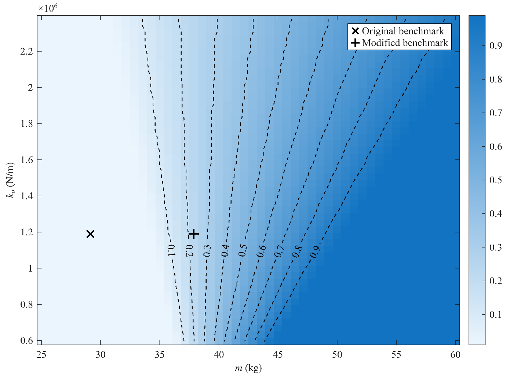

Figure 6~~6~~: Heatmap of the critical degradation ratio, <mml:math xmlns:mml="http://www.w3.org/1998/Math/MathML" xmlns:m="http://schemas.openxmlformats.org/officeDocument/2006/math"><mml:msub><mml:mrow><mml:mi mathvariant="normal">α</mml:mi></mml:mrow><mml:mrow><mml:mi>c</mml:mi><mml:mi>r</mml:mi></mml:mrow></mml:msub></mml:math>, defined as the residual stiffness fraction at which the outer controller loses stability. A lower <mml:math xmlns:mml="http://www.w3.org/1998/Math/MathML" xmlns:m="http://schemas.openxmlformats.org/officeDocument/2006/math"><mml:msub><mml:mrow><mml:mi mathvariant="normal">α</mml:mi></mml:mrow><mml:mrow><mml:mi>c</mml:mi><mml:mi>r</mml:mi></mml:mrow></mml:msub></mml:math> reflects a system that is more robust to physical degradation. The parameter configurations for both the original and modified benchmark problems are indicated by markers.

Since the objective is to support safe experiment execution, the damping ratio is conservatively assumed to remain constant during degradation avoiding the high uncertainties and practical difficulties of reliably estimating the specimen’s evolving damping during a test. However, to provide insight regarding how damping would affect these values, increasing the <mml:math xmlns:mml="http://www.w3.org/1998/Math/MathML" xmlns:m="http://schemas.openxmlformats.org/officeDocument/2006/math"><mml:mi mathvariant="normal">ζ</mml:mi></mml:math> from 1% to 2% and 5% would improve stability by reducing <mml:math xmlns:mml="http://www.w3.org/1998/Math/MathML" xmlns:m="http://schemas.openxmlformats.org/officeDocument/2006/math"><mml:msub><mml:mrow><mml:mi mathvariant="normal">α</mml:mi></mml:mrow><mml:mrow><mml:mi>c</mml:mi><mml:mi>r</mml:mi></mml:mrow></mml:msub></mml:math> from approximately 0.275 to 0.247 and 0.187, respectively.

# 4-Integration into an RTHS Framework

The preceding section presented a numerical method for quantifying system robustness specifically against structural degradation. This section expands upon that foundation to develop a stability indicator that can be used during an experiment. The goal is to develop a metric that not only offers a continuous, real-time assessment of the system’s actual robustness but also accounts for a wider range of uncertainties that may arise during an experiment.

The foundational principles for quantifying stability in linear time-invariant feedback systems were established in the 1930s and 1940s through the pioneering work of Harry Nyquist and Hendrik Bode [34], [35]. Their approach was revolutionary as it introduced a graphical approach based on the frequency domain, allowing for stability assessment without calculating the system’s poles. Using their now-famous Nyquist and Bode plots, they developed two enduring and fundamental metrics for measuring system robustness: the Gain Margin (GM) and the Phase Margin (PM). These margins were determined by geometrically inspecting the plots, providing a practical way to assess system robustness.

The first of these metrics, GM, is defined as the factor by which the open-loop gain can be increased before the system reaches the point of instability. This value can be interpreted from either of the graphical methods: on a Bode plot, as demonstrated in Figure 7(a), the GM is found by measuring the vertical distance between the 0 dB line and the magnitude curve at the frequency where the phase shift is equal to <mml:math xmlns:mml="http://www.w3.org/1998/Math/MathML" xmlns:m="http://schemas.openxmlformats.org/officeDocument/2006/math"><mml:mo>-</mml:mo><mml:mn>180</mml:mn><mml:mo>°</mml:mo></mml:math>. On a Nyquist plot, it is the reciprocal of the magnitude where the curve intersects the negative real axis as shown in Figure 7(b). While there is no universal standard, a minimum GM of 6 decibels is often considered to be sufficient for adequate robustness  [36].

The other fundamental metric is the PM, defined as the amount of additional open-loop phase lag needed to destabilize the closed-loop system at its unity-gain frequency. As illustrated in Figure 7(a), the PM on a Bode plot is the vertical distance between the phase curve and the  <mml:math xmlns:mml="http://www.w3.org/1998/Math/MathML" xmlns:m="http://schemas.openxmlformats.org/officeDocument/2006/math"><mml:mo>-</mml:mo><mml:mn>180</mml:mn><mml:mo>°</mml:mo></mml:math> line at this gain crossover frequency. Equivalently, on a Nyquist plot, it is the angle between the negative real axis and the point where the contour intersects the unit circle, as depicted in Figure 7(b).

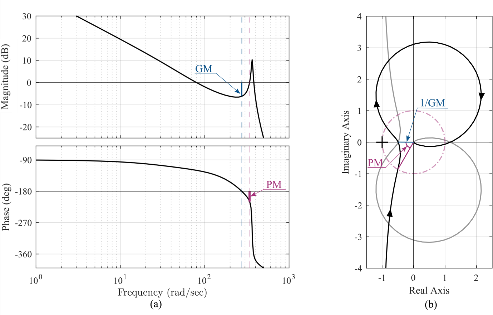

Figure 7~~7~~: (a) Bode plot of the illustrative example system, demonstrating the graphical determination of GM and PM at their respective crossover frequencies, (b) corresponding Nyquist plot, demonstrating the graphical determination of GM and PM relative to the critical point (−1, 0j).

Imposing a constant phase shift across the entire frequency spectrum yields a physically unrealizable system. In contrast, a time delay offers a more realistic model by introducing a phase lag that increases with frequency. This approach leads to another important metric, the Delay Margin (DM), which can be approximated from the PM using the expression <mml:math xmlns:mml="http://www.w3.org/1998/Math/MathML" xmlns:m="http://schemas.openxmlformats.org/officeDocument/2006/math"><mml:mi mathvariant="normal">D</mml:mi><mml:mi mathvariant="normal">M</mml:mi><mml:mo>≈</mml:mo><mml:mi mathvariant="normal">P</mml:mi><mml:mi mathvariant="normal">M</mml:mi><mml:mo>/</mml:mo><mml:msub><mml:mrow><mml:mi mathvariant="normal">ω</mml:mi></mml:mrow><mml:mrow><mml:mi mathvariant="normal">g</mml:mi><mml:mi mathvariant="normal">c</mml:mi></mml:mrow></mml:msub></mml:math> [37]. Since many RTHS components are more likely to introduce delays rather than amplify gains to the inner loop system, prior studies have often considered the DM as the most descriptive indicator of system robustness. To ensure robust performance and adequate system damping, a PM of 45 to 60 degrees is often considered a desirable design target [38].

One significant limitation of the GM and PM indicators is that they can create a false sense of security [39]. This limitation is primarily present because they are fundamentally uncoupled indicators, evaluating robustness to either pure gain or pure phase variations, but not both simultaneously. Consequently, a system can display large, apparently safe gain and phase margins yet be vulnerable to instability from a small, combined gain-and-phase perturbation. A concrete example of such a scenario is detailed in [39]. This issue was less apparent when controllers were designed with graphical techniques, however, it has become a more pronounced concern with modern automated control design methods. Similarly, since a time delay added to a system can be modeled as a phase lag variable with the frequency, the DM fails to indicate potential low robustness against gain amplifications.

To overcome the limitations of classical GM and PM indicators, the disk margin is introduced to assess simultaneous gain and phase variations in a unified manner. This approach models uncertainty as a complex multiplicative perturbation and calculates the largest perturbation disk that preserves closed-loop stability. While a skew parameter can be used to adjust the relative weighting between gain and phase uncertainty, a symmetric disk (skew = 0) is frequently employed.

The application of disk margin analysis to MIMO systems, while theoretically feasible, presents practical efficiency challenges, particularly in real-time applications. Seiler et al. [39] discussed two methodologies: loop-at-a-time analysis, which evaluates isolated channels, and multi-loop analysis, which models simultaneous perturbations. The former can be an overly optimistic assessment of system robustness because it evaluates channels in isolation, so it may exhibit excellent single-loop margins yet be destabilized by small simultaneous perturbations in multiple channels. On the other hand, multi-loop disk margins effectively address simultaneous perturbations, however, their computation requires determining the smallest combination of independent gain and phase variations across all channels that can destabilize the closed loop. This involves solving an optimization problem at each frequency point in a dense sweep, a process that is iterative and computationally intensive, making it impractical for real-time applications.

A more unified assessment of a system’s tolerance to simultaneous gain and phase variations has been developed within the framework of <mml:math xmlns:mml="http://www.w3.org/1998/Math/MathML" xmlns:m="http://schemas.openxmlformats.org/officeDocument/2006/math"><mml:msub><mml:mrow><mml:mi mathvariant="normal">H</mml:mi></mml:mrow><mml:mrow><mml:mi mathvariant="normal">∞</mml:mi></mml:mrow></mml:msub></mml:math>​ control theory. The normalized coprime factor (NCF) margin, also known in the literature as the generalized stability margin, quantifies the size of the smallest perturbation to both the plant and controller that will cause instability [40]. This metric offers a unified assessment of the system’s tolerance to simultaneous gain and phase variations into a single measure.

Let the plant of the transfer system be denoted as <mml:math xmlns:mml="http://www.w3.org/1998/Math/MathML" xmlns:m="http://schemas.openxmlformats.org/officeDocument/2006/math"><mml:mi>T</mml:mi><mml:mfenced separators="|"><mml:mrow><mml:mi>s</mml:mi><mml:mo>,</mml:mo><mml:mi mathvariant="normal">α</mml:mi></mml:mrow></mml:mfenced></mml:math>  and the outer controller as <mml:math xmlns:mml="http://www.w3.org/1998/Math/MathML" xmlns:m="http://schemas.openxmlformats.org/officeDocument/2006/math"><mml:msub><mml:mrow><mml:mi>C</mml:mi></mml:mrow><mml:mrow><mml:mi>o</mml:mi><mml:mi>u</mml:mi><mml:mi>t</mml:mi></mml:mrow></mml:msub><mml:mfenced separators="|"><mml:mrow><mml:mi>s</mml:mi></mml:mrow></mml:mfenced></mml:math>. The NCF stability margin, denoted as <mml:math xmlns:mml="http://www.w3.org/1998/Math/MathML" xmlns:m="http://schemas.openxmlformats.org/officeDocument/2006/math"><mml:msub><mml:mrow><mml:mi>b</mml:mi></mml:mrow><mml:mrow><mml:mi>g</mml:mi></mml:mrow></mml:msub><mml:mfenced separators="|"><mml:mrow><mml:msub><mml:mrow><mml:mi>C</mml:mi></mml:mrow><mml:mrow><mml:mi>o</mml:mi><mml:mi>u</mml:mi><mml:mi>t</mml:mi></mml:mrow></mml:msub><mml:mo>,</mml:mo><mml:mi>T</mml:mi></mml:mrow></mml:mfenced></mml:math>, is formally defined as [40]:

<mml:math xmlns:mml="http://www.w3.org/1998/Math/MathML" xmlns:m="http://schemas.openxmlformats.org/officeDocument/2006/math"><mml:mtable><mml:mtr><mml:mtd><mml:mrow><mml:maligngroup/><mml:msub><mml:mrow><mml:mi>b</mml:mi></mml:mrow><mml:mrow><mml:mi>g</mml:mi></mml:mrow></mml:msub><mml:mfenced separators="|"><mml:mrow><mml:msub><mml:mrow><mml:mi>C</mml:mi></mml:mrow><mml:mrow><mml:mi>o</mml:mi><mml:mi>u</mml:mi><mml:mi>t</mml:mi></mml:mrow></mml:msub><mml:mo>,</mml:mo><mml:mi>T</mml:mi></mml:mrow></mml:mfenced><mml:mo>=</mml:mo><mml:msubsup><mml:mrow><mml:mfenced open="‖" close="‖" separators="|"><mml:mrow><mml:mfenced open="[" close="]" separators="|"><mml:mrow><mml:mtable><mml:mtr><mml:mtd><mml:mrow><mml:maligngroup/><mml:msub><mml:mrow><mml:mi>C</mml:mi></mml:mrow><mml:mrow><mml:mi>o</mml:mi><mml:mi>u</mml:mi><mml:mi>t</mml:mi></mml:mrow></mml:msub></mml:mrow></mml:mtd></mml:mtr><mml:mtr><mml:mtd><mml:mrow><mml:maligngroup/><mml:mi>I</mml:mi></mml:mrow></mml:mtd></mml:mtr></mml:mtable></mml:mrow></mml:mfenced><mml:msup><mml:mrow><mml:mfenced separators="|"><mml:mrow><mml:mi>I</mml:mi><mml:mo>+</mml:mo><mml:mi>T</mml:mi><mml:msub><mml:mrow><mml:mi>C</mml:mi></mml:mrow><mml:mrow><mml:mi>o</mml:mi><mml:mi>u</mml:mi><mml:mi>t</mml:mi></mml:mrow></mml:msub></mml:mrow></mml:mfenced></mml:mrow><mml:mrow><mml:mo>-</mml:mo><mml:mn>1</mml:mn></mml:mrow></mml:msup><mml:mfenced open="[" close="]" separators="|"><mml:mrow><mml:mtable><mml:mtr><mml:mtd><mml:mi>I</mml:mi></mml:mtd><mml:mtd><mml:mi>T</mml:mi></mml:mtd></mml:mtr></mml:mtable></mml:mrow></mml:mfenced></mml:mrow></mml:mfenced></mml:mrow><mml:mrow><mml:mi>∞</mml:mi></mml:mrow><mml:mrow><mml:mo>-</mml:mo><mml:mn>1</mml:mn></mml:mrow></mml:msubsup><mml:mo>#</mml:mo><mml:mo>(</mml:mo><mml:mi> </mml:mi><mml:mi>S</mml:mi><mml:mi>E</mml:mi><mml:mi>Q</mml:mi><mml:mi> </mml:mi><mml:mi>E</mml:mi><mml:mi>q</mml:mi><mml:mi>u</mml:mi><mml:mi>a</mml:mi><mml:mi>t</mml:mi><mml:mi>i</mml:mi><mml:mi>o</mml:mi><mml:mi>n</mml:mi><mml:mi> </mml:mi><mml:mo>\</mml:mo><mml:mi>*</mml:mi><mml:mi> </mml:mi><mml:mi>A</mml:mi><mml:mi>R</mml:mi><mml:mi>A</mml:mi><mml:mi>B</mml:mi><mml:mi>I</mml:mi><mml:mi>C</mml:mi><mml:mi> </mml:mi><mml:mo>\</mml:mo><mml:mi>*</mml:mi><mml:mi> </mml:mi><mml:mi>M</mml:mi><mml:mi>E</mml:mi><mml:mi>R</mml:mi><mml:mi>G</mml:mi><mml:mi>E</mml:mi><mml:mi>F</mml:mi><mml:mi>O</mml:mi><mml:mi>R</mml:mi><mml:mi>M</mml:mi><mml:mi>A</mml:mi><mml:mi>T</mml:mi><mml:mi> </mml:mi><mml:mn>32</mml:mn><mml:mo>)</mml:mo></mml:mrow></mml:mtd></mml:mtr></mml:mtable></mml:math>

For SISO systems, this expression can be greatly simplified. Dropping the functional dependencies for simplicity, the matrix inside the norm, denoted as **H**, becomes:

<mml:math xmlns:mml="http://www.w3.org/1998/Math/MathML" xmlns:m="http://schemas.openxmlformats.org/officeDocument/2006/math"><mml:mtable><mml:mtr><mml:mtd><mml:mrow><mml:maligngroup/><mml:mi>H</mml:mi><mml:mo>=</mml:mo><mml:mfrac><mml:mrow><mml:mn>1</mml:mn></mml:mrow><mml:mrow><mml:mfenced separators="|"><mml:mrow><mml:mn>1</mml:mn><mml:mo>+</mml:mo><mml:mi>T</mml:mi><mml:mi> </mml:mi><mml:msub><mml:mrow><mml:mi>C</mml:mi></mml:mrow><mml:mrow><mml:mi>o</mml:mi><mml:mi>u</mml:mi><mml:mi>t</mml:mi></mml:mrow></mml:msub></mml:mrow></mml:mfenced></mml:mrow></mml:mfrac><mml:mfenced open="[" close="]" separators="|"><mml:mrow><mml:mtable><mml:mtr><mml:mtd><mml:msub><mml:mrow><mml:mi>C</mml:mi></mml:mrow><mml:mrow><mml:mi>o</mml:mi><mml:mi>u</mml:mi><mml:mi>t</mml:mi></mml:mrow></mml:msub></mml:mtd><mml:mtd><mml:mi> </mml:mi><mml:mi>T</mml:mi><mml:mi> </mml:mi><mml:msub><mml:mrow><mml:mi>C</mml:mi></mml:mrow><mml:mrow><mml:mi>o</mml:mi><mml:mi>u</mml:mi><mml:mi>t</mml:mi></mml:mrow></mml:msub></mml:mtd></mml:mtr><mml:mtr><mml:mtd><mml:mn>1</mml:mn></mml:mtd><mml:mtd><mml:mi>T</mml:mi></mml:mtd></mml:mtr></mml:mtable></mml:mrow></mml:mfenced><mml:mo>#</mml:mo><mml:mo>(</mml:mo><mml:mi> </mml:mi><mml:mi>S</mml:mi><mml:mi>E</mml:mi><mml:mi>Q</mml:mi><mml:mi> </mml:mi><mml:mi>E</mml:mi><mml:mi>q</mml:mi><mml:mi>u</mml:mi><mml:mi>a</mml:mi><mml:mi>t</mml:mi><mml:mi>i</mml:mi><mml:mi>o</mml:mi><mml:mi>n</mml:mi><mml:mi> </mml:mi><mml:mo>\</mml:mo><mml:mi>*</mml:mi><mml:mi> </mml:mi><mml:mi>A</mml:mi><mml:mi>R</mml:mi><mml:mi>A</mml:mi><mml:mi>B</mml:mi><mml:mi>I</mml:mi><mml:mi>C</mml:mi><mml:mi> </mml:mi><mml:mo>\</mml:mo><mml:mi>*</mml:mi><mml:mi> </mml:mi><mml:mi>M</mml:mi><mml:mi>E</mml:mi><mml:mi>R</mml:mi><mml:mi>G</mml:mi><mml:mi>E</mml:mi><mml:mi>F</mml:mi><mml:mi>O</mml:mi><mml:mi>R</mml:mi><mml:mi>M</mml:mi><mml:mi>A</mml:mi><mml:mi>T</mml:mi><mml:mi> </mml:mi><mml:mn>33</mml:mn><mml:mo>)</mml:mo></mml:mrow></mml:mtd></mml:mtr></mml:mtable></mml:math>

The <mml:math xmlns:mml="http://www.w3.org/1998/Math/MathML" xmlns:m="http://schemas.openxmlformats.org/officeDocument/2006/math"><mml:msub><mml:mrow><mml:mi mathvariant="normal">H</mml:mi></mml:mrow><mml:mrow><mml:mi mathvariant="normal">∞</mml:mi></mml:mrow></mml:msub></mml:math>-norm is found by taking the supremum, over all frequencies <mml:math xmlns:mml="http://www.w3.org/1998/Math/MathML" xmlns:m="http://schemas.openxmlformats.org/officeDocument/2006/math"><mml:mi>ω</mml:mi></mml:math>, of the maximum singular value (<mml:math xmlns:mml="http://www.w3.org/1998/Math/MathML" xmlns:m="http://schemas.openxmlformats.org/officeDocument/2006/math"><mml:msub><mml:mrow><mml:mi>σ</mml:mi></mml:mrow><mml:mrow><mml:mi>m</mml:mi><mml:mi>a</mml:mi><mml:mi>x</mml:mi></mml:mrow></mml:msub></mml:math>​) of <mml:math xmlns:mml="http://www.w3.org/1998/Math/MathML" xmlns:m="http://schemas.openxmlformats.org/officeDocument/2006/math"><mml:mi mathvariant="bold">H</mml:mi><mml:mo>(</mml:mo><mml:mi>j</mml:mi><mml:mi>ω</mml:mi><mml:mo>)</mml:mo></mml:math>. The singular values are calculated from the eigenvalues of the matrix product<mml:math xmlns:mml="http://www.w3.org/1998/Math/MathML" xmlns:m="http://schemas.openxmlformats.org/officeDocument/2006/math"><mml:mi> </mml:mi><mml:mi mathvariant="bold">H</mml:mi><mml:mfenced separators="|"><mml:mrow><mml:mi>j</mml:mi><mml:mi>ω</mml:mi></mml:mrow></mml:mfenced><mml:mi mathvariant="bold">H</mml:mi><mml:msup><mml:mrow><mml:mfenced separators="|"><mml:mrow><mml:mi>j</mml:mi><mml:mi>ω</mml:mi></mml:mrow></mml:mfenced></mml:mrow><mml:mrow><mml:mi>*</mml:mi></mml:mrow></mml:msup></mml:math>, where * denotes the complex conjugate transpose. This product is:

<mml:math xmlns:mml="http://www.w3.org/1998/Math/MathML" xmlns:m="http://schemas.openxmlformats.org/officeDocument/2006/math"><mml:mtable><mml:mtr><mml:mtd><mml:mrow><mml:maligngroup/><mml:mi>H</mml:mi><mml:mi> </mml:mi><mml:msup><mml:mrow><mml:mi mathvariant="bold">H</mml:mi></mml:mrow><mml:mrow><mml:mi mathvariant="bold">*</mml:mi></mml:mrow></mml:msup><mml:mo>=</mml:mo><mml:mfrac><mml:mrow><mml:mn>1</mml:mn></mml:mrow><mml:mrow><mml:msup><mml:mrow><mml:mfenced open="|" close="|" separators="|"><mml:mrow><mml:mn>1</mml:mn><mml:mo>+</mml:mo><mml:mi>T</mml:mi><mml:mi> </mml:mi><mml:msub><mml:mrow><mml:mi>C</mml:mi></mml:mrow><mml:mrow><mml:mi>o</mml:mi><mml:mi>u</mml:mi><mml:mi>t</mml:mi></mml:mrow></mml:msub></mml:mrow></mml:mfenced></mml:mrow><mml:mrow><mml:mn>2</mml:mn></mml:mrow></mml:msup></mml:mrow></mml:mfrac><mml:mfenced open="[" close="]" separators="|"><mml:mrow><mml:mtable><mml:mtr><mml:mtd><mml:msub><mml:mrow><mml:mi>C</mml:mi></mml:mrow><mml:mrow><mml:mi>o</mml:mi><mml:mi>u</mml:mi><mml:mi>t</mml:mi></mml:mrow></mml:msub></mml:mtd><mml:mtd><mml:mi> </mml:mi><mml:mi>T</mml:mi><mml:mi> </mml:mi><mml:msub><mml:mrow><mml:mi>C</mml:mi></mml:mrow><mml:mrow><mml:mi>o</mml:mi><mml:mi>u</mml:mi><mml:mi>t</mml:mi></mml:mrow></mml:msub></mml:mtd></mml:mtr><mml:mtr><mml:mtd><mml:mi> </mml:mi><mml:mn>1</mml:mn><mml:mi> </mml:mi></mml:mtd><mml:mtd><mml:mi> </mml:mi><mml:mi>T</mml:mi></mml:mtd></mml:mtr></mml:mtable></mml:mrow></mml:mfenced><mml:mfenced open="[" close="]" separators="|"><mml:mrow><mml:mtable><mml:mtr><mml:mtd><mml:msubsup><mml:mrow><mml:mi>C</mml:mi></mml:mrow><mml:mrow><mml:mi>o</mml:mi><mml:mi>u</mml:mi><mml:mi>t</mml:mi></mml:mrow><mml:mrow><mml:mi>*</mml:mi></mml:mrow></mml:msubsup></mml:mtd><mml:mtd><mml:mi> </mml:mi><mml:mn>1</mml:mn><mml:mi> </mml:mi></mml:mtd></mml:mtr><mml:mtr><mml:mtd><mml:mi> </mml:mi><mml:msup><mml:mrow><mml:mfenced separators="|"><mml:mrow><mml:mi>T</mml:mi><mml:mi> </mml:mi><mml:msub><mml:mrow><mml:mi>C</mml:mi></mml:mrow><mml:mrow><mml:mi>o</mml:mi><mml:mi>u</mml:mi><mml:mi>t</mml:mi></mml:mrow></mml:msub></mml:mrow></mml:mfenced></mml:mrow><mml:mrow><mml:mi>*</mml:mi></mml:mrow></mml:msup></mml:mtd><mml:mtd><mml:mi> </mml:mi><mml:msup><mml:mrow><mml:mi>T</mml:mi></mml:mrow><mml:mrow><mml:mi>*</mml:mi></mml:mrow></mml:msup></mml:mtd></mml:mtr></mml:mtable></mml:mrow></mml:mfenced><mml:mo>=</mml:mo><mml:mfrac><mml:mrow><mml:mn>1</mml:mn><mml:mo>+</mml:mo><mml:msup><mml:mrow><mml:mfenced open="|" close="|" separators="|"><mml:mrow><mml:mi>T</mml:mi></mml:mrow></mml:mfenced></mml:mrow><mml:mrow><mml:mn>2</mml:mn></mml:mrow></mml:msup></mml:mrow><mml:mrow><mml:msup><mml:mrow><mml:mfenced open="|" close="|" separators="|"><mml:mrow><mml:mn>1</mml:mn><mml:mo>+</mml:mo><mml:mi>T</mml:mi><mml:mi> </mml:mi><mml:msub><mml:mrow><mml:mi>C</mml:mi></mml:mrow><mml:mrow><mml:mi>o</mml:mi><mml:mi>u</mml:mi><mml:mi>t</mml:mi></mml:mrow></mml:msub></mml:mrow></mml:mfenced></mml:mrow><mml:mrow><mml:mn>2</mml:mn></mml:mrow></mml:msup></mml:mrow></mml:mfrac><mml:mfenced open="[" close="]" separators="|"><mml:mrow><mml:mtable><mml:mtr><mml:mtd><mml:msup><mml:mrow><mml:mfenced open="|" close="|" separators="|"><mml:mrow><mml:msub><mml:mrow><mml:mi>C</mml:mi></mml:mrow><mml:mrow><mml:mi>o</mml:mi><mml:mi>u</mml:mi><mml:mi>t</mml:mi></mml:mrow></mml:msub></mml:mrow></mml:mfenced></mml:mrow><mml:mrow><mml:mn>2</mml:mn></mml:mrow></mml:msup></mml:mtd><mml:mtd><mml:mi> </mml:mi><mml:msub><mml:mrow><mml:mi>C</mml:mi></mml:mrow><mml:mrow><mml:mi>o</mml:mi><mml:mi>u</mml:mi><mml:mi>t</mml:mi></mml:mrow></mml:msub></mml:mtd></mml:mtr><mml:mtr><mml:mtd><mml:mi> </mml:mi><mml:msubsup><mml:mrow><mml:mi>C</mml:mi></mml:mrow><mml:mrow><mml:mi>o</mml:mi><mml:mi>u</mml:mi><mml:mi>t</mml:mi></mml:mrow><mml:mrow><mml:mi>*</mml:mi></mml:mrow></mml:msubsup></mml:mtd><mml:mtd><mml:mi> </mml:mi><mml:mn>1</mml:mn></mml:mtd></mml:mtr></mml:mtable></mml:mrow></mml:mfenced><mml:mo>#</mml:mo><mml:mo>(</mml:mo><mml:mi> </mml:mi><mml:mi>S</mml:mi><mml:mi>E</mml:mi><mml:mi>Q</mml:mi><mml:mi> </mml:mi><mml:mi>E</mml:mi><mml:mi>q</mml:mi><mml:mi>u</mml:mi><mml:mi>a</mml:mi><mml:mi>t</mml:mi><mml:mi>i</mml:mi><mml:mi>o</mml:mi><mml:mi>n</mml:mi><mml:mi> </mml:mi><mml:mo>\</mml:mo><mml:mi>*</mml:mi><mml:mi> </mml:mi><mml:mi>A</mml:mi><mml:mi>R</mml:mi><mml:mi>A</mml:mi><mml:mi>B</mml:mi><mml:mi>I</mml:mi><mml:mi>C</mml:mi><mml:mi> </mml:mi><mml:mo>\</mml:mo><mml:mi>*</mml:mi><mml:mi> </mml:mi><mml:mi>M</mml:mi><mml:mi>E</mml:mi><mml:mi>R</mml:mi><mml:mi>G</mml:mi><mml:mi>E</mml:mi><mml:mi>F</mml:mi><mml:mi>O</mml:mi><mml:mi>R</mml:mi><mml:mi>M</mml:mi><mml:mi>A</mml:mi><mml:mi>T</mml:mi><mml:mi> </mml:mi><mml:mn>34</mml:mn><mml:mo>)</mml:mo></mml:mrow></mml:mtd></mml:mtr></mml:mtable></mml:math>

To obtain the singular values, the eigenvalues of the final matrix term are calculated. Solving its characteristic equation,

<mml:math xmlns:mml="http://www.w3.org/1998/Math/MathML" xmlns:m="http://schemas.openxmlformats.org/officeDocument/2006/math"><mml:mtable><mml:mtr><mml:mtd><mml:mrow><mml:maligngroup/><mml:mfenced separators="|"><mml:mrow><mml:msup><mml:mrow><mml:mfenced open="|" close="|" separators="|"><mml:mrow><mml:msub><mml:mrow><mml:mi>C</mml:mi></mml:mrow><mml:mrow><mml:mi>o</mml:mi><mml:mi>u</mml:mi><mml:mi>t</mml:mi></mml:mrow></mml:msub></mml:mrow></mml:mfenced></mml:mrow><mml:mrow><mml:mn>2</mml:mn></mml:mrow></mml:msup><mml:mo>-</mml:mo><mml:mi> </mml:mi><mml:mi>λ</mml:mi></mml:mrow></mml:mfenced><mml:mfenced separators="|"><mml:mrow><mml:mn>1</mml:mn><mml:mi> </mml:mi><mml:mo>–</mml:mo><mml:mi> </mml:mi><mml:mi>λ</mml:mi></mml:mrow></mml:mfenced><mml:mo>-</mml:mo><mml:mi> </mml:mi><mml:msup><mml:mrow><mml:mfenced open="|" close="|" separators="|"><mml:mrow><mml:msub><mml:mrow><mml:mi>C</mml:mi></mml:mrow><mml:mrow><mml:mi>o</mml:mi><mml:mi>u</mml:mi><mml:mi>t</mml:mi></mml:mrow></mml:msub></mml:mrow></mml:mfenced></mml:mrow><mml:mrow><mml:mn>2</mml:mn></mml:mrow></mml:msup><mml:mo>=</mml:mo><mml:mi> </mml:mi><mml:mn>0</mml:mn><mml:mo>#</mml:mo><mml:mo>(</mml:mo><mml:mi> </mml:mi><mml:mi>S</mml:mi><mml:mi>E</mml:mi><mml:mi>Q</mml:mi><mml:mi> </mml:mi><mml:mi>E</mml:mi><mml:mi>q</mml:mi><mml:mi>u</mml:mi><mml:mi>a</mml:mi><mml:mi>t</mml:mi><mml:mi>i</mml:mi><mml:mi>o</mml:mi><mml:mi>n</mml:mi><mml:mi> </mml:mi><mml:mo>\</mml:mo><mml:mi>*</mml:mi><mml:mi> </mml:mi><mml:mi>A</mml:mi><mml:mi>R</mml:mi><mml:mi>A</mml:mi><mml:mi>B</mml:mi><mml:mi>I</mml:mi><mml:mi>C</mml:mi><mml:mi> </mml:mi><mml:mo>\</mml:mo><mml:mi>*</mml:mi><mml:mi> </mml:mi><mml:mi>M</mml:mi><mml:mi>E</mml:mi><mml:mi>R</mml:mi><mml:mi>G</mml:mi><mml:mi>E</mml:mi><mml:mi>F</mml:mi><mml:mi>O</mml:mi><mml:mi>R</mml:mi><mml:mi>M</mml:mi><mml:mi>A</mml:mi><mml:mi>T</mml:mi><mml:mi> </mml:mi><mml:mn>35</mml:mn><mml:mo>)</mml:mo></mml:mrow></mml:mtd></mml:mtr></mml:mtable></mml:math>

yields the eigenvalues <mml:math xmlns:mml="http://www.w3.org/1998/Math/MathML" xmlns:m="http://schemas.openxmlformats.org/officeDocument/2006/math"><mml:msub><mml:mrow><mml:mi>λ</mml:mi></mml:mrow><mml:mrow><mml:mn>1</mml:mn></mml:mrow></mml:msub><mml:mo>=</mml:mo><mml:mn>0</mml:mn></mml:math> and <mml:math xmlns:mml="http://www.w3.org/1998/Math/MathML" xmlns:m="http://schemas.openxmlformats.org/officeDocument/2006/math"><mml:msub><mml:mrow><mml:mi>λ</mml:mi></mml:mrow><mml:mrow><mml:mi>m</mml:mi><mml:mi>a</mml:mi><mml:mi>x</mml:mi></mml:mrow></mml:msub><mml:mo>=</mml:mo><mml:mn>1</mml:mn><mml:mo>+</mml:mo><mml:msup><mml:mrow><mml:mfenced open="|" close="|" separators="|"><mml:mrow><mml:msub><mml:mrow><mml:mi>C</mml:mi></mml:mrow><mml:mrow><mml:mi>o</mml:mi><mml:mi>u</mml:mi><mml:mi>t</mml:mi></mml:mrow></mml:msub></mml:mrow></mml:mfenced></mml:mrow><mml:mrow><mml:mn>2</mml:mn></mml:mrow></mml:msup></mml:math>. The maximum singular value squared of <mml:math xmlns:mml="http://www.w3.org/1998/Math/MathML" xmlns:m="http://schemas.openxmlformats.org/officeDocument/2006/math"><mml:mi mathvariant="bold">H</mml:mi></mml:math> is therefore:

<mml:math xmlns:mml="http://www.w3.org/1998/Math/MathML" xmlns:m="http://schemas.openxmlformats.org/officeDocument/2006/math"><mml:mtable><mml:mtr><mml:mtd><mml:mrow><mml:maligngroup/><mml:msubsup><mml:mrow><mml:mi>σ</mml:mi></mml:mrow><mml:mrow><mml:mi mathvariant="normal">m</mml:mi><mml:mi mathvariant="normal">a</mml:mi><mml:mi mathvariant="normal">x</mml:mi></mml:mrow><mml:mrow><mml:mn>2</mml:mn></mml:mrow></mml:msubsup><mml:mo>(</mml:mo><mml:mi>H</mml:mi><mml:mo>)</mml:mo><mml:mo>=</mml:mo><mml:mfrac><mml:mrow><mml:mfenced separators="|"><mml:mrow><mml:mn>1</mml:mn><mml:mo>+</mml:mo><mml:msup><mml:mrow><mml:mfenced open="|" close="|" separators="|"><mml:mrow><mml:mi>T</mml:mi></mml:mrow></mml:mfenced></mml:mrow><mml:mrow><mml:mn>2</mml:mn></mml:mrow></mml:msup></mml:mrow></mml:mfenced><mml:mfenced separators="|"><mml:mrow><mml:mn>1</mml:mn><mml:mo>+</mml:mo><mml:msup><mml:mrow><mml:mfenced open="|" close="|" separators="|"><mml:mrow><mml:msub><mml:mrow><mml:mi>C</mml:mi></mml:mrow><mml:mrow><mml:mi>o</mml:mi><mml:mi>u</mml:mi><mml:mi>t</mml:mi></mml:mrow></mml:msub></mml:mrow></mml:mfenced></mml:mrow><mml:mrow><mml:mn>2</mml:mn></mml:mrow></mml:msup></mml:mrow></mml:mfenced></mml:mrow><mml:mrow><mml:msup><mml:mrow><mml:mfenced open="|" close="|" separators="|"><mml:mrow><mml:mn>1</mml:mn><mml:mo>+</mml:mo><mml:mi>T</mml:mi><mml:msub><mml:mrow><mml:mi>C</mml:mi></mml:mrow><mml:mrow><mml:mi>o</mml:mi><mml:mi>u</mml:mi><mml:mi>t</mml:mi></mml:mrow></mml:msub></mml:mrow></mml:mfenced></mml:mrow><mml:mrow><mml:mn>2</mml:mn></mml:mrow></mml:msup></mml:mrow></mml:mfrac><mml:mo>#</mml:mo><mml:mo>(</mml:mo><mml:mi> </mml:mi><mml:mi>S</mml:mi><mml:mi>E</mml:mi><mml:mi>Q</mml:mi><mml:mi> </mml:mi><mml:mi>E</mml:mi><mml:mi>q</mml:mi><mml:mi>u</mml:mi><mml:mi>a</mml:mi><mml:mi>t</mml:mi><mml:mi>i</mml:mi><mml:mi>o</mml:mi><mml:mi>n</mml:mi><mml:mi> </mml:mi><mml:mo>\</mml:mo><mml:mi>*</mml:mi><mml:mi> </mml:mi><mml:mi>A</mml:mi><mml:mi>R</mml:mi><mml:mi>A</mml:mi><mml:mi>B</mml:mi><mml:mi>I</mml:mi><mml:mi>C</mml:mi><mml:mi> </mml:mi><mml:mo>\</mml:mo><mml:mi>*</mml:mi><mml:mi> </mml:mi><mml:mi>M</mml:mi><mml:mi>E</mml:mi><mml:mi>R</mml:mi><mml:mi>G</mml:mi><mml:mi>E</mml:mi><mml:mi>F</mml:mi><mml:mi>O</mml:mi><mml:mi>R</mml:mi><mml:mi>M</mml:mi><mml:mi>A</mml:mi><mml:mi>T</mml:mi><mml:mi> </mml:mi><mml:mn>36</mml:mn><mml:mo>)</mml:mo></mml:mrow></mml:mtd></mml:mtr></mml:mtable></mml:math>

The stability margin <mml:math xmlns:mml="http://www.w3.org/1998/Math/MathML" xmlns:m="http://schemas.openxmlformats.org/officeDocument/2006/math"><mml:msub><mml:mrow><mml:mi>b</mml:mi></mml:mrow><mml:mrow><mml:mi>g</mml:mi></mml:mrow></mml:msub><mml:mfenced separators="|"><mml:mrow><mml:msub><mml:mrow><mml:mi>C</mml:mi></mml:mrow><mml:mrow><mml:mi>o</mml:mi><mml:mi>u</mml:mi><mml:mi>t</mml:mi></mml:mrow></mml:msub><mml:mo>,</mml:mo><mml:mi>T</mml:mi></mml:mrow></mml:mfenced></mml:math> is the inverse of the ​<mml:math xmlns:mml="http://www.w3.org/1998/Math/MathML" xmlns:m="http://schemas.openxmlformats.org/officeDocument/2006/math"><mml:msub><mml:mrow><mml:mi>H</mml:mi></mml:mrow><mml:mrow><mml:mi>∞</mml:mi></mml:mrow></mml:msub></mml:math>-norm of <mml:math xmlns:mml="http://www.w3.org/1998/Math/MathML" xmlns:m="http://schemas.openxmlformats.org/officeDocument/2006/math"><mml:mi mathvariant="normal">H</mml:mi></mml:math>, which is equivalent to the infimum of the reciprocal of <mml:math xmlns:mml="http://www.w3.org/1998/Math/MathML" xmlns:m="http://schemas.openxmlformats.org/officeDocument/2006/math"><mml:msub><mml:mrow><mml:mi>σ</mml:mi></mml:mrow><mml:mrow><mml:mi>m</mml:mi><mml:mi>a</mml:mi><mml:mi>x</mml:mi></mml:mrow></mml:msub><mml:mo>(</mml:mo><mml:mi>H</mml:mi><mml:mo>)</mml:mo></mml:math>. This leads to the final, simplified formula for the SISO NCF stability margin:

<mml:math xmlns:mml="http://www.w3.org/1998/Math/MathML" xmlns:m="http://schemas.openxmlformats.org/officeDocument/2006/math"><mml:mtable><mml:mtr><mml:mtd><mml:mrow><mml:maligngroup/><mml:msub><mml:mrow><mml:mi>b</mml:mi></mml:mrow><mml:mrow><mml:mi>g</mml:mi></mml:mrow></mml:msub><mml:mfenced separators="|"><mml:mrow><mml:msub><mml:mrow><mml:mi>C</mml:mi></mml:mrow><mml:mrow><mml:mi>o</mml:mi><mml:mi>u</mml:mi><mml:mi>t</mml:mi></mml:mrow></mml:msub><mml:mo>,</mml:mo><mml:mi> </mml:mi><mml:mi>T</mml:mi></mml:mrow></mml:mfenced><mml:mo>=</mml:mo><mml:munder><mml:mrow><mml:mi mathvariant="normal">i</mml:mi><mml:mi mathvariant="normal">n</mml:mi><mml:mi mathvariant="normal">f</mml:mi></mml:mrow><mml:mrow><mml:mi>ω</mml:mi></mml:mrow></mml:munder><mml:mfrac><mml:mrow><mml:mfenced separators="|"><mml:mrow><mml:mfenced open="|" close="|" separators="|"><mml:mrow><mml:mn>1</mml:mn><mml:mi> </mml:mi><mml:mo>+</mml:mo><mml:mi> </mml:mi><mml:mi>T</mml:mi><mml:mfenced separators="|"><mml:mrow><mml:mi>j</mml:mi><mml:mi>ω</mml:mi></mml:mrow></mml:mfenced><mml:msub><mml:mrow><mml:mi>C</mml:mi></mml:mrow><mml:mrow><mml:mi>o</mml:mi><mml:mi>u</mml:mi><mml:mi>t</mml:mi></mml:mrow></mml:msub><mml:mfenced separators="|"><mml:mrow><mml:mi>j</mml:mi><mml:mi>ω</mml:mi></mml:mrow></mml:mfenced></mml:mrow></mml:mfenced></mml:mrow></mml:mfenced></mml:mrow><mml:mrow><mml:msqrt><mml:mn>1</mml:mn><mml:mo>+</mml:mo><mml:msup><mml:mrow><mml:mfenced open="|" close="|" separators="|"><mml:mrow><mml:mi>T</mml:mi><mml:mfenced separators="|"><mml:mrow><mml:mi>j</mml:mi><mml:mi>ω</mml:mi></mml:mrow></mml:mfenced></mml:mrow></mml:mfenced></mml:mrow><mml:mrow><mml:mn>2</mml:mn></mml:mrow></mml:msup></mml:msqrt><mml:mi> </mml:mi><mml:msqrt><mml:mn>1</mml:mn><mml:mo>+</mml:mo><mml:msup><mml:mrow><mml:mfenced open="|" close="|" separators="|"><mml:mrow><mml:msub><mml:mrow><mml:mi>C</mml:mi></mml:mrow><mml:mrow><mml:mi>o</mml:mi><mml:mi>u</mml:mi><mml:mi>t</mml:mi></mml:mrow></mml:msub><mml:mfenced separators="|"><mml:mrow><mml:mi>j</mml:mi><mml:mi>ω</mml:mi></mml:mrow></mml:mfenced></mml:mrow></mml:mfenced></mml:mrow><mml:mrow><mml:mn>2</mml:mn></mml:mrow></mml:msup></mml:msqrt></mml:mrow></mml:mfrac><mml:mo>#</mml:mo><mml:mfenced separators="|"><mml:mrow><mml:mi mathvariant="normal"> </mml:mi><mml:mi mathvariant="normal">S</mml:mi><mml:mi mathvariant="normal">E</mml:mi><mml:mi mathvariant="normal">Q</mml:mi><mml:mi mathvariant="normal"> </mml:mi><mml:mi mathvariant="normal">E</mml:mi><mml:mi mathvariant="normal">q</mml:mi><mml:mi mathvariant="normal">u</mml:mi><mml:mi mathvariant="normal">a</mml:mi><mml:mi mathvariant="normal">t</mml:mi><mml:mi mathvariant="normal">i</mml:mi><mml:mi mathvariant="normal">o</mml:mi><mml:mi mathvariant="normal">n</mml:mi><mml:mi mathvariant="normal"> </mml:mi><mml:mo>\</mml:mo><mml:mi mathvariant="normal">*</mml:mi><mml:mi mathvariant="normal"> </mml:mi><mml:mi mathvariant="normal">A</mml:mi><mml:mi mathvariant="normal">R</mml:mi><mml:mi mathvariant="normal">A</mml:mi><mml:mi mathvariant="normal">B</mml:mi><mml:mi mathvariant="normal">I</mml:mi><mml:mi mathvariant="normal">C</mml:mi><mml:mi mathvariant="normal"> </mml:mi><mml:mo>\</mml:mo><mml:mi mathvariant="normal">*</mml:mi><mml:mi mathvariant="normal"> </mml:mi><mml:mi mathvariant="normal">M</mml:mi><mml:mi mathvariant="normal">E</mml:mi><mml:mi mathvariant="normal">R</mml:mi><mml:mi mathvariant="normal">G</mml:mi><mml:mi mathvariant="normal">E</mml:mi><mml:mi mathvariant="normal">F</mml:mi><mml:mi mathvariant="normal">O</mml:mi><mml:mi mathvariant="normal">R</mml:mi><mml:mi mathvariant="normal">M</mml:mi><mml:mi mathvariant="normal">A</mml:mi><mml:mi mathvariant="normal">T</mml:mi><mml:mi mathvariant="normal"> </mml:mi><mml:mn>37</mml:mn></mml:mrow></mml:mfenced></mml:mrow></mml:mtd></mml:mtr></mml:mtable></mml:math>

This expression is advantageous for online applications due to its computational efficiency. Since the singular value decomposition, the primary computational bottleneck, is resolved theoretically, the remaining online task is to simply evaluate the functions <mml:math xmlns:mml="http://www.w3.org/1998/Math/MathML" xmlns:m="http://schemas.openxmlformats.org/officeDocument/2006/math"><mml:msub><mml:mrow><mml:mi>C</mml:mi></mml:mrow><mml:mrow><mml:mi>o</mml:mi><mml:mi>u</mml:mi><mml:mi>t</mml:mi></mml:mrow></mml:msub></mml:math> and <mml:math xmlns:mml="http://www.w3.org/1998/Math/MathML" xmlns:m="http://schemas.openxmlformats.org/officeDocument/2006/math"><mml:mi>T</mml:mi></mml:math> at the frequencies of interest and find the minimum value. During operation, the controller and actuator dynamics are assumed to be known and constant, shifting the problem to one of online identification of the physical substructure. Figure 8, which extends the comparison presented in Figure 4~~4~~ to include the proposed NCF-based indicator, the proposed margin captures the progression toward instability more consistently than the classical indicators.

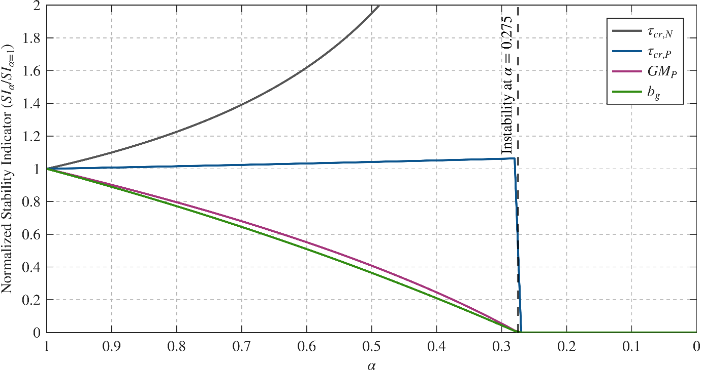

Figure 8~~8~~: Evolution of the proposed RTHS stability indicator compared to other indicators as a function of the physical substructure degradation factor

Unlike classical stability margins and due to the way the NCF margin is defined, the proposed stability indicator is not only dependent on the overall open-loop dynamics <mml:math xmlns:mml="http://www.w3.org/1998/Math/MathML" xmlns:m="http://schemas.openxmlformats.org/officeDocument/2006/math"><mml:mi>L</mml:mi></mml:math>, but it is also affected by the way it is split to a controller, <mml:math xmlns:mml="http://www.w3.org/1998/Math/MathML" xmlns:m="http://schemas.openxmlformats.org/officeDocument/2006/math"><mml:msub><mml:mrow><mml:mi>C</mml:mi></mml:mrow><mml:mrow><mml:mi>o</mml:mi><mml:mi>u</mml:mi><mml:mi>t</mml:mi></mml:mrow></mml:msub></mml:math>, and a plant, <mml:math xmlns:mml="http://www.w3.org/1998/Math/MathML" xmlns:m="http://schemas.openxmlformats.org/officeDocument/2006/math"><mml:mi>T</mml:mi></mml:math>. Naturally, this dependency motivates the development of a normalized formula, the Scaled NCF margin, also known as Vinnicombe SISO expression. The scaled margin is defined as the maximum achievable generalized (NCF) margin over all constant input/output rescalings that preserve L and is given by [41]:

<mml:math xmlns:mml="http://www.w3.org/1998/Math/MathML" xmlns:m="http://schemas.openxmlformats.org/officeDocument/2006/math"><mml:mtable><mml:mtr><mml:mtd><mml:mrow><mml:maligngroup/><mml:msub><mml:mrow><mml:mi>b</mml:mi></mml:mrow><mml:mrow><mml:mi>s</mml:mi></mml:mrow></mml:msub><mml:mo>(</mml:mo><mml:mi>L</mml:mi><mml:mo>)</mml:mo><mml:mo>=</mml:mo><mml:mi> </mml:mi><mml:munder><mml:mrow><mml:mi mathvariant="normal">i</mml:mi><mml:mi mathvariant="normal">n</mml:mi><mml:mi mathvariant="normal">f</mml:mi></mml:mrow><mml:mrow><mml:mi>ω</mml:mi></mml:mrow></mml:munder><mml:mfrac><mml:mrow><mml:mfenced open="|" close="|" separators="|"><mml:mrow><mml:mn>1</mml:mn><mml:mo>+</mml:mo><mml:mi>L</mml:mi><mml:mfenced separators="|"><mml:mrow><mml:mi>j</mml:mi><mml:mi>ω</mml:mi></mml:mrow></mml:mfenced></mml:mrow></mml:mfenced></mml:mrow><mml:mrow><mml:mn>1</mml:mn><mml:mo>+</mml:mo><mml:mfenced open="|" close="|" separators="|"><mml:mrow><mml:mi>L</mml:mi><mml:mfenced separators="|"><mml:mrow><mml:mi>j</mml:mi><mml:mi>ω</mml:mi></mml:mrow></mml:mfenced></mml:mrow></mml:mfenced></mml:mrow></mml:mfrac><mml:mi> </mml:mi><mml:mo>#</mml:mo><mml:mfenced separators="|"><mml:mrow><mml:mi mathvariant="normal"> </mml:mi><mml:mi mathvariant="normal">S</mml:mi><mml:mi mathvariant="normal">E</mml:mi><mml:mi mathvariant="normal">Q</mml:mi><mml:mi mathvariant="normal"> </mml:mi><mml:mi mathvariant="normal">E</mml:mi><mml:mi mathvariant="normal">q</mml:mi><mml:mi mathvariant="normal">u</mml:mi><mml:mi mathvariant="normal">a</mml:mi><mml:mi mathvariant="normal">t</mml:mi><mml:mi mathvariant="normal">i</mml:mi><mml:mi mathvariant="normal">o</mml:mi><mml:mi mathvariant="normal">n</mml:mi><mml:mi mathvariant="normal"> </mml:mi><mml:mo>\</mml:mo><mml:mi mathvariant="normal">*</mml:mi><mml:mi mathvariant="normal"> </mml:mi><mml:mi mathvariant="normal">A</mml:mi><mml:mi mathvariant="normal">R</mml:mi><mml:mi mathvariant="normal">A</mml:mi><mml:mi mathvariant="normal">B</mml:mi><mml:mi mathvariant="normal">I</mml:mi><mml:mi mathvariant="normal">C</mml:mi><mml:mi mathvariant="normal"> </mml:mi><mml:mo>\</mml:mo><mml:mi mathvariant="normal">*</mml:mi><mml:mi mathvariant="normal"> </mml:mi><mml:mi mathvariant="normal">M</mml:mi><mml:mi mathvariant="normal">E</mml:mi><mml:mi mathvariant="normal">R</mml:mi><mml:mi mathvariant="normal">G</mml:mi><mml:mi mathvariant="normal">E</mml:mi><mml:mi mathvariant="normal">F</mml:mi><mml:mi mathvariant="normal">O</mml:mi><mml:mi mathvariant="normal">R</mml:mi><mml:mi mathvariant="normal">M</mml:mi><mml:mi mathvariant="normal">A</mml:mi><mml:mi mathvariant="normal">T</mml:mi><mml:mi mathvariant="normal"> </mml:mi><mml:mn>38</mml:mn></mml:mrow></mml:mfenced></mml:mrow></mml:mtd></mml:mtr></mml:mtable></mml:math>

While a closed-form solution for the optimally scaled NCF margin (<mml:math xmlns:mml="http://www.w3.org/1998/Math/MathML" xmlns:m="http://schemas.openxmlformats.org/officeDocument/2006/math"><mml:msub><mml:mrow><mml:mi mathvariant="normal">b</mml:mi></mml:mrow><mml:mrow><mml:mi mathvariant="normal">s</mml:mi></mml:mrow></mml:msub></mml:math>​) does not exist for MIMO systems, an iterative method was developed by Park & Bitmead [42]. Nevertheless, the generalized NCF margin (<mml:math xmlns:mml="http://www.w3.org/1998/Math/MathML" xmlns:m="http://schemas.openxmlformats.org/officeDocument/2006/math"><mml:msub><mml:mrow><mml:mi>b</mml:mi></mml:mrow><mml:mrow><mml:mi>g</mml:mi></mml:mrow></mml:msub></mml:math>​) can serve as a practical and conservative stability indicator, as it constitutes a lower bound on the scaled margin (<mml:math xmlns:mml="http://www.w3.org/1998/Math/MathML" xmlns:m="http://schemas.openxmlformats.org/officeDocument/2006/math"><mml:msub><mml:mrow><mml:mi>b</mml:mi></mml:mrow><mml:mrow><mml:mi>g</mml:mi></mml:mrow></mml:msub><mml:mo>≤</mml:mo><mml:msub><mml:mrow><mml:mi>b</mml:mi></mml:mrow><mml:mrow><mml:mi>s</mml:mi></mml:mrow></mml:msub></mml:math>​), a proof for SISO and MIMO systems can be found in [43]. Furthermore, ensuring a minimum value for <mml:math xmlns:mml="http://www.w3.org/1998/Math/MathML" xmlns:m="http://schemas.openxmlformats.org/officeDocument/2006/math"><mml:msub><mml:mrow><mml:mi>b</mml:mi></mml:mrow><mml:mrow><mml:mi>g</mml:mi></mml:mrow></mml:msub></mml:math>​ also guarantees that the system meets target Gain and Phase Margins (<mml:math xmlns:mml="http://www.w3.org/1998/Math/MathML" xmlns:m="http://schemas.openxmlformats.org/officeDocument/2006/math"><mml:mi>G</mml:mi><mml:mi>M</mml:mi></mml:math> and <mml:math xmlns:mml="http://www.w3.org/1998/Math/MathML" xmlns:m="http://schemas.openxmlformats.org/officeDocument/2006/math"><mml:mi>P</mml:mi><mml:mi>M</mml:mi></mml:math>, respectively) as will be demonstrated. Therefore, monitoring the generalized NCF margin is a reliable method for ensuring sufficient system robustness against potential disruptions.

The scaled NCF margin effectively bridges modern robustness analysis with classical stability metrics by providing guaranteed lower bounds on the <mml:math xmlns:mml="http://www.w3.org/1998/Math/MathML" xmlns:m="http://schemas.openxmlformats.org/officeDocument/2006/math"><mml:mi>G</mml:mi><mml:mi>M</mml:mi></mml:math> and <mml:math xmlns:mml="http://www.w3.org/1998/Math/MathML" xmlns:m="http://schemas.openxmlformats.org/officeDocument/2006/math"><mml:mi>P</mml:mi><mml:mi>M</mml:mi></mml:math> by specifying one unified value. As rigorously proven in [44], these relationships are defined by the inequalities:

<mml:math xmlns:mml="http://www.w3.org/1998/Math/MathML" xmlns:m="http://schemas.openxmlformats.org/officeDocument/2006/math"><mml:mtable><mml:mtr><mml:mtd><mml:mrow><mml:maligngroup/><mml:mi>G</mml:mi><mml:mi>M</mml:mi><mml:mi> </mml:mi><mml:mo>≥</mml:mo><mml:mfrac><mml:mrow><mml:mn>1</mml:mn><mml:mo>+</mml:mo><mml:msub><mml:mrow><mml:mi>b</mml:mi></mml:mrow><mml:mrow><mml:mi>s</mml:mi></mml:mrow></mml:msub></mml:mrow><mml:mrow><mml:mn>1</mml:mn><mml:mo>-</mml:mo><mml:msub><mml:mrow><mml:mi>b</mml:mi></mml:mrow><mml:mrow><mml:mi>s</mml:mi></mml:mrow></mml:msub></mml:mrow></mml:mfrac><mml:mo>#</mml:mo><mml:mfenced separators="|"><mml:mrow><mml:mi mathvariant="normal"> </mml:mi><mml:mi mathvariant="normal">S</mml:mi><mml:mi mathvariant="normal">E</mml:mi><mml:mi mathvariant="normal">Q</mml:mi><mml:mi mathvariant="normal"> </mml:mi><mml:mi mathvariant="normal">E</mml:mi><mml:mi mathvariant="normal">q</mml:mi><mml:mi mathvariant="normal">u</mml:mi><mml:mi mathvariant="normal">a</mml:mi><mml:mi mathvariant="normal">t</mml:mi><mml:mi mathvariant="normal">i</mml:mi><mml:mi mathvariant="normal">o</mml:mi><mml:mi mathvariant="normal">n</mml:mi><mml:mi mathvariant="normal"> </mml:mi><mml:mo>\</mml:mo><mml:mi mathvariant="normal">*</mml:mi><mml:mi mathvariant="normal"> </mml:mi><mml:mi mathvariant="normal">A</mml:mi><mml:mi mathvariant="normal">R</mml:mi><mml:mi mathvariant="normal">A</mml:mi><mml:mi mathvariant="normal">B</mml:mi><mml:mi mathvariant="normal">I</mml:mi><mml:mi mathvariant="normal">C</mml:mi><mml:mi mathvariant="normal"> </mml:mi><mml:mo>\</mml:mo><mml:mi mathvariant="normal">*</mml:mi><mml:mi mathvariant="normal"> </mml:mi><mml:mi mathvariant="normal">M</mml:mi><mml:mi mathvariant="normal">E</mml:mi><mml:mi mathvariant="normal">R</mml:mi><mml:mi mathvariant="normal">G</mml:mi><mml:mi mathvariant="normal">E</mml:mi><mml:mi mathvariant="normal">F</mml:mi><mml:mi mathvariant="normal">O</mml:mi><mml:mi mathvariant="normal">R</mml:mi><mml:mi mathvariant="normal">M</mml:mi><mml:mi mathvariant="normal">A</mml:mi><mml:mi mathvariant="normal">T</mml:mi><mml:mi mathvariant="normal"> </mml:mi><mml:mn>39</mml:mn></mml:mrow></mml:mfenced></mml:mrow></mml:mtd></mml:mtr></mml:mtable></mml:math>

<mml:math xmlns:mml="http://www.w3.org/1998/Math/MathML" xmlns:m="http://schemas.openxmlformats.org/officeDocument/2006/math"><mml:mtable><mml:mtr><mml:mtd><mml:mrow><mml:maligngroup/><mml:mi>P</mml:mi><mml:mi>M</mml:mi><mml:mo>≥</mml:mo><mml:mn>2</mml:mn><mml:mrow><mml:mrow><mml:msup><mml:mrow><mml:mi mathvariant="normal">sin</mml:mi></mml:mrow><mml:mrow><mml:mo>-</mml:mo><mml:mn>1</mml:mn></mml:mrow></mml:msup></mml:mrow><mml:mo>⁡</mml:mo><mml:mrow><mml:mfenced separators="|"><mml:mrow><mml:msub><mml:mrow><mml:mi>b</mml:mi></mml:mrow><mml:mrow><mml:mi>s</mml:mi></mml:mrow></mml:msub></mml:mrow></mml:mfenced></mml:mrow></mml:mrow><mml:mo>#</mml:mo><mml:mfenced separators="|"><mml:mrow><mml:mi mathvariant="normal"> </mml:mi><mml:mi mathvariant="normal">S</mml:mi><mml:mi mathvariant="normal">E</mml:mi><mml:mi mathvariant="normal">Q</mml:mi><mml:mi mathvariant="normal"> </mml:mi><mml:mi mathvariant="normal">E</mml:mi><mml:mi mathvariant="normal">q</mml:mi><mml:mi mathvariant="normal">u</mml:mi><mml:mi mathvariant="normal">a</mml:mi><mml:mi mathvariant="normal">t</mml:mi><mml:mi mathvariant="normal">i</mml:mi><mml:mi mathvariant="normal">o</mml:mi><mml:mi mathvariant="normal">n</mml:mi><mml:mi mathvariant="normal"> </mml:mi><mml:mo>\</mml:mo><mml:mi mathvariant="normal">*</mml:mi><mml:mi mathvariant="normal"> </mml:mi><mml:mi mathvariant="normal">A</mml:mi><mml:mi mathvariant="normal">R</mml:mi><mml:mi mathvariant="normal">A</mml:mi><mml:mi mathvariant="normal">B</mml:mi><mml:mi mathvariant="normal">I</mml:mi><mml:mi mathvariant="normal">C</mml:mi><mml:mi mathvariant="normal"> </mml:mi><mml:mo>\</mml:mo><mml:mi mathvariant="normal">*</mml:mi><mml:mi mathvariant="normal"> </mml:mi><mml:mi mathvariant="normal">M</mml:mi><mml:mi mathvariant="normal">E</mml:mi><mml:mi mathvariant="normal">R</mml:mi><mml:mi mathvariant="normal">G</mml:mi><mml:mi mathvariant="normal">E</mml:mi><mml:mi mathvariant="normal">F</mml:mi><mml:mi mathvariant="normal">O</mml:mi><mml:mi mathvariant="normal">R</mml:mi><mml:mi mathvariant="normal">M</mml:mi><mml:mi mathvariant="normal">A</mml:mi><mml:mi mathvariant="normal">T</mml:mi><mml:mi mathvariant="normal"> </mml:mi><mml:mn>40</mml:mn></mml:mrow></mml:mfenced></mml:mrow></mml:mtd></mml:mtr></mml:mtable></mml:math>

Figure 9~~9~~ provides a direct mapping for selecting a target <mml:math xmlns:mml="http://www.w3.org/1998/Math/MathML" xmlns:m="http://schemas.openxmlformats.org/officeDocument/2006/math"><mml:msub><mml:mrow><mml:mi>b</mml:mi></mml:mrow><mml:mrow><mml:mi>s</mml:mi></mml:mrow></mml:msub></mml:math>​ that meets classical robustness requirements. For instance, a value of  <mml:math xmlns:mml="http://www.w3.org/1998/Math/MathML" xmlns:m="http://schemas.openxmlformats.org/officeDocument/2006/math"><mml:mi>b</mml:mi><mml:msub><mml:mrow/><mml:mrow><mml:mi>g</mml:mi></mml:mrow></mml:msub><mml:mo>=</mml:mo><mml:mn>0.4</mml:mn><mml:mi mathvariant="normal"> </mml:mi></mml:math>is shown to guarantee the recommended values for both <mml:math xmlns:mml="http://www.w3.org/1998/Math/MathML" xmlns:m="http://schemas.openxmlformats.org/officeDocument/2006/math"><mml:mi>G</mml:mi><mml:mi>M</mml:mi></mml:math> and <mml:math xmlns:mml="http://www.w3.org/1998/Math/MathML" xmlns:m="http://schemas.openxmlformats.org/officeDocument/2006/math"><mml:mi>P</mml:mi><mml:mi>M</mml:mi></mml:math>, making it a suitable design target.

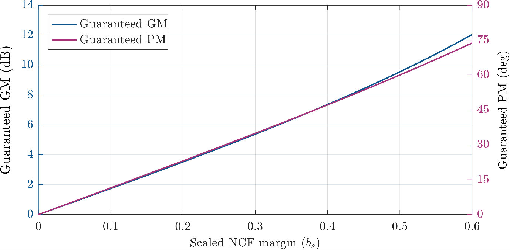

Figure 9~~9~~: A visual representation of the guaranteed lower bounds on Gain Margin and Phase Margin as a function of the scaled NCF margin, <mml:math xmlns:mml="http://www.w3.org/1998/Math/MathML" xmlns:m="http://schemas.openxmlformats.org/officeDocument/2006/math"><mml:msub><mml:mrow><mml:mi>b</mml:mi></mml:mrow><mml:mrow><mml:mi>s</mml:mi></mml:mrow></mml:msub></mml:math>

# 5-Controller Switching

Beyond monitoring stability, a key purpose for developing an online stability indicator is to improve the safety of RTHS experiments by enabling real-time protective actions, such as switching controllers when the current configuration approaches instability. By preventing catastrophic failures, this safety mechanism not only protects the specimen and testing equipment but also encourages the research community to explore more aggressive test configurations and novel control strategies, ultimately accelerating advances in the field. Therefore, this section analyzes the  stability of the system in preparation for and during such a controller transition, leveraging Lyapunov stability criteria to assess switching feasibility. Consider a general linear time-invariant (LTI) system with input,

<mml:math xmlns:mml="http://www.w3.org/1998/Math/MathML" xmlns:m="http://schemas.openxmlformats.org/officeDocument/2006/math"><mml:mtable><mml:mtr><mml:mtd><mml:mrow><mml:maligngroup/><mml:mover accent="true"><mml:mrow><mml:mi mathvariant="normal">x</mml:mi></mml:mrow><mml:mo>˙</mml:mo></mml:mover><mml:mfenced separators="|"><mml:mrow><mml:mi mathvariant="normal">t</mml:mi></mml:mrow></mml:mfenced><mml:mo>=</mml:mo><mml:mi> </mml:mi><mml:mi>A</mml:mi><mml:mi>x</mml:mi><mml:mfenced separators="|"><mml:mrow><mml:mi mathvariant="normal">t</mml:mi></mml:mrow></mml:mfenced><mml:mo>+</mml:mo><mml:mi> </mml:mi><mml:mi>B</mml:mi><mml:mi>u</mml:mi><mml:mfenced separators="|"><mml:mrow><mml:mi>t</mml:mi></mml:mrow></mml:mfenced><mml:mi> </mml:mi><mml:mo>#</mml:mo><mml:mfenced separators="|"><mml:mrow><mml:mi mathvariant="normal"> </mml:mi><mml:mi mathvariant="normal">S</mml:mi><mml:mi mathvariant="normal">E</mml:mi><mml:mi mathvariant="normal">Q</mml:mi><mml:mi mathvariant="normal"> </mml:mi><mml:mi mathvariant="normal">E</mml:mi><mml:mi mathvariant="normal">q</mml:mi><mml:mi mathvariant="normal">u</mml:mi><mml:mi mathvariant="normal">a</mml:mi><mml:mi mathvariant="normal">t</mml:mi><mml:mi mathvariant="normal">i</mml:mi><mml:mi mathvariant="normal">o</mml:mi><mml:mi mathvariant="normal">n</mml:mi><mml:mi mathvariant="normal"> </mml:mi><mml:mo>\</mml:mo><mml:mi mathvariant="normal">*</mml:mi><mml:mi mathvariant="normal"> </mml:mi><mml:mi mathvariant="normal">A</mml:mi><mml:mi mathvariant="normal">R</mml:mi><mml:mi mathvariant="normal">A</mml:mi><mml:mi mathvariant="normal">B</mml:mi><mml:mi mathvariant="normal">I</mml:mi><mml:mi mathvariant="normal">C</mml:mi><mml:mi mathvariant="normal"> </mml:mi><mml:mo>\</mml:mo><mml:mi mathvariant="normal">*</mml:mi><mml:mi mathvariant="normal"> </mml:mi><mml:mi mathvariant="normal">M</mml:mi><mml:mi mathvariant="normal">E</mml:mi><mml:mi mathvariant="normal">R</mml:mi><mml:mi mathvariant="normal">G</mml:mi><mml:mi mathvariant="normal">E</mml:mi><mml:mi mathvariant="normal">F</mml:mi><mml:mi mathvariant="normal">O</mml:mi><mml:mi mathvariant="normal">R</mml:mi><mml:mi mathvariant="normal">M</mml:mi><mml:mi mathvariant="normal">A</mml:mi><mml:mi mathvariant="normal">T</mml:mi><mml:mi mathvariant="normal"> </mml:mi><mml:mn>41</mml:mn></mml:mrow></mml:mfenced></mml:mrow></mml:mtd></mml:mtr></mml:mtable></mml:math>

Note that, although here we are looking at a general state space system, equation <mml:math xmlns:mml="http://www.w3.org/1998/Math/MathML" xmlns:m="http://schemas.openxmlformats.org/officeDocument/2006/math"><mml:mn>41</mml:mn><mml:mn>41</mml:mn></mml:math> is representative of the closed-loop RTHS transfer system. Since stability is an internal system characteristic and independent of the input, only the unforced response is considered by setting the input to zero, <mml:math xmlns:mml="http://www.w3.org/1998/Math/MathML" xmlns:m="http://schemas.openxmlformats.org/officeDocument/2006/math"><mml:mi>u</mml:mi><mml:mfenced separators="|"><mml:mrow><mml:mi>t</mml:mi></mml:mrow></mml:mfenced><mml:mo>=</mml:mo><mml:mn>0</mml:mn></mml:math>:

<mml:math xmlns:mml="http://www.w3.org/1998/Math/MathML" xmlns:m="http://schemas.openxmlformats.org/officeDocument/2006/math"><mml:mtable><mml:mtr><mml:mtd><mml:mrow><mml:maligngroup/><mml:mover accent="true"><mml:mrow><mml:mi mathvariant="normal">x</mml:mi></mml:mrow><mml:mo>˙</mml:mo></mml:mover><mml:mfenced separators="|"><mml:mrow><mml:mi mathvariant="normal">t</mml:mi></mml:mrow></mml:mfenced><mml:mo>=</mml:mo><mml:mi> </mml:mi><mml:mi>A</mml:mi><mml:mi>x</mml:mi><mml:mfenced separators="|"><mml:mrow><mml:mi mathvariant="normal">t</mml:mi></mml:mrow></mml:mfenced><mml:mo>#</mml:mo><mml:mfenced separators="|"><mml:mrow><mml:mi mathvariant="normal"> </mml:mi><mml:mi mathvariant="normal">S</mml:mi><mml:mi mathvariant="normal">E</mml:mi><mml:mi mathvariant="normal">Q</mml:mi><mml:mi mathvariant="normal"> </mml:mi><mml:mi mathvariant="normal">E</mml:mi><mml:mi mathvariant="normal">q</mml:mi><mml:mi mathvariant="normal">u</mml:mi><mml:mi mathvariant="normal">a</mml:mi><mml:mi mathvariant="normal">t</mml:mi><mml:mi mathvariant="normal">i</mml:mi><mml:mi mathvariant="normal">o</mml:mi><mml:mi mathvariant="normal">n</mml:mi><mml:mi mathvariant="normal"> </mml:mi><mml:mo>\</mml:mo><mml:mi mathvariant="normal">*</mml:mi><mml:mi mathvariant="normal"> </mml:mi><mml:mi mathvariant="normal">A</mml:mi><mml:mi mathvariant="normal">R</mml:mi><mml:mi mathvariant="normal">A</mml:mi><mml:mi mathvariant="normal">B</mml:mi><mml:mi mathvariant="normal">I</mml:mi><mml:mi mathvariant="normal">C</mml:mi><mml:mi mathvariant="normal"> </mml:mi><mml:mo>\</mml:mo><mml:mi mathvariant="normal">*</mml:mi><mml:mi mathvariant="normal"> </mml:mi><mml:mi mathvariant="normal">M</mml:mi><mml:mi mathvariant="normal">E</mml:mi><mml:mi mathvariant="normal">R</mml:mi><mml:mi mathvariant="normal">G</mml:mi><mml:mi mathvariant="normal">E</mml:mi><mml:mi mathvariant="normal">F</mml:mi><mml:mi mathvariant="normal">O</mml:mi><mml:mi mathvariant="normal">R</mml:mi><mml:mi mathvariant="normal">M</mml:mi><mml:mi mathvariant="normal">A</mml:mi><mml:mi mathvariant="normal">T</mml:mi><mml:mi mathvariant="normal"> </mml:mi><mml:mn>42</mml:mn></mml:mrow></mml:mfenced></mml:mrow></mml:mtd></mml:mtr></mml:mtable></mml:math>

Choose a quadratic Lyapunov candidate with a symmetric positive definite matrix <mml:math xmlns:mml="http://www.w3.org/1998/Math/MathML" xmlns:m="http://schemas.openxmlformats.org/officeDocument/2006/math"><mml:mi mathvariant="bold">P</mml:mi></mml:math>** **[45]:

<mml:math xmlns:mml="http://www.w3.org/1998/Math/MathML" xmlns:m="http://schemas.openxmlformats.org/officeDocument/2006/math"><mml:mtable><mml:mtr><mml:mtd><mml:mrow><mml:maligngroup/><mml:mi>V</mml:mi><mml:mfenced separators="|"><mml:mrow><mml:mi>x</mml:mi></mml:mrow></mml:mfenced><mml:mo>=</mml:mo><mml:mi> </mml:mi><mml:mi>x</mml:mi><mml:mi>ᵀ</mml:mi><mml:mi> </mml:mi><mml:mi>P</mml:mi><mml:mi>x</mml:mi><mml:mo>,</mml:mo><mml:mi> </mml:mi><mml:mi> </mml:mi><mml:mi>P</mml:mi><mml:mi> </mml:mi><mml:mo>=</mml:mo><mml:mi> </mml:mi><mml:mi>P</mml:mi><mml:mi>ᵀ</mml:mi><mml:mi> </mml:mi><mml:mo>≻</mml:mo><mml:mi> </mml:mi><mml:mn>0</mml:mn><mml:mo>#</mml:mo><mml:mfenced separators="|"><mml:mrow><mml:mi mathvariant="normal"> </mml:mi><mml:mi mathvariant="normal">S</mml:mi><mml:mi mathvariant="normal">E</mml:mi><mml:mi mathvariant="normal">Q</mml:mi><mml:mi mathvariant="normal"> </mml:mi><mml:mi mathvariant="normal">E</mml:mi><mml:mi mathvariant="normal">q</mml:mi><mml:mi mathvariant="normal">u</mml:mi><mml:mi mathvariant="normal">a</mml:mi><mml:mi mathvariant="normal">t</mml:mi><mml:mi mathvariant="normal">i</mml:mi><mml:mi mathvariant="normal">o</mml:mi><mml:mi mathvariant="normal">n</mml:mi><mml:mi mathvariant="normal"> </mml:mi><mml:mo>\</mml:mo><mml:mi mathvariant="normal">*</mml:mi><mml:mi mathvariant="normal"> </mml:mi><mml:mi mathvariant="normal">A</mml:mi><mml:mi mathvariant="normal">R</mml:mi><mml:mi mathvariant="normal">A</mml:mi><mml:mi mathvariant="normal">B</mml:mi><mml:mi mathvariant="normal">I</mml:mi><mml:mi mathvariant="normal">C</mml:mi><mml:mi mathvariant="normal"> </mml:mi><mml:mo>\</mml:mo><mml:mi mathvariant="normal">*</mml:mi><mml:mi mathvariant="normal"> </mml:mi><mml:mi mathvariant="normal">M</mml:mi><mml:mi mathvariant="normal">E</mml:mi><mml:mi mathvariant="normal">R</mml:mi><mml:mi mathvariant="normal">G</mml:mi><mml:mi mathvariant="normal">E</mml:mi><mml:mi mathvariant="normal">F</mml:mi><mml:mi mathvariant="normal">O</mml:mi><mml:mi mathvariant="normal">R</mml:mi><mml:mi mathvariant="normal">M</mml:mi><mml:mi mathvariant="normal">A</mml:mi><mml:mi mathvariant="normal">T</mml:mi><mml:mi mathvariant="normal"> </mml:mi><mml:mn>43</mml:mn></mml:mrow></mml:mfenced></mml:mrow></mml:mtd></mml:mtr></mml:mtable></mml:math>

Using the product rule, the derivative is:

<mml:math xmlns:mml="http://www.w3.org/1998/Math/MathML" xmlns:m="http://schemas.openxmlformats.org/officeDocument/2006/math"><mml:mtable><mml:mtr><mml:mtd><mml:mrow><mml:maligngroup/><mml:mover accent="true"><mml:mrow><mml:mi>V</mml:mi></mml:mrow><mml:mo>˙</mml:mo></mml:mover><mml:mfenced separators="|"><mml:mrow><mml:mi>x</mml:mi></mml:mrow></mml:mfenced><mml:mo>=</mml:mo><mml:mi> </mml:mi><mml:msup><mml:mrow><mml:mover accent="true"><mml:mrow><mml:mi mathvariant="normal">x</mml:mi></mml:mrow><mml:mo>˙</mml:mo></mml:mover></mml:mrow><mml:mrow><mml:mi mathvariant="normal">T</mml:mi></mml:mrow></mml:msup><mml:mi>P</mml:mi><mml:mi> </mml:mi><mml:mi>x</mml:mi><mml:mi> </mml:mi><mml:mo>+</mml:mo><mml:mi> </mml:mi><mml:msup><mml:mrow><mml:mi mathvariant="normal">x</mml:mi></mml:mrow><mml:mrow><mml:mi mathvariant="normal">T</mml:mi></mml:mrow></mml:msup><mml:mi>P</mml:mi><mml:mi> </mml:mi><mml:mover accent="true"><mml:mrow><mml:mi mathvariant="normal">x</mml:mi><mml:mi mathvariant="normal"> </mml:mi></mml:mrow><mml:mo>˙</mml:mo></mml:mover><mml:mo>#</mml:mo><mml:mfenced separators="|"><mml:mrow><mml:mi mathvariant="normal"> </mml:mi><mml:mi mathvariant="normal">S</mml:mi><mml:mi mathvariant="normal">E</mml:mi><mml:mi mathvariant="normal">Q</mml:mi><mml:mi mathvariant="normal"> </mml:mi><mml:mi mathvariant="normal">E</mml:mi><mml:mi mathvariant="normal">q</mml:mi><mml:mi mathvariant="normal">u</mml:mi><mml:mi mathvariant="normal">a</mml:mi><mml:mi mathvariant="normal">t</mml:mi><mml:mi mathvariant="normal">i</mml:mi><mml:mi mathvariant="normal">o</mml:mi><mml:mi mathvariant="normal">n</mml:mi><mml:mi mathvariant="normal"> </mml:mi><mml:mo>\</mml:mo><mml:mi mathvariant="normal">*</mml:mi><mml:mi mathvariant="normal"> </mml:mi><mml:mi mathvariant="normal">A</mml:mi><mml:mi mathvariant="normal">R</mml:mi><mml:mi mathvariant="normal">A</mml:mi><mml:mi mathvariant="normal">B</mml:mi><mml:mi mathvariant="normal">I</mml:mi><mml:mi mathvariant="normal">C</mml:mi><mml:mi mathvariant="normal"> </mml:mi><mml:mo>\</mml:mo><mml:mi mathvariant="normal">*</mml:mi><mml:mi mathvariant="normal"> </mml:mi><mml:mi mathvariant="normal">M</mml:mi><mml:mi mathvariant="normal">E</mml:mi><mml:mi mathvariant="normal">R</mml:mi><mml:mi mathvariant="normal">G</mml:mi><mml:mi mathvariant="normal">E</mml:mi><mml:mi mathvariant="normal">F</mml:mi><mml:mi mathvariant="normal">O</mml:mi><mml:mi mathvariant="normal">R</mml:mi><mml:mi mathvariant="normal">M</mml:mi><mml:mi mathvariant="normal">A</mml:mi><mml:mi mathvariant="normal">T</mml:mi><mml:mi mathvariant="normal"> </mml:mi><mml:mn>44</mml:mn></mml:mrow></mml:mfenced></mml:mrow></mml:mtd></mml:mtr></mml:mtable></mml:math>

Substituting  <mml:math xmlns:mml="http://www.w3.org/1998/Math/MathML" xmlns:m="http://schemas.openxmlformats.org/officeDocument/2006/math"><mml:mover accent="true"><mml:mrow><mml:mi>x</mml:mi></mml:mrow><mml:mo>˙</mml:mo></mml:mover><mml:mo>=</mml:mo><mml:mi mathvariant="bold">A</mml:mi><mml:mi>x</mml:mi></mml:math> yields:

<mml:math xmlns:mml="http://www.w3.org/1998/Math/MathML" xmlns:m="http://schemas.openxmlformats.org/officeDocument/2006/math"><mml:mtable><mml:mtr><mml:mtd><mml:mrow><mml:maligngroup/><mml:mover accent="true"><mml:mrow><mml:mi>V</mml:mi></mml:mrow><mml:mo>˙</mml:mo></mml:mover><mml:mfenced separators="|"><mml:mrow><mml:mi>x</mml:mi></mml:mrow></mml:mfenced><mml:mo>=</mml:mo><mml:mi>x</mml:mi><mml:mi>ᵀ</mml:mi><mml:mfenced separators="|"><mml:mrow><mml:mi mathvariant="bold">A</mml:mi><mml:mi mathvariant="bold">ᵀ</mml:mi><mml:mi mathvariant="bold">P</mml:mi><mml:mo>+</mml:mo><mml:mi mathvariant="bold">P</mml:mi><mml:mi mathvariant="bold">A</mml:mi></mml:mrow></mml:mfenced><mml:mi>x</mml:mi><mml:mi> </mml:mi><mml:mo>#</mml:mo><mml:mfenced separators="|"><mml:mrow><mml:mi mathvariant="normal"> </mml:mi><mml:mi mathvariant="normal">S</mml:mi><mml:mi mathvariant="normal">E</mml:mi><mml:mi mathvariant="normal">Q</mml:mi><mml:mi mathvariant="normal"> </mml:mi><mml:mi mathvariant="normal">E</mml:mi><mml:mi mathvariant="normal">q</mml:mi><mml:mi mathvariant="normal">u</mml:mi><mml:mi mathvariant="normal">a</mml:mi><mml:mi mathvariant="normal">t</mml:mi><mml:mi mathvariant="normal">i</mml:mi><mml:mi mathvariant="normal">o</mml:mi><mml:mi mathvariant="normal">n</mml:mi><mml:mi mathvariant="normal"> </mml:mi><mml:mo>\</mml:mo><mml:mi mathvariant="normal">*</mml:mi><mml:mi mathvariant="normal"> </mml:mi><mml:mi mathvariant="normal">A</mml:mi><mml:mi mathvariant="normal">R</mml:mi><mml:mi mathvariant="normal">A</mml:mi><mml:mi mathvariant="normal">B</mml:mi><mml:mi mathvariant="normal">I</mml:mi><mml:mi mathvariant="normal">C</mml:mi><mml:mi mathvariant="normal"> </mml:mi><mml:mo>\</mml:mo><mml:mi mathvariant="normal">*</mml:mi><mml:mi mathvariant="normal"> </mml:mi><mml:mi mathvariant="normal">M</mml:mi><mml:mi mathvariant="normal">E</mml:mi><mml:mi mathvariant="normal">R</mml:mi><mml:mi mathvariant="normal">G</mml:mi><mml:mi mathvariant="normal">E</mml:mi><mml:mi mathvariant="normal">F</mml:mi><mml:mi mathvariant="normal">O</mml:mi><mml:mi mathvariant="normal">R</mml:mi><mml:mi mathvariant="normal">M</mml:mi><mml:mi mathvariant="normal">A</mml:mi><mml:mi mathvariant="normal">T</mml:mi><mml:mi mathvariant="normal"> </mml:mi><mml:mn>45</mml:mn></mml:mrow></mml:mfenced></mml:mrow></mml:mtd></mml:mtr></mml:mtable></mml:math>

Thus, the Lyapunov condition is:

<mml:math xmlns:mml="http://www.w3.org/1998/Math/MathML" xmlns:m="http://schemas.openxmlformats.org/officeDocument/2006/math"><mml:mtable><mml:mtr><mml:mtd><mml:mrow><mml:maligngroup/><mml:mi>A</mml:mi><mml:mi>ᵀ</mml:mi><mml:mi> </mml:mi><mml:mi>P</mml:mi><mml:mi> </mml:mi><mml:mo>+</mml:mo><mml:mi> </mml:mi><mml:mi>P</mml:mi><mml:mi>A</mml:mi><mml:mi> </mml:mi><mml:mo>≺</mml:mo><mml:mi> </mml:mi><mml:mn>0</mml:mn><mml:mi> </mml:mi><mml:mo>#</mml:mo><mml:mfenced separators="|"><mml:mrow><mml:mi mathvariant="normal"> </mml:mi><mml:mi mathvariant="normal">S</mml:mi><mml:mi mathvariant="normal">E</mml:mi><mml:mi mathvariant="normal">Q</mml:mi><mml:mi mathvariant="normal"> </mml:mi><mml:mi mathvariant="normal">E</mml:mi><mml:mi mathvariant="normal">q</mml:mi><mml:mi mathvariant="normal">u</mml:mi><mml:mi mathvariant="normal">a</mml:mi><mml:mi mathvariant="normal">t</mml:mi><mml:mi mathvariant="normal">i</mml:mi><mml:mi mathvariant="normal">o</mml:mi><mml:mi mathvariant="normal">n</mml:mi><mml:mi mathvariant="normal"> </mml:mi><mml:mo>\</mml:mo><mml:mi mathvariant="normal">*</mml:mi><mml:mi mathvariant="normal"> </mml:mi><mml:mi mathvariant="normal">A</mml:mi><mml:mi mathvariant="normal">R</mml:mi><mml:mi mathvariant="normal">A</mml:mi><mml:mi mathvariant="normal">B</mml:mi><mml:mi mathvariant="normal">I</mml:mi><mml:mi mathvariant="normal">C</mml:mi><mml:mi mathvariant="normal"> </mml:mi><mml:mo>\</mml:mo><mml:mi mathvariant="normal">*</mml:mi><mml:mi mathvariant="normal"> </mml:mi><mml:mi mathvariant="normal">M</mml:mi><mml:mi mathvariant="normal">E</mml:mi><mml:mi mathvariant="normal">R</mml:mi><mml:mi mathvariant="normal">G</mml:mi><mml:mi mathvariant="normal">E</mml:mi><mml:mi mathvariant="normal">F</mml:mi><mml:mi mathvariant="normal">O</mml:mi><mml:mi mathvariant="normal">R</mml:mi><mml:mi mathvariant="normal">M</mml:mi><mml:mi mathvariant="normal">A</mml:mi><mml:mi mathvariant="normal">T</mml:mi><mml:mi mathvariant="normal"> </mml:mi><mml:mn>46</mml:mn></mml:mrow></mml:mfenced></mml:mrow></mml:mtd></mml:mtr></mml:mtable></mml:math>

with <mml:math xmlns:mml="http://www.w3.org/1998/Math/MathML" xmlns:m="http://schemas.openxmlformats.org/officeDocument/2006/math"><mml:mi mathvariant="bold">A</mml:mi></mml:math> being the closed-loop system matrix, the system is asymptotically stable if a symmetric positive definite matrix <mml:math xmlns:mml="http://www.w3.org/1998/Math/MathML" xmlns:m="http://schemas.openxmlformats.org/officeDocument/2006/math"><mml:mi mathvariant="bold">P</mml:mi></mml:math> exists that satisfies this Lyapunov inequality.

Because the controller transition occurs over a short time interval, the plant dynamics are assumed to be approximately constant during the switch. The closed-loop system is then constructed from the state-space realizations of the plant and controller, denoted by subscripts <mml:math xmlns:mml="http://www.w3.org/1998/Math/MathML" xmlns:m="http://schemas.openxmlformats.org/officeDocument/2006/math"><mml:mi>T</mml:mi></mml:math> and <mml:math xmlns:mml="http://www.w3.org/1998/Math/MathML" xmlns:m="http://schemas.openxmlformats.org/officeDocument/2006/math"><mml:mi>C</mml:mi></mml:math>, respectively. With no direct feedthrough in the physical plant, the plant state-space model is:

<mml:math xmlns:mml="http://www.w3.org/1998/Math/MathML" xmlns:m="http://schemas.openxmlformats.org/officeDocument/2006/math"><mml:mtable><mml:mtr><mml:mtd><mml:mrow><mml:maligngroup/><mml:msub><mml:mrow><mml:mover accent="true"><mml:mrow><mml:mi mathvariant="normal">x</mml:mi></mml:mrow><mml:mo>˙</mml:mo></mml:mover></mml:mrow><mml:mrow><mml:mi mathvariant="normal">T</mml:mi></mml:mrow></mml:msub><mml:mi> </mml:mi><mml:mo>=</mml:mo><mml:mi> </mml:mi><mml:msub><mml:mrow><mml:mi mathvariant="bold">A</mml:mi></mml:mrow><mml:mrow><mml:mi mathvariant="bold">T</mml:mi></mml:mrow></mml:msub><mml:mi> </mml:mi><mml:msub><mml:mrow><mml:mi mathvariant="normal">x</mml:mi></mml:mrow><mml:mrow><mml:mi mathvariant="normal">T</mml:mi></mml:mrow></mml:msub><mml:mo>+</mml:mo><mml:mi> </mml:mi><mml:msub><mml:mrow><mml:mi mathvariant="bold">B</mml:mi></mml:mrow><mml:mrow><mml:mi mathvariant="bold">T</mml:mi></mml:mrow></mml:msub><mml:mi> </mml:mi><mml:msub><mml:mrow><mml:mi mathvariant="normal">y</mml:mi></mml:mrow><mml:mrow><mml:mi mathvariant="normal">C</mml:mi></mml:mrow></mml:msub><mml:mi> </mml:mi><mml:mo>#</mml:mo><mml:mfenced separators="|"><mml:mrow><mml:mi mathvariant="normal"> </mml:mi><mml:mi mathvariant="normal">S</mml:mi><mml:mi mathvariant="normal">E</mml:mi><mml:mi mathvariant="normal">Q</mml:mi><mml:mi mathvariant="normal"> </mml:mi><mml:mi mathvariant="normal">E</mml:mi><mml:mi mathvariant="normal">q</mml:mi><mml:mi mathvariant="normal">u</mml:mi><mml:mi mathvariant="normal">a</mml:mi><mml:mi mathvariant="normal">t</mml:mi><mml:mi mathvariant="normal">i</mml:mi><mml:mi mathvariant="normal">o</mml:mi><mml:mi mathvariant="normal">n</mml:mi><mml:mi mathvariant="normal"> </mml:mi><mml:mo>\</mml:mo><mml:mi mathvariant="normal">*</mml:mi><mml:mi mathvariant="normal"> </mml:mi><mml:mi mathvariant="normal">A</mml:mi><mml:mi mathvariant="normal">R</mml:mi><mml:mi mathvariant="normal">A</mml:mi><mml:mi mathvariant="normal">B</mml:mi><mml:mi mathvariant="normal">I</mml:mi><mml:mi mathvariant="normal">C</mml:mi><mml:mi mathvariant="normal"> </mml:mi><mml:mo>\</mml:mo><mml:mi mathvariant="normal">*</mml:mi><mml:mi mathvariant="normal"> </mml:mi><mml:mi mathvariant="normal">M</mml:mi><mml:mi mathvariant="normal">E</mml:mi><mml:mi mathvariant="normal">R</mml:mi><mml:mi mathvariant="normal">G</mml:mi><mml:mi mathvariant="normal">E</mml:mi><mml:mi mathvariant="normal">F</mml:mi><mml:mi mathvariant="normal">O</mml:mi><mml:mi mathvariant="normal">R</mml:mi><mml:mi mathvariant="normal">M</mml:mi><mml:mi mathvariant="normal">A</mml:mi><mml:mi mathvariant="normal">T</mml:mi><mml:mi mathvariant="normal"> </mml:mi><mml:mn>47</mml:mn></mml:mrow></mml:mfenced></mml:mrow></mml:mtd></mml:mtr></mml:mtable></mml:math>

<mml:math xmlns:mml="http://www.w3.org/1998/Math/MathML" xmlns:m="http://schemas.openxmlformats.org/officeDocument/2006/math"><mml:mtable><mml:mtr><mml:mtd><mml:mrow><mml:maligngroup/><mml:msub><mml:mrow><mml:mi>y</mml:mi></mml:mrow><mml:mrow><mml:mi>T</mml:mi></mml:mrow></mml:msub><mml:mi> </mml:mi><mml:mo>=</mml:mo><mml:mi> </mml:mi><mml:msub><mml:mrow><mml:mi mathvariant="bold">C</mml:mi></mml:mrow><mml:mrow><mml:mi mathvariant="bold">T</mml:mi></mml:mrow></mml:msub><mml:mi> </mml:mi><mml:msub><mml:mrow><mml:mi mathvariant="normal">x</mml:mi></mml:mrow><mml:mrow><mml:mi mathvariant="normal">T</mml:mi></mml:mrow></mml:msub><mml:mi> </mml:mi><mml:mi> </mml:mi><mml:mo>#</mml:mo><mml:mfenced separators="|"><mml:mrow><mml:mi mathvariant="normal"> </mml:mi><mml:mi mathvariant="normal">S</mml:mi><mml:mi mathvariant="normal">E</mml:mi><mml:mi mathvariant="normal">Q</mml:mi><mml:mi mathvariant="normal"> </mml:mi><mml:mi mathvariant="normal">E</mml:mi><mml:mi mathvariant="normal">q</mml:mi><mml:mi mathvariant="normal">u</mml:mi><mml:mi mathvariant="normal">a</mml:mi><mml:mi mathvariant="normal">t</mml:mi><mml:mi mathvariant="normal">i</mml:mi><mml:mi mathvariant="normal">o</mml:mi><mml:mi mathvariant="normal">n</mml:mi><mml:mi mathvariant="normal"> </mml:mi><mml:mo>\</mml:mo><mml:mi mathvariant="normal">*</mml:mi><mml:mi mathvariant="normal"> </mml:mi><mml:mi mathvariant="normal">A</mml:mi><mml:mi mathvariant="normal">R</mml:mi><mml:mi mathvariant="normal">A</mml:mi><mml:mi mathvariant="normal">B</mml:mi><mml:mi mathvariant="normal">I</mml:mi><mml:mi mathvariant="normal">C</mml:mi><mml:mi mathvariant="normal"> </mml:mi><mml:mo>\</mml:mo><mml:mi mathvariant="normal">*</mml:mi><mml:mi mathvariant="normal"> </mml:mi><mml:mi mathvariant="normal">M</mml:mi><mml:mi mathvariant="normal">E</mml:mi><mml:mi mathvariant="normal">R</mml:mi><mml:mi mathvariant="normal">G</mml:mi><mml:mi mathvariant="normal">E</mml:mi><mml:mi mathvariant="normal">F</mml:mi><mml:mi mathvariant="normal">O</mml:mi><mml:mi mathvariant="normal">R</mml:mi><mml:mi mathvariant="normal">M</mml:mi><mml:mi mathvariant="normal">A</mml:mi><mml:mi mathvariant="normal">T</mml:mi><mml:mi mathvariant="normal"> </mml:mi><mml:mn>48</mml:mn></mml:mrow></mml:mfenced></mml:mrow></mml:mtd></mml:mtr></mml:mtable></mml:math>

where <mml:math xmlns:mml="http://www.w3.org/1998/Math/MathML" xmlns:m="http://schemas.openxmlformats.org/officeDocument/2006/math"><mml:msub><mml:mrow><mml:mi>A</mml:mi></mml:mrow><mml:mrow><mml:mi>T</mml:mi></mml:mrow></mml:msub><mml:mo>,</mml:mo><mml:mi> </mml:mi><mml:msub><mml:mrow><mml:mi>B</mml:mi></mml:mrow><mml:mrow><mml:mi>T</mml:mi></mml:mrow></mml:msub><mml:mo>,</mml:mo></mml:math> and <mml:math xmlns:mml="http://www.w3.org/1998/Math/MathML" xmlns:m="http://schemas.openxmlformats.org/officeDocument/2006/math"><mml:msub><mml:mrow><mml:mi>C</mml:mi></mml:mrow><mml:mrow><mml:mi>T</mml:mi></mml:mrow></mml:msub></mml:math> are the state space realization for the plant T, <mml:math xmlns:mml="http://www.w3.org/1998/Math/MathML" xmlns:m="http://schemas.openxmlformats.org/officeDocument/2006/math"><mml:msub><mml:mrow><mml:mi mathvariant="normal">x</mml:mi></mml:mrow><mml:mrow><mml:mi>T</mml:mi></mml:mrow></mml:msub></mml:math> ​ is the plant state vector, <mml:math xmlns:mml="http://www.w3.org/1998/Math/MathML" xmlns:m="http://schemas.openxmlformats.org/officeDocument/2006/math"><mml:msub><mml:mrow><mml:mi>y</mml:mi></mml:mrow><mml:mrow><mml:mi>C</mml:mi></mml:mrow></mml:msub></mml:math> is the control signal, and <mml:math xmlns:mml="http://www.w3.org/1998/Math/MathML" xmlns:m="http://schemas.openxmlformats.org/officeDocument/2006/math"><mml:msub><mml:mrow><mml:mi>y</mml:mi></mml:mrow><mml:mrow><mml:mi>T</mml:mi></mml:mrow></mml:msub></mml:math> is the plant output. Similarly, for the controller:

<mml:math xmlns:mml="http://www.w3.org/1998/Math/MathML" xmlns:m="http://schemas.openxmlformats.org/officeDocument/2006/math"><mml:mtable><mml:mtr><mml:mtd><mml:mrow><mml:maligngroup/><mml:msub><mml:mrow><mml:mover accent="true"><mml:mrow><mml:mi mathvariant="normal">x</mml:mi></mml:mrow><mml:mo>˙</mml:mo></mml:mover></mml:mrow><mml:mrow><mml:mi mathvariant="normal">C</mml:mi></mml:mrow></mml:msub><mml:mi> </mml:mi><mml:mo>=</mml:mo><mml:mi> </mml:mi><mml:msub><mml:mrow><mml:mi mathvariant="bold">A</mml:mi></mml:mrow><mml:mrow><mml:mi mathvariant="bold">C</mml:mi></mml:mrow></mml:msub><mml:mi> </mml:mi><mml:msub><mml:mrow><mml:mi mathvariant="normal">x</mml:mi></mml:mrow><mml:mrow><mml:mi mathvariant="normal">C</mml:mi></mml:mrow></mml:msub><mml:mo>+</mml:mo><mml:mi> </mml:mi><mml:msub><mml:mrow><mml:mi mathvariant="bold">B</mml:mi></mml:mrow><mml:mrow><mml:mi mathvariant="bold">C</mml:mi></mml:mrow></mml:msub><mml:mi> </mml:mi><mml:mi>e</mml:mi><mml:mi> </mml:mi><mml:mo>#</mml:mo><mml:mfenced separators="|"><mml:mrow><mml:mi mathvariant="normal"> </mml:mi><mml:mi mathvariant="normal">S</mml:mi><mml:mi mathvariant="normal">E</mml:mi><mml:mi mathvariant="normal">Q</mml:mi><mml:mi mathvariant="normal"> </mml:mi><mml:mi mathvariant="normal">E</mml:mi><mml:mi mathvariant="normal">q</mml:mi><mml:mi mathvariant="normal">u</mml:mi><mml:mi mathvariant="normal">a</mml:mi><mml:mi mathvariant="normal">t</mml:mi><mml:mi mathvariant="normal">i</mml:mi><mml:mi mathvariant="normal">o</mml:mi><mml:mi mathvariant="normal">n</mml:mi><mml:mi mathvariant="normal"> </mml:mi><mml:mo>\</mml:mo><mml:mi mathvariant="normal">*</mml:mi><mml:mi mathvariant="normal"> </mml:mi><mml:mi mathvariant="normal">A</mml:mi><mml:mi mathvariant="normal">R</mml:mi><mml:mi mathvariant="normal">A</mml:mi><mml:mi mathvariant="normal">B</mml:mi><mml:mi mathvariant="normal">I</mml:mi><mml:mi mathvariant="normal">C</mml:mi><mml:mi mathvariant="normal"> </mml:mi><mml:mo>\</mml:mo><mml:mi mathvariant="normal">*</mml:mi><mml:mi mathvariant="normal"> </mml:mi><mml:mi mathvariant="normal">M</mml:mi><mml:mi mathvariant="normal">E</mml:mi><mml:mi mathvariant="normal">R</mml:mi><mml:mi mathvariant="normal">G</mml:mi><mml:mi mathvariant="normal">E</mml:mi><mml:mi mathvariant="normal">F</mml:mi><mml:mi mathvariant="normal">O</mml:mi><mml:mi mathvariant="normal">R</mml:mi><mml:mi mathvariant="normal">M</mml:mi><mml:mi mathvariant="normal">A</mml:mi><mml:mi mathvariant="normal">T</mml:mi><mml:mi mathvariant="normal"> </mml:mi><mml:mn>49</mml:mn></mml:mrow></mml:mfenced></mml:mrow></mml:mtd></mml:mtr></mml:mtable></mml:math>

<mml:math xmlns:mml="http://www.w3.org/1998/Math/MathML" xmlns:m="http://schemas.openxmlformats.org/officeDocument/2006/math"><mml:mtable><mml:mtr><mml:mtd><mml:mrow><mml:maligngroup/><mml:msub><mml:mrow><mml:mi>y</mml:mi></mml:mrow><mml:mrow><mml:mi>C</mml:mi></mml:mrow></mml:msub><mml:mi> </mml:mi><mml:mo>=</mml:mo><mml:mi> </mml:mi><mml:msub><mml:mrow><mml:mi mathvariant="bold">C</mml:mi></mml:mrow><mml:mrow><mml:mi mathvariant="bold">C</mml:mi></mml:mrow></mml:msub><mml:mi> </mml:mi><mml:msub><mml:mrow><mml:mi>x</mml:mi></mml:mrow><mml:mrow><mml:mi>C</mml:mi></mml:mrow></mml:msub><mml:mo>+</mml:mo><mml:mi> </mml:mi><mml:msub><mml:mrow><mml:mi mathvariant="bold">D</mml:mi></mml:mrow><mml:mrow><mml:mi mathvariant="bold">C</mml:mi></mml:mrow></mml:msub><mml:mi> </mml:mi><mml:mi>e</mml:mi><mml:mi> </mml:mi><mml:mo>#</mml:mo><mml:mfenced separators="|"><mml:mrow><mml:mi mathvariant="normal"> </mml:mi><mml:mi mathvariant="normal">S</mml:mi><mml:mi mathvariant="normal">E</mml:mi><mml:mi mathvariant="normal">Q</mml:mi><mml:mi mathvariant="normal"> </mml:mi><mml:mi mathvariant="normal">E</mml:mi><mml:mi mathvariant="normal">q</mml:mi><mml:mi mathvariant="normal">u</mml:mi><mml:mi mathvariant="normal">a</mml:mi><mml:mi mathvariant="normal">t</mml:mi><mml:mi mathvariant="normal">i</mml:mi><mml:mi mathvariant="normal">o</mml:mi><mml:mi mathvariant="normal">n</mml:mi><mml:mi mathvariant="normal"> </mml:mi><mml:mo>\</mml:mo><mml:mi mathvariant="normal">*</mml:mi><mml:mi mathvariant="normal"> </mml:mi><mml:mi mathvariant="normal">A</mml:mi><mml:mi mathvariant="normal">R</mml:mi><mml:mi mathvariant="normal">A</mml:mi><mml:mi mathvariant="normal">B</mml:mi><mml:mi mathvariant="normal">I</mml:mi><mml:mi mathvariant="normal">C</mml:mi><mml:mi mathvariant="normal"> </mml:mi><mml:mo>\</mml:mo><mml:mi mathvariant="normal">*</mml:mi><mml:mi mathvariant="normal"> </mml:mi><mml:mi mathvariant="normal">M</mml:mi><mml:mi mathvariant="normal">E</mml:mi><mml:mi mathvariant="normal">R</mml:mi><mml:mi mathvariant="normal">G</mml:mi><mml:mi mathvariant="normal">E</mml:mi><mml:mi mathvariant="normal">F</mml:mi><mml:mi mathvariant="normal">O</mml:mi><mml:mi mathvariant="normal">R</mml:mi><mml:mi mathvariant="normal">M</mml:mi><mml:mi mathvariant="normal">A</mml:mi><mml:mi mathvariant="normal">T</mml:mi><mml:mi mathvariant="normal"> </mml:mi><mml:mn>50</mml:mn></mml:mrow></mml:mfenced></mml:mrow></mml:mtd></mml:mtr></mml:mtable></mml:math>

where <mml:math xmlns:mml="http://www.w3.org/1998/Math/MathML" xmlns:m="http://schemas.openxmlformats.org/officeDocument/2006/math"><mml:msub><mml:mrow><mml:mi mathvariant="bold">A</mml:mi></mml:mrow><mml:mrow><mml:mi mathvariant="bold">C</mml:mi></mml:mrow></mml:msub><mml:mo>,</mml:mo><mml:mi mathvariant="bold"> </mml:mi><mml:msub><mml:mrow><mml:mi mathvariant="bold">B</mml:mi></mml:mrow><mml:mrow><mml:mi mathvariant="bold">C</mml:mi></mml:mrow></mml:msub><mml:mo>,</mml:mo><mml:mi mathvariant="bold"> </mml:mi><mml:msub><mml:mrow><mml:mi mathvariant="bold">C</mml:mi></mml:mrow><mml:mrow><mml:mi mathvariant="bold">C</mml:mi></mml:mrow></mml:msub><mml:mo>,</mml:mo><mml:mi> </mml:mi></mml:math>and <mml:math xmlns:mml="http://www.w3.org/1998/Math/MathML" xmlns:m="http://schemas.openxmlformats.org/officeDocument/2006/math"><mml:msub><mml:mrow><mml:mi mathvariant="bold">D</mml:mi></mml:mrow><mml:mrow><mml:mi mathvariant="bold">C</mml:mi></mml:mrow></mml:msub></mml:math> are the state space realization for the controller, <mml:math xmlns:mml="http://www.w3.org/1998/Math/MathML" xmlns:m="http://schemas.openxmlformats.org/officeDocument/2006/math"><mml:msub><mml:mrow><mml:mi mathvariant="normal">x</mml:mi></mml:mrow><mml:mrow><mml:mi>C</mml:mi></mml:mrow></mml:msub></mml:math> is the controller state vector, and <mml:math xmlns:mml="http://www.w3.org/1998/Math/MathML" xmlns:m="http://schemas.openxmlformats.org/officeDocument/2006/math"><mml:mi>e</mml:mi><mml:mo>=</mml:mo><mml:mi>r</mml:mi><mml:mo>-</mml:mo><mml:msub><mml:mrow><mml:mi>y</mml:mi></mml:mrow><mml:mrow><mml:mi>T</mml:mi></mml:mrow></mml:msub></mml:math> is the error signal, with <mml:math xmlns:mml="http://www.w3.org/1998/Math/MathML" xmlns:m="http://schemas.openxmlformats.org/officeDocument/2006/math"><mml:mi>r</mml:mi></mml:math> denoting the reference input. For stability analysis, the equation can be simplified by setting the reference signal to zero (r=0), which gives <mml:math xmlns:mml="http://www.w3.org/1998/Math/MathML" xmlns:m="http://schemas.openxmlformats.org/officeDocument/2006/math"><mml:mi>e</mml:mi><mml:mo>=</mml:mo><mml:mi>r</mml:mi><mml:mo>-</mml:mo><mml:msub><mml:mrow><mml:mi>y</mml:mi></mml:mrow><mml:mrow><mml:mi>T</mml:mi></mml:mrow></mml:msub><mml:mo>=</mml:mo><mml:mo>-</mml:mo><mml:msub><mml:mrow><mml:mi>y</mml:mi></mml:mrow><mml:mrow><mml:mi>T</mml:mi></mml:mrow></mml:msub></mml:math>. Substituting the plant output from Equation (<mml:math xmlns:mml="http://www.w3.org/1998/Math/MathML" xmlns:m="http://schemas.openxmlformats.org/officeDocument/2006/math"><mml:mn>48</mml:mn><mml:mn>48</mml:mn></mml:math>):

<mml:math xmlns:mml="http://www.w3.org/1998/Math/MathML" xmlns:m="http://schemas.openxmlformats.org/officeDocument/2006/math"><mml:mtable><mml:mtr><mml:mtd><mml:mrow><mml:maligngroup/><mml:mi> </mml:mi><mml:mi> </mml:mi><mml:mi>e</mml:mi><mml:mi> </mml:mi><mml:mo>=</mml:mo><mml:mi> </mml:mi><mml:mo>-</mml:mo><mml:mi> </mml:mi><mml:msub><mml:mrow><mml:mi mathvariant="bold">C</mml:mi></mml:mrow><mml:mrow><mml:mi mathvariant="bold">T</mml:mi></mml:mrow></mml:msub><mml:mi> </mml:mi><mml:msub><mml:mrow><mml:mi mathvariant="normal">x</mml:mi></mml:mrow><mml:mrow><mml:mi mathvariant="normal">T</mml:mi></mml:mrow></mml:msub><mml:mi> </mml:mi><mml:mo>#</mml:mo><mml:mfenced separators="|"><mml:mrow><mml:mi mathvariant="normal"> </mml:mi><mml:mi mathvariant="normal">S</mml:mi><mml:mi mathvariant="normal">E</mml:mi><mml:mi mathvariant="normal">Q</mml:mi><mml:mi mathvariant="normal"> </mml:mi><mml:mi mathvariant="normal">E</mml:mi><mml:mi mathvariant="normal">q</mml:mi><mml:mi mathvariant="normal">u</mml:mi><mml:mi mathvariant="normal">a</mml:mi><mml:mi mathvariant="normal">t</mml:mi><mml:mi mathvariant="normal">i</mml:mi><mml:mi mathvariant="normal">o</mml:mi><mml:mi mathvariant="normal">n</mml:mi><mml:mi mathvariant="normal"> </mml:mi><mml:mo>\</mml:mo><mml:mi mathvariant="normal">*</mml:mi><mml:mi mathvariant="normal"> </mml:mi><mml:mi mathvariant="normal">A</mml:mi><mml:mi mathvariant="normal">R</mml:mi><mml:mi mathvariant="normal">A</mml:mi><mml:mi mathvariant="normal">B</mml:mi><mml:mi mathvariant="normal">I</mml:mi><mml:mi mathvariant="normal">C</mml:mi><mml:mi mathvariant="normal"> </mml:mi><mml:mo>\</mml:mo><mml:mi mathvariant="normal">*</mml:mi><mml:mi mathvariant="normal"> </mml:mi><mml:mi mathvariant="normal">M</mml:mi><mml:mi mathvariant="normal">E</mml:mi><mml:mi mathvariant="normal">R</mml:mi><mml:mi mathvariant="normal">G</mml:mi><mml:mi mathvariant="normal">E</mml:mi><mml:mi mathvariant="normal">F</mml:mi><mml:mi mathvariant="normal">O</mml:mi><mml:mi mathvariant="normal">R</mml:mi><mml:mi mathvariant="normal">M</mml:mi><mml:mi mathvariant="normal">A</mml:mi><mml:mi mathvariant="normal">T</mml:mi><mml:mi mathvariant="normal"> </mml:mi><mml:mn>51</mml:mn></mml:mrow></mml:mfenced></mml:mrow></mml:mtd></mml:mtr></mml:mtable></mml:math>

Substituting <mml:math xmlns:mml="http://www.w3.org/1998/Math/MathML" xmlns:m="http://schemas.openxmlformats.org/officeDocument/2006/math"><mml:msub><mml:mrow><mml:mi>y</mml:mi></mml:mrow><mml:mrow><mml:mi>c</mml:mi></mml:mrow></mml:msub></mml:math> and <mml:math xmlns:mml="http://www.w3.org/1998/Math/MathML" xmlns:m="http://schemas.openxmlformats.org/officeDocument/2006/math"><mml:mi>e</mml:mi></mml:math> into Equations <mml:math xmlns:mml="http://www.w3.org/1998/Math/MathML" xmlns:m="http://schemas.openxmlformats.org/officeDocument/2006/math"><mml:mn>47</mml:mn><mml:mn>47</mml:mn></mml:math> and <mml:math xmlns:mml="http://www.w3.org/1998/Math/MathML" xmlns:m="http://schemas.openxmlformats.org/officeDocument/2006/math"><mml:mn>49</mml:mn><mml:mn>49</mml:mn></mml:math> yields:

<mml:math xmlns:mml="http://www.w3.org/1998/Math/MathML" xmlns:m="http://schemas.openxmlformats.org/officeDocument/2006/math"><mml:mtable><mml:mtr><mml:mtd><mml:mrow><mml:maligngroup/><mml:msub><mml:mrow><mml:mover accent="true"><mml:mrow><mml:mi mathvariant="normal">x</mml:mi></mml:mrow><mml:mo>˙</mml:mo></mml:mover></mml:mrow><mml:mrow><mml:mi mathvariant="normal">T</mml:mi></mml:mrow></mml:msub><mml:mo>=</mml:mo><mml:mi> </mml:mi><mml:msub><mml:mrow><mml:mi mathvariant="bold">A</mml:mi></mml:mrow><mml:mrow><mml:mi mathvariant="bold">T</mml:mi></mml:mrow></mml:msub><mml:msub><mml:mrow><mml:mi mathvariant="normal">x</mml:mi></mml:mrow><mml:mrow><mml:mi mathvariant="normal">T</mml:mi></mml:mrow></mml:msub><mml:mo>+</mml:mo><mml:mi> </mml:mi><mml:msub><mml:mrow><mml:mi mathvariant="bold">B</mml:mi></mml:mrow><mml:mrow><mml:mi mathvariant="bold">T</mml:mi></mml:mrow></mml:msub><mml:mfenced separators="|"><mml:mrow><mml:msub><mml:mrow><mml:mi mathvariant="bold">C</mml:mi></mml:mrow><mml:mrow><mml:mi mathvariant="bold">C</mml:mi></mml:mrow></mml:msub><mml:msub><mml:mrow><mml:mi mathvariant="normal">x</mml:mi></mml:mrow><mml:mrow><mml:mi mathvariant="normal">C</mml:mi></mml:mrow></mml:msub><mml:mo>+</mml:mo><mml:mi mathvariant="normal"> </mml:mi><mml:msub><mml:mrow><mml:mi mathvariant="bold">D</mml:mi></mml:mrow><mml:mrow><mml:mi mathvariant="bold">C</mml:mi></mml:mrow></mml:msub><mml:mi mathvariant="normal">e</mml:mi></mml:mrow></mml:mfenced><mml:mo>=</mml:mo><mml:mi> </mml:mi><mml:mfenced separators="|"><mml:mrow><mml:msub><mml:mrow><mml:mi mathvariant="bold">A</mml:mi></mml:mrow><mml:mrow><mml:mi mathvariant="bold">T</mml:mi></mml:mrow></mml:msub><mml:mo>-</mml:mo><mml:mi mathvariant="normal"> </mml:mi><mml:msub><mml:mrow><mml:mi mathvariant="bold">B</mml:mi></mml:mrow><mml:mrow><mml:mi mathvariant="bold">T</mml:mi></mml:mrow></mml:msub><mml:msub><mml:mrow><mml:mi mathvariant="bold">D</mml:mi></mml:mrow><mml:mrow><mml:mi mathvariant="bold">C</mml:mi></mml:mrow></mml:msub><mml:msub><mml:mrow><mml:mi mathvariant="bold">C</mml:mi></mml:mrow><mml:mrow><mml:mi mathvariant="bold">T</mml:mi></mml:mrow></mml:msub></mml:mrow></mml:mfenced><mml:msub><mml:mrow><mml:mi mathvariant="normal">x</mml:mi></mml:mrow><mml:mrow><mml:mi mathvariant="normal">T</mml:mi></mml:mrow></mml:msub><mml:mo>+</mml:mo><mml:mi> </mml:mi><mml:msub><mml:mrow><mml:mi mathvariant="bold">B</mml:mi></mml:mrow><mml:mrow><mml:mi mathvariant="bold">T</mml:mi></mml:mrow></mml:msub><mml:msub><mml:mrow><mml:mi mathvariant="bold">C</mml:mi></mml:mrow><mml:mrow><mml:mi mathvariant="bold">C</mml:mi></mml:mrow></mml:msub><mml:msub><mml:mrow><mml:mi mathvariant="normal">x</mml:mi></mml:mrow><mml:mrow><mml:mi mathvariant="normal">C</mml:mi></mml:mrow></mml:msub><mml:mo>#</mml:mo><mml:mfenced separators="|"><mml:mrow><mml:mi mathvariant="normal"> </mml:mi><mml:mi mathvariant="normal">S</mml:mi><mml:mi mathvariant="normal">E</mml:mi><mml:mi mathvariant="normal">Q</mml:mi><mml:mi mathvariant="normal"> </mml:mi><mml:mi mathvariant="normal">E</mml:mi><mml:mi mathvariant="normal">q</mml:mi><mml:mi mathvariant="normal">u</mml:mi><mml:mi mathvariant="normal">a</mml:mi><mml:mi mathvariant="normal">t</mml:mi><mml:mi mathvariant="normal">i</mml:mi><mml:mi mathvariant="normal">o</mml:mi><mml:mi mathvariant="normal">n</mml:mi><mml:mi mathvariant="normal"> </mml:mi><mml:mo>\</mml:mo><mml:mi mathvariant="normal">*</mml:mi><mml:mi mathvariant="normal"> </mml:mi><mml:mi mathvariant="normal">A</mml:mi><mml:mi mathvariant="normal">R</mml:mi><mml:mi mathvariant="normal">A</mml:mi><mml:mi mathvariant="normal">B</mml:mi><mml:mi mathvariant="normal">I</mml:mi><mml:mi mathvariant="normal">C</mml:mi><mml:mi mathvariant="normal"> </mml:mi><mml:mo>\</mml:mo><mml:mi mathvariant="normal">*</mml:mi><mml:mi mathvariant="normal"> </mml:mi><mml:mi mathvariant="normal">M</mml:mi><mml:mi mathvariant="normal">E</mml:mi><mml:mi mathvariant="normal">R</mml:mi><mml:mi mathvariant="normal">G</mml:mi><mml:mi mathvariant="normal">E</mml:mi><mml:mi mathvariant="normal">F</mml:mi><mml:mi mathvariant="normal">O</mml:mi><mml:mi mathvariant="normal">R</mml:mi><mml:mi mathvariant="normal">M</mml:mi><mml:mi mathvariant="normal">A</mml:mi><mml:mi mathvariant="normal">T</mml:mi><mml:mi mathvariant="normal"> </mml:mi><mml:mn>52</mml:mn></mml:mrow></mml:mfenced></mml:mrow></mml:mtd></mml:mtr></mml:mtable></mml:math>

<mml:math xmlns:mml="http://www.w3.org/1998/Math/MathML" xmlns:m="http://schemas.openxmlformats.org/officeDocument/2006/math"><mml:mtable><mml:mtr><mml:mtd><mml:mrow><mml:maligngroup/><mml:msub><mml:mrow><mml:mover accent="true"><mml:mrow><mml:mi mathvariant="normal">x</mml:mi></mml:mrow><mml:mo>˙</mml:mo></mml:mover></mml:mrow><mml:mrow><mml:mi mathvariant="normal">C</mml:mi></mml:mrow></mml:msub><mml:mo>=</mml:mo><mml:mi> </mml:mi><mml:msub><mml:mrow><mml:mi mathvariant="bold">A</mml:mi></mml:mrow><mml:mrow><mml:mi mathvariant="bold">C</mml:mi></mml:mrow></mml:msub><mml:msub><mml:mrow><mml:mi mathvariant="normal">x</mml:mi></mml:mrow><mml:mrow><mml:mi mathvariant="normal">C</mml:mi></mml:mrow></mml:msub><mml:mo>+</mml:mo><mml:mi> </mml:mi><mml:msub><mml:mrow><mml:mi mathvariant="bold">B</mml:mi></mml:mrow><mml:mrow><mml:mi mathvariant="bold">C</mml:mi></mml:mrow></mml:msub><mml:mi>e</mml:mi><mml:mi> </mml:mi><mml:mo>=</mml:mo><mml:mi> </mml:mi><mml:mo>-</mml:mo><mml:msub><mml:mrow><mml:mi mathvariant="bold">B</mml:mi></mml:mrow><mml:mrow><mml:mi mathvariant="bold">C</mml:mi></mml:mrow></mml:msub><mml:msub><mml:mrow><mml:mi mathvariant="bold">C</mml:mi></mml:mrow><mml:mrow><mml:mi mathvariant="bold">T</mml:mi></mml:mrow></mml:msub><mml:msub><mml:mrow><mml:mi mathvariant="normal">x</mml:mi></mml:mrow><mml:mrow><mml:mi mathvariant="normal">T</mml:mi></mml:mrow></mml:msub><mml:mo>+</mml:mo><mml:mi> </mml:mi><mml:msub><mml:mrow><mml:mi mathvariant="bold">A</mml:mi></mml:mrow><mml:mrow><mml:mi mathvariant="bold">C</mml:mi></mml:mrow></mml:msub><mml:msub><mml:mrow><mml:mi mathvariant="normal">x</mml:mi></mml:mrow><mml:mrow><mml:mi mathvariant="normal">C</mml:mi></mml:mrow></mml:msub><mml:mo>#</mml:mo><mml:mfenced separators="|"><mml:mrow><mml:mi mathvariant="normal"> </mml:mi><mml:mi mathvariant="normal">S</mml:mi><mml:mi mathvariant="normal">E</mml:mi><mml:mi mathvariant="normal">Q</mml:mi><mml:mi mathvariant="normal"> </mml:mi><mml:mi mathvariant="normal">E</mml:mi><mml:mi mathvariant="normal">q</mml:mi><mml:mi mathvariant="normal">u</mml:mi><mml:mi mathvariant="normal">a</mml:mi><mml:mi mathvariant="normal">t</mml:mi><mml:mi mathvariant="normal">i</mml:mi><mml:mi mathvariant="normal">o</mml:mi><mml:mi mathvariant="normal">n</mml:mi><mml:mi mathvariant="normal"> </mml:mi><mml:mo>\</mml:mo><mml:mi mathvariant="normal">*</mml:mi><mml:mi mathvariant="normal"> </mml:mi><mml:mi mathvariant="normal">A</mml:mi><mml:mi mathvariant="normal">R</mml:mi><mml:mi mathvariant="normal">A</mml:mi><mml:mi mathvariant="normal">B</mml:mi><mml:mi mathvariant="normal">I</mml:mi><mml:mi mathvariant="normal">C</mml:mi><mml:mi mathvariant="normal"> </mml:mi><mml:mo>\</mml:mo><mml:mi mathvariant="normal">*</mml:mi><mml:mi mathvariant="normal"> </mml:mi><mml:mi mathvariant="normal">M</mml:mi><mml:mi mathvariant="normal">E</mml:mi><mml:mi mathvariant="normal">R</mml:mi><mml:mi mathvariant="normal">G</mml:mi><mml:mi mathvariant="normal">E</mml:mi><mml:mi mathvariant="normal">F</mml:mi><mml:mi mathvariant="normal">O</mml:mi><mml:mi mathvariant="normal">R</mml:mi><mml:mi mathvariant="normal">M</mml:mi><mml:mi mathvariant="normal">A</mml:mi><mml:mi mathvariant="normal">T</mml:mi><mml:mi mathvariant="normal"> </mml:mi><mml:mn>53</mml:mn></mml:mrow></mml:mfenced></mml:mrow></mml:mtd></mml:mtr></mml:mtable></mml:math>

Stacking the plant and controller states into a single state vector yields

<mml:math xmlns:mml="http://www.w3.org/1998/Math/MathML" xmlns:m="http://schemas.openxmlformats.org/officeDocument/2006/math"><mml:mtable><mml:mtr><mml:mtd><mml:mrow><mml:maligngroup/><mml:mfenced open="[" close="]" separators="|"><mml:mrow><mml:mtable><mml:mtr><mml:mtd><mml:msub><mml:mrow><mml:mover accent="true"><mml:mrow><mml:mi mathvariant="normal">x</mml:mi></mml:mrow><mml:mo>˙</mml:mo></mml:mover></mml:mrow><mml:mrow><mml:mi mathvariant="normal">T</mml:mi></mml:mrow></mml:msub></mml:mtd></mml:mtr><mml:mtr><mml:mtd><mml:msub><mml:mrow><mml:mover accent="true"><mml:mrow><mml:mi mathvariant="normal">x</mml:mi></mml:mrow><mml:mo>˙</mml:mo></mml:mover></mml:mrow><mml:mrow><mml:mi mathvariant="normal">C</mml:mi></mml:mrow></mml:msub></mml:mtd></mml:mtr></mml:mtable></mml:mrow></mml:mfenced><mml:mo>=</mml:mo><mml:mi> </mml:mi><mml:msub><mml:mrow><mml:mi mathvariant="bold">A</mml:mi></mml:mrow><mml:mrow><mml:mi mathvariant="bold">c</mml:mi><mml:mi mathvariant="bold">l</mml:mi></mml:mrow></mml:msub><mml:mfenced open="[" close="]" separators="|"><mml:mrow><mml:mtable><mml:mtr><mml:mtd><mml:msub><mml:mrow><mml:mi mathvariant="normal">x</mml:mi></mml:mrow><mml:mrow><mml:mi mathvariant="normal">T</mml:mi></mml:mrow></mml:msub></mml:mtd></mml:mtr><mml:mtr><mml:mtd><mml:msub><mml:mrow><mml:mi mathvariant="normal">x</mml:mi></mml:mrow><mml:mrow><mml:mi mathvariant="normal">C</mml:mi></mml:mrow></mml:msub></mml:mtd></mml:mtr></mml:mtable></mml:mrow></mml:mfenced><mml:mi> </mml:mi><mml:mo>#</mml:mo><mml:mfenced separators="|"><mml:mrow><mml:mi mathvariant="normal"> </mml:mi><mml:mi mathvariant="normal">S</mml:mi><mml:mi mathvariant="normal">E</mml:mi><mml:mi mathvariant="normal">Q</mml:mi><mml:mi mathvariant="normal"> </mml:mi><mml:mi mathvariant="normal">E</mml:mi><mml:mi mathvariant="normal">q</mml:mi><mml:mi mathvariant="normal">u</mml:mi><mml:mi mathvariant="normal">a</mml:mi><mml:mi mathvariant="normal">t</mml:mi><mml:mi mathvariant="normal">i</mml:mi><mml:mi mathvariant="normal">o</mml:mi><mml:mi mathvariant="normal">n</mml:mi><mml:mi mathvariant="normal"> </mml:mi><mml:mo>\</mml:mo><mml:mi mathvariant="normal">*</mml:mi><mml:mi mathvariant="normal"> </mml:mi><mml:mi mathvariant="normal">A</mml:mi><mml:mi mathvariant="normal">R</mml:mi><mml:mi mathvariant="normal">A</mml:mi><mml:mi mathvariant="normal">B</mml:mi><mml:mi mathvariant="normal">I</mml:mi><mml:mi mathvariant="normal">C</mml:mi><mml:mi mathvariant="normal"> </mml:mi><mml:mo>\</mml:mo><mml:mi mathvariant="normal">*</mml:mi><mml:mi mathvariant="normal"> </mml:mi><mml:mi mathvariant="normal">M</mml:mi><mml:mi mathvariant="normal">E</mml:mi><mml:mi mathvariant="normal">R</mml:mi><mml:mi mathvariant="normal">G</mml:mi><mml:mi mathvariant="normal">E</mml:mi><mml:mi mathvariant="normal">F</mml:mi><mml:mi mathvariant="normal">O</mml:mi><mml:mi mathvariant="normal">R</mml:mi><mml:mi mathvariant="normal">M</mml:mi><mml:mi mathvariant="normal">A</mml:mi><mml:mi mathvariant="normal">T</mml:mi><mml:mi mathvariant="normal"> </mml:mi><mml:mn>54</mml:mn></mml:mrow></mml:mfenced></mml:mrow></mml:mtd></mml:mtr></mml:mtable></mml:math>

The closed-loop state-space realization is given by:

<mml:math xmlns:mml="http://www.w3.org/1998/Math/MathML" xmlns:m="http://schemas.openxmlformats.org/officeDocument/2006/math"><mml:mtable><mml:mtr><mml:mtd><mml:mrow><mml:maligngroup/><mml:msub><mml:mrow><mml:mi mathvariant="bold">A</mml:mi></mml:mrow><mml:mrow><mml:mi mathvariant="bold">c</mml:mi><mml:mi mathvariant="bold">l</mml:mi></mml:mrow></mml:msub><mml:mo>=</mml:mo><mml:mi> </mml:mi><mml:mfenced open="[" close="]" separators="|"><mml:mrow><mml:mtable><mml:mtr><mml:mtd><mml:msub><mml:mrow><mml:mi mathvariant="bold">A</mml:mi></mml:mrow><mml:mrow><mml:mi mathvariant="bold">T</mml:mi></mml:mrow></mml:msub><mml:mo>-</mml:mo><mml:msub><mml:mrow><mml:mi mathvariant="bold">B</mml:mi></mml:mrow><mml:mrow><mml:mi mathvariant="bold">T</mml:mi></mml:mrow></mml:msub><mml:msub><mml:mrow><mml:mi mathvariant="bold">D</mml:mi></mml:mrow><mml:mrow><mml:mi mathvariant="bold">C</mml:mi></mml:mrow></mml:msub><mml:msub><mml:mrow><mml:mi mathvariant="bold">C</mml:mi></mml:mrow><mml:mrow><mml:mi mathvariant="bold">T</mml:mi></mml:mrow></mml:msub></mml:mtd><mml:mtd><mml:msub><mml:mrow><mml:mi mathvariant="bold">B</mml:mi></mml:mrow><mml:mrow><mml:mi mathvariant="bold">T</mml:mi></mml:mrow></mml:msub><mml:msub><mml:mrow><mml:mi mathvariant="bold">C</mml:mi></mml:mrow><mml:mrow><mml:mi mathvariant="bold">C</mml:mi></mml:mrow></mml:msub></mml:mtd></mml:mtr><mml:mtr><mml:mtd><mml:mo>-</mml:mo><mml:mi mathvariant="bold"> </mml:mi><mml:msub><mml:mrow><mml:mi mathvariant="bold">B</mml:mi></mml:mrow><mml:mrow><mml:mi mathvariant="bold">C</mml:mi></mml:mrow></mml:msub><mml:msub><mml:mrow><mml:mi mathvariant="bold">C</mml:mi></mml:mrow><mml:mrow><mml:mi mathvariant="bold">T</mml:mi></mml:mrow></mml:msub></mml:mtd><mml:mtd><mml:msub><mml:mrow><mml:mi mathvariant="bold">A</mml:mi></mml:mrow><mml:mrow><mml:mi mathvariant="bold">C</mml:mi></mml:mrow></mml:msub></mml:mtd></mml:mtr></mml:mtable></mml:mrow></mml:mfenced><mml:mo>#</mml:mo><mml:mfenced separators="|"><mml:mrow><mml:mi mathvariant="normal"> </mml:mi><mml:mi mathvariant="normal">S</mml:mi><mml:mi mathvariant="normal">E</mml:mi><mml:mi mathvariant="normal">Q</mml:mi><mml:mi mathvariant="normal"> </mml:mi><mml:mi mathvariant="normal">E</mml:mi><mml:mi mathvariant="normal">q</mml:mi><mml:mi mathvariant="normal">u</mml:mi><mml:mi mathvariant="normal">a</mml:mi><mml:mi mathvariant="normal">t</mml:mi><mml:mi mathvariant="normal">i</mml:mi><mml:mi mathvariant="normal">o</mml:mi><mml:mi mathvariant="normal">n</mml:mi><mml:mi mathvariant="normal"> </mml:mi><mml:mo>\</mml:mo><mml:mi mathvariant="normal">*</mml:mi><mml:mi mathvariant="normal"> </mml:mi><mml:mi mathvariant="normal">A</mml:mi><mml:mi mathvariant="normal">R</mml:mi><mml:mi mathvariant="normal">A</mml:mi><mml:mi mathvariant="normal">B</mml:mi><mml:mi mathvariant="normal">I</mml:mi><mml:mi mathvariant="normal">C</mml:mi><mml:mi mathvariant="normal"> </mml:mi><mml:mo>\</mml:mo><mml:mi mathvariant="normal">*</mml:mi><mml:mi mathvariant="normal"> </mml:mi><mml:mi mathvariant="normal">M</mml:mi><mml:mi mathvariant="normal">E</mml:mi><mml:mi mathvariant="normal">R</mml:mi><mml:mi mathvariant="normal">G</mml:mi><mml:mi mathvariant="normal">E</mml:mi><mml:mi mathvariant="normal">F</mml:mi><mml:mi mathvariant="normal">O</mml:mi><mml:mi mathvariant="normal">R</mml:mi><mml:mi mathvariant="normal">M</mml:mi><mml:mi mathvariant="normal">A</mml:mi><mml:mi mathvariant="normal">T</mml:mi><mml:mi mathvariant="normal"> </mml:mi><mml:mn>55</mml:mn></mml:mrow></mml:mfenced></mml:mrow></mml:mtd></mml:mtr></mml:mtable></mml:math>

Now consider a combined controller <mml:math xmlns:mml="http://www.w3.org/1998/Math/MathML" xmlns:m="http://schemas.openxmlformats.org/officeDocument/2006/math"><mml:msub><mml:mrow><mml:mi>C</mml:mi></mml:mrow><mml:mrow><mml:mi>c</mml:mi><mml:mi>o</mml:mi><mml:mi>m</mml:mi><mml:mi>b</mml:mi></mml:mrow></mml:msub></mml:math>  consisting of a convex combination of two controllers <mml:math xmlns:mml="http://www.w3.org/1998/Math/MathML" xmlns:m="http://schemas.openxmlformats.org/officeDocument/2006/math"><mml:mi>C</mml:mi><mml:mn>1</mml:mn></mml:math>  and <mml:math xmlns:mml="http://www.w3.org/1998/Math/MathML" xmlns:m="http://schemas.openxmlformats.org/officeDocument/2006/math"><mml:mi>C</mml:mi><mml:mn>2</mml:mn></mml:math>:

<mml:math xmlns:mml="http://www.w3.org/1998/Math/MathML" xmlns:m="http://schemas.openxmlformats.org/officeDocument/2006/math"><mml:mtable><mml:mtr><mml:mtd><mml:mrow><mml:maligngroup/><mml:msub><mml:mrow><mml:mi mathvariant="bold">A</mml:mi></mml:mrow><mml:mrow><mml:mi mathvariant="bold">c</mml:mi><mml:mi mathvariant="bold">o</mml:mi><mml:mi mathvariant="bold">m</mml:mi><mml:mi mathvariant="bold">b</mml:mi></mml:mrow></mml:msub><mml:mo>=</mml:mo><mml:mi> </mml:mi><mml:mi>γ</mml:mi><mml:mi> </mml:mi><mml:msub><mml:mrow><mml:mi mathvariant="bold">A</mml:mi></mml:mrow><mml:mrow><mml:mi mathvariant="bold">C</mml:mi><mml:mn>1</mml:mn></mml:mrow></mml:msub><mml:mo>+</mml:mo><mml:mi> </mml:mi><mml:mfenced separators="|"><mml:mrow><mml:mn>1</mml:mn><mml:mo>-</mml:mo><mml:mi>γ</mml:mi></mml:mrow></mml:mfenced><mml:msub><mml:mrow><mml:mi mathvariant="bold">A</mml:mi></mml:mrow><mml:mrow><mml:mi mathvariant="bold">C</mml:mi><mml:mn>2</mml:mn></mml:mrow></mml:msub><mml:mo>#</mml:mo><mml:mfenced separators="|"><mml:mrow><mml:mi mathvariant="normal"> </mml:mi><mml:mi mathvariant="normal">S</mml:mi><mml:mi mathvariant="normal">E</mml:mi><mml:mi mathvariant="normal">Q</mml:mi><mml:mi mathvariant="normal"> </mml:mi><mml:mi mathvariant="normal">E</mml:mi><mml:mi mathvariant="normal">q</mml:mi><mml:mi mathvariant="normal">u</mml:mi><mml:mi mathvariant="normal">a</mml:mi><mml:mi mathvariant="normal">t</mml:mi><mml:mi mathvariant="normal">i</mml:mi><mml:mi mathvariant="normal">o</mml:mi><mml:mi mathvariant="normal">n</mml:mi><mml:mi mathvariant="normal"> </mml:mi><mml:mo>\</mml:mo><mml:mi mathvariant="normal">*</mml:mi><mml:mi mathvariant="normal"> </mml:mi><mml:mi mathvariant="normal">A</mml:mi><mml:mi mathvariant="normal">R</mml:mi><mml:mi mathvariant="normal">A</mml:mi><mml:mi mathvariant="normal">B</mml:mi><mml:mi mathvariant="normal">I</mml:mi><mml:mi mathvariant="normal">C</mml:mi><mml:mi mathvariant="normal"> </mml:mi><mml:mo>\</mml:mo><mml:mi mathvariant="normal">*</mml:mi><mml:mi mathvariant="normal"> </mml:mi><mml:mi mathvariant="normal">M</mml:mi><mml:mi mathvariant="normal">E</mml:mi><mml:mi mathvariant="normal">R</mml:mi><mml:mi mathvariant="normal">G</mml:mi><mml:mi mathvariant="normal">E</mml:mi><mml:mi mathvariant="normal">F</mml:mi><mml:mi mathvariant="normal">O</mml:mi><mml:mi mathvariant="normal">R</mml:mi><mml:mi mathvariant="normal">M</mml:mi><mml:mi mathvariant="normal">A</mml:mi><mml:mi mathvariant="normal">T</mml:mi><mml:mi mathvariant="normal"> </mml:mi><mml:mn>56</mml:mn></mml:mrow></mml:mfenced></mml:mrow></mml:mtd></mml:mtr></mml:mtable></mml:math>

<mml:math xmlns:mml="http://www.w3.org/1998/Math/MathML" xmlns:m="http://schemas.openxmlformats.org/officeDocument/2006/math"><mml:mtable><mml:mtr><mml:mtd><mml:mrow><mml:maligngroup/><mml:msub><mml:mrow><mml:mi mathvariant="bold">B</mml:mi></mml:mrow><mml:mrow><mml:mi mathvariant="bold">c</mml:mi><mml:mi mathvariant="bold">o</mml:mi><mml:mi mathvariant="bold">m</mml:mi><mml:mi mathvariant="bold">b</mml:mi></mml:mrow></mml:msub><mml:mo>=</mml:mo><mml:mi> </mml:mi><mml:mi>γ</mml:mi><mml:mi> </mml:mi><mml:msub><mml:mrow><mml:mi mathvariant="bold">B</mml:mi></mml:mrow><mml:mrow><mml:mi mathvariant="bold">C</mml:mi><mml:mn>1</mml:mn></mml:mrow></mml:msub><mml:mo>+</mml:mo><mml:mi> </mml:mi><mml:mfenced separators="|"><mml:mrow><mml:mn>1</mml:mn><mml:mo>-</mml:mo><mml:mi>γ</mml:mi></mml:mrow></mml:mfenced><mml:msub><mml:mrow><mml:mi mathvariant="bold">B</mml:mi></mml:mrow><mml:mrow><mml:mi mathvariant="bold">C</mml:mi><mml:mn>2</mml:mn></mml:mrow></mml:msub><mml:mo>#</mml:mo><mml:mfenced separators="|"><mml:mrow><mml:mi mathvariant="normal"> </mml:mi><mml:mi mathvariant="normal">S</mml:mi><mml:mi mathvariant="normal">E</mml:mi><mml:mi mathvariant="normal">Q</mml:mi><mml:mi mathvariant="normal"> </mml:mi><mml:mi mathvariant="normal">E</mml:mi><mml:mi mathvariant="normal">q</mml:mi><mml:mi mathvariant="normal">u</mml:mi><mml:mi mathvariant="normal">a</mml:mi><mml:mi mathvariant="normal">t</mml:mi><mml:mi mathvariant="normal">i</mml:mi><mml:mi mathvariant="normal">o</mml:mi><mml:mi mathvariant="normal">n</mml:mi><mml:mi mathvariant="normal"> </mml:mi><mml:mo>\</mml:mo><mml:mi mathvariant="normal">*</mml:mi><mml:mi mathvariant="normal"> </mml:mi><mml:mi mathvariant="normal">A</mml:mi><mml:mi mathvariant="normal">R</mml:mi><mml:mi mathvariant="normal">A</mml:mi><mml:mi mathvariant="normal">B</mml:mi><mml:mi mathvariant="normal">I</mml:mi><mml:mi mathvariant="normal">C</mml:mi><mml:mi mathvariant="normal"> </mml:mi><mml:mo>\</mml:mo><mml:mi mathvariant="normal">*</mml:mi><mml:mi mathvariant="normal"> </mml:mi><mml:mi mathvariant="normal">M</mml:mi><mml:mi mathvariant="normal">E</mml:mi><mml:mi mathvariant="normal">R</mml:mi><mml:mi mathvariant="normal">G</mml:mi><mml:mi mathvariant="normal">E</mml:mi><mml:mi mathvariant="normal">F</mml:mi><mml:mi mathvariant="normal">O</mml:mi><mml:mi mathvariant="normal">R</mml:mi><mml:mi mathvariant="normal">M</mml:mi><mml:mi mathvariant="normal">A</mml:mi><mml:mi mathvariant="normal">T</mml:mi><mml:mi mathvariant="normal"> </mml:mi><mml:mn>57</mml:mn></mml:mrow></mml:mfenced></mml:mrow></mml:mtd></mml:mtr></mml:mtable></mml:math>

<mml:math xmlns:mml="http://www.w3.org/1998/Math/MathML" xmlns:m="http://schemas.openxmlformats.org/officeDocument/2006/math"><mml:mtable><mml:mtr><mml:mtd><mml:mrow><mml:maligngroup/><mml:msub><mml:mrow><mml:mi mathvariant="bold">C</mml:mi></mml:mrow><mml:mrow><mml:mi mathvariant="bold">c</mml:mi><mml:mi mathvariant="bold">o</mml:mi><mml:mi mathvariant="bold">m</mml:mi><mml:mi mathvariant="bold">b</mml:mi></mml:mrow></mml:msub><mml:mo>=</mml:mo><mml:mi> </mml:mi><mml:mi>γ</mml:mi><mml:mi> </mml:mi><mml:msub><mml:mrow><mml:mi mathvariant="bold">C</mml:mi></mml:mrow><mml:mrow><mml:mi mathvariant="bold">C</mml:mi><mml:mn>1</mml:mn></mml:mrow></mml:msub><mml:mo>+</mml:mo><mml:mi> </mml:mi><mml:mfenced separators="|"><mml:mrow><mml:mn>1</mml:mn><mml:mo>-</mml:mo><mml:mi>γ</mml:mi></mml:mrow></mml:mfenced><mml:msub><mml:mrow><mml:mi mathvariant="bold">C</mml:mi></mml:mrow><mml:mrow><mml:mi mathvariant="bold">C</mml:mi><mml:mn>2</mml:mn></mml:mrow></mml:msub><mml:mo>#</mml:mo><mml:mfenced separators="|"><mml:mrow><mml:mi mathvariant="normal"> </mml:mi><mml:mi mathvariant="normal">S</mml:mi><mml:mi mathvariant="normal">E</mml:mi><mml:mi mathvariant="normal">Q</mml:mi><mml:mi mathvariant="normal"> </mml:mi><mml:mi mathvariant="normal">E</mml:mi><mml:mi mathvariant="normal">q</mml:mi><mml:mi mathvariant="normal">u</mml:mi><mml:mi mathvariant="normal">a</mml:mi><mml:mi mathvariant="normal">t</mml:mi><mml:mi mathvariant="normal">i</mml:mi><mml:mi mathvariant="normal">o</mml:mi><mml:mi mathvariant="normal">n</mml:mi><mml:mi mathvariant="normal"> </mml:mi><mml:mo>\</mml:mo><mml:mi mathvariant="normal">*</mml:mi><mml:mi mathvariant="normal"> </mml:mi><mml:mi mathvariant="normal">A</mml:mi><mml:mi mathvariant="normal">R</mml:mi><mml:mi mathvariant="normal">A</mml:mi><mml:mi mathvariant="normal">B</mml:mi><mml:mi mathvariant="normal">I</mml:mi><mml:mi mathvariant="normal">C</mml:mi><mml:mi mathvariant="normal"> </mml:mi><mml:mo>\</mml:mo><mml:mi mathvariant="normal">*</mml:mi><mml:mi mathvariant="normal"> </mml:mi><mml:mi mathvariant="normal">M</mml:mi><mml:mi mathvariant="normal">E</mml:mi><mml:mi mathvariant="normal">R</mml:mi><mml:mi mathvariant="normal">G</mml:mi><mml:mi mathvariant="normal">E</mml:mi><mml:mi mathvariant="normal">F</mml:mi><mml:mi mathvariant="normal">O</mml:mi><mml:mi mathvariant="normal">R</mml:mi><mml:mi mathvariant="normal">M</mml:mi><mml:mi mathvariant="normal">A</mml:mi><mml:mi mathvariant="normal">T</mml:mi><mml:mi mathvariant="normal"> </mml:mi><mml:mn>58</mml:mn></mml:mrow></mml:mfenced></mml:mrow></mml:mtd></mml:mtr></mml:mtable></mml:math>

<mml:math xmlns:mml="http://www.w3.org/1998/Math/MathML" xmlns:m="http://schemas.openxmlformats.org/officeDocument/2006/math"><mml:mtable><mml:mtr><mml:mtd><mml:mrow><mml:maligngroup/><mml:msub><mml:mrow><mml:mi mathvariant="bold">D</mml:mi></mml:mrow><mml:mrow><mml:mi mathvariant="bold">c</mml:mi><mml:mi mathvariant="bold">o</mml:mi><mml:mi mathvariant="bold">m</mml:mi><mml:mi mathvariant="bold">b</mml:mi></mml:mrow></mml:msub><mml:mo>=</mml:mo><mml:mi> </mml:mi><mml:mi>γ</mml:mi><mml:mi> </mml:mi><mml:msub><mml:mrow><mml:mi mathvariant="bold">D</mml:mi></mml:mrow><mml:mrow><mml:mi mathvariant="bold">C</mml:mi><mml:mn>1</mml:mn></mml:mrow></mml:msub><mml:mo>+</mml:mo><mml:mi> </mml:mi><mml:mfenced separators="|"><mml:mrow><mml:mn>1</mml:mn><mml:mo>-</mml:mo><mml:mi>γ</mml:mi></mml:mrow></mml:mfenced><mml:msub><mml:mrow><mml:mi mathvariant="bold">D</mml:mi></mml:mrow><mml:mrow><mml:mi mathvariant="bold">C</mml:mi><mml:mn>2</mml:mn></mml:mrow></mml:msub><mml:mo>#</mml:mo><mml:mfenced separators="|"><mml:mrow><mml:mi mathvariant="normal"> </mml:mi><mml:mi mathvariant="normal">S</mml:mi><mml:mi mathvariant="normal">E</mml:mi><mml:mi mathvariant="normal">Q</mml:mi><mml:mi mathvariant="normal"> </mml:mi><mml:mi mathvariant="normal">E</mml:mi><mml:mi mathvariant="normal">q</mml:mi><mml:mi mathvariant="normal">u</mml:mi><mml:mi mathvariant="normal">a</mml:mi><mml:mi mathvariant="normal">t</mml:mi><mml:mi mathvariant="normal">i</mml:mi><mml:mi mathvariant="normal">o</mml:mi><mml:mi mathvariant="normal">n</mml:mi><mml:mi mathvariant="normal"> </mml:mi><mml:mo>\</mml:mo><mml:mi mathvariant="normal">*</mml:mi><mml:mi mathvariant="normal"> </mml:mi><mml:mi mathvariant="normal">A</mml:mi><mml:mi mathvariant="normal">R</mml:mi><mml:mi mathvariant="normal">A</mml:mi><mml:mi mathvariant="normal">B</mml:mi><mml:mi mathvariant="normal">I</mml:mi><mml:mi mathvariant="normal">C</mml:mi><mml:mi mathvariant="normal"> </mml:mi><mml:mo>\</mml:mo><mml:mi mathvariant="normal">*</mml:mi><mml:mi mathvariant="normal"> </mml:mi><mml:mi mathvariant="normal">M</mml:mi><mml:mi mathvariant="normal">E</mml:mi><mml:mi mathvariant="normal">R</mml:mi><mml:mi mathvariant="normal">G</mml:mi><mml:mi mathvariant="normal">E</mml:mi><mml:mi mathvariant="normal">F</mml:mi><mml:mi mathvariant="normal">O</mml:mi><mml:mi mathvariant="normal">R</mml:mi><mml:mi mathvariant="normal">M</mml:mi><mml:mi mathvariant="normal">A</mml:mi><mml:mi mathvariant="normal">T</mml:mi><mml:mi mathvariant="normal"> </mml:mi><mml:mn>59</mml:mn></mml:mrow></mml:mfenced></mml:mrow></mml:mtd></mml:mtr></mml:mtable></mml:math>

By substituting Equations (<mml:math xmlns:mml="http://www.w3.org/1998/Math/MathML" xmlns:m="http://schemas.openxmlformats.org/officeDocument/2006/math"><mml:mn>56</mml:mn><mml:mn>56</mml:mn></mml:math>-<mml:math xmlns:mml="http://www.w3.org/1998/Math/MathML" xmlns:m="http://schemas.openxmlformats.org/officeDocument/2006/math"><mml:mn>59</mml:mn><mml:mn>59</mml:mn></mml:math>) into Equation (<mml:math xmlns:mml="http://www.w3.org/1998/Math/MathML" xmlns:m="http://schemas.openxmlformats.org/officeDocument/2006/math"><mml:mn>56</mml:mn><mml:mn>56</mml:mn></mml:math>), the following is obtained:

<mml:math xmlns:mml="http://www.w3.org/1998/Math/MathML" xmlns:m="http://schemas.openxmlformats.org/officeDocument/2006/math"><mml:mtable><mml:mtr><mml:mtd><mml:mrow><mml:maligngroup/><mml:msub><mml:mrow><mml:mi mathvariant="bold">A</mml:mi></mml:mrow><mml:mrow><mml:mi mathvariant="bold">c</mml:mi><mml:mi mathvariant="bold">l</mml:mi><mml:mo>,</mml:mo><mml:mi mathvariant="bold">c</mml:mi><mml:mi mathvariant="bold">o</mml:mi><mml:mi mathvariant="bold">m</mml:mi><mml:mi mathvariant="bold">b</mml:mi></mml:mrow></mml:msub><mml:mo>=</mml:mo><mml:mi> </mml:mi><mml:mfenced open="[" close="]" separators="|"><mml:mrow><mml:mtable><mml:mtr><mml:mtd><mml:msub><mml:mrow><mml:mi mathvariant="bold">A</mml:mi></mml:mrow><mml:mrow><mml:mi mathvariant="bold">T</mml:mi></mml:mrow></mml:msub><mml:mo>-</mml:mo><mml:msub><mml:mrow><mml:mi mathvariant="bold">B</mml:mi></mml:mrow><mml:mrow><mml:mi mathvariant="bold">T</mml:mi></mml:mrow></mml:msub><mml:msub><mml:mrow><mml:mi mathvariant="bold">D</mml:mi></mml:mrow><mml:mrow><mml:mi mathvariant="bold">C</mml:mi><mml:mi mathvariant="bold">o</mml:mi><mml:mi mathvariant="bold">m</mml:mi><mml:mi mathvariant="bold">b</mml:mi></mml:mrow></mml:msub><mml:msub><mml:mrow><mml:mi mathvariant="bold">C</mml:mi></mml:mrow><mml:mrow><mml:mi mathvariant="bold">T</mml:mi></mml:mrow></mml:msub></mml:mtd><mml:mtd><mml:msub><mml:mrow><mml:mi mathvariant="bold">B</mml:mi></mml:mrow><mml:mrow><mml:mi mathvariant="bold">T</mml:mi></mml:mrow></mml:msub><mml:msub><mml:mrow><mml:mi mathvariant="bold">C</mml:mi></mml:mrow><mml:mrow><mml:mi mathvariant="bold">C</mml:mi><mml:mi mathvariant="bold">o</mml:mi><mml:mi mathvariant="bold">m</mml:mi><mml:mi mathvariant="bold">b</mml:mi></mml:mrow></mml:msub></mml:mtd></mml:mtr><mml:mtr><mml:mtd><mml:mo>-</mml:mo><mml:mi mathvariant="bold"> </mml:mi><mml:msub><mml:mrow><mml:mi mathvariant="bold">B</mml:mi></mml:mrow><mml:mrow><mml:mi mathvariant="bold">C</mml:mi><mml:mi mathvariant="bold">o</mml:mi><mml:mi mathvariant="bold">m</mml:mi><mml:mi mathvariant="bold">b</mml:mi></mml:mrow></mml:msub><mml:msub><mml:mrow><mml:mi mathvariant="bold">C</mml:mi></mml:mrow><mml:mrow><mml:mi mathvariant="bold">T</mml:mi></mml:mrow></mml:msub></mml:mtd><mml:mtd><mml:msub><mml:mrow><mml:mi mathvariant="bold">A</mml:mi></mml:mrow><mml:mrow><mml:mi mathvariant="bold">C</mml:mi><mml:mi mathvariant="bold">o</mml:mi><mml:mi mathvariant="bold">m</mml:mi><mml:mi mathvariant="bold">b</mml:mi></mml:mrow></mml:msub></mml:mtd></mml:mtr></mml:mtable></mml:mrow></mml:mfenced><mml:mo>#</mml:mo><mml:mfenced separators="|"><mml:mrow><mml:mi mathvariant="normal"> </mml:mi><mml:mi mathvariant="normal">S</mml:mi><mml:mi mathvariant="normal">E</mml:mi><mml:mi mathvariant="normal">Q</mml:mi><mml:mi mathvariant="normal"> </mml:mi><mml:mi mathvariant="normal">E</mml:mi><mml:mi mathvariant="normal">q</mml:mi><mml:mi mathvariant="normal">u</mml:mi><mml:mi mathvariant="normal">a</mml:mi><mml:mi mathvariant="normal">t</mml:mi><mml:mi mathvariant="normal">i</mml:mi><mml:mi mathvariant="normal">o</mml:mi><mml:mi mathvariant="normal">n</mml:mi><mml:mi mathvariant="normal"> </mml:mi><mml:mo>\</mml:mo><mml:mi mathvariant="normal">*</mml:mi><mml:mi mathvariant="normal"> </mml:mi><mml:mi mathvariant="normal">A</mml:mi><mml:mi mathvariant="normal">R</mml:mi><mml:mi mathvariant="normal">A</mml:mi><mml:mi mathvariant="normal">B</mml:mi><mml:mi mathvariant="normal">I</mml:mi><mml:mi mathvariant="normal">C</mml:mi><mml:mi mathvariant="normal"> </mml:mi><mml:mo>\</mml:mo><mml:mi mathvariant="normal">*</mml:mi><mml:mi mathvariant="normal"> </mml:mi><mml:mi mathvariant="normal">M</mml:mi><mml:mi mathvariant="normal">E</mml:mi><mml:mi mathvariant="normal">R</mml:mi><mml:mi mathvariant="normal">G</mml:mi><mml:mi mathvariant="normal">E</mml:mi><mml:mi mathvariant="normal">F</mml:mi><mml:mi mathvariant="normal">O</mml:mi><mml:mi mathvariant="normal">R</mml:mi><mml:mi mathvariant="normal">M</mml:mi><mml:mi mathvariant="normal">A</mml:mi><mml:mi mathvariant="normal">T</mml:mi><mml:mi mathvariant="normal"> </mml:mi><mml:mn>60</mml:mn></mml:mrow></mml:mfenced></mml:mrow></mml:mtd></mml:mtr></mml:mtable></mml:math>

<mml:math xmlns:mml="http://www.w3.org/1998/Math/MathML" xmlns:m="http://schemas.openxmlformats.org/officeDocument/2006/math"><mml:mtable><mml:mtr><mml:mtd><mml:mrow><mml:maligngroup/><mml:msub><mml:mrow><mml:mi mathvariant="bold">A</mml:mi></mml:mrow><mml:mrow><mml:mi mathvariant="bold">c</mml:mi><mml:mi mathvariant="bold">l</mml:mi><mml:mo>,</mml:mo><mml:mi mathvariant="bold">c</mml:mi><mml:mi mathvariant="bold">o</mml:mi><mml:mi mathvariant="bold">m</mml:mi><mml:mi mathvariant="bold">b</mml:mi></mml:mrow></mml:msub><mml:mo>=</mml:mo><mml:mi>γ</mml:mi><mml:mfenced open="[" close="]" separators="|"><mml:mrow><mml:mtable><mml:mtr><mml:mtd><mml:msub><mml:mrow><mml:mi mathvariant="bold">A</mml:mi></mml:mrow><mml:mrow><mml:mi mathvariant="bold">T</mml:mi></mml:mrow></mml:msub><mml:mo>-</mml:mo><mml:msub><mml:mrow><mml:mi mathvariant="bold">B</mml:mi></mml:mrow><mml:mrow><mml:mi mathvariant="bold">T</mml:mi></mml:mrow></mml:msub><mml:msub><mml:mrow><mml:mi mathvariant="bold">D</mml:mi></mml:mrow><mml:mrow><mml:mi mathvariant="bold">C</mml:mi><mml:mn>1</mml:mn></mml:mrow></mml:msub><mml:msub><mml:mrow><mml:mi mathvariant="bold">C</mml:mi></mml:mrow><mml:mrow><mml:mi mathvariant="bold">T</mml:mi></mml:mrow></mml:msub></mml:mtd><mml:mtd><mml:msub><mml:mrow><mml:mi mathvariant="bold">B</mml:mi></mml:mrow><mml:mrow><mml:mi mathvariant="bold">T</mml:mi></mml:mrow></mml:msub><mml:msub><mml:mrow><mml:mi mathvariant="bold">C</mml:mi></mml:mrow><mml:mrow><mml:mi mathvariant="bold">C</mml:mi><mml:mn>1</mml:mn></mml:mrow></mml:msub></mml:mtd></mml:mtr><mml:mtr><mml:mtd><mml:mo>-</mml:mo><mml:mi mathvariant="bold"> </mml:mi><mml:msub><mml:mrow><mml:mi mathvariant="bold">B</mml:mi></mml:mrow><mml:mrow><mml:mi mathvariant="bold">C</mml:mi><mml:mn>1</mml:mn></mml:mrow></mml:msub><mml:msub><mml:mrow><mml:mi mathvariant="bold">C</mml:mi></mml:mrow><mml:mrow><mml:mi mathvariant="bold">T</mml:mi></mml:mrow></mml:msub></mml:mtd><mml:mtd><mml:msub><mml:mrow><mml:mi mathvariant="bold">A</mml:mi></mml:mrow><mml:mrow><mml:mi mathvariant="bold">C</mml:mi><mml:mn>1</mml:mn></mml:mrow></mml:msub></mml:mtd></mml:mtr></mml:mtable></mml:mrow></mml:mfenced><mml:mo>+</mml:mo><mml:mo>(</mml:mo><mml:mn>1</mml:mn><mml:mo>-</mml:mo><mml:mi>γ</mml:mi><mml:mo>)</mml:mo><mml:mfenced open="[" close="]" separators="|"><mml:mrow><mml:mtable><mml:mtr><mml:mtd><mml:msub><mml:mrow><mml:mi mathvariant="bold">A</mml:mi></mml:mrow><mml:mrow><mml:mi mathvariant="bold">T</mml:mi></mml:mrow></mml:msub><mml:mo>-</mml:mo><mml:msub><mml:mrow><mml:mi mathvariant="bold">B</mml:mi></mml:mrow><mml:mrow><mml:mi mathvariant="bold">T</mml:mi></mml:mrow></mml:msub><mml:msub><mml:mrow><mml:mi mathvariant="bold">D</mml:mi></mml:mrow><mml:mrow><mml:mi mathvariant="bold">C</mml:mi><mml:mn>2</mml:mn></mml:mrow></mml:msub><mml:msub><mml:mrow><mml:mi mathvariant="bold">C</mml:mi></mml:mrow><mml:mrow><mml:mi mathvariant="bold">T</mml:mi></mml:mrow></mml:msub></mml:mtd><mml:mtd><mml:msub><mml:mrow><mml:mi mathvariant="bold">B</mml:mi></mml:mrow><mml:mrow><mml:mi mathvariant="bold">T</mml:mi></mml:mrow></mml:msub><mml:msub><mml:mrow><mml:mi mathvariant="bold">C</mml:mi></mml:mrow><mml:mrow><mml:mi mathvariant="bold">C</mml:mi><mml:mn>2</mml:mn></mml:mrow></mml:msub></mml:mtd></mml:mtr><mml:mtr><mml:mtd><mml:mo>-</mml:mo><mml:mi mathvariant="bold"> </mml:mi><mml:msub><mml:mrow><mml:mi mathvariant="bold">B</mml:mi></mml:mrow><mml:mrow><mml:mi mathvariant="bold">C</mml:mi><mml:mn>2</mml:mn></mml:mrow></mml:msub><mml:msub><mml:mrow><mml:mi mathvariant="bold">C</mml:mi></mml:mrow><mml:mrow><mml:mi mathvariant="bold">T</mml:mi></mml:mrow></mml:msub></mml:mtd><mml:mtd><mml:msub><mml:mrow><mml:mi mathvariant="bold">A</mml:mi></mml:mrow><mml:mrow><mml:mi mathvariant="bold">C</mml:mi><mml:mn>2</mml:mn></mml:mrow></mml:msub></mml:mtd></mml:mtr></mml:mtable></mml:mrow></mml:mfenced><mml:mo>#</mml:mo><mml:mfenced separators="|"><mml:mrow><mml:mi mathvariant="normal"> </mml:mi><mml:mi mathvariant="normal">S</mml:mi><mml:mi mathvariant="normal">E</mml:mi><mml:mi mathvariant="normal">Q</mml:mi><mml:mi mathvariant="normal"> </mml:mi><mml:mi mathvariant="normal">E</mml:mi><mml:mi mathvariant="normal">q</mml:mi><mml:mi mathvariant="normal">u</mml:mi><mml:mi mathvariant="normal">a</mml:mi><mml:mi mathvariant="normal">t</mml:mi><mml:mi mathvariant="normal">i</mml:mi><mml:mi mathvariant="normal">o</mml:mi><mml:mi mathvariant="normal">n</mml:mi><mml:mi mathvariant="normal"> </mml:mi><mml:mo>\</mml:mo><mml:mi mathvariant="normal">*</mml:mi><mml:mi mathvariant="normal"> </mml:mi><mml:mi mathvariant="normal">A</mml:mi><mml:mi mathvariant="normal">R</mml:mi><mml:mi mathvariant="normal">A</mml:mi><mml:mi mathvariant="normal">B</mml:mi><mml:mi mathvariant="normal">I</mml:mi><mml:mi mathvariant="normal">C</mml:mi><mml:mi mathvariant="normal"> </mml:mi><mml:mo>\</mml:mo><mml:mi mathvariant="normal">*</mml:mi><mml:mi mathvariant="normal"> </mml:mi><mml:mi mathvariant="normal">M</mml:mi><mml:mi mathvariant="normal">E</mml:mi><mml:mi mathvariant="normal">R</mml:mi><mml:mi mathvariant="normal">G</mml:mi><mml:mi mathvariant="normal">E</mml:mi><mml:mi mathvariant="normal">F</mml:mi><mml:mi mathvariant="normal">O</mml:mi><mml:mi mathvariant="normal">R</mml:mi><mml:mi mathvariant="normal">M</mml:mi><mml:mi mathvariant="normal">A</mml:mi><mml:mi mathvariant="normal">T</mml:mi><mml:mi mathvariant="normal"> </mml:mi><mml:mn>61</mml:mn></mml:mrow></mml:mfenced></mml:mrow></mml:mtd></mml:mtr></mml:mtable></mml:math>

<mml:math xmlns:mml="http://www.w3.org/1998/Math/MathML" xmlns:m="http://schemas.openxmlformats.org/officeDocument/2006/math"><mml:mtable><mml:mtr><mml:mtd><mml:mrow><mml:maligngroup/><mml:msub><mml:mrow><mml:mi mathvariant="bold">A</mml:mi></mml:mrow><mml:mrow><mml:mi mathvariant="bold">c</mml:mi><mml:mi mathvariant="bold">l</mml:mi><mml:mo>,</mml:mo><mml:mi mathvariant="bold">c</mml:mi><mml:mi mathvariant="bold">o</mml:mi><mml:mi mathvariant="bold">m</mml:mi><mml:mi mathvariant="bold">b</mml:mi></mml:mrow></mml:msub><mml:mo>=</mml:mo><mml:mi> </mml:mi><mml:mi>γ</mml:mi><mml:mi> </mml:mi><mml:msub><mml:mrow><mml:mi mathvariant="bold">A</mml:mi></mml:mrow><mml:mrow><mml:mi mathvariant="bold">c</mml:mi><mml:mi mathvariant="bold">l</mml:mi><mml:mn>1</mml:mn></mml:mrow></mml:msub><mml:mo>+</mml:mo><mml:mi> </mml:mi><mml:mfenced separators="|"><mml:mrow><mml:mn>1</mml:mn><mml:mo>-</mml:mo><mml:mi>γ</mml:mi></mml:mrow></mml:mfenced><mml:msub><mml:mrow><mml:mi mathvariant="bold">A</mml:mi></mml:mrow><mml:mrow><mml:mi mathvariant="bold">c</mml:mi><mml:mi mathvariant="bold">l</mml:mi><mml:mn>2</mml:mn></mml:mrow></mml:msub><mml:mo>#</mml:mo><mml:mfenced separators="|"><mml:mrow><mml:mi mathvariant="normal"> </mml:mi><mml:mi mathvariant="normal">S</mml:mi><mml:mi mathvariant="normal">E</mml:mi><mml:mi mathvariant="normal">Q</mml:mi><mml:mi mathvariant="normal"> </mml:mi><mml:mi mathvariant="normal">E</mml:mi><mml:mi mathvariant="normal">q</mml:mi><mml:mi mathvariant="normal">u</mml:mi><mml:mi mathvariant="normal">a</mml:mi><mml:mi mathvariant="normal">t</mml:mi><mml:mi mathvariant="normal">i</mml:mi><mml:mi mathvariant="normal">o</mml:mi><mml:mi mathvariant="normal">n</mml:mi><mml:mi mathvariant="normal"> </mml:mi><mml:mo>\</mml:mo><mml:mi mathvariant="normal">*</mml:mi><mml:mi mathvariant="normal"> </mml:mi><mml:mi mathvariant="normal">A</mml:mi><mml:mi mathvariant="normal">R</mml:mi><mml:mi mathvariant="normal">A</mml:mi><mml:mi mathvariant="normal">B</mml:mi><mml:mi mathvariant="normal">I</mml:mi><mml:mi mathvariant="normal">C</mml:mi><mml:mi mathvariant="normal"> </mml:mi><mml:mo>\</mml:mo><mml:mi mathvariant="normal">*</mml:mi><mml:mi mathvariant="normal"> </mml:mi><mml:mi mathvariant="normal">M</mml:mi><mml:mi mathvariant="normal">E</mml:mi><mml:mi mathvariant="normal">R</mml:mi><mml:mi mathvariant="normal">G</mml:mi><mml:mi mathvariant="normal">E</mml:mi><mml:mi mathvariant="normal">F</mml:mi><mml:mi mathvariant="normal">O</mml:mi><mml:mi mathvariant="normal">R</mml:mi><mml:mi mathvariant="normal">M</mml:mi><mml:mi mathvariant="normal">A</mml:mi><mml:mi mathvariant="normal">T</mml:mi><mml:mi mathvariant="normal"> </mml:mi><mml:mn>62</mml:mn></mml:mrow></mml:mfenced></mml:mrow></mml:mtd></mml:mtr></mml:mtable></mml:math>

Rewriting the Lyapunov condition in Equation (<mml:math xmlns:mml="http://www.w3.org/1998/Math/MathML" xmlns:m="http://schemas.openxmlformats.org/officeDocument/2006/math"><mml:mn>46</mml:mn><mml:mn>46</mml:mn></mml:math>) in terms of <mml:math xmlns:mml="http://www.w3.org/1998/Math/MathML" xmlns:m="http://schemas.openxmlformats.org/officeDocument/2006/math"><mml:msub><mml:mrow><mml:mi mathvariant="bold">A</mml:mi></mml:mrow><mml:mrow><mml:mi mathvariant="bold">c</mml:mi><mml:mi mathvariant="bold">l</mml:mi><mml:mo>,</mml:mo><mml:mi mathvariant="bold">c</mml:mi><mml:mi mathvariant="bold">o</mml:mi><mml:mi mathvariant="bold">m</mml:mi><mml:mi mathvariant="bold">b</mml:mi></mml:mrow></mml:msub></mml:math>:

<mml:math xmlns:mml="http://www.w3.org/1998/Math/MathML" xmlns:m="http://schemas.openxmlformats.org/officeDocument/2006/math"><mml:mtable><mml:mtr><mml:mtd><mml:mrow><mml:maligngroup/><mml:msubsup><mml:mrow><mml:mi mathvariant="bold">A</mml:mi></mml:mrow><mml:mrow><mml:mi mathvariant="bold">c</mml:mi><mml:mi mathvariant="bold">l</mml:mi><mml:mo>,</mml:mo><mml:mi mathvariant="bold">c</mml:mi><mml:mi mathvariant="bold">o</mml:mi><mml:mi mathvariant="bold">m</mml:mi><mml:mi mathvariant="bold">b</mml:mi></mml:mrow><mml:mrow><mml:mi mathvariant="bold">T</mml:mi></mml:mrow></mml:msubsup><mml:mi>P</mml:mi><mml:mi> </mml:mi><mml:mo>+</mml:mo><mml:mi> </mml:mi><mml:mi>P</mml:mi><mml:mi> </mml:mi><mml:msub><mml:mrow><mml:mi mathvariant="bold">A</mml:mi></mml:mrow><mml:mrow><mml:mi mathvariant="bold">c</mml:mi><mml:mi mathvariant="bold">l</mml:mi><mml:mo>,</mml:mo><mml:mi mathvariant="bold">c</mml:mi><mml:mi mathvariant="bold">o</mml:mi><mml:mi mathvariant="bold">m</mml:mi><mml:mi mathvariant="bold">b</mml:mi></mml:mrow></mml:msub><mml:mo>=</mml:mo><mml:mi> </mml:mi><mml:mi>γ</mml:mi><mml:mi> </mml:mi><mml:mfenced separators="|"><mml:mrow><mml:msubsup><mml:mrow><mml:mi mathvariant="bold">A</mml:mi></mml:mrow><mml:mrow><mml:mi mathvariant="bold">c</mml:mi><mml:mi mathvariant="bold">l</mml:mi><mml:mn>1</mml:mn></mml:mrow><mml:mrow><mml:mi mathvariant="bold">T</mml:mi></mml:mrow></mml:msubsup><mml:mi mathvariant="bold">P</mml:mi><mml:mi> </mml:mi><mml:mo>+</mml:mo><mml:mi mathvariant="bold"> </mml:mi><mml:mi mathvariant="bold">P</mml:mi><mml:mi mathvariant="bold"> </mml:mi><mml:msub><mml:mrow><mml:mi mathvariant="bold">A</mml:mi></mml:mrow><mml:mrow><mml:mi mathvariant="bold">c</mml:mi><mml:mi mathvariant="bold">l</mml:mi><mml:mn>1</mml:mn></mml:mrow></mml:msub></mml:mrow></mml:mfenced><mml:mo>+</mml:mo><mml:mi> </mml:mi><mml:mfenced separators="|"><mml:mrow><mml:mn>1</mml:mn><mml:mo>-</mml:mo><mml:mi>γ</mml:mi></mml:mrow></mml:mfenced><mml:mfenced separators="|"><mml:mrow><mml:msubsup><mml:mrow><mml:mi mathvariant="bold">A</mml:mi></mml:mrow><mml:mrow><mml:mi mathvariant="bold">c</mml:mi><mml:mi mathvariant="bold">l</mml:mi><mml:mn>2</mml:mn></mml:mrow><mml:mrow><mml:mi mathvariant="bold">T</mml:mi></mml:mrow></mml:msubsup><mml:mi mathvariant="bold">P</mml:mi><mml:mi> </mml:mi><mml:mo>+</mml:mo><mml:mi> </mml:mi><mml:mi mathvariant="bold">P</mml:mi><mml:mi> </mml:mi><mml:msub><mml:mrow><mml:mi mathvariant="bold">A</mml:mi></mml:mrow><mml:mrow><mml:mi mathvariant="bold">c</mml:mi><mml:mi mathvariant="bold">l</mml:mi><mml:mn>2</mml:mn></mml:mrow></mml:msub></mml:mrow></mml:mfenced><mml:mo>#</mml:mo><mml:mfenced separators="|"><mml:mrow><mml:mi mathvariant="normal"> </mml:mi><mml:mi mathvariant="normal">S</mml:mi><mml:mi mathvariant="normal">E</mml:mi><mml:mi mathvariant="normal">Q</mml:mi><mml:mi mathvariant="normal"> </mml:mi><mml:mi mathvariant="normal">E</mml:mi><mml:mi mathvariant="normal">q</mml:mi><mml:mi mathvariant="normal">u</mml:mi><mml:mi mathvariant="normal">a</mml:mi><mml:mi mathvariant="normal">t</mml:mi><mml:mi mathvariant="normal">i</mml:mi><mml:mi mathvariant="normal">o</mml:mi><mml:mi mathvariant="normal">n</mml:mi><mml:mi mathvariant="normal"> </mml:mi><mml:mo>\</mml:mo><mml:mi mathvariant="normal">*</mml:mi><mml:mi mathvariant="normal"> </mml:mi><mml:mi mathvariant="normal">A</mml:mi><mml:mi mathvariant="normal">R</mml:mi><mml:mi mathvariant="normal">A</mml:mi><mml:mi mathvariant="normal">B</mml:mi><mml:mi mathvariant="normal">I</mml:mi><mml:mi mathvariant="normal">C</mml:mi><mml:mi mathvariant="normal"> </mml:mi><mml:mo>\</mml:mo><mml:mi mathvariant="normal">*</mml:mi><mml:mi mathvariant="normal"> </mml:mi><mml:mi mathvariant="normal">M</mml:mi><mml:mi mathvariant="normal">E</mml:mi><mml:mi mathvariant="normal">R</mml:mi><mml:mi mathvariant="normal">G</mml:mi><mml:mi mathvariant="normal">E</mml:mi><mml:mi mathvariant="normal">F</mml:mi><mml:mi mathvariant="normal">O</mml:mi><mml:mi mathvariant="normal">R</mml:mi><mml:mi mathvariant="normal">M</mml:mi><mml:mi mathvariant="normal">A</mml:mi><mml:mi mathvariant="normal">T</mml:mi><mml:mi mathvariant="normal"> </mml:mi><mml:mn>63</mml:mn></mml:mrow></mml:mfenced></mml:mrow></mml:mtd></mml:mtr></mml:mtable></mml:math>

If there exists a common symmetric positive definite matrix <mml:math xmlns:mml="http://www.w3.org/1998/Math/MathML" xmlns:m="http://schemas.openxmlformats.org/officeDocument/2006/math"><mml:mi mathvariant="normal">P</mml:mi></mml:math> (<mml:math xmlns:mml="http://www.w3.org/1998/Math/MathML" xmlns:m="http://schemas.openxmlformats.org/officeDocument/2006/math"><mml:mi mathvariant="normal">P</mml:mi><mml:mi mathvariant="normal"> </mml:mi><mml:mo>=</mml:mo><mml:mi mathvariant="normal"> </mml:mi><mml:mi mathvariant="normal">P</mml:mi><mml:mi mathvariant="normal">ᵀ</mml:mi><mml:mi mathvariant="normal"> </mml:mi><mml:mo>≻</mml:mo><mml:mi mathvariant="normal"> </mml:mi><mml:mn>0</mml:mn></mml:math>) that satisfies the Lyapunov inequalities for both systems:

<mml:math xmlns:mml="http://www.w3.org/1998/Math/MathML" xmlns:m="http://schemas.openxmlformats.org/officeDocument/2006/math"><mml:mtable><mml:mtr><mml:mtd><mml:mrow><mml:maligngroup/><mml:msubsup><mml:mrow><mml:mi mathvariant="bold">A</mml:mi></mml:mrow><mml:mrow><mml:mi mathvariant="bold">c</mml:mi><mml:mi mathvariant="bold">l</mml:mi><mml:mn>1</mml:mn></mml:mrow><mml:mrow><mml:mi mathvariant="bold">T</mml:mi></mml:mrow></mml:msubsup><mml:mi>P</mml:mi><mml:mi> </mml:mi><mml:mo>+</mml:mo><mml:mi> </mml:mi><mml:mi>P</mml:mi><mml:mi> </mml:mi><mml:msub><mml:mrow><mml:mi mathvariant="bold">A</mml:mi></mml:mrow><mml:mrow><mml:mi mathvariant="bold">c</mml:mi><mml:mi mathvariant="bold">l</mml:mi><mml:mn>1</mml:mn></mml:mrow></mml:msub><mml:mo>≺</mml:mo><mml:mi> </mml:mi><mml:mn>0</mml:mn><mml:mo>,</mml:mo><mml:mi> </mml:mi><mml:mi> </mml:mi><mml:msubsup><mml:mrow><mml:mi mathvariant="bold">A</mml:mi></mml:mrow><mml:mrow><mml:mi mathvariant="bold">c</mml:mi><mml:mi mathvariant="bold">l</mml:mi><mml:mn>2</mml:mn></mml:mrow><mml:mrow><mml:mi mathvariant="bold">T</mml:mi></mml:mrow></mml:msubsup><mml:mi>P</mml:mi><mml:mi> </mml:mi><mml:mo>+</mml:mo><mml:mi> </mml:mi><mml:mi>P</mml:mi><mml:mi> </mml:mi><mml:msub><mml:mrow><mml:mi mathvariant="bold">A</mml:mi></mml:mrow><mml:mrow><mml:mi mathvariant="bold">c</mml:mi><mml:mi mathvariant="bold">l</mml:mi><mml:mn>2</mml:mn></mml:mrow></mml:msub><mml:mo>≺</mml:mo><mml:mi> </mml:mi><mml:mn>0</mml:mn><mml:mo>#</mml:mo><mml:mfenced separators="|"><mml:mrow><mml:mi mathvariant="normal"> </mml:mi><mml:mi mathvariant="normal">S</mml:mi><mml:mi mathvariant="normal">E</mml:mi><mml:mi mathvariant="normal">Q</mml:mi><mml:mi mathvariant="normal"> </mml:mi><mml:mi mathvariant="normal">E</mml:mi><mml:mi mathvariant="normal">q</mml:mi><mml:mi mathvariant="normal">u</mml:mi><mml:mi mathvariant="normal">a</mml:mi><mml:mi mathvariant="normal">t</mml:mi><mml:mi mathvariant="normal">i</mml:mi><mml:mi mathvariant="normal">o</mml:mi><mml:mi mathvariant="normal">n</mml:mi><mml:mi mathvariant="normal"> </mml:mi><mml:mo>\</mml:mo><mml:mi mathvariant="normal">*</mml:mi><mml:mi mathvariant="normal"> </mml:mi><mml:mi mathvariant="normal">A</mml:mi><mml:mi mathvariant="normal">R</mml:mi><mml:mi mathvariant="normal">A</mml:mi><mml:mi mathvariant="normal">B</mml:mi><mml:mi mathvariant="normal">I</mml:mi><mml:mi mathvariant="normal">C</mml:mi><mml:mi mathvariant="normal"> </mml:mi><mml:mo>\</mml:mo><mml:mi mathvariant="normal">*</mml:mi><mml:mi mathvariant="normal"> </mml:mi><mml:mi mathvariant="normal">M</mml:mi><mml:mi mathvariant="normal">E</mml:mi><mml:mi mathvariant="normal">R</mml:mi><mml:mi mathvariant="normal">G</mml:mi><mml:mi mathvariant="normal">E</mml:mi><mml:mi mathvariant="normal">F</mml:mi><mml:mi mathvariant="normal">O</mml:mi><mml:mi mathvariant="normal">R</mml:mi><mml:mi mathvariant="normal">M</mml:mi><mml:mi mathvariant="normal">A</mml:mi><mml:mi mathvariant="normal">T</mml:mi><mml:mi mathvariant="normal"> </mml:mi><mml:mn>64</mml:mn></mml:mrow></mml:mfenced></mml:mrow></mml:mtd></mml:mtr></mml:mtable></mml:math>

Then the Lyapunov inequality holds for the combined system too:

<mml:math xmlns:mml="http://www.w3.org/1998/Math/MathML" xmlns:m="http://schemas.openxmlformats.org/officeDocument/2006/math"><mml:mtable><mml:mtr><mml:mtd><mml:mrow><mml:maligngroup/><mml:msubsup><mml:mrow><mml:mi mathvariant="bold">A</mml:mi></mml:mrow><mml:mrow><mml:mi mathvariant="bold">c</mml:mi><mml:mi mathvariant="bold">l</mml:mi><mml:mo>,</mml:mo><mml:mi mathvariant="bold">c</mml:mi><mml:mi mathvariant="bold">o</mml:mi><mml:mi mathvariant="bold">m</mml:mi><mml:mi mathvariant="bold">b</mml:mi></mml:mrow><mml:mrow><mml:mi mathvariant="bold">T</mml:mi></mml:mrow></mml:msubsup><mml:mi>P</mml:mi><mml:mi> </mml:mi><mml:mo>+</mml:mo><mml:mi> </mml:mi><mml:mi>P</mml:mi><mml:mi> </mml:mi><mml:msub><mml:mrow><mml:mi mathvariant="bold">A</mml:mi></mml:mrow><mml:mrow><mml:mi mathvariant="bold">c</mml:mi><mml:mi mathvariant="bold">l</mml:mi><mml:mo>,</mml:mo><mml:mi mathvariant="bold">c</mml:mi><mml:mi mathvariant="bold">o</mml:mi><mml:mi mathvariant="bold">m</mml:mi><mml:mi mathvariant="bold">b</mml:mi></mml:mrow></mml:msub><mml:mo>≺</mml:mo><mml:mi> </mml:mi><mml:mn>0</mml:mn><mml:mo>#</mml:mo><mml:mfenced separators="|"><mml:mrow><mml:mi mathvariant="normal"> </mml:mi><mml:mi mathvariant="normal">S</mml:mi><mml:mi mathvariant="normal">E</mml:mi><mml:mi mathvariant="normal">Q</mml:mi><mml:mi mathvariant="normal"> </mml:mi><mml:mi mathvariant="normal">E</mml:mi><mml:mi mathvariant="normal">q</mml:mi><mml:mi mathvariant="normal">u</mml:mi><mml:mi mathvariant="normal">a</mml:mi><mml:mi mathvariant="normal">t</mml:mi><mml:mi mathvariant="normal">i</mml:mi><mml:mi mathvariant="normal">o</mml:mi><mml:mi mathvariant="normal">n</mml:mi><mml:mi mathvariant="normal"> </mml:mi><mml:mo>\</mml:mo><mml:mi mathvariant="normal">*</mml:mi><mml:mi mathvariant="normal"> </mml:mi><mml:mi mathvariant="normal">A</mml:mi><mml:mi mathvariant="normal">R</mml:mi><mml:mi mathvariant="normal">A</mml:mi><mml:mi mathvariant="normal">B</mml:mi><mml:mi mathvariant="normal">I</mml:mi><mml:mi mathvariant="normal">C</mml:mi><mml:mi mathvariant="normal"> </mml:mi><mml:mo>\</mml:mo><mml:mi mathvariant="normal">*</mml:mi><mml:mi mathvariant="normal"> </mml:mi><mml:mi mathvariant="normal">M</mml:mi><mml:mi mathvariant="normal">E</mml:mi><mml:mi mathvariant="normal">R</mml:mi><mml:mi mathvariant="normal">G</mml:mi><mml:mi mathvariant="normal">E</mml:mi><mml:mi mathvariant="normal">F</mml:mi><mml:mi mathvariant="normal">O</mml:mi><mml:mi mathvariant="normal">R</mml:mi><mml:mi mathvariant="normal">M</mml:mi><mml:mi mathvariant="normal">A</mml:mi><mml:mi mathvariant="normal">T</mml:mi><mml:mi mathvariant="normal"> </mml:mi><mml:mn>65</mml:mn></mml:mrow></mml:mfenced></mml:mrow></mml:mtd></mml:mtr></mml:mtable></mml:math>

where <mml:math xmlns:mml="http://www.w3.org/1998/Math/MathML" xmlns:m="http://schemas.openxmlformats.org/officeDocument/2006/math"><mml:mi>γ</mml:mi><mml:mi> </mml:mi><mml:mo>∈</mml:mo><mml:mi> </mml:mi><mml:mfenced open="[" close="]" separators="|"><mml:mrow><mml:mn>0</mml:mn><mml:mo>,</mml:mo><mml:mi> </mml:mi><mml:mn>1</mml:mn></mml:mrow></mml:mfenced></mml:math>.

Through this analysis, it is clear that the stability for both instant switching and combining the controllers is guaranteed [45], [46]. Importantly, this conclusion rests on the fact that the combination parameter, <mml:math xmlns:mml="http://www.w3.org/1998/Math/MathML" xmlns:m="http://schemas.openxmlformats.org/officeDocument/2006/math"><mml:mi mathvariant="normal">γ</mml:mi></mml:math>, is applied on the outer controller gains; this approach is not equivalent to combining the output of two controllers. Although asymptotic stability is theoretically guaranteed under the common Lyapunov framework, this result relies on the assumption of exact linear models. In practice, noise, model uncertainty, and the linearization approximation used to represent the physical substructure may affect the switching behavior. Therefore, the following transition function is employed to provide a gradual controller blending that is more robust to these real-world deviations,

<mml:math xmlns:mml="http://www.w3.org/1998/Math/MathML" xmlns:m="http://schemas.openxmlformats.org/officeDocument/2006/math"><mml:mtable><mml:mtr><mml:mtd><mml:mrow><mml:maligngroup/><mml:mi>γ</mml:mi><mml:mo>(</mml:mo><mml:mi>t</mml:mi><mml:mo>)</mml:mo><mml:mi> </mml:mi><mml:mo>=</mml:mo><mml:mi> </mml:mi><mml:mfenced open="{" close="" separators="|"><mml:mrow><mml:mtable><mml:mtr><mml:mtd><mml:mrow><mml:maligngroup/><mml:mn>0</mml:mn><mml:mo>,</mml:mo><mml:mi> </mml:mi><mml:mi> </mml:mi><mml:mi>t</mml:mi><mml:mo>&lt;</mml:mo><mml:msup><mml:mrow><mml:mi>t</mml:mi></mml:mrow><mml:mrow><mml:mi>*</mml:mi></mml:mrow></mml:msup><mml:mo>,</mml:mo></mml:mrow></mml:mtd></mml:mtr><mml:mtr><mml:mtd><mml:mrow><mml:maligngroup/><mml:mfrac><mml:mrow><mml:mi>t</mml:mi><mml:mo>-</mml:mo><mml:msup><mml:mrow><mml:mi>t</mml:mi></mml:mrow><mml:mrow><mml:mi>*</mml:mi></mml:mrow></mml:msup></mml:mrow><mml:mrow><mml:msub><mml:mrow><mml:mi>T</mml:mi></mml:mrow><mml:mrow><mml:mi>s</mml:mi></mml:mrow></mml:msub></mml:mrow></mml:mfrac><mml:mo>,</mml:mo><mml:mi> </mml:mi><mml:mi> </mml:mi><mml:msup><mml:mrow><mml:mi>t</mml:mi></mml:mrow><mml:mrow><mml:mi>*</mml:mi></mml:mrow></mml:msup><mml:mo>&lt;</mml:mo><mml:mi>t</mml:mi><mml:mo>&lt;</mml:mo><mml:msub><mml:mrow><mml:mi>T</mml:mi></mml:mrow><mml:mrow><mml:mi>s</mml:mi></mml:mrow></mml:msub></mml:mrow></mml:mtd></mml:mtr><mml:mtr><mml:mtd><mml:mrow><mml:maligngroup/><mml:mn>1</mml:mn><mml:mo>,</mml:mo><mml:mi> </mml:mi><mml:mi> </mml:mi><mml:mi>t</mml:mi><mml:mo>&gt;</mml:mo><mml:msub><mml:mrow><mml:mi>T</mml:mi></mml:mrow><mml:mrow><mml:mi>s</mml:mi></mml:mrow></mml:msub></mml:mrow></mml:mtd></mml:mtr></mml:mtable></mml:mrow></mml:mfenced><mml:mo>,</mml:mo><mml:mo>#</mml:mo><mml:mfenced separators="|"><mml:mrow><mml:mi mathvariant="normal"> </mml:mi><mml:mi mathvariant="normal">S</mml:mi><mml:mi mathvariant="normal">E</mml:mi><mml:mi mathvariant="normal">Q</mml:mi><mml:mi mathvariant="normal"> </mml:mi><mml:mi mathvariant="normal">E</mml:mi><mml:mi mathvariant="normal">q</mml:mi><mml:mi mathvariant="normal">u</mml:mi><mml:mi mathvariant="normal">a</mml:mi><mml:mi mathvariant="normal">t</mml:mi><mml:mi mathvariant="normal">i</mml:mi><mml:mi mathvariant="normal">o</mml:mi><mml:mi mathvariant="normal">n</mml:mi><mml:mi mathvariant="normal"> </mml:mi><mml:mo>\</mml:mo><mml:mi mathvariant="normal">*</mml:mi><mml:mi mathvariant="normal"> </mml:mi><mml:mi mathvariant="normal">A</mml:mi><mml:mi mathvariant="normal">R</mml:mi><mml:mi mathvariant="normal">A</mml:mi><mml:mi mathvariant="normal">B</mml:mi><mml:mi mathvariant="normal">I</mml:mi><mml:mi mathvariant="normal">C</mml:mi><mml:mi mathvariant="normal"> </mml:mi><mml:mo>\</mml:mo><mml:mi mathvariant="normal">*</mml:mi><mml:mi mathvariant="normal"> </mml:mi><mml:mi mathvariant="normal">M</mml:mi><mml:mi mathvariant="normal">E</mml:mi><mml:mi mathvariant="normal">R</mml:mi><mml:mi mathvariant="normal">G</mml:mi><mml:mi mathvariant="normal">E</mml:mi><mml:mi mathvariant="normal">F</mml:mi><mml:mi mathvariant="normal">O</mml:mi><mml:mi mathvariant="normal">R</mml:mi><mml:mi mathvariant="normal">M</mml:mi><mml:mi mathvariant="normal">A</mml:mi><mml:mi mathvariant="normal">T</mml:mi><mml:mi mathvariant="normal"> </mml:mi><mml:mn>66</mml:mn></mml:mrow></mml:mfenced></mml:mrow></mml:mtd></mml:mtr></mml:mtable></mml:math>

can be utilized, where <mml:math xmlns:mml="http://www.w3.org/1998/Math/MathML" xmlns:m="http://schemas.openxmlformats.org/officeDocument/2006/math"><mml:msup><mml:mrow><mml:mi mathvariant="normal">t</mml:mi></mml:mrow><mml:mrow><mml:mi mathvariant="normal">*</mml:mi></mml:mrow></mml:msup></mml:math> is the point in time the decision to switch the controller is made based on monitoring the online stability indicator, and <mml:math xmlns:mml="http://www.w3.org/1998/Math/MathML" xmlns:m="http://schemas.openxmlformats.org/officeDocument/2006/math"><mml:msub><mml:mrow><mml:mi>T</mml:mi></mml:mrow><mml:mrow><mml:mi>s</mml:mi></mml:mrow></mml:msub></mml:math> determines how fast the switch should be applied. Figure 10~~10~~ illustrates the corresponding evolution of the controller weighting factors during this transition.

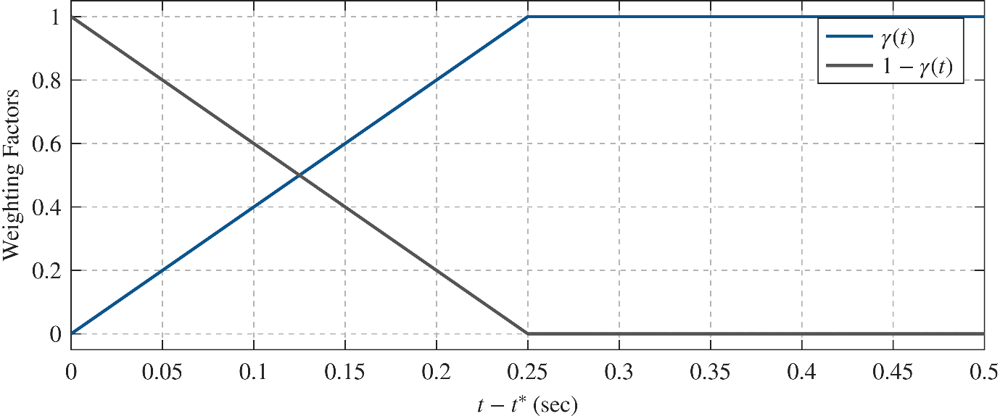

Figure 10~~10~~: Profile of the development of the combination parameter <mml:math xmlns:mml="http://www.w3.org/1998/Math/MathML" xmlns:m="http://schemas.openxmlformats.org/officeDocument/2006/math"><mml:mi>γ</mml:mi></mml:math>, showing a ramp transition from 0 to 1 starting at <mml:math xmlns:mml="http://www.w3.org/1998/Math/MathML" xmlns:m="http://schemas.openxmlformats.org/officeDocument/2006/math"><mml:mi>t</mml:mi><mml:mo>=</mml:mo><mml:msup><mml:mrow><mml:mi>t</mml:mi></mml:mrow><mml:mrow><mml:mi>*</mml:mi></mml:mrow></mml:msup><mml:mo>.</mml:mo></mml:math>

The selection of the transition duration, <mml:math xmlns:mml="http://www.w3.org/1998/Math/MathML" xmlns:m="http://schemas.openxmlformats.org/officeDocument/2006/math"><mml:msub><mml:mrow><mml:mi>T</mml:mi></mml:mrow><mml:mrow><mml:mi>s</mml:mi></mml:mrow></mml:msub></mml:math>, involves a trade-off between switching smoothness and speed. An excessively small <mml:math xmlns:mml="http://www.w3.org/1998/Math/MathML" xmlns:m="http://schemas.openxmlformats.org/officeDocument/2006/math"><mml:msub><mml:mrow><mml:mi>T</mml:mi></mml:mrow><mml:mrow><mml:mi>s</mml:mi></mml:mrow></mml:msub></mml:math> may introduce abrupt variations in the command signal, whereas an excessively large <mml:math xmlns:mml="http://www.w3.org/1998/Math/MathML" xmlns:m="http://schemas.openxmlformats.org/officeDocument/2006/math"><mml:msub><mml:mrow><mml:mi>T</mml:mi></mml:mrow><mml:mrow><mml:mi>s</mml:mi></mml:mrow></mml:msub></mml:math> may potentially allow the system to approach its stability boundary before the transition is completed. For the transfer system considered here, simulation-based evaluation indicated that <mml:math xmlns:mml="http://www.w3.org/1998/Math/MathML" xmlns:m="http://schemas.openxmlformats.org/officeDocument/2006/math"><mml:msub><mml:mrow><mml:mi>T</mml:mi></mml:mrow><mml:mrow><mml:mi>s</mml:mi></mml:mrow></mml:msub><mml:mo>=</mml:mo><mml:mn>0.25</mml:mn><mml:mi> </mml:mi><mml:mtext>sec</mml:mtext></mml:math> provides a suitable balance.

# 6-Illustrative Example

In this section, we consider a modified version of the RTHS benchmark problem statement presented to the community in [10] to evaluate and demonstrate our proposed procedure. This benchmark problem examines a three-story steel frame as the reference structure, partitioned such that a portion of the first story is designated as the physical substructure. The numerical substructure models the remaining dynamics, which include the rest of the first story as well as the upper two stories. The benchmark problem statement provides a sample controller design using a proportional-integral (PI) controller augmented with a phase-lead compensator. The original identified parameters for the physical substructure are the mass (<mml:math xmlns:mml="http://www.w3.org/1998/Math/MathML" xmlns:m="http://schemas.openxmlformats.org/officeDocument/2006/math"><mml:msub><mml:mrow><mml:mi mathvariant="normal">m</mml:mi></mml:mrow><mml:mrow><mml:mi mathvariant="normal">e</mml:mi></mml:mrow></mml:msub></mml:math>) of <mml:math xmlns:mml="http://www.w3.org/1998/Math/MathML" xmlns:m="http://schemas.openxmlformats.org/officeDocument/2006/math"><mml:mn>29.1</mml:mn><mml:mi mathvariant="normal"> </mml:mi><mml:mi mathvariant="normal">k</mml:mi><mml:mi mathvariant="normal">g</mml:mi></mml:math>, stiffness (<mml:math xmlns:mml="http://www.w3.org/1998/Math/MathML" xmlns:m="http://schemas.openxmlformats.org/officeDocument/2006/math"><mml:msub><mml:mrow><mml:mi mathvariant="normal">k</mml:mi></mml:mrow><mml:mrow><mml:mi mathvariant="normal">e</mml:mi></mml:mrow></mml:msub></mml:math>) of <mml:math xmlns:mml="http://www.w3.org/1998/Math/MathML" xmlns:m="http://schemas.openxmlformats.org/officeDocument/2006/math"><mml:mn>1.19</mml:mn><mml:mi mathvariant="normal">x</mml:mi><mml:msup><mml:mrow><mml:mn>10</mml:mn></mml:mrow><mml:mrow><mml:mn>6</mml:mn></mml:mrow></mml:msup><mml:mi mathvariant="normal">N</mml:mi><mml:mo>/</mml:mo><mml:mi mathvariant="normal">m</mml:mi></mml:math>, and damping (<mml:math xmlns:mml="http://www.w3.org/1998/Math/MathML" xmlns:m="http://schemas.openxmlformats.org/officeDocument/2006/math"><mml:msub><mml:mrow><mml:mi>c</mml:mi></mml:mrow><mml:mrow><mml:mi>e</mml:mi></mml:mrow></mml:msub></mml:math>) of <mml:math xmlns:mml="http://www.w3.org/1998/Math/MathML" xmlns:m="http://schemas.openxmlformats.org/officeDocument/2006/math"><mml:mn>114.6</mml:mn><mml:mi> </mml:mi><mml:mi mathvariant="normal">N</mml:mi><mml:mo>/</mml:mo><mml:mi mathvariant="normal">m</mml:mi></mml:math>. For this illustrative example, however, the experimental mass is increased by 30% to <mml:math xmlns:mml="http://www.w3.org/1998/Math/MathML" xmlns:m="http://schemas.openxmlformats.org/officeDocument/2006/math"><mml:mn>37.83</mml:mn><mml:mi> </mml:mi><mml:mi>k</mml:mi><mml:mi>g</mml:mi></mml:math>. This modification is intentionally introduced to render the system more susceptible to instability, as suggested by the sensitivity analysis in Figure 6~~6~~. Moreover, a Bouc–Wen model is employed to represent the hysteretic behavior of the degrading physical substructure, providing a challenging and dynamic scenario for assessing the proposed RTHS stability indicator.

## 6.1-vRTHS Setup

In this study, the 1940 El Centro earthquake record with an intensity of 0.4g is selected to maintain a consistent comparison baseline with the results shown in the benchmark. Moreover, two distinct PI controllers are designed: 1) a high-performance controller (Controller A) optimized for precise tracking with low error, and 2) a high-robustness controller (Controller B) designed to maintain stability under significant specimen degradation. In practice, the controller may begin to exhibit undesirable behavior prior to reaching the theoretical instability limit, which means that Controller B must be designed to maintain a sufficient stability margin over the expected range of specimen degradation during a typical RTHS. The two controllers are first evaluated independently under the undamaged linear condition, followed by the degradation and controller-switching scenarios described in Section 6.4. The system and controller parameters used in this study are summarized in Table 2~~2~~. The vRTHS equations were integrated at 4096 Hz, while the NCF indicator was implemented as a multi-rate task updated every 100 integration steps (40.96 Hz), evaluating both controllers over 200 frequencies from 1 to 200 Hz at each update. A vRTHS is presented to demonstrate the practical application of the proposed stability indicator. In this demonstration, the vRTHS begins with the high-performance controller (Controller A), and the online indicator is used to monitor stability margins and trigger a transition to the high-robustness controller (Controller B) at the appropriate time.

In addition, the phase-lead block is redesigned to achieve comparable vRTHS performance to that of the original benchmark. This redesigned compensator is given by:

<mml:math xmlns:mml="http://www.w3.org/1998/Math/MathML" xmlns:m="http://schemas.openxmlformats.org/officeDocument/2006/math"><mml:mtable><mml:mtr><mml:mtd><mml:mrow><mml:maligngroup/><mml:msub><mml:mrow><mml:mi>G</mml:mi></mml:mrow><mml:mrow><mml:mi>T</mml:mi></mml:mrow></mml:msub><mml:mfenced separators="|"><mml:mrow><mml:mi>s</mml:mi></mml:mrow></mml:mfenced><mml:mo>=</mml:mo><mml:mn>31.64</mml:mn><mml:mo> </mml:mo><mml:mfrac><mml:mrow><mml:mi>s</mml:mi><mml:mo>+</mml:mo><mml:mn>49.35</mml:mn></mml:mrow><mml:mrow><mml:mi>s</mml:mi><mml:mo>+</mml:mo><mml:mn>1658</mml:mn></mml:mrow></mml:mfrac><mml:mo>#</mml:mo><mml:mfenced separators="|"><mml:mrow><mml:mi mathvariant="normal"> </mml:mi><mml:mi mathvariant="normal">S</mml:mi><mml:mi mathvariant="normal">E</mml:mi><mml:mi mathvariant="normal">Q</mml:mi><mml:mi mathvariant="normal"> </mml:mi><mml:mi mathvariant="normal">E</mml:mi><mml:mi mathvariant="normal">q</mml:mi><mml:mi mathvariant="normal">u</mml:mi><mml:mi mathvariant="normal">a</mml:mi><mml:mi mathvariant="normal">t</mml:mi><mml:mi mathvariant="normal">i</mml:mi><mml:mi mathvariant="normal">o</mml:mi><mml:mi mathvariant="normal">n</mml:mi><mml:mi mathvariant="normal"> </mml:mi><mml:mo>\</mml:mo><mml:mi mathvariant="normal">*</mml:mi><mml:mi mathvariant="normal"> </mml:mi><mml:mi mathvariant="normal">A</mml:mi><mml:mi mathvariant="normal">R</mml:mi><mml:mi mathvariant="normal">A</mml:mi><mml:mi mathvariant="normal">B</mml:mi><mml:mi mathvariant="normal">I</mml:mi><mml:mi mathvariant="normal">C</mml:mi><mml:mi mathvariant="normal"> </mml:mi><mml:mo>\</mml:mo><mml:mi mathvariant="normal">*</mml:mi><mml:mi mathvariant="normal"> </mml:mi><mml:mi mathvariant="normal">M</mml:mi><mml:mi mathvariant="normal">E</mml:mi><mml:mi mathvariant="normal">R</mml:mi><mml:mi mathvariant="normal">G</mml:mi><mml:mi mathvariant="normal">E</mml:mi><mml:mi mathvariant="normal">F</mml:mi><mml:mi mathvariant="normal">O</mml:mi><mml:mi mathvariant="normal">R</mml:mi><mml:mi mathvariant="normal">M</mml:mi><mml:mi mathvariant="normal">A</mml:mi><mml:mi mathvariant="normal">T</mml:mi><mml:mi mathvariant="normal"> </mml:mi><mml:mn>67</mml:mn></mml:mrow></mml:mfenced></mml:mrow></mml:mtd></mml:mtr></mml:mtable></mml:math>

## 6.2 Stability Analysis

The transfer system for this illustrative example follows the block diagram in Figure 2~~2~~, utilizing the parameters specified in Table 2~~2~~. For the purpose of illustration, an analysis is first conducted to understand the system's expected behavior with each PI controller, focusing on damage tolerance and the stability of the switching process. This step is not a requirement for implementing the proposed framework but is included here to provide insight into the simulation results that follow. First, for Controller A, the composite transfer function <mml:math xmlns:mml="http://www.w3.org/1998/Math/MathML" xmlns:m="http://schemas.openxmlformats.org/officeDocument/2006/math"><mml:mi>Y</mml:mi><mml:mo>(</mml:mo><mml:mi>s</mml:mi><mml:mo>)</mml:mo></mml:math> is determined using Equation (<mml:math xmlns:mml="http://www.w3.org/1998/Math/MathML" xmlns:m="http://schemas.openxmlformats.org/officeDocument/2006/math"><mml:mn>20</mml:mn><mml:mn>20</mml:mn></mml:math>) as:

<mml:math xmlns:mml="http://www.w3.org/1998/Math/MathML" xmlns:m="http://schemas.openxmlformats.org/officeDocument/2006/math"><mml:mtable><mml:mtr><mml:mtd><mml:mrow><mml:maligngroup/><mml:mi>Y</mml:mi><mml:mfenced separators="|"><mml:mrow><mml:mi>s</mml:mi></mml:mrow></mml:mfenced><mml:mo>=</mml:mo><mml:mfrac><mml:mrow><mml:mn>4.23</mml:mn><mml:mo>×</mml:mo><mml:msup><mml:mrow><mml:mn>10</mml:mn></mml:mrow><mml:mrow><mml:mn>6</mml:mn></mml:mrow></mml:msup><mml:msup><mml:mrow><mml:mi>s</mml:mi></mml:mrow><mml:mrow><mml:mn>4</mml:mn></mml:mrow></mml:msup><mml:mo>+</mml:mo><mml:mn>1.798</mml:mn><mml:mo>×</mml:mo><mml:msup><mml:mrow><mml:mn>10</mml:mn></mml:mrow><mml:mrow><mml:mn>9</mml:mn></mml:mrow></mml:msup><mml:msup><mml:mrow><mml:mi>s</mml:mi></mml:mrow><mml:mrow><mml:mn>3</mml:mn></mml:mrow></mml:msup><mml:mo>+</mml:mo><mml:mn>4.229</mml:mn><mml:mo>×</mml:mo><mml:msup><mml:mrow><mml:mn>10</mml:mn></mml:mrow><mml:mrow><mml:mn>11</mml:mn></mml:mrow></mml:msup><mml:msup><mml:mrow><mml:mi>s</mml:mi></mml:mrow><mml:mrow><mml:mn>2</mml:mn></mml:mrow></mml:msup><mml:mo>+</mml:mo><mml:mn>5.046</mml:mn><mml:mo>×</mml:mo><mml:msup><mml:mrow><mml:mn>10</mml:mn></mml:mrow><mml:mrow><mml:mn>13</mml:mn></mml:mrow></mml:msup><mml:mi>s</mml:mi><mml:mo>+</mml:mo><mml:mn>1.536</mml:mn><mml:mo>×</mml:mo><mml:msup><mml:mrow><mml:mn>10</mml:mn></mml:mrow><mml:mrow><mml:mn>15</mml:mn></mml:mrow></mml:msup></mml:mrow><mml:mrow><mml:msup><mml:mrow><mml:mi>s</mml:mi></mml:mrow><mml:mrow><mml:mn>4</mml:mn></mml:mrow></mml:msup><mml:mo>+</mml:mo><mml:mn>428.3</mml:mn><mml:msup><mml:mrow><mml:mi>s</mml:mi></mml:mrow><mml:mrow><mml:mn>3</mml:mn></mml:mrow></mml:msup><mml:mo>+</mml:mo><mml:mn>1.014</mml:mn><mml:mo>×</mml:mo><mml:msup><mml:mrow><mml:mn>10</mml:mn></mml:mrow><mml:mrow><mml:mn>5</mml:mn></mml:mrow></mml:msup><mml:msup><mml:mrow><mml:mi>s</mml:mi></mml:mrow><mml:mrow><mml:mn>2</mml:mn></mml:mrow></mml:msup><mml:mo>+</mml:mo><mml:mn>3.299</mml:mn><mml:mo>×</mml:mo><mml:msup><mml:mrow><mml:mn>10</mml:mn></mml:mrow><mml:mrow><mml:mn>5</mml:mn></mml:mrow></mml:msup><mml:mi>s</mml:mi></mml:mrow></mml:mfrac><mml:mo>.</mml:mo><mml:mo>#</mml:mo><mml:mfenced separators="|"><mml:mrow><mml:mi mathvariant="normal"> </mml:mi><mml:mi mathvariant="normal">S</mml:mi><mml:mi mathvariant="normal">E</mml:mi><mml:mi mathvariant="normal">Q</mml:mi><mml:mi mathvariant="normal"> </mml:mi><mml:mi mathvariant="normal">E</mml:mi><mml:mi mathvariant="normal">q</mml:mi><mml:mi mathvariant="normal">u</mml:mi><mml:mi mathvariant="normal">a</mml:mi><mml:mi mathvariant="normal">t</mml:mi><mml:mi mathvariant="normal">i</mml:mi><mml:mi mathvariant="normal">o</mml:mi><mml:mi mathvariant="normal">n</mml:mi><mml:mi mathvariant="normal"> </mml:mi><mml:mo>\</mml:mo><mml:mi mathvariant="normal">*</mml:mi><mml:mi mathvariant="normal"> </mml:mi><mml:mi mathvariant="normal">A</mml:mi><mml:mi mathvariant="normal">R</mml:mi><mml:mi mathvariant="normal">A</mml:mi><mml:mi mathvariant="normal">B</mml:mi><mml:mi mathvariant="normal">I</mml:mi><mml:mi mathvariant="normal">C</mml:mi><mml:mi mathvariant="normal"> </mml:mi><mml:mo>\</mml:mo><mml:mi mathvariant="normal">*</mml:mi><mml:mi mathvariant="normal"> </mml:mi><mml:mi mathvariant="normal">M</mml:mi><mml:mi mathvariant="normal">E</mml:mi><mml:mi mathvariant="normal">R</mml:mi><mml:mi mathvariant="normal">G</mml:mi><mml:mi mathvariant="normal">E</mml:mi><mml:mi mathvariant="normal">F</mml:mi><mml:mi mathvariant="normal">O</mml:mi><mml:mi mathvariant="normal">R</mml:mi><mml:mi mathvariant="normal">M</mml:mi><mml:mi mathvariant="normal">A</mml:mi><mml:mi mathvariant="normal">T</mml:mi><mml:mi mathvariant="normal"> </mml:mi><mml:mn>68</mml:mn></mml:mrow></mml:mfenced></mml:mrow></mml:mtd></mml:mtr></mml:mtable></mml:math>

By solving Equations (<mml:math xmlns:mml="http://www.w3.org/1998/Math/MathML" xmlns:m="http://schemas.openxmlformats.org/officeDocument/2006/math"><mml:mn>31</mml:mn><mml:mn>31</mml:mn></mml:math>) and (<mml:math xmlns:mml="http://www.w3.org/1998/Math/MathML" xmlns:m="http://schemas.openxmlformats.org/officeDocument/2006/math"><mml:mn>29</mml:mn><mml:mn>29</mml:mn></mml:math>) with this function, the critical frequency and degradation ratio are found to be <mml:math xmlns:mml="http://www.w3.org/1998/Math/MathML" xmlns:m="http://schemas.openxmlformats.org/officeDocument/2006/math"><mml:msub><mml:mrow><mml:mi>ω</mml:mi></mml:mrow><mml:mrow><mml:mi>c</mml:mi><mml:mi>r</mml:mi></mml:mrow></mml:msub><mml:mo>=</mml:mo><mml:mn>287.3</mml:mn></mml:math> rad/s and <mml:math xmlns:mml="http://www.w3.org/1998/Math/MathML" xmlns:m="http://schemas.openxmlformats.org/officeDocument/2006/math"><mml:msub><mml:mrow><mml:mi>α</mml:mi></mml:mrow><mml:mrow><mml:mi>c</mml:mi><mml:mi>r</mml:mi></mml:mrow></mml:msub><mml:mo>=</mml:mo><mml:mn>0.27</mml:mn><mml:mo>.</mml:mo></mml:math> Repeating this analytical procedure for the high-robustness controller (Controller B) yields a controller that is unconditionally stable with respect to stiffness degradation.

To guarantee stability during the controller transition, a common symmetric positive definite matrix <mml:math xmlns:mml="http://www.w3.org/1998/Math/MathML" xmlns:m="http://schemas.openxmlformats.org/officeDocument/2006/math"><mml:mi>P</mml:mi></mml:math>, which defines a common quadratic Lyapunov function of the form given in Equation (43), must be found for both closed-loop systems. This search is performed iteratively by gradually decreasing the value of the degradation factor <mml:math xmlns:mml="http://www.w3.org/1998/Math/MathML" xmlns:m="http://schemas.openxmlformats.org/officeDocument/2006/math"><mml:mi>α</mml:mi></mml:math> to determine the minimum value at which such a common matrix still exists. For a given <mml:math xmlns:mml="http://www.w3.org/1998/Math/MathML" xmlns:m="http://schemas.openxmlformats.org/officeDocument/2006/math"><mml:mi>α</mml:mi></mml:math>, the plant and both controllers, A and B, are first converted to their state-space representations to construct the two closed-loop system matrices, <mml:math xmlns:mml="http://www.w3.org/1998/Math/MathML" xmlns:m="http://schemas.openxmlformats.org/officeDocument/2006/math"><mml:msub><mml:mrow><mml:mi>A</mml:mi></mml:mrow><mml:mrow><mml:mi>c</mml:mi><mml:mi>l</mml:mi><mml:mo>,</mml:mo><mml:mi> </mml:mi><mml:mi>a</mml:mi></mml:mrow></mml:msub><mml:mi> </mml:mi></mml:math>and <mml:math xmlns:mml="http://www.w3.org/1998/Math/MathML" xmlns:m="http://schemas.openxmlformats.org/officeDocument/2006/math"><mml:msub><mml:mrow><mml:mi>A</mml:mi></mml:mrow><mml:mrow><mml:mi>c</mml:mi><mml:mi>l</mml:mi><mml:mo>,</mml:mo><mml:mi> </mml:mi><mml:mi>b</mml:mi></mml:mrow></mml:msub></mml:math>. The common Lyapunov matrix is obtained by formulating the stability requirements, <mml:math xmlns:mml="http://www.w3.org/1998/Math/MathML" xmlns:m="http://schemas.openxmlformats.org/officeDocument/2006/math"><mml:mi>P</mml:mi><mml:mo>≻</mml:mo><mml:mn>0</mml:mn><mml:mo>,</mml:mo><mml:mi> </mml:mi><mml:mi> </mml:mi><mml:mi> </mml:mi><mml:msubsup><mml:mrow><mml:mi>A</mml:mi></mml:mrow><mml:mrow><mml:mtext>cl, </mml:mtext><mml:mi>a</mml:mi></mml:mrow><mml:mrow><mml:mi>T</mml:mi></mml:mrow></mml:msubsup><mml:mi>P</mml:mi><mml:mo>+</mml:mo><mml:mi>P</mml:mi><mml:msub><mml:mrow><mml:mi>A</mml:mi></mml:mrow><mml:mrow><mml:mtext>cl</mml:mtext><mml:mo>,</mml:mo><mml:mi> </mml:mi><mml:mi> </mml:mi><mml:mi>a</mml:mi></mml:mrow></mml:msub><mml:mo>≺</mml:mo><mml:mn>0</mml:mn></mml:math>, and <mml:math xmlns:mml="http://www.w3.org/1998/Math/MathML" xmlns:m="http://schemas.openxmlformats.org/officeDocument/2006/math"><mml:msubsup><mml:mrow><mml:mi>A</mml:mi></mml:mrow><mml:mrow><mml:mtext>cl</mml:mtext><mml:mo>,</mml:mo><mml:mi> </mml:mi><mml:mi>b</mml:mi></mml:mrow><mml:mrow><mml:mi>T</mml:mi></mml:mrow></mml:msubsup><mml:mi>P</mml:mi><mml:mo>+</mml:mo><mml:mi>P</mml:mi><mml:msub><mml:mrow><mml:mi>A</mml:mi></mml:mrow><mml:mrow><mml:mtext>cl</mml:mtext><mml:mo>,</mml:mo><mml:mi> </mml:mi><mml:mi>b</mml:mi></mml:mrow></mml:msub><mml:mo>≺</mml:mo><mml:mn>0</mml:mn></mml:math>, as an LMI feasibility problem. The numerical solution follows the projective LMI framework developed by Nemirovski and Gahinet [47]. It is implemented in this study using MATLAB’s feasp solver [48], which applies this projective-method-based feasibility procedure to determine a common matrix, <mml:math xmlns:mml="http://www.w3.org/1998/Math/MathML" xmlns:m="http://schemas.openxmlformats.org/officeDocument/2006/math"><mml:mi>P</mml:mi></mml:math>, satisfying the prescribed LMIs.

The search determined the switching stability boundary to be at <mml:math xmlns:mml="http://www.w3.org/1998/Math/MathML" xmlns:m="http://schemas.openxmlformats.org/officeDocument/2006/math"><mml:mi>α</mml:mi><mml:mo>=</mml:mo><mml:mn>0.40</mml:mn></mml:math>. At this boundary, the realization of state space matrices <mml:math xmlns:mml="http://www.w3.org/1998/Math/MathML" xmlns:m="http://schemas.openxmlformats.org/officeDocument/2006/math"><mml:msub><mml:mrow><mml:mi>A</mml:mi></mml:mrow><mml:mrow><mml:mi>c</mml:mi><mml:mi>l</mml:mi><mml:mo>,</mml:mo><mml:mi>a</mml:mi></mml:mrow></mml:msub><mml:mi> </mml:mi></mml:math>and <mml:math xmlns:mml="http://www.w3.org/1998/Math/MathML" xmlns:m="http://schemas.openxmlformats.org/officeDocument/2006/math"><mml:msub><mml:mrow><mml:mi>A</mml:mi></mml:mrow><mml:mrow><mml:mi>c</mml:mi><mml:mi>l</mml:mi><mml:mo>,</mml:mo><mml:mi> </mml:mi><mml:mi>b</mml:mi></mml:mrow></mml:msub></mml:math> is:

<mml:math xmlns:mml="http://www.w3.org/1998/Math/MathML" xmlns:m="http://schemas.openxmlformats.org/officeDocument/2006/math"><mml:mtable><mml:mtr><mml:mtd><mml:mrow><mml:maligngroup/><mml:msub><mml:mrow><mml:mi>A</mml:mi></mml:mrow><mml:mrow><mml:mi>c</mml:mi><mml:mi>l</mml:mi><mml:mo>,</mml:mo><mml:mi> </mml:mi><mml:mi>a</mml:mi></mml:mrow></mml:msub><mml:mo>=</mml:mo><mml:mfenced open="[" close="]" separators="|"><mml:mrow><mml:mtable><mml:mtr><mml:mtd><mml:mo>-</mml:mo><mml:mn>431.7</mml:mn></mml:mtd><mml:mtd><mml:mo>-</mml:mo><mml:mn>443.6</mml:mn></mml:mtd><mml:mtd><mml:mo>-</mml:mo><mml:mn>408.4</mml:mn></mml:mtd><mml:mtd><mml:mo>-</mml:mo><mml:mn>370.8</mml:mn></mml:mtd><mml:mtd><mml:mo>-</mml:mo><mml:mn>311.2</mml:mn></mml:mtd><mml:mtd><mml:mn>1154</mml:mn></mml:mtd></mml:mtr><mml:mtr><mml:mtd><mml:mn>512.0</mml:mn></mml:mtd><mml:mtd><mml:mn>0.0</mml:mn></mml:mtd><mml:mtd><mml:mn>0.0</mml:mn></mml:mtd><mml:mtd><mml:mn>0.0</mml:mn></mml:mtd><mml:mtd><mml:mn>0.0</mml:mn></mml:mtd><mml:mtd><mml:mn>0.0</mml:mn></mml:mtd></mml:mtr><mml:mtr><mml:mtd><mml:mn>0.0</mml:mn></mml:mtd><mml:mtd><mml:mn>256.0</mml:mn></mml:mtd><mml:mtd><mml:mn>0.0</mml:mn></mml:mtd><mml:mtd><mml:mn>0.0</mml:mn></mml:mtd><mml:mtd><mml:mn>0.0</mml:mn></mml:mtd><mml:mtd><mml:mn>0.0</mml:mn></mml:mtd></mml:mtr><mml:mtr><mml:mtd><mml:mn>0.0</mml:mn></mml:mtd><mml:mtd><mml:mn>0.0</mml:mn></mml:mtd><mml:mtd><mml:mn>256.0</mml:mn></mml:mtd><mml:mtd><mml:mn>0.0</mml:mn></mml:mtd><mml:mtd><mml:mn>0.0</mml:mn></mml:mtd><mml:mtd><mml:mn>0.0</mml:mn></mml:mtd></mml:mtr><mml:mtr><mml:mtd><mml:mn>0.0</mml:mn></mml:mtd><mml:mtd><mml:mn>0.0</mml:mn></mml:mtd><mml:mtd><mml:mn>0.0</mml:mn></mml:mtd><mml:mtd><mml:mn>128.0</mml:mn></mml:mtd><mml:mtd><mml:mn>0.0</mml:mn></mml:mtd><mml:mtd><mml:mn>0.0</mml:mn></mml:mtd></mml:mtr><mml:mtr><mml:mtd><mml:mn>0.0</mml:mn></mml:mtd><mml:mtd><mml:mn>0.0</mml:mn></mml:mtd><mml:mtd><mml:mn>0.0</mml:mn></mml:mtd><mml:mtd><mml:mn>0.0</mml:mn></mml:mtd><mml:mtd><mml:mo>-</mml:mo><mml:mn>8.2</mml:mn></mml:mtd><mml:mtd><mml:mn>0.0</mml:mn></mml:mtd></mml:mtr></mml:mtable></mml:mrow></mml:mfenced><mml:mo>#</mml:mo><mml:mfenced separators="|"><mml:mrow><mml:mi mathvariant="normal"> </mml:mi><mml:mi mathvariant="normal">S</mml:mi><mml:mi mathvariant="normal">E</mml:mi><mml:mi mathvariant="normal">Q</mml:mi><mml:mi mathvariant="normal"> </mml:mi><mml:mi mathvariant="normal">E</mml:mi><mml:mi mathvariant="normal">q</mml:mi><mml:mi mathvariant="normal">u</mml:mi><mml:mi mathvariant="normal">a</mml:mi><mml:mi mathvariant="normal">t</mml:mi><mml:mi mathvariant="normal">i</mml:mi><mml:mi mathvariant="normal">o</mml:mi><mml:mi mathvariant="normal">n</mml:mi><mml:mi mathvariant="normal"> </mml:mi><mml:mo>\</mml:mo><mml:mi mathvariant="normal">*</mml:mi><mml:mi mathvariant="normal"> </mml:mi><mml:mi mathvariant="normal">A</mml:mi><mml:mi mathvariant="normal">R</mml:mi><mml:mi mathvariant="normal">A</mml:mi><mml:mi mathvariant="normal">B</mml:mi><mml:mi mathvariant="normal">I</mml:mi><mml:mi mathvariant="normal">C</mml:mi><mml:mi mathvariant="normal"> </mml:mi><mml:mo>\</mml:mo><mml:mi mathvariant="normal">*</mml:mi><mml:mi mathvariant="normal"> </mml:mi><mml:mi mathvariant="normal">M</mml:mi><mml:mi mathvariant="normal">E</mml:mi><mml:mi mathvariant="normal">R</mml:mi><mml:mi mathvariant="normal">G</mml:mi><mml:mi mathvariant="normal">E</mml:mi><mml:mi mathvariant="normal">F</mml:mi><mml:mi mathvariant="normal">O</mml:mi><mml:mi mathvariant="normal">R</mml:mi><mml:mi mathvariant="normal">M</mml:mi><mml:mi mathvariant="normal">A</mml:mi><mml:mi mathvariant="normal">T</mml:mi><mml:mi mathvariant="normal"> </mml:mi><mml:mn>69</mml:mn></mml:mrow></mml:mfenced></mml:mrow></mml:mtd></mml:mtr></mml:mtable></mml:math>

<mml:math xmlns:mml="http://www.w3.org/1998/Math/MathML" xmlns:m="http://schemas.openxmlformats.org/officeDocument/2006/math"><mml:mtable><mml:mtr><mml:mtd><mml:mrow><mml:maligngroup/><mml:msub><mml:mrow><mml:mi>A</mml:mi></mml:mrow><mml:mrow><mml:mi>c</mml:mi><mml:mi>l</mml:mi><mml:mo>,</mml:mo><mml:mi> </mml:mi><mml:mi>b</mml:mi></mml:mrow></mml:msub><mml:mo>=</mml:mo><mml:mfenced open="[" close="]" separators="|"><mml:mrow><mml:mtable><mml:mtr><mml:mtd><mml:mo>-</mml:mo><mml:mn>431.7</mml:mn></mml:mtd><mml:mtd><mml:mo>-</mml:mo><mml:mn>443.6</mml:mn></mml:mtd><mml:mtd><mml:mo>-</mml:mo><mml:mn>408.4</mml:mn></mml:mtd><mml:mtd><mml:mo>-</mml:mo><mml:mn>370.8</mml:mn></mml:mtd><mml:mtd><mml:mo>-</mml:mo><mml:mn>232.8</mml:mn></mml:mtd><mml:mtd><mml:mn>1339</mml:mn></mml:mtd></mml:mtr><mml:mtr><mml:mtd><mml:mn>512.0</mml:mn></mml:mtd><mml:mtd><mml:mn>0.0</mml:mn></mml:mtd><mml:mtd><mml:mn>0.0</mml:mn></mml:mtd><mml:mtd><mml:mn>0.0</mml:mn></mml:mtd><mml:mtd><mml:mn>0.0</mml:mn></mml:mtd><mml:mtd><mml:mn>0.0</mml:mn></mml:mtd></mml:mtr><mml:mtr><mml:mtd><mml:mn>0.0</mml:mn></mml:mtd><mml:mtd><mml:mn>256.0</mml:mn></mml:mtd><mml:mtd><mml:mn>0.0</mml:mn></mml:mtd><mml:mtd><mml:mn>0.0</mml:mn></mml:mtd><mml:mtd><mml:mn>0.0</mml:mn></mml:mtd><mml:mtd><mml:mn>0.0</mml:mn></mml:mtd></mml:mtr><mml:mtr><mml:mtd><mml:mn>0.0</mml:mn></mml:mtd><mml:mtd><mml:mn>0.0</mml:mn></mml:mtd><mml:mtd><mml:mn>256.0</mml:mn></mml:mtd><mml:mtd><mml:mn>0.0</mml:mn></mml:mtd><mml:mtd><mml:mn>0.0</mml:mn></mml:mtd><mml:mtd><mml:mn>0.0</mml:mn></mml:mtd></mml:mtr><mml:mtr><mml:mtd><mml:mn>0.0</mml:mn></mml:mtd><mml:mtd><mml:mn>0.0</mml:mn></mml:mtd><mml:mtd><mml:mn>0.0</mml:mn></mml:mtd><mml:mtd><mml:mn>128.0</mml:mn></mml:mtd><mml:mtd><mml:mn>0.0</mml:mn></mml:mtd><mml:mtd><mml:mn>0.0</mml:mn></mml:mtd></mml:mtr><mml:mtr><mml:mtd><mml:mn>0.0</mml:mn></mml:mtd><mml:mtd><mml:mn>0.0</mml:mn></mml:mtd><mml:mtd><mml:mn>0.0</mml:mn></mml:mtd><mml:mtd><mml:mn>0.0</mml:mn></mml:mtd><mml:mtd><mml:mo>-</mml:mo><mml:mn>8.2</mml:mn></mml:mtd><mml:mtd><mml:mn>0.0</mml:mn></mml:mtd></mml:mtr></mml:mtable></mml:mrow></mml:mfenced><mml:mo>#</mml:mo><mml:mfenced separators="|"><mml:mrow><mml:mi mathvariant="normal"> </mml:mi><mml:mi mathvariant="normal">S</mml:mi><mml:mi mathvariant="normal">E</mml:mi><mml:mi mathvariant="normal">Q</mml:mi><mml:mi mathvariant="normal"> </mml:mi><mml:mi mathvariant="normal">E</mml:mi><mml:mi mathvariant="normal">q</mml:mi><mml:mi mathvariant="normal">u</mml:mi><mml:mi mathvariant="normal">a</mml:mi><mml:mi mathvariant="normal">t</mml:mi><mml:mi mathvariant="normal">i</mml:mi><mml:mi mathvariant="normal">o</mml:mi><mml:mi mathvariant="normal">n</mml:mi><mml:mi mathvariant="normal"> </mml:mi><mml:mo>\</mml:mo><mml:mi mathvariant="normal">*</mml:mi><mml:mi mathvariant="normal"> </mml:mi><mml:mi mathvariant="normal">A</mml:mi><mml:mi mathvariant="normal">R</mml:mi><mml:mi mathvariant="normal">A</mml:mi><mml:mi mathvariant="normal">B</mml:mi><mml:mi mathvariant="normal">I</mml:mi><mml:mi mathvariant="normal">C</mml:mi><mml:mi mathvariant="normal"> </mml:mi><mml:mo>\</mml:mo><mml:mi mathvariant="normal">*</mml:mi><mml:mi mathvariant="normal"> </mml:mi><mml:mi mathvariant="normal">M</mml:mi><mml:mi mathvariant="normal">E</mml:mi><mml:mi mathvariant="normal">R</mml:mi><mml:mi mathvariant="normal">G</mml:mi><mml:mi mathvariant="normal">E</mml:mi><mml:mi mathvariant="normal">F</mml:mi><mml:mi mathvariant="normal">O</mml:mi><mml:mi mathvariant="normal">R</mml:mi><mml:mi mathvariant="normal">M</mml:mi><mml:mi mathvariant="normal">A</mml:mi><mml:mi mathvariant="normal">T</mml:mi><mml:mi mathvariant="normal"> </mml:mi><mml:mn>70</mml:mn></mml:mrow></mml:mfenced></mml:mrow></mml:mtd></mml:mtr></mml:mtable></mml:math>

and the matrix <mml:math xmlns:mml="http://www.w3.org/1998/Math/MathML" xmlns:m="http://schemas.openxmlformats.org/officeDocument/2006/math"><mml:mi>P</mml:mi></mml:math> of the common quadratic Lyapunov function found by the algorithm is:

<mml:math xmlns:mml="http://www.w3.org/1998/Math/MathML" xmlns:m="http://schemas.openxmlformats.org/officeDocument/2006/math"><mml:mtable><mml:mtr><mml:mtd><mml:mrow><mml:maligngroup/><mml:mi>P</mml:mi><mml:mo>=</mml:mo><mml:mfenced open="[" close="]" separators="|"><mml:mrow><mml:mtable><mml:mtr><mml:mtd><mml:mn>0.0069</mml:mn></mml:mtd><mml:mtd><mml:mn>0.0056</mml:mn></mml:mtd><mml:mtd><mml:mn>0.0075</mml:mn></mml:mtd><mml:mtd><mml:mn>0.0041</mml:mn></mml:mtd><mml:mtd><mml:mn>0.0033</mml:mn></mml:mtd><mml:mtd><mml:mo>-</mml:mo><mml:mn>0.0091</mml:mn></mml:mtd></mml:mtr><mml:mtr><mml:mtd><mml:mn>0.0056</mml:mn></mml:mtd><mml:mtd><mml:mn>0.0067</mml:mn></mml:mtd><mml:mtd><mml:mn>0.0093</mml:mn></mml:mtd><mml:mtd><mml:mn>0.0075</mml:mn></mml:mtd><mml:mtd><mml:mn>0.0061</mml:mn></mml:mtd><mml:mtd><mml:mo>-</mml:mo><mml:mn>0.0241</mml:mn></mml:mtd></mml:mtr><mml:mtr><mml:mtd><mml:mn>0.0075</mml:mn></mml:mtd><mml:mtd><mml:mn>0.0093</mml:mn></mml:mtd><mml:mtd><mml:mn>0.0139</mml:mn></mml:mtd><mml:mtd><mml:mn>0.0114</mml:mn></mml:mtd><mml:mtd><mml:mn>0.0107</mml:mn></mml:mtd><mml:mtd><mml:mo>-</mml:mo><mml:mn>0.0418</mml:mn></mml:mtd></mml:mtr><mml:mtr><mml:mtd><mml:mn>0.0041</mml:mn></mml:mtd><mml:mtd><mml:mn>0.0075</mml:mn></mml:mtd><mml:mtd><mml:mn>0.0114</mml:mn></mml:mtd><mml:mtd><mml:mn>0.0118</mml:mn></mml:mtd><mml:mtd><mml:mn>0.0111</mml:mn></mml:mtd><mml:mtd><mml:mo>-</mml:mo><mml:mn>0.0505</mml:mn></mml:mtd></mml:mtr><mml:mtr><mml:mtd><mml:mn>0.0033</mml:mn></mml:mtd><mml:mtd><mml:mn>0.0061</mml:mn></mml:mtd><mml:mtd><mml:mn>0.0107</mml:mn></mml:mtd><mml:mtd><mml:mn>0.0111</mml:mn></mml:mtd><mml:mtd><mml:mn>0.0150</mml:mn></mml:mtd><mml:mtd><mml:mo>-</mml:mo><mml:mn>0.0627</mml:mn></mml:mtd></mml:mtr><mml:mtr><mml:mtd><mml:mo>-</mml:mo><mml:mn>0.0091</mml:mn></mml:mtd><mml:mtd><mml:mo>-</mml:mo><mml:mn>0.0241</mml:mn></mml:mtd><mml:mtd><mml:mo>-</mml:mo><mml:mn>0.0418</mml:mn></mml:mtd><mml:mtd><mml:mo>-</mml:mo><mml:mn>0.0505</mml:mn></mml:mtd><mml:mtd><mml:mo>-</mml:mo><mml:mn>0.0627</mml:mn></mml:mtd><mml:mtd><mml:mn>0.9457</mml:mn></mml:mtd></mml:mtr></mml:mtable></mml:mrow></mml:mfenced><mml:mi> </mml:mi><mml:mo>#</mml:mo><mml:mfenced separators="|"><mml:mrow><mml:mi mathvariant="normal"> </mml:mi><mml:mi mathvariant="normal">S</mml:mi><mml:mi mathvariant="normal">E</mml:mi><mml:mi mathvariant="normal">Q</mml:mi><mml:mi mathvariant="normal"> </mml:mi><mml:mi mathvariant="normal">E</mml:mi><mml:mi mathvariant="normal">q</mml:mi><mml:mi mathvariant="normal">u</mml:mi><mml:mi mathvariant="normal">a</mml:mi><mml:mi mathvariant="normal">t</mml:mi><mml:mi mathvariant="normal">i</mml:mi><mml:mi mathvariant="normal">o</mml:mi><mml:mi mathvariant="normal">n</mml:mi><mml:mi mathvariant="normal"> </mml:mi><mml:mo>\</mml:mo><mml:mi mathvariant="normal">*</mml:mi><mml:mi mathvariant="normal"> </mml:mi><mml:mi mathvariant="normal">A</mml:mi><mml:mi mathvariant="normal">R</mml:mi><mml:mi mathvariant="normal">A</mml:mi><mml:mi mathvariant="normal">B</mml:mi><mml:mi mathvariant="normal">I</mml:mi><mml:mi mathvariant="normal">C</mml:mi><mml:mi mathvariant="normal"> </mml:mi><mml:mo>\</mml:mo><mml:mi mathvariant="normal">*</mml:mi><mml:mi mathvariant="normal"> </mml:mi><mml:mi mathvariant="normal">M</mml:mi><mml:mi mathvariant="normal">E</mml:mi><mml:mi mathvariant="normal">R</mml:mi><mml:mi mathvariant="normal">G</mml:mi><mml:mi mathvariant="normal">E</mml:mi><mml:mi mathvariant="normal">F</mml:mi><mml:mi mathvariant="normal">O</mml:mi><mml:mi mathvariant="normal">R</mml:mi><mml:mi mathvariant="normal">M</mml:mi><mml:mi mathvariant="normal">A</mml:mi><mml:mi mathvariant="normal">T</mml:mi><mml:mi mathvariant="normal"> </mml:mi><mml:mn>71</mml:mn></mml:mrow></mml:mfenced></mml:mrow></mml:mtd></mml:mtr></mml:mtable></mml:math>

Figure 11~~11~~ shows the evaluated stability margin <mml:math xmlns:mml="http://www.w3.org/1998/Math/MathML" xmlns:m="http://schemas.openxmlformats.org/officeDocument/2006/math"><mml:msub><mml:mrow><mml:mi>b</mml:mi></mml:mrow><mml:mrow><mml:mi>g</mml:mi></mml:mrow></mml:msub></mml:math> for both controllers as a function of the physical substructure degradation factor. For numerical simulations, we specify a switching margin of <mml:math xmlns:mml="http://www.w3.org/1998/Math/MathML" xmlns:m="http://schemas.openxmlformats.org/officeDocument/2006/math"><mml:msub><mml:mrow><mml:mi>b</mml:mi></mml:mrow><mml:mrow><mml:mi>g</mml:mi></mml:mrow></mml:msub><mml:mo>=</mml:mo><mml:mn>0.15</mml:mn></mml:math>. While modeling error and parameter drift are generally smaller than specimen degradation effects, they remain unavoidable and require a sufficient robustness margin. Similar to gain and phase margins, the NCF margin must reflect anticipated experimental uncertainties, which vary by laboratory and experiment. Based on our observations, we found that <mml:math xmlns:mml="http://www.w3.org/1998/Math/MathML" xmlns:m="http://schemas.openxmlformats.org/officeDocument/2006/math"><mml:msub><mml:mrow><mml:mi>b</mml:mi></mml:mrow><mml:mrow><mml:mi>g</mml:mi></mml:mrow></mml:msub><mml:mo>=</mml:mo><mml:mi> </mml:mi><mml:mn>0.4</mml:mn></mml:math> serves as a practical guideline for physical experiments.

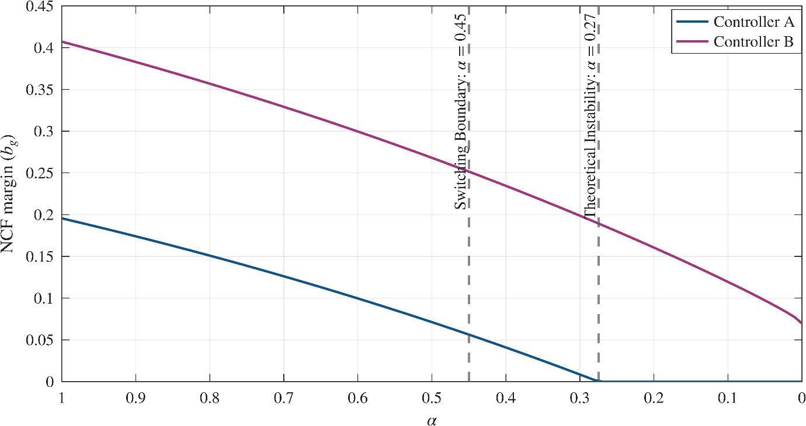

Figure 11~~11~~: NCF stability margin versus physical substructure degradation factor <mml:math xmlns:mml="http://www.w3.org/1998/Math/MathML" xmlns:m="http://schemas.openxmlformats.org/officeDocument/2006/math"><mml:mi>α</mml:mi></mml:math> for two PI controller designs (Controllers A and B)

## 6.3 Physical Substructure Modeling

The nonlinear response of the simulated physical substructure is represented using a degrading Bouc–Wen model. The Bouc–Wen formulation originates from the hysteresis model introduced by Bouc [49]. It was subsequently extended to represent degrading hysteretic behavior by Baber and Noori [50]. The formulation adopted in this study follows the normalized degrading form described by Song [51], in which stiffness and strength deterioration are introduced through energy-dependent functions.

The Bouc–Wen restoring force is defined as:

<mml:math xmlns:mml="http://www.w3.org/1998/Math/MathML" xmlns:m="http://schemas.openxmlformats.org/officeDocument/2006/math"><mml:mtable><mml:mtr><mml:mtd><mml:mrow><mml:maligngroup/><mml:msub><mml:mrow><mml:mi>F</mml:mi></mml:mrow><mml:mrow><mml:mi>B</mml:mi><mml:mi>W</mml:mi></mml:mrow></mml:msub><mml:mi>​</mml:mi><mml:mo>=</mml:mo><mml:msub><mml:mrow><mml:mi>k</mml:mi></mml:mrow><mml:mrow><mml:mn>0</mml:mn></mml:mrow></mml:msub><mml:mi>​</mml:mi><mml:mfenced open="[" close="]" separators="|"><mml:mrow><mml:mi>ρ</mml:mi><mml:msub><mml:mrow><mml:mi>d</mml:mi></mml:mrow><mml:mrow><mml:mi>m</mml:mi></mml:mrow></mml:msub><mml:mo>+</mml:mo><mml:mfenced separators="|"><mml:mrow><mml:mn>1</mml:mn><mml:mo>-</mml:mo><mml:mi>ρ</mml:mi></mml:mrow></mml:mfenced><mml:mi>z</mml:mi></mml:mrow></mml:mfenced><mml:mo>,</mml:mo><mml:mo>#</mml:mo><mml:mfenced separators="|"><mml:mrow><mml:mi mathvariant="normal"> </mml:mi><mml:mi mathvariant="normal">S</mml:mi><mml:mi mathvariant="normal">E</mml:mi><mml:mi mathvariant="normal">Q</mml:mi><mml:mi mathvariant="normal"> </mml:mi><mml:mi mathvariant="normal">E</mml:mi><mml:mi mathvariant="normal">q</mml:mi><mml:mi mathvariant="normal">u</mml:mi><mml:mi mathvariant="normal">a</mml:mi><mml:mi mathvariant="normal">t</mml:mi><mml:mi mathvariant="normal">i</mml:mi><mml:mi mathvariant="normal">o</mml:mi><mml:mi mathvariant="normal">n</mml:mi><mml:mi mathvariant="normal"> </mml:mi><mml:mo>\</mml:mo><mml:mi mathvariant="normal">*</mml:mi><mml:mi mathvariant="normal"> </mml:mi><mml:mi mathvariant="normal">A</mml:mi><mml:mi mathvariant="normal">R</mml:mi><mml:mi mathvariant="normal">A</mml:mi><mml:mi mathvariant="normal">B</mml:mi><mml:mi mathvariant="normal">I</mml:mi><mml:mi mathvariant="normal">C</mml:mi><mml:mi mathvariant="normal"> </mml:mi><mml:mo>\</mml:mo><mml:mi mathvariant="normal">*</mml:mi><mml:mi mathvariant="normal"> </mml:mi><mml:mi mathvariant="normal">M</mml:mi><mml:mi mathvariant="normal">E</mml:mi><mml:mi mathvariant="normal">R</mml:mi><mml:mi mathvariant="normal">G</mml:mi><mml:mi mathvariant="normal">E</mml:mi><mml:mi mathvariant="normal">F</mml:mi><mml:mi mathvariant="normal">O</mml:mi><mml:mi mathvariant="normal">R</mml:mi><mml:mi mathvariant="normal">M</mml:mi><mml:mi mathvariant="normal">A</mml:mi><mml:mi mathvariant="normal">T</mml:mi><mml:mi mathvariant="normal"> </mml:mi><mml:mi mathvariant="normal"> </mml:mi><mml:mn>72</mml:mn></mml:mrow></mml:mfenced></mml:mrow></mml:mtd></mml:mtr></mml:mtable></mml:math>

where <mml:math xmlns:mml="http://www.w3.org/1998/Math/MathML" xmlns:m="http://schemas.openxmlformats.org/officeDocument/2006/math"><mml:msub><mml:mrow><mml:mi>k</mml:mi></mml:mrow><mml:mrow><mml:mn>0</mml:mn></mml:mrow></mml:msub></mml:math> is the initial stiffness and <mml:math xmlns:mml="http://www.w3.org/1998/Math/MathML" xmlns:m="http://schemas.openxmlformats.org/officeDocument/2006/math"><mml:mi>α</mml:mi></mml:math> determines the residual post-yield stiffness contribution, and the parameter <mml:math xmlns:mml="http://www.w3.org/1998/Math/MathML" xmlns:m="http://schemas.openxmlformats.org/officeDocument/2006/math"><mml:mi>z</mml:mi></mml:math>  governs the history-dependent portion of the restoring force. In this study, the initial stiffness is inherited directly from the established vRTHS benchmark specimen (<mml:math xmlns:mml="http://www.w3.org/1998/Math/MathML" xmlns:m="http://schemas.openxmlformats.org/officeDocument/2006/math"><mml:msub><mml:mrow><mml:mi>k</mml:mi></mml:mrow><mml:mrow><mml:mn>0</mml:mn></mml:mrow></mml:msub><mml:mo>=</mml:mo><mml:mn>1.19</mml:mn><mml:mi> </mml:mi><mml:mi mathvariant="normal">k</mml:mi><mml:mi mathvariant="normal">N</mml:mi><mml:mo>/</mml:mo><mml:mi mathvariant="normal">m</mml:mi><mml:mi mathvariant="normal">m</mml:mi></mml:math>), while <mml:math xmlns:mml="http://www.w3.org/1998/Math/MathML" xmlns:m="http://schemas.openxmlformats.org/officeDocument/2006/math"><mml:mi>ρ</mml:mi></mml:math> is set to 0.001 to be consistent with the nominal plastic plateau recommended by EN 1993-1-5, Annex C.6 [52] and implemented by IDEA StatiCa in nonlinear connection design [53].

The evolution of the internal hysteretic variable <mml:math xmlns:mml="http://www.w3.org/1998/Math/MathML" xmlns:m="http://schemas.openxmlformats.org/officeDocument/2006/math"><mml:mi>z</mml:mi></mml:math> is governed by

<mml:math xmlns:mml="http://www.w3.org/1998/Math/MathML" xmlns:m="http://schemas.openxmlformats.org/officeDocument/2006/math"><mml:mtable><mml:mtr><mml:mtd><mml:mrow><mml:maligngroup/><mml:mover accent="true"><mml:mrow><mml:mi>z</mml:mi></mml:mrow><mml:mo>˙</mml:mo></mml:mover><mml:mo>=</mml:mo><mml:mfrac><mml:mrow><mml:mover accent="true"><mml:mrow><mml:msub><mml:mrow><mml:mi>d</mml:mi></mml:mrow><mml:mrow><mml:mi>m</mml:mi></mml:mrow></mml:msub></mml:mrow><mml:mo>˙</mml:mo></mml:mover><mml:mo>-</mml:mo><mml:mi>ν</mml:mi><mml:mfenced separators="|"><mml:mrow><mml:mi>E</mml:mi></mml:mrow></mml:mfenced><mml:msub><mml:mrow><mml:mi>β</mml:mi></mml:mrow><mml:mrow><mml:mi>b</mml:mi></mml:mrow></mml:msub><mml:mfenced open="|" close="|" separators="|"><mml:mrow><mml:mover accent="true"><mml:mrow><mml:mi>d</mml:mi></mml:mrow><mml:mo>˙</mml:mo></mml:mover></mml:mrow></mml:mfenced><mml:mi>z</mml:mi><mml:msup><mml:mrow><mml:mfenced open="|" close="|" separators="|"><mml:mrow><mml:mi>z</mml:mi></mml:mrow></mml:mfenced></mml:mrow><mml:mrow><mml:mi>n</mml:mi><mml:mo>-</mml:mo><mml:mn>1</mml:mn></mml:mrow></mml:msup><mml:mo>-</mml:mo><mml:mi>ν</mml:mi><mml:mfenced separators="|"><mml:mrow><mml:mi>E</mml:mi></mml:mrow></mml:mfenced><mml:msub><mml:mrow><mml:mi>γ</mml:mi></mml:mrow><mml:mrow><mml:mi>b</mml:mi></mml:mrow></mml:msub><mml:mover accent="true"><mml:mrow><mml:mi>d</mml:mi></mml:mrow><mml:mo>˙</mml:mo></mml:mover><mml:msup><mml:mrow><mml:mfenced open="|" close="|" separators="|"><mml:mrow><mml:mi>z</mml:mi></mml:mrow></mml:mfenced></mml:mrow><mml:mrow><mml:mi>n</mml:mi></mml:mrow></mml:msup></mml:mrow><mml:mrow><mml:mi>η</mml:mi><mml:mfenced separators="|"><mml:mrow><mml:mi>E</mml:mi></mml:mrow></mml:mfenced></mml:mrow></mml:mfrac><mml:mi> </mml:mi><mml:mo>#</mml:mo><mml:mfenced separators="|"><mml:mrow><mml:mi mathvariant="normal"> </mml:mi><mml:mi mathvariant="normal">S</mml:mi><mml:mi mathvariant="normal">E</mml:mi><mml:mi mathvariant="normal">Q</mml:mi><mml:mi mathvariant="normal"> </mml:mi><mml:mi mathvariant="normal">E</mml:mi><mml:mi mathvariant="normal">q</mml:mi><mml:mi mathvariant="normal">u</mml:mi><mml:mi mathvariant="normal">a</mml:mi><mml:mi mathvariant="normal">t</mml:mi><mml:mi mathvariant="normal">i</mml:mi><mml:mi mathvariant="normal">o</mml:mi><mml:mi mathvariant="normal">n</mml:mi><mml:mi mathvariant="normal"> </mml:mi><mml:mo>\</mml:mo><mml:mi mathvariant="normal">*</mml:mi><mml:mi mathvariant="normal"> </mml:mi><mml:mi mathvariant="normal">A</mml:mi><mml:mi mathvariant="normal">R</mml:mi><mml:mi mathvariant="normal">A</mml:mi><mml:mi mathvariant="normal">B</mml:mi><mml:mi mathvariant="normal">I</mml:mi><mml:mi mathvariant="normal">C</mml:mi><mml:mi mathvariant="normal"> </mml:mi><mml:mo>\</mml:mo><mml:mi mathvariant="normal">*</mml:mi><mml:mi mathvariant="normal"> </mml:mi><mml:mi mathvariant="normal">M</mml:mi><mml:mi mathvariant="normal">E</mml:mi><mml:mi mathvariant="normal">R</mml:mi><mml:mi mathvariant="normal">G</mml:mi><mml:mi mathvariant="normal">E</mml:mi><mml:mi mathvariant="normal">F</mml:mi><mml:mi mathvariant="normal">O</mml:mi><mml:mi mathvariant="normal">R</mml:mi><mml:mi mathvariant="normal">M</mml:mi><mml:mi mathvariant="normal">A</mml:mi><mml:mi mathvariant="normal">T</mml:mi><mml:mi mathvariant="normal"> </mml:mi><mml:mn>73</mml:mn></mml:mrow></mml:mfenced></mml:mrow></mml:mtd></mml:mtr></mml:mtable></mml:math>

The parameters <mml:math xmlns:mml="http://www.w3.org/1998/Math/MathML" xmlns:m="http://schemas.openxmlformats.org/officeDocument/2006/math"><mml:msub><mml:mrow><mml:mi>β</mml:mi></mml:mrow><mml:mrow><mml:mi>b</mml:mi></mml:mrow></mml:msub></mml:math> and <mml:math xmlns:mml="http://www.w3.org/1998/Math/MathML" xmlns:m="http://schemas.openxmlformats.org/officeDocument/2006/math"><mml:msub><mml:mrow><mml:mi>γ</mml:mi></mml:mrow><mml:mrow><mml:mi>b</mml:mi></mml:mrow></mml:msub></mml:math> determine the shape of the hysteresis loop, whereas <mml:math xmlns:mml="http://www.w3.org/1998/Math/MathML" xmlns:m="http://schemas.openxmlformats.org/officeDocument/2006/math"><mml:mi>n</mml:mi></mml:math> controls the sharpness of the transition between the initial elastic region and the hysteretic plateau. Their values are selected to produce a realistic steel hysteretic response with <mml:math xmlns:mml="http://www.w3.org/1998/Math/MathML" xmlns:m="http://schemas.openxmlformats.org/officeDocument/2006/math"><mml:msub><mml:mrow><mml:mi>β</mml:mi></mml:mrow><mml:mrow><mml:mi>b</mml:mi><mml:mi>​</mml:mi></mml:mrow></mml:msub><mml:mo>=</mml:mo><mml:mn>0.03</mml:mn><mml:mi> </mml:mi><mml:msup><mml:mrow><mml:mi>m</mml:mi><mml:mi>m</mml:mi></mml:mrow><mml:mrow><mml:mo>-</mml:mo><mml:mn>4</mml:mn></mml:mrow></mml:msup></mml:math>, <mml:math xmlns:mml="http://www.w3.org/1998/Math/MathML" xmlns:m="http://schemas.openxmlformats.org/officeDocument/2006/math"><mml:msub><mml:mrow><mml:mi>γ</mml:mi></mml:mrow><mml:mrow><mml:mi>b</mml:mi></mml:mrow></mml:msub><mml:mo>=</mml:mo><mml:mi> </mml:mi><mml:mn>0.009</mml:mn><mml:mi> </mml:mi><mml:msup><mml:mrow><mml:mi>m</mml:mi><mml:mi>m</mml:mi></mml:mrow><mml:mrow><mml:mo>-</mml:mo><mml:mn>4</mml:mn></mml:mrow></mml:msup></mml:math> and <mml:math xmlns:mml="http://www.w3.org/1998/Math/MathML" xmlns:m="http://schemas.openxmlformats.org/officeDocument/2006/math"><mml:mi>n</mml:mi><mml:mo>=</mml:mo><mml:mn>8</mml:mn></mml:math>.

Moreover, to represent progressive deterioration during cyclic loading, the model introduces the accumulated hysteretic-work variable *E*. Its evolution is defined as

<mml:math xmlns:mml="http://www.w3.org/1998/Math/MathML" xmlns:m="http://schemas.openxmlformats.org/officeDocument/2006/math"><mml:mtable><mml:mtr><mml:mtd><mml:mrow><mml:maligngroup/><mml:mover accent="true"><mml:mrow><mml:mi>E</mml:mi></mml:mrow><mml:mo>˙</mml:mo></mml:mover><mml:mo>=</mml:mo><mml:mi>z</mml:mi><mml:mover accent="true"><mml:mrow><mml:msub><mml:mrow><mml:mi>d</mml:mi></mml:mrow><mml:mrow><mml:mi>m</mml:mi></mml:mrow></mml:msub></mml:mrow><mml:mo>˙</mml:mo></mml:mover><mml:mo>,</mml:mo><mml:mi> </mml:mi><mml:mo>#</mml:mo><mml:mfenced separators="|"><mml:mrow><mml:mi mathvariant="normal"> </mml:mi><mml:mi mathvariant="normal">S</mml:mi><mml:mi mathvariant="normal">E</mml:mi><mml:mi mathvariant="normal">Q</mml:mi><mml:mi mathvariant="normal"> </mml:mi><mml:mi mathvariant="normal">E</mml:mi><mml:mi mathvariant="normal">q</mml:mi><mml:mi mathvariant="normal">u</mml:mi><mml:mi mathvariant="normal">a</mml:mi><mml:mi mathvariant="normal">t</mml:mi><mml:mi mathvariant="normal">i</mml:mi><mml:mi mathvariant="normal">o</mml:mi><mml:mi mathvariant="normal">n</mml:mi><mml:mi mathvariant="normal"> </mml:mi><mml:mo>\</mml:mo><mml:mi mathvariant="normal">*</mml:mi><mml:mi mathvariant="normal"> </mml:mi><mml:mi mathvariant="normal">A</mml:mi><mml:mi mathvariant="normal">R</mml:mi><mml:mi mathvariant="normal">A</mml:mi><mml:mi mathvariant="normal">B</mml:mi><mml:mi mathvariant="normal">I</mml:mi><mml:mi mathvariant="normal">C</mml:mi><mml:mi mathvariant="normal"> </mml:mi><mml:mo>\</mml:mo><mml:mi mathvariant="normal">*</mml:mi><mml:mi mathvariant="normal"> </mml:mi><mml:mi mathvariant="normal">M</mml:mi><mml:mi mathvariant="normal">E</mml:mi><mml:mi mathvariant="normal">R</mml:mi><mml:mi mathvariant="normal">G</mml:mi><mml:mi mathvariant="normal">E</mml:mi><mml:mi mathvariant="normal">F</mml:mi><mml:mi mathvariant="normal">O</mml:mi><mml:mi mathvariant="normal">R</mml:mi><mml:mi mathvariant="normal">M</mml:mi><mml:mi mathvariant="normal">A</mml:mi><mml:mi mathvariant="normal">T</mml:mi><mml:mi mathvariant="normal"> </mml:mi><mml:mn>74</mml:mn></mml:mrow></mml:mfenced></mml:mrow></mml:mtd></mml:mtr></mml:mtable></mml:math>

The strength and stiffness degradation are introduced through the functions:

<mml:math xmlns:mml="http://www.w3.org/1998/Math/MathML" xmlns:m="http://schemas.openxmlformats.org/officeDocument/2006/math"><mml:mtable><mml:mtr><mml:mtd><mml:mrow><mml:maligngroup/><mml:mi>ν</mml:mi><mml:mfenced separators="|"><mml:mrow><mml:mi>E</mml:mi></mml:mrow></mml:mfenced><mml:mo>=</mml:mo><mml:mn>1</mml:mn><mml:mo>+</mml:mo><mml:msub><mml:mrow><mml:mi>δ</mml:mi></mml:mrow><mml:mrow><mml:mi>ν</mml:mi></mml:mrow></mml:msub><mml:mi>E</mml:mi><mml:mo>,</mml:mo><mml:mi> </mml:mi><mml:mo>#</mml:mo><mml:mfenced separators="|"><mml:mrow><mml:mi mathvariant="normal"> </mml:mi><mml:mi mathvariant="normal">S</mml:mi><mml:mi mathvariant="normal">E</mml:mi><mml:mi mathvariant="normal">Q</mml:mi><mml:mi mathvariant="normal"> </mml:mi><mml:mi mathvariant="normal">E</mml:mi><mml:mi mathvariant="normal">q</mml:mi><mml:mi mathvariant="normal">u</mml:mi><mml:mi mathvariant="normal">a</mml:mi><mml:mi mathvariant="normal">t</mml:mi><mml:mi mathvariant="normal">i</mml:mi><mml:mi mathvariant="normal">o</mml:mi><mml:mi mathvariant="normal">n</mml:mi><mml:mi mathvariant="normal"> </mml:mi><mml:mo>\</mml:mo><mml:mi mathvariant="normal">*</mml:mi><mml:mi mathvariant="normal"> </mml:mi><mml:mi mathvariant="normal">A</mml:mi><mml:mi mathvariant="normal">R</mml:mi><mml:mi mathvariant="normal">A</mml:mi><mml:mi mathvariant="normal">B</mml:mi><mml:mi mathvariant="normal">I</mml:mi><mml:mi mathvariant="normal">C</mml:mi><mml:mi mathvariant="normal"> </mml:mi><mml:mo>\</mml:mo><mml:mi mathvariant="normal">*</mml:mi><mml:mi mathvariant="normal"> </mml:mi><mml:mi mathvariant="normal">M</mml:mi><mml:mi mathvariant="normal">E</mml:mi><mml:mi mathvariant="normal">R</mml:mi><mml:mi mathvariant="normal">G</mml:mi><mml:mi mathvariant="normal">E</mml:mi><mml:mi mathvariant="normal">F</mml:mi><mml:mi mathvariant="normal">O</mml:mi><mml:mi mathvariant="normal">R</mml:mi><mml:mi mathvariant="normal">M</mml:mi><mml:mi mathvariant="normal">A</mml:mi><mml:mi mathvariant="normal">T</mml:mi><mml:mi mathvariant="normal"> </mml:mi><mml:mn>75</mml:mn></mml:mrow></mml:mfenced></mml:mrow></mml:mtd></mml:mtr></mml:mtable></mml:math>

<mml:math xmlns:mml="http://www.w3.org/1998/Math/MathML" xmlns:m="http://schemas.openxmlformats.org/officeDocument/2006/math"><mml:mtable><mml:mtr><mml:mtd><mml:mrow><mml:maligngroup/><mml:mi>η</mml:mi><mml:mfenced separators="|"><mml:mrow><mml:mi>E</mml:mi></mml:mrow></mml:mfenced><mml:mo>=</mml:mo><mml:mn>1</mml:mn><mml:mo>+</mml:mo><mml:msub><mml:mrow><mml:mi>δ</mml:mi></mml:mrow><mml:mrow><mml:mi>η</mml:mi></mml:mrow></mml:msub><mml:mi>E</mml:mi><mml:mo>.</mml:mo><mml:mi> </mml:mi><mml:mo>#</mml:mo><mml:mfenced separators="|"><mml:mrow><mml:mi mathvariant="normal"> </mml:mi><mml:mi mathvariant="normal">S</mml:mi><mml:mi mathvariant="normal">E</mml:mi><mml:mi mathvariant="normal">Q</mml:mi><mml:mi mathvariant="normal"> </mml:mi><mml:mi mathvariant="normal">E</mml:mi><mml:mi mathvariant="normal">q</mml:mi><mml:mi mathvariant="normal">u</mml:mi><mml:mi mathvariant="normal">a</mml:mi><mml:mi mathvariant="normal">t</mml:mi><mml:mi mathvariant="normal">i</mml:mi><mml:mi mathvariant="normal">o</mml:mi><mml:mi mathvariant="normal">n</mml:mi><mml:mi mathvariant="normal"> </mml:mi><mml:mo>\</mml:mo><mml:mi mathvariant="normal">*</mml:mi><mml:mi mathvariant="normal"> </mml:mi><mml:mi mathvariant="normal">A</mml:mi><mml:mi mathvariant="normal">R</mml:mi><mml:mi mathvariant="normal">A</mml:mi><mml:mi mathvariant="normal">B</mml:mi><mml:mi mathvariant="normal">I</mml:mi><mml:mi mathvariant="normal">C</mml:mi><mml:mi mathvariant="normal"> </mml:mi><mml:mo>\</mml:mo><mml:mi mathvariant="normal">*</mml:mi><mml:mi mathvariant="normal"> </mml:mi><mml:mi mathvariant="normal">M</mml:mi><mml:mi mathvariant="normal">E</mml:mi><mml:mi mathvariant="normal">R</mml:mi><mml:mi mathvariant="normal">G</mml:mi><mml:mi mathvariant="normal">E</mml:mi><mml:mi mathvariant="normal">F</mml:mi><mml:mi mathvariant="normal">O</mml:mi><mml:mi mathvariant="normal">R</mml:mi><mml:mi mathvariant="normal">M</mml:mi><mml:mi mathvariant="normal">A</mml:mi><mml:mi mathvariant="normal">T</mml:mi><mml:mi mathvariant="normal"> </mml:mi><mml:mn>76</mml:mn></mml:mrow></mml:mfenced></mml:mrow></mml:mtd></mml:mtr></mml:mtable></mml:math>

The degradation parameters are tuned for the simulation to produce a level of cyclic deterioration comparable to the degrading steel-frame response obtained in [54], where deterioration is associated with progressive inelastic deformation, partial connection fracture and bolt loosening. Therefore, the degradation coefficients are set as <mml:math xmlns:mml="http://www.w3.org/1998/Math/MathML" xmlns:m="http://schemas.openxmlformats.org/officeDocument/2006/math"><mml:msub><mml:mrow><mml:mi>δ</mml:mi></mml:mrow><mml:mrow><mml:mi>ν</mml:mi></mml:mrow></mml:msub><mml:mo>=</mml:mo><mml:msub><mml:mrow><mml:mi>δ</mml:mi></mml:mrow><mml:mrow><mml:mi>η</mml:mi></mml:mrow></mml:msub><mml:mo>=</mml:mo><mml:mn>0.03</mml:mn><mml:mi> </mml:mi><mml:mi>m</mml:mi><mml:msup><mml:mrow><mml:mi>m</mml:mi></mml:mrow><mml:mrow><mml:mo>-</mml:mo><mml:mn>2</mml:mn></mml:mrow></mml:msup></mml:math>. In this study, the Bouc–Wen model is implemented in Simulink using a MATLAB Function block to update the hysteretic states and evaluate the restoring force at each simulation step, further details of the numerical implementation are provided in [51]. To enable a realistic comparison under nonlinear scenarios, the reference model is also modeled with the Bouc–Wen model.

During the simulation, the effective specimen stiffness is estimated using a moving least-squares fit of the Bouc-Wen restoring force against measured displacement. The fitted slope is then normalized by the initial stiffness providing the stiffness factor used in the stability calculation as shown in the used expression,

<mml:math xmlns:mml="http://www.w3.org/1998/Math/MathML" xmlns:m="http://schemas.openxmlformats.org/officeDocument/2006/math"><mml:mtable><mml:mtr><mml:mtd><mml:mrow><mml:maligngroup/><mml:mover accent="true"><mml:mrow><mml:mi>k</mml:mi></mml:mrow><mml:mo>^</mml:mo></mml:mover><mml:mfenced separators="|"><mml:mrow><mml:mi>t</mml:mi></mml:mrow></mml:mfenced><mml:mo>=</mml:mo><mml:mfrac><mml:mrow><mml:mrow><mml:msub><mml:mo stretchy="false">∑</mml:mo><mml:mrow><mml:mi>i</mml:mi><mml:mo>∈</mml:mo><mml:mi mathvariant="script">W</mml:mi><mml:mfenced separators="|"><mml:mrow><mml:mi>t</mml:mi></mml:mrow></mml:mfenced></mml:mrow></mml:msub><mml:mrow><mml:mfenced open="[" close="]" separators="|"><mml:mrow><mml:msub><mml:mrow><mml:mi>d</mml:mi></mml:mrow><mml:mrow><mml:mi>m</mml:mi></mml:mrow></mml:msub><mml:mfenced separators="|"><mml:mrow><mml:msub><mml:mrow><mml:mi>t</mml:mi></mml:mrow><mml:mrow><mml:mi>i</mml:mi></mml:mrow></mml:msub></mml:mrow></mml:mfenced><mml:mo>-</mml:mo><mml:mover accent="true"><mml:mrow><mml:msub><mml:mrow><mml:mi>d</mml:mi></mml:mrow><mml:mrow><mml:mi>m</mml:mi></mml:mrow></mml:msub></mml:mrow><mml:mo>-</mml:mo></mml:mover><mml:mfenced separators="|"><mml:mrow><mml:mi>t</mml:mi></mml:mrow></mml:mfenced></mml:mrow></mml:mfenced><mml:mfenced open="[" close="]" separators="|"><mml:mrow><mml:msub><mml:mrow><mml:mi>F</mml:mi></mml:mrow><mml:mrow><mml:mi>B</mml:mi><mml:mi>W</mml:mi></mml:mrow></mml:msub><mml:mfenced separators="|"><mml:mrow><mml:msub><mml:mrow><mml:mi>t</mml:mi></mml:mrow><mml:mrow><mml:mi>i</mml:mi></mml:mrow></mml:msub></mml:mrow></mml:mfenced><mml:mo>-</mml:mo><mml:mover accent="true"><mml:mrow><mml:msub><mml:mrow><mml:mi>F</mml:mi></mml:mrow><mml:mrow><mml:mi>B</mml:mi><mml:mi>W</mml:mi></mml:mrow></mml:msub></mml:mrow><mml:mo>-</mml:mo></mml:mover><mml:mfenced separators="|"><mml:mrow><mml:mi>t</mml:mi></mml:mrow></mml:mfenced></mml:mrow></mml:mfenced></mml:mrow></mml:mrow></mml:mrow><mml:mrow><mml:mrow><mml:msub><mml:mo stretchy="false">∑</mml:mo><mml:mrow><mml:mi>i</mml:mi><mml:mo>∈</mml:mo><mml:mi mathvariant="script">W</mml:mi><mml:mfenced separators="|"><mml:mrow><mml:mi>t</mml:mi></mml:mrow></mml:mfenced></mml:mrow></mml:msub><mml:mrow><mml:msup><mml:mrow><mml:mfenced open="[" close="]" separators="|"><mml:mrow><mml:msub><mml:mrow><mml:mi>d</mml:mi></mml:mrow><mml:mrow><mml:mi>m</mml:mi></mml:mrow></mml:msub><mml:mfenced separators="|"><mml:mrow><mml:msub><mml:mrow><mml:mi>t</mml:mi></mml:mrow><mml:mrow><mml:mi>i</mml:mi></mml:mrow></mml:msub></mml:mrow></mml:mfenced><mml:mo>-</mml:mo><mml:mover accent="true"><mml:mrow><mml:msub><mml:mrow><mml:mi>d</mml:mi></mml:mrow><mml:mrow><mml:mi>m</mml:mi></mml:mrow></mml:msub></mml:mrow><mml:mo>-</mml:mo></mml:mover><mml:mfenced separators="|"><mml:mrow><mml:mi>t</mml:mi></mml:mrow></mml:mfenced></mml:mrow></mml:mfenced></mml:mrow><mml:mrow><mml:mn>2</mml:mn></mml:mrow></mml:msup></mml:mrow></mml:mrow></mml:mrow></mml:mfrac><mml:mo>#</mml:mo><mml:mfenced separators="|"><mml:mrow><mml:mi mathvariant="normal"> </mml:mi><mml:mi mathvariant="normal">S</mml:mi><mml:mi mathvariant="normal">E</mml:mi><mml:mi mathvariant="normal">Q</mml:mi><mml:mi mathvariant="normal"> </mml:mi><mml:mi mathvariant="normal">E</mml:mi><mml:mi mathvariant="normal">q</mml:mi><mml:mi mathvariant="normal">u</mml:mi><mml:mi mathvariant="normal">a</mml:mi><mml:mi mathvariant="normal">t</mml:mi><mml:mi mathvariant="normal">i</mml:mi><mml:mi mathvariant="normal">o</mml:mi><mml:mi mathvariant="normal">n</mml:mi><mml:mi mathvariant="normal"> </mml:mi><mml:mo>\</mml:mo><mml:mi mathvariant="normal">*</mml:mi><mml:mi mathvariant="normal"> </mml:mi><mml:mi mathvariant="normal">A</mml:mi><mml:mi mathvariant="normal">R</mml:mi><mml:mi mathvariant="normal">A</mml:mi><mml:mi mathvariant="normal">B</mml:mi><mml:mi mathvariant="normal">I</mml:mi><mml:mi mathvariant="normal">C</mml:mi><mml:mi mathvariant="normal"> </mml:mi><mml:mo>\</mml:mo><mml:mi mathvariant="normal">*</mml:mi><mml:mi mathvariant="normal"> </mml:mi><mml:mi mathvariant="normal">M</mml:mi><mml:mi mathvariant="normal">E</mml:mi><mml:mi mathvariant="normal">R</mml:mi><mml:mi mathvariant="normal">G</mml:mi><mml:mi mathvariant="normal">E</mml:mi><mml:mi mathvariant="normal">F</mml:mi><mml:mi mathvariant="normal">O</mml:mi><mml:mi mathvariant="normal">R</mml:mi><mml:mi mathvariant="normal">M</mml:mi><mml:mi mathvariant="normal">A</mml:mi><mml:mi mathvariant="normal">T</mml:mi><mml:mi mathvariant="normal"> </mml:mi><mml:mn>77</mml:mn></mml:mrow></mml:mfenced></mml:mrow></mml:mtd></mml:mtr></mml:mtable></mml:math>

<mml:math xmlns:mml="http://www.w3.org/1998/Math/MathML" xmlns:m="http://schemas.openxmlformats.org/officeDocument/2006/math"><mml:mtable><mml:mtr><mml:mtd><mml:mrow><mml:maligngroup/><mml:mi>α</mml:mi><mml:mfenced separators="|"><mml:mrow><mml:mi>t</mml:mi></mml:mrow></mml:mfenced><mml:mo>=</mml:mo><mml:mfrac><mml:mrow><mml:mover accent="true"><mml:mrow><mml:mi>k</mml:mi></mml:mrow><mml:mo>^</mml:mo></mml:mover><mml:mfenced separators="|"><mml:mrow><mml:mi>t</mml:mi></mml:mrow></mml:mfenced></mml:mrow><mml:mrow><mml:msub><mml:mrow><mml:mi>k</mml:mi></mml:mrow><mml:mrow><mml:mn>0</mml:mn></mml:mrow></mml:msub></mml:mrow></mml:mfrac><mml:mo>#</mml:mo><mml:mfenced separators="|"><mml:mrow><mml:mi mathvariant="normal"> </mml:mi><mml:mi mathvariant="normal">S</mml:mi><mml:mi mathvariant="normal">E</mml:mi><mml:mi mathvariant="normal">Q</mml:mi><mml:mi mathvariant="normal"> </mml:mi><mml:mi mathvariant="normal">E</mml:mi><mml:mi mathvariant="normal">q</mml:mi><mml:mi mathvariant="normal">u</mml:mi><mml:mi mathvariant="normal">a</mml:mi><mml:mi mathvariant="normal">t</mml:mi><mml:mi mathvariant="normal">i</mml:mi><mml:mi mathvariant="normal">o</mml:mi><mml:mi mathvariant="normal">n</mml:mi><mml:mi mathvariant="normal"> </mml:mi><mml:mo>\</mml:mo><mml:mi mathvariant="normal">*</mml:mi><mml:mi mathvariant="normal"> </mml:mi><mml:mi mathvariant="normal">A</mml:mi><mml:mi mathvariant="normal">R</mml:mi><mml:mi mathvariant="normal">A</mml:mi><mml:mi mathvariant="normal">B</mml:mi><mml:mi mathvariant="normal">I</mml:mi><mml:mi mathvariant="normal">C</mml:mi><mml:mi mathvariant="normal"> </mml:mi><mml:mo>\</mml:mo><mml:mi mathvariant="normal">*</mml:mi><mml:mi mathvariant="normal"> </mml:mi><mml:mi mathvariant="normal">M</mml:mi><mml:mi mathvariant="normal">E</mml:mi><mml:mi mathvariant="normal">R</mml:mi><mml:mi mathvariant="normal">G</mml:mi><mml:mi mathvariant="normal">E</mml:mi><mml:mi mathvariant="normal">F</mml:mi><mml:mi mathvariant="normal">O</mml:mi><mml:mi mathvariant="normal">R</mml:mi><mml:mi mathvariant="normal">M</mml:mi><mml:mi mathvariant="normal">A</mml:mi><mml:mi mathvariant="normal">T</mml:mi><mml:mi mathvariant="normal"> </mml:mi><mml:mn>78</mml:mn></mml:mrow></mml:mfenced></mml:mrow></mml:mtd></mml:mtr></mml:mtable></mml:math>

where <mml:math xmlns:mml="http://www.w3.org/1998/Math/MathML" xmlns:m="http://schemas.openxmlformats.org/officeDocument/2006/math"><mml:mi mathvariant="script">W</mml:mi><mml:mfenced separators="|"><mml:mrow><mml:mi>t</mml:mi></mml:mrow></mml:mfenced></mml:math> denotes the moving estimation window, and <mml:math xmlns:mml="http://www.w3.org/1998/Math/MathML" xmlns:m="http://schemas.openxmlformats.org/officeDocument/2006/math"><mml:mover accent="true"><mml:mrow><mml:msub><mml:mrow><mml:mi>d</mml:mi></mml:mrow><mml:mrow><mml:mi>m</mml:mi></mml:mrow></mml:msub></mml:mrow><mml:mo>-</mml:mo></mml:mover><mml:mfenced separators="|"><mml:mrow><mml:mi>t</mml:mi></mml:mrow></mml:mfenced></mml:math> and <mml:math xmlns:mml="http://www.w3.org/1998/Math/MathML" xmlns:m="http://schemas.openxmlformats.org/officeDocument/2006/math"><mml:mover accent="true"><mml:mrow><mml:msub><mml:mrow><mml:mi>F</mml:mi></mml:mrow><mml:mrow><mml:mi>B</mml:mi><mml:mi>W</mml:mi></mml:mrow></mml:msub></mml:mrow><mml:mo>-</mml:mo></mml:mover><mml:mfenced separators="|"><mml:mrow><mml:mi>t</mml:mi></mml:mrow></mml:mfenced></mml:math> are the corresponding window averages.

The window length should balance noise sensitivity and responsiveness. A shorter window provides faster tracking but is more sensitive to noise, whereas a longer window provides a smoother estimate but may delay or rapid stiffness changes. In this study, a 0.5-sec window was found to provide a suitable tradeoff between these effects.

Using this estimated <mml:math xmlns:mml="http://www.w3.org/1998/Math/MathML" xmlns:m="http://schemas.openxmlformats.org/officeDocument/2006/math"><mml:mi mathvariant="normal">α</mml:mi><mml:mfenced separators="|"><mml:mrow><mml:mi>t</mml:mi></mml:mrow></mml:mfenced></mml:math>, the parametric transfer-system model is updated to obtain <mml:math xmlns:mml="http://www.w3.org/1998/Math/MathML" xmlns:m="http://schemas.openxmlformats.org/officeDocument/2006/math"><mml:mi>T</mml:mi><mml:mfenced separators="|"><mml:mrow><mml:mi>s</mml:mi><mml:mo>,</mml:mo><mml:mi mathvariant="normal">α</mml:mi><mml:mfenced separators="|"><mml:mrow><mml:mi>t</mml:mi></mml:mrow></mml:mfenced></mml:mrow></mml:mfenced></mml:math>, which is then evaluated at the frequencies of interest to compute the NCF stability margin.

## 6.4 Simulations and Results

To compare the controller designs for the modified benchmark, four simulation cases are considered. Cases I and II correspond to the linear undamaged specimen using Controllers A and B, respectively. Case III considers the degrading nonlinear specimen while retaining Controller A throughout the simulation, whereas Case IV demonstrates the proposed switching strategy under the same degrading nonlinear specimen.

Performance is quantified using nine benchmark criteria, <mml:math xmlns:mml="http://www.w3.org/1998/Math/MathML" xmlns:m="http://schemas.openxmlformats.org/officeDocument/2006/math"><mml:msub><mml:mrow><mml:mi>J</mml:mi></mml:mrow><mml:mrow><mml:mn>1</mml:mn></mml:mrow></mml:msub><mml:mo>–</mml:mo><mml:msub><mml:mrow><mml:mi>J</mml:mi></mml:mrow><mml:mrow><mml:mn>9</mml:mn></mml:mrow></mml:msub></mml:math>. The delay criterion <mml:math xmlns:mml="http://www.w3.org/1998/Math/MathML" xmlns:m="http://schemas.openxmlformats.org/officeDocument/2006/math"><mml:msub><mml:mrow><mml:mi>J</mml:mi></mml:mrow><mml:mrow><mml:mn>1</mml:mn></mml:mrow></mml:msub></mml:math> is obtained from the cross-correlation between the numerical target and measured actuator displacements in milliseconds and is defined as

<mml:math xmlns:mml="http://www.w3.org/1998/Math/MathML" xmlns:m="http://schemas.openxmlformats.org/officeDocument/2006/math"><mml:mtable><mml:mtr><mml:mtd><mml:mrow><mml:maligngroup/><mml:msub><mml:mrow><mml:mi>J</mml:mi></mml:mrow><mml:mrow><mml:mn>1</mml:mn></mml:mrow></mml:msub><mml:mo>=</mml:mo><mml:mrow><mml:mrow><mml:mi mathvariant="normal">arg</mml:mi></mml:mrow><mml:mo>⁡</mml:mo><mml:mrow><mml:mi>m</mml:mi><mml:mi>a</mml:mi><mml:msub><mml:mrow><mml:mi>x</mml:mi></mml:mrow><mml:mrow><mml:mi>k</mml:mi></mml:mrow></mml:msub><mml:mfenced separators="|"><mml:mrow><mml:mrow><mml:msub><mml:mo stretchy="false">∑</mml:mo><mml:mrow><mml:mi>i</mml:mi></mml:mrow></mml:msub><mml:mrow><mml:msubsup><mml:mrow><mml:mi>y</mml:mi></mml:mrow><mml:mrow><mml:mi>n</mml:mi></mml:mrow><mml:mrow><mml:mn>1</mml:mn></mml:mrow></mml:msubsup><mml:mfenced separators="|"><mml:mrow><mml:mi>i</mml:mi></mml:mrow></mml:mfenced><mml:mi> </mml:mi><mml:msub><mml:mrow><mml:mi>x</mml:mi></mml:mrow><mml:mrow><mml:mi>m</mml:mi></mml:mrow></mml:msub><mml:mfenced separators="|"><mml:mrow><mml:mi>i</mml:mi><mml:mo>-</mml:mo><mml:mi>k</mml:mi></mml:mrow></mml:mfenced></mml:mrow></mml:mrow></mml:mrow></mml:mfenced></mml:mrow></mml:mrow><mml:mo>.</mml:mo><mml:mo>#</mml:mo><mml:mfenced separators="|"><mml:mrow><mml:mi mathvariant="normal"> </mml:mi><mml:mi mathvariant="normal">S</mml:mi><mml:mi mathvariant="normal">E</mml:mi><mml:mi mathvariant="normal">Q</mml:mi><mml:mi mathvariant="normal"> </mml:mi><mml:mi mathvariant="normal">E</mml:mi><mml:mi mathvariant="normal">q</mml:mi><mml:mi mathvariant="normal">u</mml:mi><mml:mi mathvariant="normal">a</mml:mi><mml:mi mathvariant="normal">t</mml:mi><mml:mi mathvariant="normal">i</mml:mi><mml:mi mathvariant="normal">o</mml:mi><mml:mi mathvariant="normal">n</mml:mi><mml:mi mathvariant="normal"> </mml:mi><mml:mo>\</mml:mo><mml:mi mathvariant="normal">*</mml:mi><mml:mi mathvariant="normal"> </mml:mi><mml:mi mathvariant="normal">A</mml:mi><mml:mi mathvariant="normal">R</mml:mi><mml:mi mathvariant="normal">A</mml:mi><mml:mi mathvariant="normal">B</mml:mi><mml:mi mathvariant="normal">I</mml:mi><mml:mi mathvariant="normal">C</mml:mi><mml:mi mathvariant="normal"> </mml:mi><mml:mo>\</mml:mo><mml:mi mathvariant="normal">*</mml:mi><mml:mi mathvariant="normal"> </mml:mi><mml:mi mathvariant="normal">M</mml:mi><mml:mi mathvariant="normal">E</mml:mi><mml:mi mathvariant="normal">R</mml:mi><mml:mi mathvariant="normal">G</mml:mi><mml:mi mathvariant="normal">E</mml:mi><mml:mi mathvariant="normal">F</mml:mi><mml:mi mathvariant="normal">O</mml:mi><mml:mi mathvariant="normal">R</mml:mi><mml:mi mathvariant="normal">M</mml:mi><mml:mi mathvariant="normal">A</mml:mi><mml:mi mathvariant="normal">T</mml:mi><mml:mi mathvariant="normal"> </mml:mi><mml:mn>79</mml:mn></mml:mrow></mml:mfenced><mml:mi> </mml:mi></mml:mrow></mml:mtd></mml:mtr></mml:mtable></mml:math>

Criteria <mml:math xmlns:mml="http://www.w3.org/1998/Math/MathML" xmlns:m="http://schemas.openxmlformats.org/officeDocument/2006/math"><mml:msub><mml:mrow><mml:mi>J</mml:mi></mml:mrow><mml:mrow><mml:mn>2</mml:mn></mml:mrow></mml:msub></mml:math> and <mml:math xmlns:mml="http://www.w3.org/1998/Math/MathML" xmlns:m="http://schemas.openxmlformats.org/officeDocument/2006/math"><mml:msub><mml:mrow><mml:mi>J</mml:mi></mml:mrow><mml:mrow><mml:mn>3</mml:mn></mml:mrow></mml:msub></mml:math> quantify the normalized standard-deviation and peak actuator-tracking errors respectively, and are given by

<mml:math xmlns:mml="http://www.w3.org/1998/Math/MathML" xmlns:m="http://schemas.openxmlformats.org/officeDocument/2006/math"><mml:mtable><mml:mtr><mml:mtd><mml:mrow><mml:maligngroup/><mml:msub><mml:mrow><mml:mi>J</mml:mi></mml:mrow><mml:mrow><mml:mn>2</mml:mn></mml:mrow></mml:msub><mml:mo>=</mml:mo><mml:msqrt><mml:mfrac><mml:mrow><mml:mrow><mml:msubsup><mml:mo stretchy="false">∑</mml:mo><mml:mrow><mml:mi>i</mml:mi><mml:mo>=</mml:mo><mml:mn>1</mml:mn></mml:mrow><mml:mrow><mml:mi>N</mml:mi></mml:mrow></mml:msubsup><mml:mrow><mml:msup><mml:mrow><mml:mfenced open="[" close="]" separators="|"><mml:mrow><mml:msub><mml:mrow><mml:mi>x</mml:mi></mml:mrow><mml:mrow><mml:mi>m</mml:mi></mml:mrow></mml:msub><mml:mfenced separators="|"><mml:mrow><mml:mi>i</mml:mi></mml:mrow></mml:mfenced><mml:mo>-</mml:mo><mml:msubsup><mml:mrow><mml:mi>y</mml:mi></mml:mrow><mml:mrow><mml:mi>n</mml:mi></mml:mrow><mml:mrow><mml:mn>1</mml:mn></mml:mrow></mml:msubsup><mml:mfenced separators="|"><mml:mrow><mml:mi>i</mml:mi></mml:mrow></mml:mfenced></mml:mrow></mml:mfenced></mml:mrow><mml:mrow><mml:mn>2</mml:mn></mml:mrow></mml:msup></mml:mrow></mml:mrow></mml:mrow><mml:mrow><mml:mrow><mml:msubsup><mml:mo stretchy="false">∑</mml:mo><mml:mrow><mml:mi>i</mml:mi><mml:mo>=</mml:mo><mml:mn>1</mml:mn></mml:mrow><mml:mrow><mml:mi>N</mml:mi></mml:mrow></mml:msubsup><mml:mrow><mml:msup><mml:mrow><mml:mfenced open="[" close="]" separators="|"><mml:mrow><mml:msubsup><mml:mrow><mml:mi>y</mml:mi></mml:mrow><mml:mrow><mml:mi>n</mml:mi></mml:mrow><mml:mrow><mml:mn>1</mml:mn></mml:mrow></mml:msubsup><mml:mfenced separators="|"><mml:mrow><mml:mi>i</mml:mi></mml:mrow></mml:mfenced></mml:mrow></mml:mfenced></mml:mrow><mml:mrow><mml:mn>2</mml:mn></mml:mrow></mml:msup></mml:mrow></mml:mrow></mml:mrow></mml:mfrac></mml:msqrt><mml:mo>,</mml:mo><mml:mo> </mml:mo><mml:msub><mml:mrow><mml:mi>J</mml:mi></mml:mrow><mml:mrow><mml:mn>3</mml:mn></mml:mrow></mml:msub><mml:mo>=</mml:mo><mml:mfrac><mml:mrow><mml:mi>m</mml:mi><mml:mi>a</mml:mi><mml:msub><mml:mrow><mml:mi>x</mml:mi></mml:mrow><mml:mrow><mml:mi>i</mml:mi></mml:mrow></mml:msub><mml:mfenced open="|" close="|" separators="|"><mml:mrow><mml:msub><mml:mrow><mml:mi>x</mml:mi></mml:mrow><mml:mrow><mml:mi>m</mml:mi></mml:mrow></mml:msub><mml:mfenced separators="|"><mml:mrow><mml:mi>i</mml:mi></mml:mrow></mml:mfenced><mml:mo>-</mml:mo><mml:msubsup><mml:mrow><mml:mi>y</mml:mi></mml:mrow><mml:mrow><mml:mi>n</mml:mi></mml:mrow><mml:mrow><mml:mn>1</mml:mn></mml:mrow></mml:msubsup><mml:mfenced separators="|"><mml:mrow><mml:mi>i</mml:mi></mml:mrow></mml:mfenced></mml:mrow></mml:mfenced></mml:mrow><mml:mrow><mml:mi>m</mml:mi><mml:mi>a</mml:mi><mml:msub><mml:mrow><mml:mi>x</mml:mi></mml:mrow><mml:mrow><mml:mi>i</mml:mi></mml:mrow></mml:msub><mml:mfenced open="|" close="|" separators="|"><mml:mrow><mml:msubsup><mml:mrow><mml:mi>y</mml:mi></mml:mrow><mml:mrow><mml:mi>n</mml:mi></mml:mrow><mml:mrow><mml:mn>1</mml:mn></mml:mrow></mml:msubsup><mml:mfenced separators="|"><mml:mrow><mml:mi>i</mml:mi></mml:mrow></mml:mfenced></mml:mrow></mml:mfenced></mml:mrow></mml:mfrac><mml:mi> </mml:mi><mml:mo>#</mml:mo><mml:mfenced separators="|"><mml:mrow><mml:mi mathvariant="normal"> </mml:mi><mml:mi mathvariant="normal">S</mml:mi><mml:mi mathvariant="normal">E</mml:mi><mml:mi mathvariant="normal">Q</mml:mi><mml:mi mathvariant="normal"> </mml:mi><mml:mi mathvariant="normal">E</mml:mi><mml:mi mathvariant="normal">q</mml:mi><mml:mi mathvariant="normal">u</mml:mi><mml:mi mathvariant="normal">a</mml:mi><mml:mi mathvariant="normal">t</mml:mi><mml:mi mathvariant="normal">i</mml:mi><mml:mi mathvariant="normal">o</mml:mi><mml:mi mathvariant="normal">n</mml:mi><mml:mi mathvariant="normal"> </mml:mi><mml:mo>\</mml:mo><mml:mi mathvariant="normal">*</mml:mi><mml:mi mathvariant="normal"> </mml:mi><mml:mi mathvariant="normal">A</mml:mi><mml:mi mathvariant="normal">R</mml:mi><mml:mi mathvariant="normal">A</mml:mi><mml:mi mathvariant="normal">B</mml:mi><mml:mi mathvariant="normal">I</mml:mi><mml:mi mathvariant="normal">C</mml:mi><mml:mi mathvariant="normal"> </mml:mi><mml:mo>\</mml:mo><mml:mi mathvariant="normal">*</mml:mi><mml:mi mathvariant="normal"> </mml:mi><mml:mi mathvariant="normal">M</mml:mi><mml:mi mathvariant="normal">E</mml:mi><mml:mi mathvariant="normal">R</mml:mi><mml:mi mathvariant="normal">G</mml:mi><mml:mi mathvariant="normal">E</mml:mi><mml:mi mathvariant="normal">F</mml:mi><mml:mi mathvariant="normal">O</mml:mi><mml:mi mathvariant="normal">R</mml:mi><mml:mi mathvariant="normal">M</mml:mi><mml:mi mathvariant="normal">A</mml:mi><mml:mi mathvariant="normal">T</mml:mi><mml:mi mathvariant="normal"> </mml:mi><mml:mn>80</mml:mn></mml:mrow></mml:mfenced></mml:mrow></mml:mtd></mml:mtr></mml:mtable></mml:math>

Criteria <mml:math xmlns:mml="http://www.w3.org/1998/Math/MathML" xmlns:m="http://schemas.openxmlformats.org/officeDocument/2006/math"><mml:mi>J</mml:mi><mml:mo>₄</mml:mo><mml:mo>–</mml:mo><mml:mi>J</mml:mi><mml:mo>₆</mml:mo></mml:math> represent the normalized RMS displacement errors for floors 1–3, respectively, while <mml:math xmlns:mml="http://www.w3.org/1998/Math/MathML" xmlns:m="http://schemas.openxmlformats.org/officeDocument/2006/math"><mml:mi>J</mml:mi><mml:mo>₇</mml:mo><mml:mo>–</mml:mo><mml:mi>J</mml:mi><mml:mo>₉</mml:mo></mml:math> represent the corresponding normalized peak displacement errors. For floors 2 and 3, numerical responses are used because measured responses are unavailable.

<mml:math xmlns:mml="http://www.w3.org/1998/Math/MathML" xmlns:m="http://schemas.openxmlformats.org/officeDocument/2006/math"><mml:mtable><mml:mtr><mml:mtd><mml:mrow><mml:maligngroup/><mml:msub><mml:mrow><mml:mi>J</mml:mi></mml:mrow><mml:mrow><mml:mn>4</mml:mn></mml:mrow></mml:msub><mml:mo>=</mml:mo><mml:msqrt><mml:mfrac><mml:mrow><mml:mrow><mml:munderover><mml:mo stretchy="false">∑</mml:mo><mml:mrow><mml:mi>i</mml:mi></mml:mrow><mml:mrow><mml:mi>N</mml:mi></mml:mrow></mml:munderover><mml:mrow><mml:msup><mml:mrow><mml:mfenced open="[" close="]" separators="|"><mml:mrow><mml:mi>x</mml:mi><mml:mi>ₘ</mml:mi><mml:mfenced separators="|"><mml:mrow><mml:mi>i</mml:mi></mml:mrow></mml:mfenced><mml:mo>-</mml:mo><mml:mi>x</mml:mi><mml:msup><mml:mrow><mml:mi>ᵣ</mml:mi></mml:mrow><mml:mrow><mml:mfenced separators="|"><mml:mrow><mml:mn>1</mml:mn></mml:mrow></mml:mfenced></mml:mrow></mml:msup><mml:mfenced separators="|"><mml:mrow><mml:mi>i</mml:mi></mml:mrow></mml:mfenced></mml:mrow></mml:mfenced></mml:mrow><mml:mrow><mml:mn>2</mml:mn></mml:mrow></mml:msup></mml:mrow></mml:mrow></mml:mrow><mml:mrow><mml:mrow><mml:munderover><mml:mo stretchy="false">∑</mml:mo><mml:mrow><mml:mi>i</mml:mi></mml:mrow><mml:mrow><mml:mi>N</mml:mi></mml:mrow></mml:munderover><mml:mrow><mml:msup><mml:mrow><mml:mfenced open="[" close="]" separators="|"><mml:mrow><mml:mi>x</mml:mi><mml:msup><mml:mrow><mml:mi>ᵣ</mml:mi></mml:mrow><mml:mrow><mml:mfenced separators="|"><mml:mrow><mml:mn>1</mml:mn></mml:mrow></mml:mfenced></mml:mrow></mml:msup><mml:mfenced separators="|"><mml:mrow><mml:mi>i</mml:mi></mml:mrow></mml:mfenced></mml:mrow></mml:mfenced></mml:mrow><mml:mrow><mml:mn>2</mml:mn></mml:mrow></mml:msup></mml:mrow></mml:mrow></mml:mrow></mml:mfrac></mml:msqrt><mml:mo>,</mml:mo><mml:mi> </mml:mi><mml:msub><mml:mrow><mml:mi>J</mml:mi></mml:mrow><mml:mrow><mml:mn>5</mml:mn></mml:mrow></mml:msub><mml:mo>=</mml:mo><mml:msqrt><mml:mfrac><mml:mrow><mml:mrow><mml:munderover><mml:mo stretchy="false">∑</mml:mo><mml:mrow><mml:mi>i</mml:mi></mml:mrow><mml:mrow><mml:mi>N</mml:mi></mml:mrow></mml:munderover><mml:mrow><mml:msup><mml:mrow><mml:mfenced open="[" close="]" separators="|"><mml:mrow><mml:msubsup><mml:mrow><mml:mi>x</mml:mi></mml:mrow><mml:mrow><mml:mi>n</mml:mi></mml:mrow><mml:mrow><mml:mfenced separators="|"><mml:mrow><mml:mn>2</mml:mn></mml:mrow></mml:mfenced></mml:mrow></mml:msubsup><mml:mo>-</mml:mo><mml:msubsup><mml:mrow><mml:mi>x</mml:mi></mml:mrow><mml:mrow><mml:mi>r</mml:mi></mml:mrow><mml:mrow><mml:mfenced separators="|"><mml:mrow><mml:mn>2</mml:mn></mml:mrow></mml:mfenced></mml:mrow></mml:msubsup><mml:mfenced separators="|"><mml:mrow><mml:mi>i</mml:mi></mml:mrow></mml:mfenced></mml:mrow></mml:mfenced></mml:mrow><mml:mrow><mml:mn>2</mml:mn></mml:mrow></mml:msup></mml:mrow></mml:mrow></mml:mrow><mml:mrow><mml:mrow><mml:munderover><mml:mo stretchy="false">∑</mml:mo><mml:mrow><mml:mi>i</mml:mi></mml:mrow><mml:mrow><mml:mi>N</mml:mi></mml:mrow></mml:munderover><mml:mrow><mml:msup><mml:mrow><mml:mfenced open="[" close="]" separators="|"><mml:mrow><mml:mi>x</mml:mi><mml:msup><mml:mrow><mml:mi>ᵣ</mml:mi></mml:mrow><mml:mrow><mml:mfenced separators="|"><mml:mrow><mml:mn>2</mml:mn></mml:mrow></mml:mfenced></mml:mrow></mml:msup><mml:mfenced separators="|"><mml:mrow><mml:mi>i</mml:mi></mml:mrow></mml:mfenced></mml:mrow></mml:mfenced></mml:mrow><mml:mrow><mml:mn>2</mml:mn></mml:mrow></mml:msup></mml:mrow></mml:mrow></mml:mrow></mml:mfrac></mml:msqrt><mml:mo>,</mml:mo><mml:msub><mml:mrow><mml:mi>J</mml:mi></mml:mrow><mml:mrow><mml:mn>6</mml:mn></mml:mrow></mml:msub><mml:mo>=</mml:mo><mml:msqrt><mml:mfrac><mml:mrow><mml:mrow><mml:munderover><mml:mo stretchy="false">∑</mml:mo><mml:mrow><mml:mi>i</mml:mi></mml:mrow><mml:mrow><mml:mi>N</mml:mi></mml:mrow></mml:munderover><mml:mrow><mml:msup><mml:mrow><mml:mfenced open="[" close="]" separators="|"><mml:mrow><mml:msubsup><mml:mrow><mml:mi>x</mml:mi></mml:mrow><mml:mrow><mml:mi>n</mml:mi></mml:mrow><mml:mrow><mml:mfenced separators="|"><mml:mrow><mml:mn>3</mml:mn></mml:mrow></mml:mfenced></mml:mrow></mml:msubsup><mml:mo>-</mml:mo><mml:msubsup><mml:mrow><mml:mi>x</mml:mi></mml:mrow><mml:mrow><mml:mi>r</mml:mi></mml:mrow><mml:mrow><mml:mfenced separators="|"><mml:mrow><mml:mn>3</mml:mn></mml:mrow></mml:mfenced></mml:mrow></mml:msubsup><mml:mfenced separators="|"><mml:mrow><mml:mi>i</mml:mi></mml:mrow></mml:mfenced></mml:mrow></mml:mfenced></mml:mrow><mml:mrow><mml:mn>2</mml:mn></mml:mrow></mml:msup></mml:mrow></mml:mrow></mml:mrow><mml:mrow><mml:mrow><mml:munderover><mml:mo stretchy="false">∑</mml:mo><mml:mrow><mml:mi>i</mml:mi></mml:mrow><mml:mrow><mml:mi>N</mml:mi></mml:mrow></mml:munderover><mml:mrow><mml:msup><mml:mrow><mml:mfenced open="[" close="]" separators="|"><mml:mrow><mml:mi>x</mml:mi><mml:msup><mml:mrow><mml:mi>ᵣ</mml:mi></mml:mrow><mml:mrow><mml:mfenced separators="|"><mml:mrow><mml:mn>3</mml:mn></mml:mrow></mml:mfenced></mml:mrow></mml:msup><mml:mfenced separators="|"><mml:mrow><mml:mi>i</mml:mi></mml:mrow></mml:mfenced></mml:mrow></mml:mfenced></mml:mrow><mml:mrow><mml:mn>2</mml:mn></mml:mrow></mml:msup></mml:mrow></mml:mrow></mml:mrow></mml:mfrac></mml:msqrt><mml:mo>#</mml:mo><mml:mfenced separators="|"><mml:mrow><mml:mi mathvariant="normal"> </mml:mi><mml:mi mathvariant="normal">S</mml:mi><mml:mi mathvariant="normal">E</mml:mi><mml:mi mathvariant="normal">Q</mml:mi><mml:mi mathvariant="normal"> </mml:mi><mml:mi mathvariant="normal">E</mml:mi><mml:mi mathvariant="normal">q</mml:mi><mml:mi mathvariant="normal">u</mml:mi><mml:mi mathvariant="normal">a</mml:mi><mml:mi mathvariant="normal">t</mml:mi><mml:mi mathvariant="normal">i</mml:mi><mml:mi mathvariant="normal">o</mml:mi><mml:mi mathvariant="normal">n</mml:mi><mml:mi mathvariant="normal"> </mml:mi><mml:mo>\</mml:mo><mml:mi mathvariant="normal">*</mml:mi><mml:mi mathvariant="normal"> </mml:mi><mml:mi mathvariant="normal">A</mml:mi><mml:mi mathvariant="normal">R</mml:mi><mml:mi mathvariant="normal">A</mml:mi><mml:mi mathvariant="normal">B</mml:mi><mml:mi mathvariant="normal">I</mml:mi><mml:mi mathvariant="normal">C</mml:mi><mml:mi mathvariant="normal"> </mml:mi><mml:mo>\</mml:mo><mml:mi mathvariant="normal">*</mml:mi><mml:mi mathvariant="normal"> </mml:mi><mml:mi mathvariant="normal">M</mml:mi><mml:mi mathvariant="normal">E</mml:mi><mml:mi mathvariant="normal">R</mml:mi><mml:mi mathvariant="normal">G</mml:mi><mml:mi mathvariant="normal">E</mml:mi><mml:mi mathvariant="normal">F</mml:mi><mml:mi mathvariant="normal">O</mml:mi><mml:mi mathvariant="normal">R</mml:mi><mml:mi mathvariant="normal">M</mml:mi><mml:mi mathvariant="normal">A</mml:mi><mml:mi mathvariant="normal">T</mml:mi><mml:mi mathvariant="normal"> </mml:mi><mml:mn>81</mml:mn></mml:mrow></mml:mfenced></mml:mrow></mml:mtd></mml:mtr></mml:mtable></mml:math>

<mml:math xmlns:mml="http://www.w3.org/1998/Math/MathML" xmlns:m="http://schemas.openxmlformats.org/officeDocument/2006/math"><mml:mtable><mml:mtr><mml:mtd><mml:mrow><mml:maligngroup/><mml:msub><mml:mrow><mml:mi>J</mml:mi></mml:mrow><mml:mrow><mml:mn>7</mml:mn></mml:mrow></mml:msub><mml:mo>=</mml:mo><mml:mfrac><mml:mrow><mml:mi>m</mml:mi><mml:mi>a</mml:mi><mml:msub><mml:mrow><mml:mi>x</mml:mi></mml:mrow><mml:mrow><mml:mi>i</mml:mi></mml:mrow></mml:msub><mml:mfenced open="|" close="|" separators="|"><mml:mrow><mml:msub><mml:mrow><mml:mi>x</mml:mi></mml:mrow><mml:mrow><mml:mi>m</mml:mi><mml:mfenced separators="|"><mml:mrow><mml:mi>i</mml:mi></mml:mrow></mml:mfenced></mml:mrow></mml:msub><mml:mo>-</mml:mo><mml:msubsup><mml:mrow><mml:mi>x</mml:mi></mml:mrow><mml:mrow><mml:mi>r</mml:mi></mml:mrow><mml:mrow><mml:mfenced separators="|"><mml:mrow><mml:mn>1</mml:mn></mml:mrow></mml:mfenced><mml:mfenced separators="|"><mml:mrow><mml:mi>i</mml:mi></mml:mrow></mml:mfenced></mml:mrow></mml:msubsup></mml:mrow></mml:mfenced></mml:mrow><mml:mrow><mml:mi>m</mml:mi><mml:mi>a</mml:mi><mml:msub><mml:mrow><mml:mi>x</mml:mi></mml:mrow><mml:mrow><mml:mi>i</mml:mi></mml:mrow></mml:msub><mml:mfenced open="|" close="|" separators="|"><mml:mrow><mml:msubsup><mml:mrow><mml:mi>x</mml:mi></mml:mrow><mml:mrow><mml:mi>r</mml:mi></mml:mrow><mml:mrow><mml:mfenced separators="|"><mml:mrow><mml:mn>1</mml:mn></mml:mrow></mml:mfenced><mml:mfenced separators="|"><mml:mrow><mml:mi>i</mml:mi></mml:mrow></mml:mfenced></mml:mrow></mml:msubsup></mml:mrow></mml:mfenced></mml:mrow></mml:mfrac><mml:mo>,</mml:mo><mml:mi> </mml:mi><mml:msub><mml:mrow><mml:mi>J</mml:mi></mml:mrow><mml:mrow><mml:mn>8</mml:mn></mml:mrow></mml:msub><mml:mo>=</mml:mo><mml:mfrac><mml:mrow><mml:mi>m</mml:mi><mml:mi>a</mml:mi><mml:msub><mml:mrow><mml:mi>x</mml:mi></mml:mrow><mml:mrow><mml:mi>i</mml:mi></mml:mrow></mml:msub><mml:mfenced open="|" close="|" separators="|"><mml:mrow><mml:msubsup><mml:mrow><mml:mi>x</mml:mi></mml:mrow><mml:mrow><mml:mi>n</mml:mi></mml:mrow><mml:mrow><mml:mfenced separators="|"><mml:mrow><mml:mn>2</mml:mn></mml:mrow></mml:mfenced><mml:mfenced separators="|"><mml:mrow><mml:mi>i</mml:mi></mml:mrow></mml:mfenced></mml:mrow></mml:msubsup><mml:mo>-</mml:mo><mml:msubsup><mml:mrow><mml:mi>x</mml:mi></mml:mrow><mml:mrow><mml:mi>r</mml:mi></mml:mrow><mml:mrow><mml:mfenced separators="|"><mml:mrow><mml:mn>2</mml:mn></mml:mrow></mml:mfenced><mml:mfenced separators="|"><mml:mrow><mml:mi>i</mml:mi></mml:mrow></mml:mfenced></mml:mrow></mml:msubsup></mml:mrow></mml:mfenced></mml:mrow><mml:mrow><mml:mi>m</mml:mi><mml:mi>a</mml:mi><mml:msub><mml:mrow><mml:mi>x</mml:mi></mml:mrow><mml:mrow><mml:mi>i</mml:mi></mml:mrow></mml:msub><mml:mfenced open="|" close="|" separators="|"><mml:mrow><mml:msubsup><mml:mrow><mml:mi>x</mml:mi></mml:mrow><mml:mrow><mml:mi>r</mml:mi></mml:mrow><mml:mrow><mml:mfenced separators="|"><mml:mrow><mml:mn>2</mml:mn></mml:mrow></mml:mfenced><mml:mfenced separators="|"><mml:mrow><mml:mi>i</mml:mi></mml:mrow></mml:mfenced></mml:mrow></mml:msubsup></mml:mrow></mml:mfenced></mml:mrow></mml:mfrac><mml:mo>,</mml:mo><mml:mi> </mml:mi><mml:msub><mml:mrow><mml:mi>J</mml:mi></mml:mrow><mml:mrow><mml:mn>9</mml:mn></mml:mrow></mml:msub><mml:mo>=</mml:mo><mml:mfrac><mml:mrow><mml:mi>m</mml:mi><mml:mi>a</mml:mi><mml:msub><mml:mrow><mml:mi>x</mml:mi></mml:mrow><mml:mrow><mml:mi>i</mml:mi></mml:mrow></mml:msub><mml:mfenced open="|" close="|" separators="|"><mml:mrow><mml:msubsup><mml:mrow><mml:mi>x</mml:mi></mml:mrow><mml:mrow><mml:mi>n</mml:mi></mml:mrow><mml:mrow><mml:mfenced separators="|"><mml:mrow><mml:mn>3</mml:mn></mml:mrow></mml:mfenced><mml:mfenced separators="|"><mml:mrow><mml:mi>i</mml:mi></mml:mrow></mml:mfenced></mml:mrow></mml:msubsup><mml:mo>-</mml:mo><mml:msubsup><mml:mrow><mml:mi>x</mml:mi></mml:mrow><mml:mrow><mml:mi>r</mml:mi></mml:mrow><mml:mrow><mml:mfenced separators="|"><mml:mrow><mml:mn>3</mml:mn></mml:mrow></mml:mfenced><mml:mfenced separators="|"><mml:mrow><mml:mi>i</mml:mi></mml:mrow></mml:mfenced></mml:mrow></mml:msubsup></mml:mrow></mml:mfenced></mml:mrow><mml:mrow><mml:mi>m</mml:mi><mml:mi>a</mml:mi><mml:msub><mml:mrow><mml:mi>x</mml:mi></mml:mrow><mml:mrow><mml:mi>i</mml:mi></mml:mrow></mml:msub><mml:mfenced open="|" close="|" separators="|"><mml:mrow><mml:msubsup><mml:mrow><mml:mi>x</mml:mi></mml:mrow><mml:mrow><mml:mi>r</mml:mi></mml:mrow><mml:mrow><mml:mfenced separators="|"><mml:mrow><mml:mn>3</mml:mn></mml:mrow></mml:mfenced><mml:mfenced separators="|"><mml:mrow><mml:mi>i</mml:mi></mml:mrow></mml:mfenced></mml:mrow></mml:msubsup></mml:mrow></mml:mfenced></mml:mrow></mml:mfrac><mml:mo>.</mml:mo><mml:mi> </mml:mi><mml:mo>#</mml:mo><mml:mfenced separators="|"><mml:mrow><mml:mi mathvariant="normal"> </mml:mi><mml:mi mathvariant="normal">S</mml:mi><mml:mi mathvariant="normal">E</mml:mi><mml:mi mathvariant="normal">Q</mml:mi><mml:mi mathvariant="normal"> </mml:mi><mml:mi mathvariant="normal">E</mml:mi><mml:mi mathvariant="normal">q</mml:mi><mml:mi mathvariant="normal">u</mml:mi><mml:mi mathvariant="normal">a</mml:mi><mml:mi mathvariant="normal">t</mml:mi><mml:mi mathvariant="normal">i</mml:mi><mml:mi mathvariant="normal">o</mml:mi><mml:mi mathvariant="normal">n</mml:mi><mml:mi mathvariant="normal"> </mml:mi><mml:mo>\</mml:mo><mml:mi mathvariant="normal">*</mml:mi><mml:mi mathvariant="normal"> </mml:mi><mml:mi mathvariant="normal">A</mml:mi><mml:mi mathvariant="normal">R</mml:mi><mml:mi mathvariant="normal">A</mml:mi><mml:mi mathvariant="normal">B</mml:mi><mml:mi mathvariant="normal">I</mml:mi><mml:mi mathvariant="normal">C</mml:mi><mml:mi mathvariant="normal"> </mml:mi><mml:mo>\</mml:mo><mml:mi mathvariant="normal">*</mml:mi><mml:mi mathvariant="normal"> </mml:mi><mml:mi mathvariant="normal">M</mml:mi><mml:mi mathvariant="normal">E</mml:mi><mml:mi mathvariant="normal">R</mml:mi><mml:mi mathvariant="normal">G</mml:mi><mml:mi mathvariant="normal">E</mml:mi><mml:mi mathvariant="normal">F</mml:mi><mml:mi mathvariant="normal">O</mml:mi><mml:mi mathvariant="normal">R</mml:mi><mml:mi mathvariant="normal">M</mml:mi><mml:mi mathvariant="normal">A</mml:mi><mml:mi mathvariant="normal">T</mml:mi><mml:mi mathvariant="normal"> </mml:mi><mml:mn>82</mml:mn></mml:mrow></mml:mfenced></mml:mrow></mml:mtd></mml:mtr></mml:mtable></mml:math>

Figure 12~~12~~ presents the simulation results for Case I. The first three subplots show the measured displacement from the vRTHS against the reference model's calculated displacement for the first, second, and third floors (in mm). The fourth subplot shows <mml:math xmlns:mml="http://www.w3.org/1998/Math/MathML" xmlns:m="http://schemas.openxmlformats.org/officeDocument/2006/math"><mml:mi>α</mml:mi></mml:math> and <mml:math xmlns:mml="http://www.w3.org/1998/Math/MathML" xmlns:m="http://schemas.openxmlformats.org/officeDocument/2006/math"><mml:msub><mml:mrow><mml:mi>b</mml:mi></mml:mrow><mml:mrow><mml:mi>g</mml:mi></mml:mrow></mml:msub></mml:math>, both of which remain constant in this scenario. Finally, Table 3 summarizes the evaluation criteria for the stable Cases I, II, and IV. The low error values are consistent with the displacement time histories in Figure 12~~12~~, where the vRTHS output closely follows the reference model throughout the simulation. These results establish Case I as the baseline for the degradation and switching studies that follow.

Case II, presented in Figure 13, evaluates the response of the undamaged linear physical substructure when Controller B is used throughout the simulation. As expected, the system remains stable, and the measured floor displacements follow the reference response closely. Compared with Case I, however, the tracking performance is slightly less accurate, which is consistent with the design objective of Controller B as a more robust but less aggressive controller.

Case III, presented in Figure 14, examines the system response when the physical substructure is represented by a nonlinear Bouc–Wen model while Controller A is retained throughout the simulation. Initially, while the specimen retains sufficient stiffness, Controller A provides good tracking performance and the closed-loop system remains stable. As the specimen undergoes degradation, the reduction in effective stiffness progressively erodes the available stability margin. Once the specimen approaches the critical degradation level, the closed-loop response begins to exhibit rapidly increasing oscillations and ultimately approaches instability. This behavior provides numerical validation of the theoretical prediction that specimen stiffness loss can drive the transfer system toward instability.

Case IV, presented in Figure 15,  demonstrates the proposed online stability-monitoring and controller-switching framework under nonlinear specimen behavior. The simulation begins with the high-performance Controller A, which provides accurate tracking while the estimated stability margin remains sufficiently large. As the specimen degrades and its effective stiffness decreases, the stability margin progressively diminishes until it reaches the predefined switching threshold. At this point, the controller transitions from Controller A to the slower but more robust Controller B. As shown in Figure 15, the transition is smooth and the vRTHS remains stable. The quantitative results in Table 3 further confirm that the proposed switching strategy maintains performance close to the undamaged Case I baseline. For example, <mml:math xmlns:mml="http://www.w3.org/1998/Math/MathML" xmlns:m="http://schemas.openxmlformats.org/officeDocument/2006/math"><mml:msub><mml:mrow><mml:mi>J</mml:mi></mml:mrow><mml:mrow><mml:mn>2</mml:mn></mml:mrow></mml:msub><mml:mi> </mml:mi></mml:math>increases from 9.8% to 11.1%, while <mml:math xmlns:mml="http://www.w3.org/1998/Math/MathML" xmlns:m="http://schemas.openxmlformats.org/officeDocument/2006/math"><mml:msub><mml:mrow><mml:mi>J</mml:mi></mml:mrow><mml:mrow><mml:mn>4</mml:mn></mml:mrow></mml:msub></mml:math>,<mml:math xmlns:mml="http://www.w3.org/1998/Math/MathML" xmlns:m="http://schemas.openxmlformats.org/officeDocument/2006/math"><mml:msub><mml:mrow><mml:mi>J</mml:mi></mml:mrow><mml:mrow><mml:mn>5</mml:mn></mml:mrow></mml:msub></mml:math>, and <mml:math xmlns:mml="http://www.w3.org/1998/Math/MathML" xmlns:m="http://schemas.openxmlformats.org/officeDocument/2006/math"><mml:msub><mml:mrow><mml:mi>J</mml:mi></mml:mrow><mml:mrow><mml:mn>6</mml:mn></mml:mrow></mml:msub></mml:math> increase from 18.9%, 13.1%, and 15.7% to 21.1%, 15.7%, and 17.1%, respectively. The remaining criteria exhibit similarly limited changes. These results indicate that the proposed switching strategy preserves overall vRTHS accuracy while providing the additional robustness required to avoid the instability observed in Case III. Following the degradation event, the specimen retains a permanent reduction in stiffness, with the identified degradation factor settling at approximately <mml:math xmlns:mml="http://www.w3.org/1998/Math/MathML" xmlns:m="http://schemas.openxmlformats.org/officeDocument/2006/math"><mml:mi>α</mml:mi><mml:mo>≈</mml:mo><mml:mn>0.7</mml:mn></mml:math> for the remainder of the simulation. This shift in system dynamics is more favorable to Controller B, allowing it to maintain good performance. Figure 16~~16~~ further illustrates the nonlinear hysteretic response of the specimen, showing the progression from the initial elastic regime through yielding and into the post-yield response, with the changing loop characteristics reflecting the associated stiffness degradation.

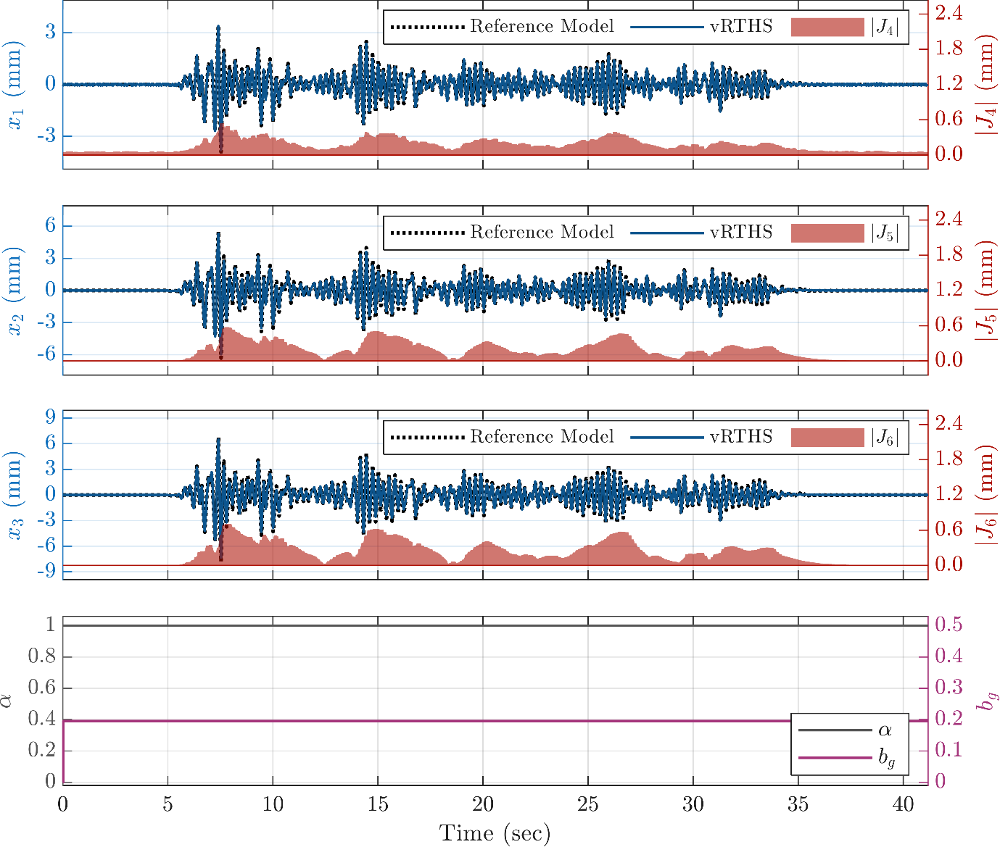

Figure 12~~12~~. Simulation results for Case I, where Controller A is utilized and the physical substructure is maintained undamaged.

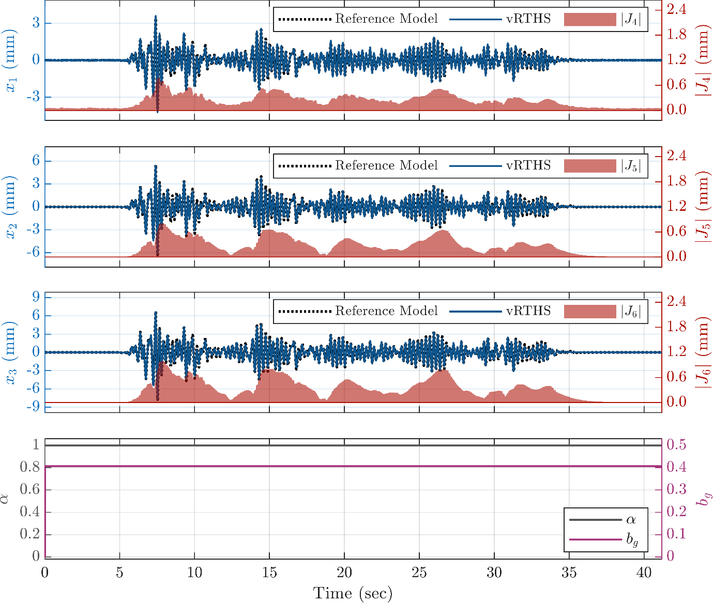

Figure 13~~13~~. Simulation results for Case II, where Controller B is utilized and the physical substructure is maintained undamaged.

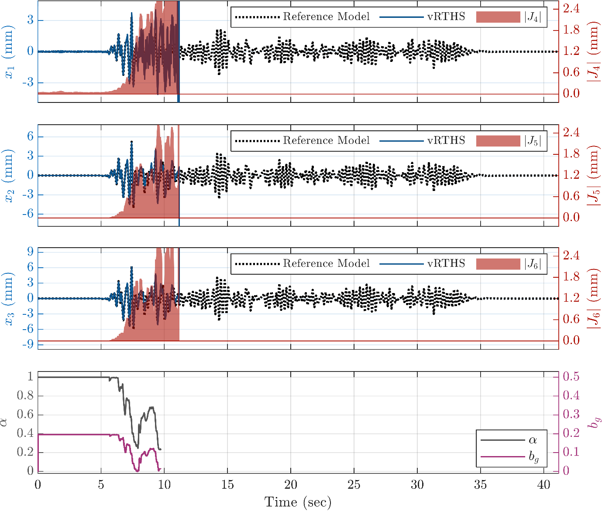

Figure 14~~14~~: Case III results, demonstrating Controller A response to degradation.

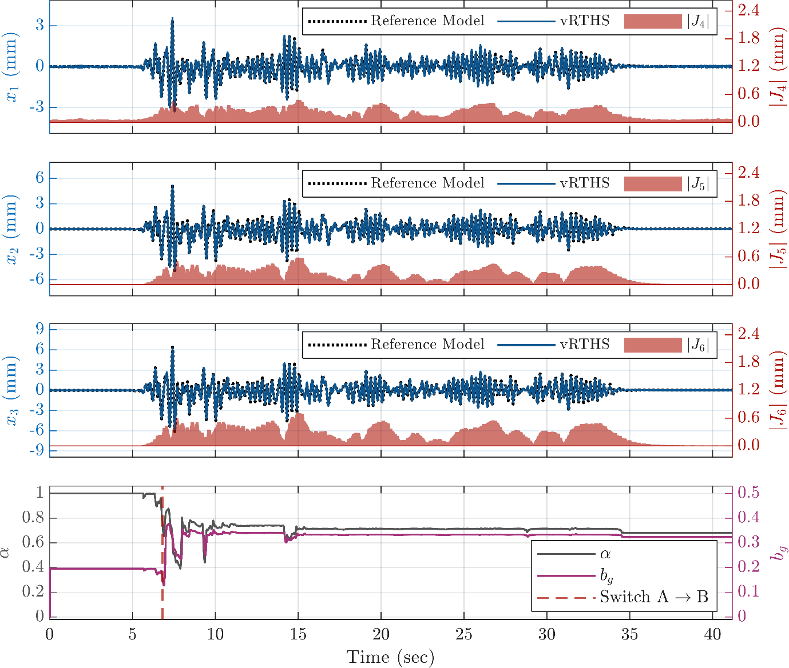

Figure 15~~15~~: Case IV results, demonstrating the effectiveness of the proposed control strategy, utilizing a smooth transition from Controller A to Controller B at the predefined stability threshold.

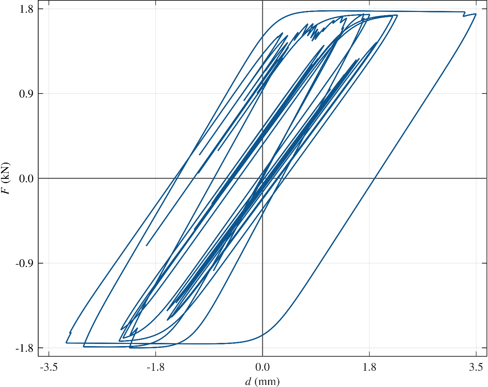

Figure 16~~16~~: Hysteretic force–displacement response for Case IV simulation

# 7-Conclusion

This work develops and demonstrates an online stability indicator based on the NCF stability margin that quantifies the robustness of the closed-loop system as the plant changes during testing and enables the adaptation of control techniques in response to those changes. While the indicator may be useful for detecting different types of adaptations, damage in the form of structural degradation is selected as a situation of interest to demonstrate its capabilities. For SISO settings, a closed-form stability boundary associated with specimen degradation is derived for the outer-controller loop and used to perform a sensitivity analysis, showing that more flexible structures are more susceptible to outer-loop instability caused by stiffness loss. A practical procedure is developed herein in which the indicator triggers a controller switch, and stability of the transition is ensured through the identification of a common Lyapunov function. An illustrative example based on a modified version of a benchmark problem confirms that the indicator provides an advance warning of diminishing robustness and potential instability, and that the controller transitions remain smooth, allowing the test to continue safely despite changes in the physical specimen. These results suggest that incorporating the proposed indicator into experimental systems can improve the tracking performance and expand the range of high quality real-time hybrid simulations, enable more complex tests that are prone to changes in the physical substructure, and improve both test reliability and equipment safety by reducing the likelihood of unexpected instability. Experimental validation of the proposed framework is currently in progress, and an expanded discussion of the associated practical issues and observations will be included in a future manuscript.

# Data Availability Statement

The simulation data that support the findings of this study are available from the corresponding author upon request.

# Conflicts of Interest

The authors declare no conflicts of interest.

# Funding

This work was supported by the U.S. National Science Foundation (NSF), Cyber-Physical Systems (CPS) program (Award No. **CNS-2229136****). **

# References

[1] S. J. Chapman, M. S. Williams, and A. Blakeborough, ‘Laboratory testing of structures under dynamic loads: an introductory review’, *Philosophical Transactions of the Royal Society of London. Series A: Mathematical, Physical and Engineering Sciences*, vol. 359, no. 1786, pp. 1651–1669, Sep. 2001, doi: 10.1098/rsta.2001.0860.

[2] R. T. Leon and G. G. Deierlein, ‘Considerations for the Use of Quasi-Static Testing’, *Earthquake Spectra*, vol. 12, no. 1, pp. 87–109, Feb. 1996, doi: 10.1193/1.1585869.

[3] M. Nakashima, H. Kato, and E. Takaoka, ‘Development of real-time pseudo dynamic testing’, *Earthquake Engineering & Structural Dynamics*, vol. 21, no. 1, pp. 79–92, 1992, doi: 10.1002/eqe.4290210106.

[4] S. A. Mahin, P.-S. B. Shing, C. R. Thewalt, and R. D. Hanson, ‘Pseudodynamic Test Method—Current Status and Future Directions’, *Journal of Structural Engineering*, vol. 115, no. 8, pp. 2113–2128, Aug. 1989, doi: 10.1061/(ASCE)0733-9445(1989)115:8(2113).

[5] A. Maghareh, S. J. Dyke, A. Prakash, and G. B. Bunting, ‘Establishing a predictive performance indicator for real-time hybrid simulation’, *Earthquake Engineering & Structural Dynamics*, vol. 43, no. 15, pp. 2299–2318, 2014, doi: 10.1002/eqe.2448.

[6] J. E. Carrion, ‘Model-based strategies for real-time hybrid testing’, Ph.D., University of Illinois at Urbana-Champaign, United States -- Illinois, 2007. Accessed: Aug. 23, 2025. [Online]. Available: https://www.proquest.com/docview/304858699/abstract/C7673E4A6EB14338PQ/1

[7] A. Najafi, G. A. Fermandois, S. J. Dyke, and B. F. Spencer, ‘Hybrid simulation with multiple actuators: A state-of-the-art review’, *Engineering Structures*, vol. 276, p. 115284, Feb. 2023, doi: 10.1016/j.engstruct.2022.115284.

[8] S. J. Dyke, B. F. Spencer, P. Quast, and M. K. Sain, ‘Role of Control-Structure Interaction in Protective System Design’, *Journal of Engineering Mechanics*, vol. 121, no. 2, pp. 322–338, Feb. 1995, doi: 10.1061/(ASCE)0733-9399(1995)121:2(322).

[9] A. Maghareh, C. E. Silva, and S. J. Dyke, ‘Servo-hydraulic actuator in controllable canonical form: Identification and experimental validation’, *Mechanical Systems and Signal Processing*, vol. 100, pp. 398–414, Feb. 2018, doi: 10.1016/j.ymssp.2017.07.022.

[10] C. E. Silva, D. Gomez, A. Maghareh, S. J. Dyke, and B. F. Spencer, ‘Benchmark control problem for real-time hybrid simulation’, *Mechanical Systems and Signal Processing*, vol. 135, p. 106381, Jan. 2020, doi: 10.1016/j.ymssp.2019.106381.

[11] J. W. Condori Uribe *et al.*, ‘Experimental benchmark control problem for multi-axial real-time hybrid simulation’, *Front. Built Environ.*, vol. 9, Nov. 2023, doi: 10.3389/fbuil.2023.1270996.

[12] H. Zhou, D. Xu, X. Shao, X. Ning, and T. Wang, ‘A robust linear-quadratic-gaussian controller for the real-time hybrid simulation on a benchmark problem’, *Mechanical Systems and Signal Processing*, vol. 133, p. 106260, Nov. 2019, doi: 10.1016/j.ymssp.2019.106260.

[13] A. Palacio-Betancur and M. Gutierrez Soto, ‘Adaptive tracking control for real-time hybrid simulation of structures subjected to seismic loading’, *Mechanical Systems and Signal Processing*, vol. 134, p. 106345, Dec. 2019, doi: 10.1016/j.ymssp.2019.106345.

[14] Z. Wang, X. Ning, G. Xu, H. Zhou, and B. Wu, ‘High performance compensation using an adaptive strategy for real-time hybrid simulation’, *Mechanical Systems and Signal Processing*, vol. 133, p. 106262, Nov. 2019, doi: 10.1016/j.ymssp.2019.106262.

[15] Y. Shangguan, Z. Wang, Y. Guo, Y. Chen, Y. Zeng, and H. Zhou, ‘Adaptive sliding-mode delay compensation for real-time hybrid simulations with multiple actuators’, *Front. Built Environ.*, vol. 10, Aug. 2024, doi: 10.3389/fbuil.2024.1393710.

[16] A. J. Aguila, H. Li, A. Palacio-Betancur, K. A. Ahmed, I. Kovalenko, and M. Gutierrez Soto, ‘Conditional adaptive time series compensation and control design for multi-axial real-time hybrid simulation’, *Front. Built Environ.*, vol. 10, May 2024, doi: 10.3389/fbuil.2024.1384235.

[17] A. Maghareh, S. J. Dyke, and C. E. Silva, ‘A Self-tuning Robust Control System for nonlinear real-time hybrid simulation’, *Earthquake Engineering & Structural Dynamics*, vol. 49, no. 7, pp. 695–715, 2020, doi: 10.1002/eqe.3260.

[18] P. j. Gawthrop, M. i. Wallace, S. a. Neild, and D. j. Wagg, ‘Robust real-time substructuring techniques for under-damped systems’, *Structural Control and Health Monitoring*, vol. 14, no. 4, pp. 591–608, 2007, doi: 10.1002/stc.174.

[19] O. Mercan and J. M. Ricles, ‘Stability analysis for real-time pseudodynamic and hybrid pseudodynamic testing with multiple sources of delay’, *Earthquake Engineering & Structural Dynamics*, vol. 37, no. 10, pp. 1269–1293, 2008, doi: 10.1002/eqe.814.

[20] F. Chi, J. Wang, and F. Jin, ‘Delay-dependent stability and added damping of SDOF real-time dynamic hybrid testing’, *Earthq. Eng. Eng. Vib.*, vol. 9, no. 3, pp. 425–438, Sep. 2010, doi: 10.1007/s11803-010-0026-0.

[21] M. I. Wallace, J. Sieber, S. A. Neild, D. J. Wagg, and B. Krauskopf, ‘Stability analysis of real-time dynamic substructuring using delay differential equation models’, *Earthquake Engineering & Structural Dynamics*, vol. 34, no. 15, pp. 1817–1832, 2005, doi: 10.1002/eqe.513.

[22] Y. N. Kyrychko, K. B. Blyuss, A. Gonzalez-Buelga, S. J. Hogan, and D. J. Wagg, ‘Real-time dynamic substructuring in a coupled oscillator–pendulum system’, *Proc. A*, vol. 462, no. 2068, pp. 1271–1294, Jan. 2006, doi: 10.1098/rspa.2005.1624.

[23] X. S. Gao and S. You, ‘Dynamical stability analysis of MDOF real-time hybrid system’, *Mechanical Systems and Signal Processing*, vol. 133, p. 106261, 2019, doi: https://doi.org/10.1016/j.ymssp.2019.106261.

[24] F. Zhu, J.-T. Wang, F. Jin, F.-D. Chi, and Y. Gui, ‘Stability analysis of MDOF real-time dynamic hybrid testing systems using the discrete-time root locus technique’, *Earthquake Engineering & Structural Dynamics*, vol. 44, no. 2, pp. 221–241, 2015, doi: 10.1002/eqe.2467.

[25] C. Gálmez and G. Fermandois, ‘Online Stability Analysis for Real-Time Hybrid Simulation Testing’, *Front. Built Environ.*, vol. 6, Aug. 2020, doi: 10.3389/fbuil.2020.00134.

[26] M. Ahmadizadeh and G. Mosqueda, ‘Online energy-based error indicator for the assessment of numerical and experimental errors in a hybrid simulation’, *Engineering Structures*, vol. 31, no. 9, pp. 1987–1996, Sep. 2009, doi: 10.1016/j.engstruct.2009.03.002.

[27] Z. Tang, M. Dietz, and Z. Li, ‘Substructuring stability analysis in light of comprehensive transfer system dynamics’, *Bull Earthquake Eng*, vol. 16, no. 1, pp. 129–154, Jan. 2018, doi: 10.1007/s10518-017-0192-9.

[28] H. Zhou, X. Shao, B. Zhang, P. Tan, and T. Wang, ‘Relative stability analysis for robustness design of real-time hybrid simulation’, *Soil Dynamics and Earthquake Engineering*, vol. 165, p. 107681, Feb. 2023, doi: 10.1016/j.soildyn.2022.107681.

[29] A. Maghareh, S. Dyke, S. Rabieniaharatbar, and A. Prakash, ‘Predictive stability indicator: a novel approach to configuring a real-time hybrid simulation’, *Earthquake Engineering & Structural Dynamics*, vol. 46, no. 1, pp. 95–116, 2017.

[30] D. M. Williams, M. S. Williams, and A. Blakeborough, ‘Numerical Modeling of a Servohydraulic Testing System for Structures’, *Journal of Engineering Mechanics*, vol. 127, no. 8, pp. 816–827, Aug. 2001, doi: 10.1061/(ASCE)0733-9399(2001)127:8(816).

[31] E. D. Patino, M. Gomaa, J. N. Villamizar, S. You, S. J. Dyke, and J. A. Ramirez, ‘Performance and Stability of Cascade Controllers for Mixed-mode Hydraulic Structural Testing’, Aug. 01, 2026, *Social Science Research Network, Rochester, NY*: 7217745. doi: 10.2139/ssrn.7217745.

[32] C. Chen, J. Valdovinos, and W. Pong, ‘Real-Time Hybrid Simulation of Viscous Dampers for Seismic Hazard Mitigation’, in *Pressure Vessels and Piping Conference*, American Society of Mechanical Engineers, 2014, p. V008T08A001.

[33] W. H. Press, S. A. Teukolsky, W. T. Vetterling, and B. P. Flannery, *Numerical Recipes: The Art of Scientific Computing*, 3rd edn. Cambridge, UK: Cambridge University Press, 2007.

[34] H. Nyquist, ‘Regeneration Theory’, *Bell System Technical Journal*, vol. 11, no. 1, pp. 126–147, 1932, doi: 10.1002/j.1538-7305.1932.tb02344.x.

[35] H. W. Bode, *Network analysis and feedback amplifier design*. D. Van Nostrand Company, Inc., 1945.

[36] G. F. Franklin, J. D. Powell, M. L. Workman, and others, *Digital control of dynamic systems*, vol. 3. Addison-wesley Menlo Park, 1998.

[37] A. Ingimundarson and T. Hägglund, ‘Robust tuning procedures of dead-time compensating controllers’, *Control Engineering Practice*, vol. 9, no. 11, pp. 1195–1208, Nov. 2001, doi: 10.1016/S0967-0661(01)00065-X.

[38] K. Ogata, *Modern Control Engineering*, 5th edn. Upper Saddle River, NJ: Prentice Hall, 2010.

[39] P. Seiler, A. Packard, and P. Gahinet, ‘An Introduction to Disk Margins [Lecture Notes]’, *IEEE Control Systems Magazine*, vol. 40, no. 5, pp. 78–95, Oct. 2020, doi: 10.1109/MCS.2020.3005277.

[40] K. Glover and D. McFarlane, ‘Robust stabilization of normalized coprime factor plant descriptions with H/sub infinity /-bounded uncertainty’, *IEEE Transactions on Automatic Control*, vol. 34, no. 8, pp. 821–830, Aug. 1989, doi: 10.1109/9.29424.

[41] G. Vinnicombe, ‘Measuring robustness of feedback systems’, PhD Thesis, University of Cambridge, 1992.

[42] J. Park and R. R. Bitmead, ‘Simultaneous scaling for MIMO controller certification’, in *2007 46th IEEE Conference on Decision and Control*, Dec. 2007, pp. 4409–4414. doi: 10.1109/CDC.2007.4434796.

[43] K. M. Halsey, ‘Robust Stability in a Classical and Modern Context’, in *Proceedings of the 44th IEEE Conference on Decision and Control*, Dec. 2005, pp. 2308–2313. doi: 10.1109/CDC.2005.1582506.

[44] K. Zhou and J. C. Doyle, *Essentials of robust control*, vol. 104. Prentice hall Upper Saddle River, NJ, 1998.

[45] D. Liberzon, *Switching in Systems and Control*. in Systems & Control: Foundations & Applications. Boston, MA: Birkhäuser, 2003. doi: 10.1007/978-1-4612-0017-8.

[46] K. S. Narendra and J. Balakrishnan, ‘A common Lyapunov function for stable LTI systems with commuting A-matrices’, *IEEE Transactions on Automatic Control*, vol. 39, no. 12, pp. 2469–2471, Dec. 1994, doi: 10.1109/9.362846.

[47] A. Nemirovskii and P. Gahinet, ‘The projective method for solving linear matrix inequalities’, in *Proceedings of 1994 American Control Conference - ACC ’94*, Jun. 1994, pp. 840–844 vol.1. doi: 10.1109/ACC.1994.751861.

[48] ‘feasp - Compute solution to given system of LMIs - MATLAB’. Accessed: Aug. 26, 2026. [Online]. Available: https://www.mathworks.com/help/robust/ref/feasp.html

[49] R. Bouc, ‘Forced vibrations of mechanical systems with hysteresis’, in *Proc. of the Fourth Conference on Nonlinear Oscillations, Prague, 1967*, 1967.

[50] T. T. Baber and M. N. Noori, ‘Modeling general hysteresis behavior and random vibration application’, *ASME Journal of Vibration Acoustics*, vol. 108, no. 4, pp. 411–420, 1986.

[51] W. Song and S. Dyke, ‘Real-Time Dynamic Model Updating of a Hysteretic Structural System’, *Journal of Structural Engineering*, vol. 140, no. 3, p. 04013082, Mar. 2014, doi: 10.1061/(ASCE)ST.1943-541X.0000857.

[52] C. En, ‘1-1, Eurocode 3: Design of steel structures’, *General rules and rules for buildings*, 1993.

[53] IDEA StatiCa, ‘CBFEM – How It Works, Code Compliance, Validation and Verification’. Accessed: Aug. 18, 2026. [Online]. Available: https://www.ideastatica.com/support-center/support-center-knowledge-base/cbfem-how-it-works-code-compliance-validation-and-verification

[54] K.-W. Liao, Y.-K. Wen, and D. Foutch, ‘Evaluation of 3D steel moment frames under earthquake excitations. I: Modeling’, *Journal of Structural Engineering*, vol. 133, no. 3, pp. 462–470, 2007.

[55] A. P. Darby, M. S. Williams, and A. Blakeborough, ‘Stability and Delay Compensation for Real-Time Substructure Testing’, *Journal of Engineering Mechanics*, vol. 128, no. 12, pp. 1276–1284, Dec. 2002, doi: 10.1061/(ASCE)0733-9399(2002)128:12(1276).

[56] L. Huang, C. Chen, Y. Pu, J. Wang, and T. Guo, ‘Stability analysis of real time hybrid simulation under coupled actuator delay and nonlinear behavior’, doi: 10.1002/eqe.3667.

[57] T. Wang, H. Zhou, X. Zhang, and T. Ran, ‘Stability of an explicit time-integration algorithm for hybrid tests, considering stiffness hardening behavior’, *Earthq. Eng. Eng. Vib.*, vol. 17, no. 3, pp. 595–606, Jul. 2018, doi: 10.1007/s11803-018-0465-6.

Table 1: Comparative summary of RTHS stability indicators

| **Criterion** | **Delay-Margin Based** | **Gain-Margin Based** | **Z-plane unit-circle** | **Energy Based** | **NCF Margin Based** |
| --- | --- | --- | --- | --- | --- |
| Examples | [5], [18], [19], [20], [21], [22], [23], [24], [55], [56] | [27] | [28], [57] | [25], [26] | - |
| Quantifies stability under coupled gain and delay variations | No | No | Yes | Yes | Yes |
| Inherently extensible to MIMO systems | Partially (Not with high-fidelity representation of the transfer system) | Partially (Not with high-fidelity representation of the transfer system) | Partially (Not with high-fidelity representation of the transfer system) | Yes | Yes |
| Reliable for online application a | Partially (Not with high-fidelity representation of the transfer system) | Partially (Not with high-fidelity representation of the transfer system) | Partially (Not with high-fidelity representation of the transfer system) | Yes | Yes (can be computationally expensive) |
| Tunable warning lead time | Yes | Yes | Yes | No | Yes |
| Transfer system dynamics representation b | Pure time delay simplification | High-fidelity representation | High-fidelity representation | N/A | High-fidelity representation |
| Scope of Stability  Analysis c | The numerical substructure loop (Figure 1~~1~~) | The numerical substructure loop (Figure 1~~1~~) | The numerical substructure loop (Figure 1~~1~~) | The numerical substructure loop (Figure 1~~1~~) | The outer controller loop (Figure 2~~2~~) |
| Is Experimentally Verified | Yes (not evaluated in real-time) | Yes (not evaluated in real-time) | Yes (not evaluated in real-time) | Yes (evaluated in real-time) | No |

*a** This criterion denotes the indicator’s computational feasibility and reliability for online evaluation under time-varying physical-substructure dynamics. A functioning model-updating scheme is assumed to supply the required parameters online; additionally, these parameters are assumed to be approximately constant over the estimation window.*

*b** Although delay-margin-based indicators can be extended to incorporate high-fidelity representation of the transfer-system, they have primarily been studied using a lumped pure time-delay representation.*

*c** Although these stability indicators can be applied to any of the nested loops within the RTHS architecture, the table specifically denotes the loops evaluated in the cited examples. As noted earlier, this study focuses on the outer controller loop, since this approach enables detecting instability arising from structural degradation.*

**Table ****2**~~**2**~~**.** Virtual system and controller parameters

| **Parameter** | **Nominal value** | **Units** |
| --- | --- | --- |
| *a₁β₀* | 2.13 × 10¹³ | m Pa/s |
| *a₂* | 4.23 × 10⁶ | m Pa |
| *a₃* | 3.3 | 1/s |
| *β₁* | 425 | non-dimensional |
| *β₂* | 10 × 10⁴ | 1/s |
| *mₑ* | 37.83 | kg |
| *kₑ* | 1.19 × 10⁶ | N/m |
| *cₑ* | 130.2 | kg/s |
| Controller A *Kₚ* | 1.37 | non-dimensional |
| Controller A *Kᵢ* | 72.2 | non-dimensional |
| Controller B *Kₚ* | 0.69 | non-dimensional |
| Controller B *Kᵢ* | 73.3 | non-dimensional |

Table 3: Virtual RTHS evaluation criteria for Cases I, II and IV

| Case (#) | *J*1 (msec) | *J*2 (%) | *J*3 (%) | *J*4 (%) | *J*5 (%) | *J*6 (%) | *J*7 (%) | *J*8 (%) | *J*9 (%) |
| --- | --- | --- | --- | --- | --- | --- | --- | --- | --- |
| I | 3.9 | 9.8 | 10.7 | 18.9 | 13.1 | 15.7 | 13.9 | 9.1 | 9.1 |
| II | 2.9 | 12.1 | 14.7 | 26.7 | 21.5 | 21.6 | 20.0 | 12.7 | 12.7 |
| IV | 3.4 | 10.9 | 18.5 | 22.1 | 18.2 | 18.2 | 14.4 | 11.1 | 11.0 |
