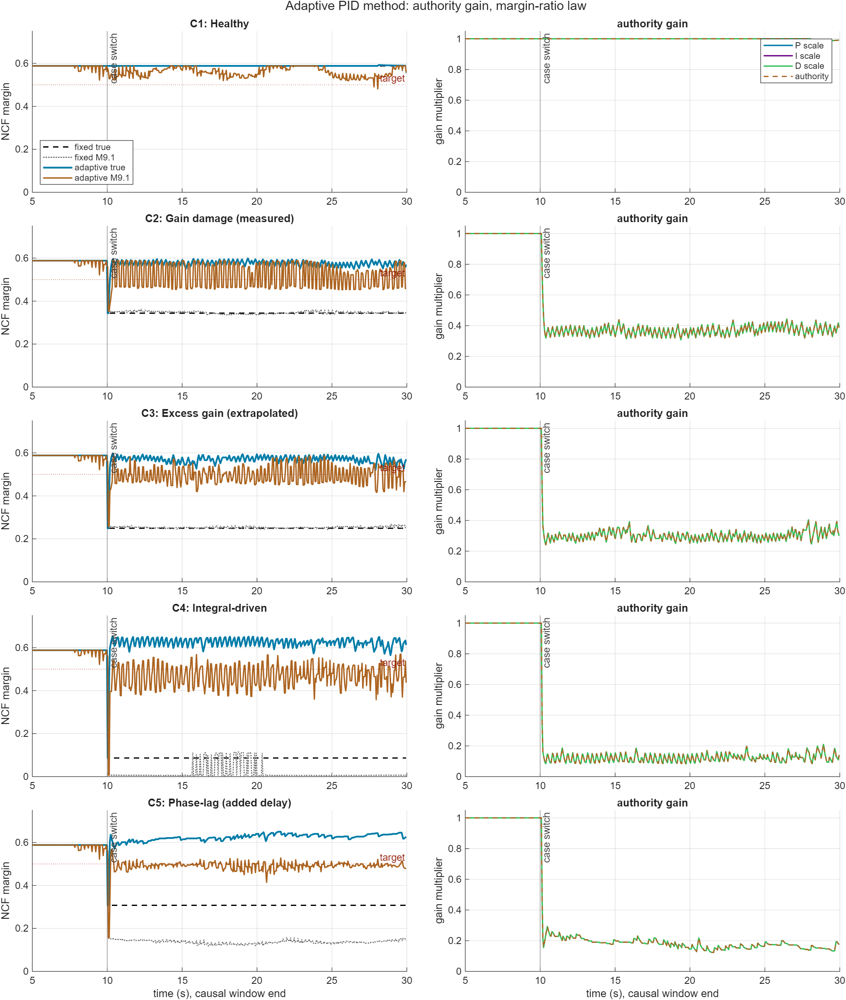

# Adaptive PID authority gain with M9.1 margin feedback

Generated by `run_adaptive_pid_study.m`.

The OSI estimator used here is `main/control_and_HS/OSI/m91_adaptive_margin.m`. The earlier research implementation is not called.

Target NCF margin: `0.500`. Change it in `params/adaptive_pid_config.m` using `cfg.target_margin`.

The only adaptive law kept in this folder is uniform PID authority scaling: `P`, `I`, and `D` are multiplied by the same authority factor `a` while derivative-filter `N` is unchanged.

Each case is calibrated on the healthy nominal loop, then switches at `10.0 s` into the corresponding member of `osi_test_cases.m`. C1 stays healthy.

## Authority law

When M9.1 estimates margin below target, the next authority target is computed from the margin ratio and smoothed downward:

`a_desired = a * (max(m91_margin, 0.05) / target_margin)^power`

Authority recovers slowly toward `1.0` only when the margin is above the target plus deadband. Configure this in `cfg.authority_gain`.

## Summary

| mean fixed below area | mean adaptive below area | reduction | worst fixed settled true NCF | worst adaptive settled true NCF | mean score |
|---:|---:|---:|---:|---:|---:|
| 4.045 | 0.022 | 99.5 % | 0.087 | 0.521 | 10.775 |

## Case details

| Case | fixed min true NCF | adaptive settled min true NCF | fixed below area | adaptive below area | min authority | max authority |
|---|---:|---:|---:|---:|---:|---:|
| C1 | 0.588 | 0.588 | 0.000 | 0.000 | 0.967 | 1.000 |
| C2 | 0.344 | 0.549 | 3.119 | 0.019 | 0.308 | 1.000 |
| C3 | 0.249 | 0.521 | 5.009 | 0.029 | 0.241 | 1.000 |
| C4 | 0.087 | 0.565 | 8.255 | 0.043 | 0.084 | 1.000 |
| C5 | 0.308 | 0.606 | 3.843 | 0.019 | 0.124 | 1.000 |

## Plot

