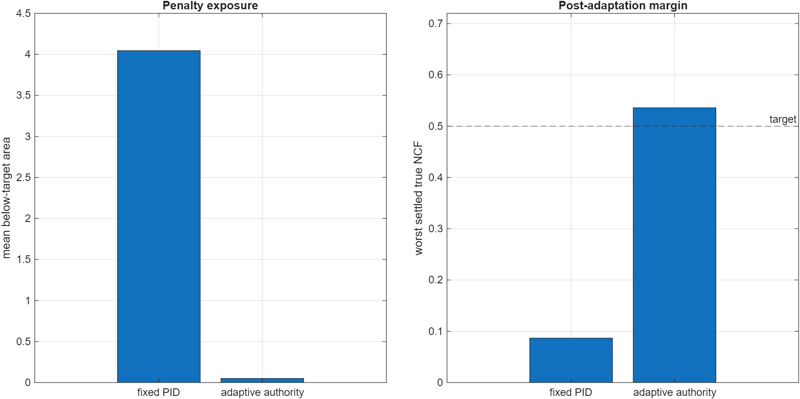
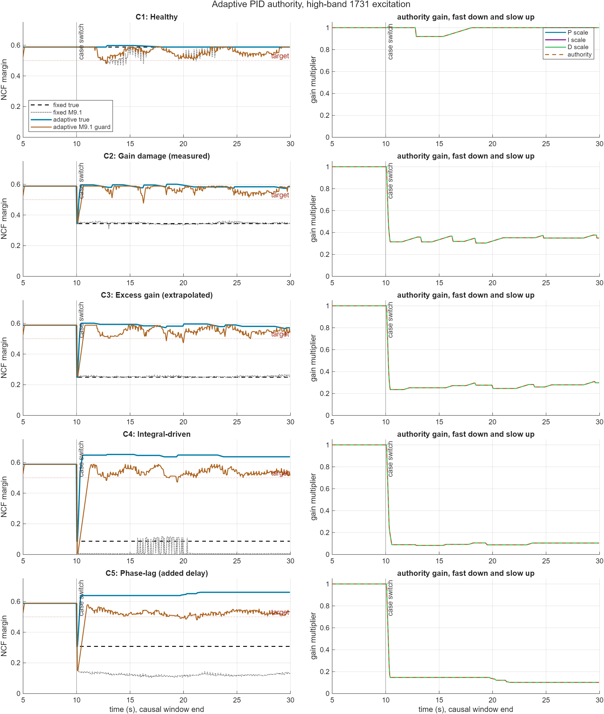
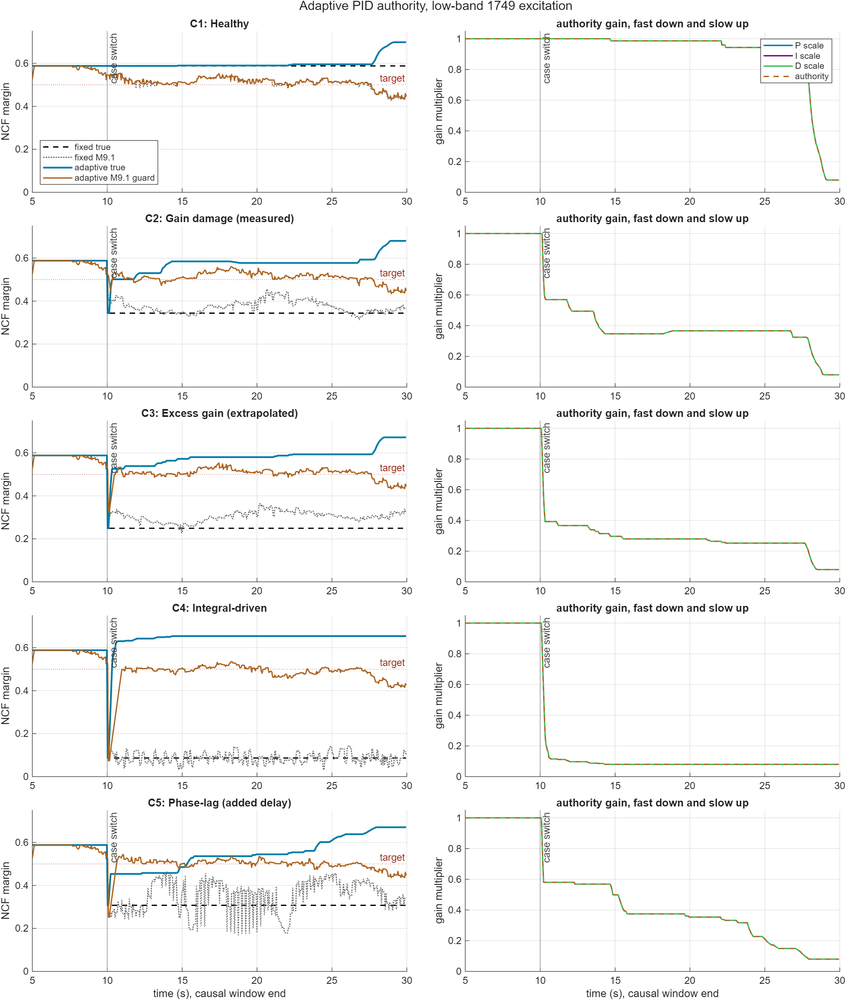
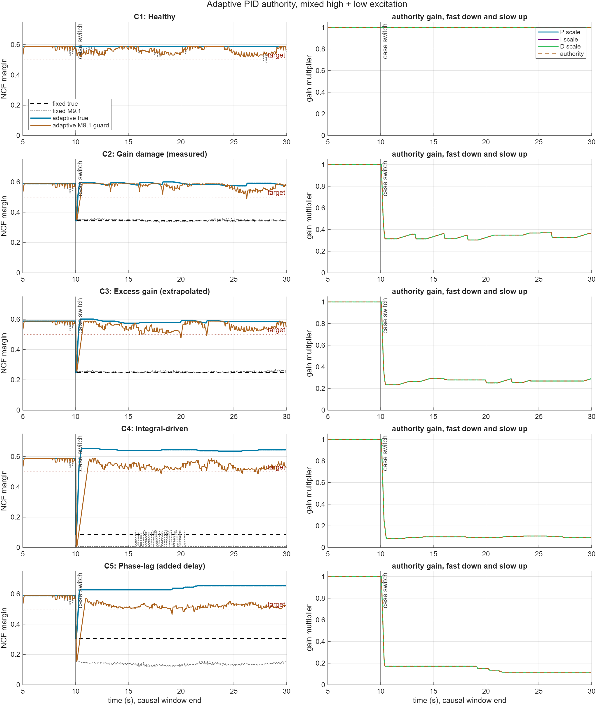

# Adaptive PID authority gain with M9.1 margin feedback

Generated by `run_adaptive_pid_study.m`.

The OSI estimator used here is `main/control_and_HS/OSI/m91_adaptive_margin.m`. The earlier research implementation is not called.

Target NCF margin: `0.500`. Change it in `params/adaptive_pid_config.m` using `cfg.target_margin`.

The adaptive law is uniform PID authority scaling: `P`, `I`, and `D` are multiplied by the same authority factor `a` while derivative-filter `N` is unchanged.

The Simulink/Speedgoat-compatible authority update is encapsulated in `main/control_and_HS/OSI/auth_stability_gain.m`; the study calls that same OSI-level function.

Excitations are now explicit: high-band, low-band, and mixed high + low.

## Authority law

When M9.1 estimates margin below target, authority drops quickly from the raw margin ratio, with a bounded per-update downward slew to avoid injecting authority-step transients:

`a_desired = a * (max(m91_margin, 0.05) / target_margin)^power`

Raw M9.1 is preserved in `ncf_m91`. The validation plots show `ncf_m91_guarded`, which is the adaptive decision signal. Severe dips below `down_immediate_margin` pass immediately, moderate dips must persist for `down_confirm_n` updates, and non-severe guarded-margin movement is rate-limited; this keeps the adaptation from chasing estimator spikes while keeping the raw M9.1 estimate saved separately.

When guarded margin is above target, authority only recovers after it stays above the upper deadband for the configured hold time, then rises by a small rate limit. Configure this in `cfg.authority_gain`.

## Summary

| mean fixed below area | mean adaptive below area | reduction | worst fixed settled true NCF | worst adaptive settled true NCF | mean score |
|---:|---:|---:|---:|---:|---:|
| 4.045 | 0.051 | 98.8 % | 0.087 | 0.536 | 14.169 |

## Case details

| Excitation | Case | fixed min true NCF | adaptive settled min true NCF | fixed below area | adaptive below area | min authority | max authority |
|---|---|---:|---:|---:|---:|---:|---:|
| high | C1 | 0.588 | 0.588 | 0.000 | 0.000 | 0.919 | 1.000 |
| high | C2 | 0.344 | 0.574 | 3.119 | 0.023 | 0.304 | 1.000 |
| high | C3 | 0.249 | 0.566 | 5.009 | 0.043 | 0.236 | 1.000 |
| high | C4 | 0.087 | 0.636 | 8.255 | 0.082 | 0.083 | 1.000 |
| high | C5 | 0.308 | 0.639 | 3.843 | 0.033 | 0.102 | 1.000 |
| low | C1 | 0.588 | 0.590 | 0.000 | 0.000 | 0.080 | 1.000 |
| low | C2 | 0.344 | 0.577 | 3.119 | 0.031 | 0.080 | 1.000 |
| low | C3 | 0.249 | 0.580 | 5.009 | 0.043 | 0.080 | 1.000 |
| low | C4 | 0.087 | 0.654 | 8.255 | 0.082 | 0.080 | 1.000 |
| low | C5 | 0.308 | 0.536 | 3.843 | 0.240 | 0.080 | 1.000 |
| mixed | C1 | 0.588 | 0.588 | 0.000 | 0.000 | 1.000 | 1.000 |
| mixed | C2 | 0.344 | 0.574 | 3.119 | 0.023 | 0.304 | 1.000 |
| mixed | C3 | 0.249 | 0.575 | 5.009 | 0.043 | 0.235 | 1.000 |
| mixed | C4 | 0.087 | 0.636 | 8.255 | 0.082 | 0.082 | 1.000 |
| mixed | C5 | 0.308 | 0.627 | 3.843 | 0.033 | 0.116 | 1.000 |

## Plots

