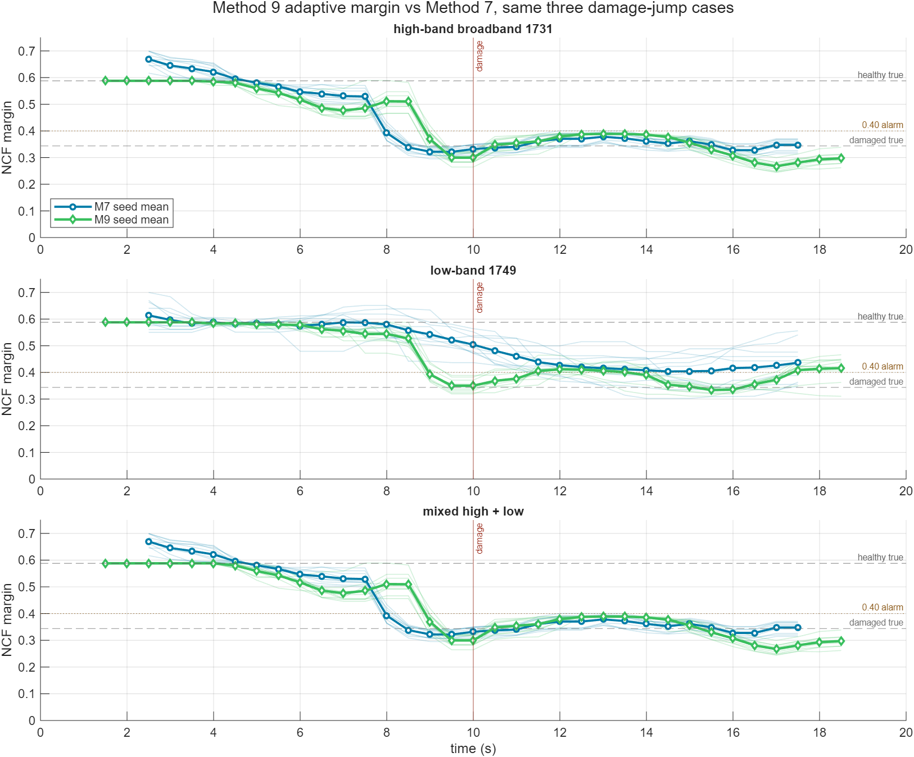

# Method 9 adaptive margin report

Generated by `run_m9_vs_m7_compare.m`.

M9 combines direct closed-loop `S,T` NCF where `dd_lead` excites a frequency with a wide residual-output spectrum where it does not. The search band is 2-100 Hz, with only the 60 Hz line rejected.

True loop-only NCF: healthy `0.5879`, damaged `0.3438`.

## M7 vs M9 summary

| Case | M7 healthy | M7 damaged | M7 abs error | M7 seeds | M7 median s | M9 healthy | M9 damaged | M9 abs error | M9 seeds | M9 median s | M9 freq Hz |
|---|---:|---:|---:|---:|---:|---:|---:|---:|---:|---:|---:|
| high-band | 0.587 | 0.354 | 0.010 | 10 | 9.5 | 0.546 | 0.339 | 0.005 | 10 | 10.5 | 39.0 |
| low-band | 0.587 | 0.415 | 0.071 | 10 | 12.2 | 0.572 | 0.384 | 0.040 | 10 | 10.5 | 8.0 |
| mixed | 0.587 | 0.354 | 0.010 | 10 | 9.5 | 0.546 | 0.339 | 0.005 | 10 | 10.5 | 38.5 |

## Why M9 addresses the M7 issues

- M7 hard-codes a peak band. M9 searches 2-100 Hz point by point and reports the frequency that bound the estimate.
- M7 is relative to `b_nom` and `S_pk,ref`. M9 has an absolute phase-aware branch from `S=1-T`, `T=dm/dd_lead` whenever the band is excited; the model anchor is only the fallback scale for unexcited output-only evidence.
- If the instability is caused by phase delay instead of gain amplification, the `S,T` branch still sees the Nyquist distance shrink because it uses the complex transfer function, not only output amplitude.
- If the dangerous region is actually excited, M9 uses the measured complex FRF instead of waiting for a resonance peak to grow.
- If the dangerous region is not excited, M9 falls back to residual output noise after removing command-correlated output by coherence.
