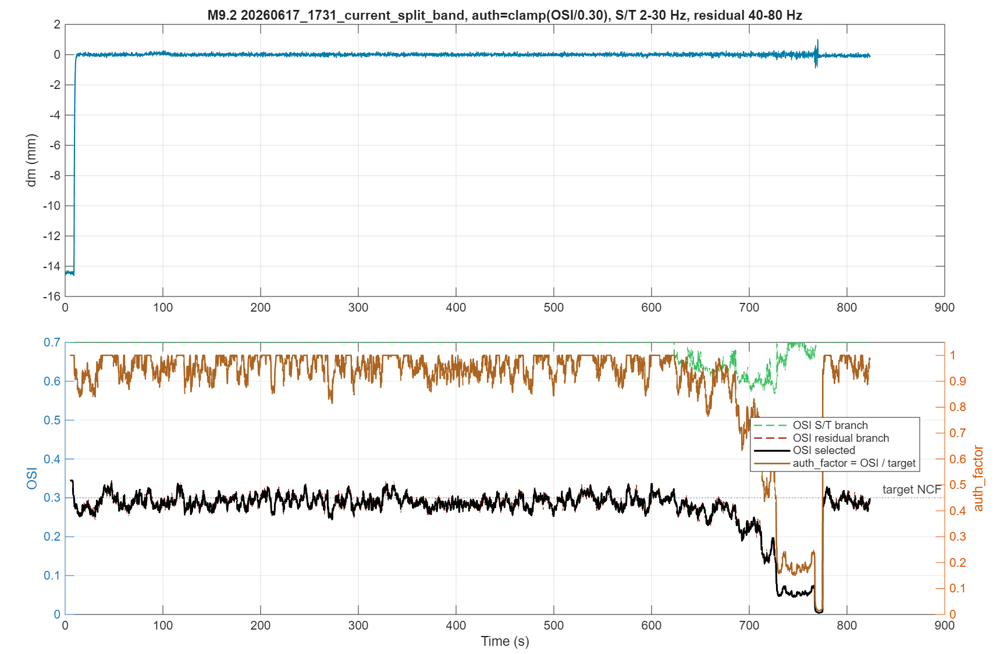
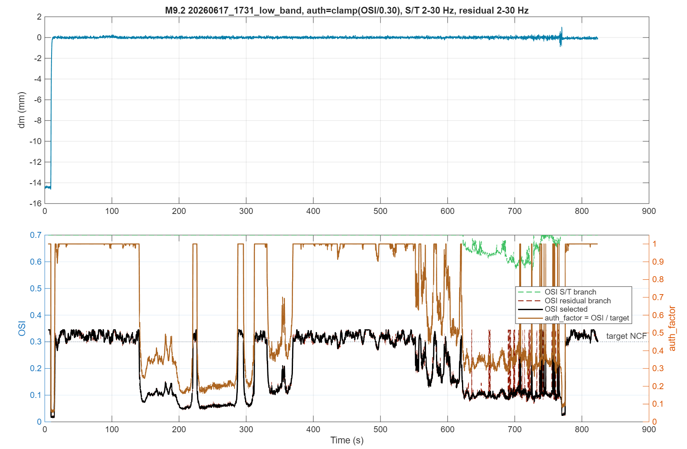
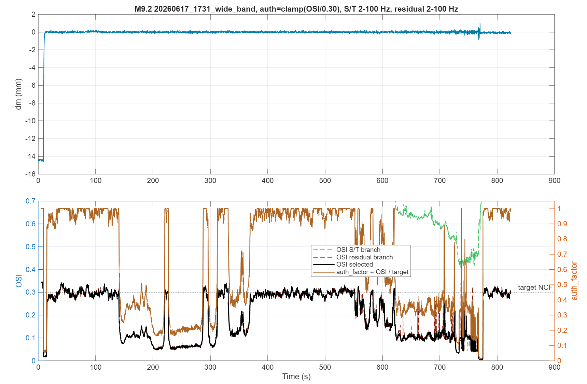
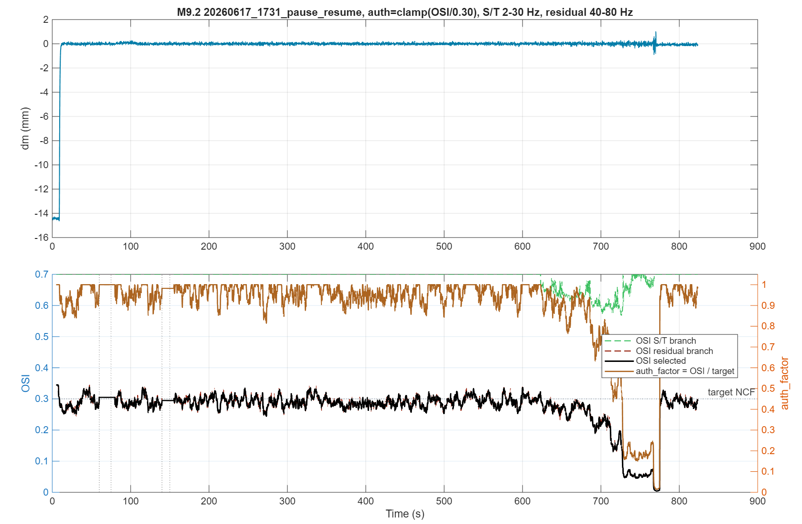
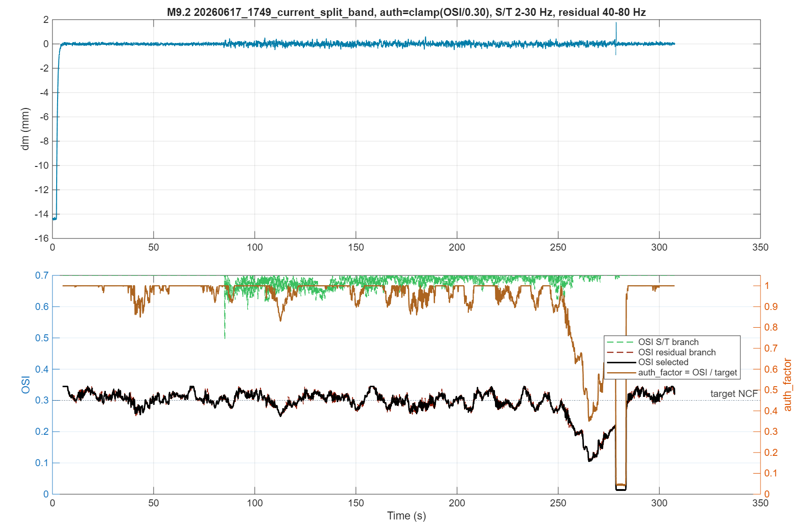
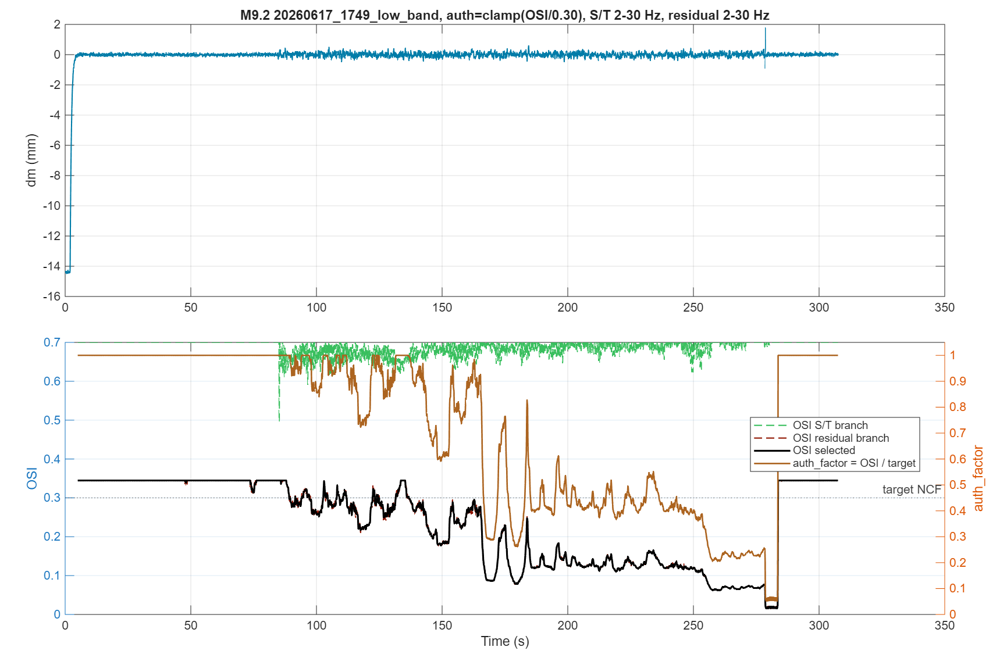
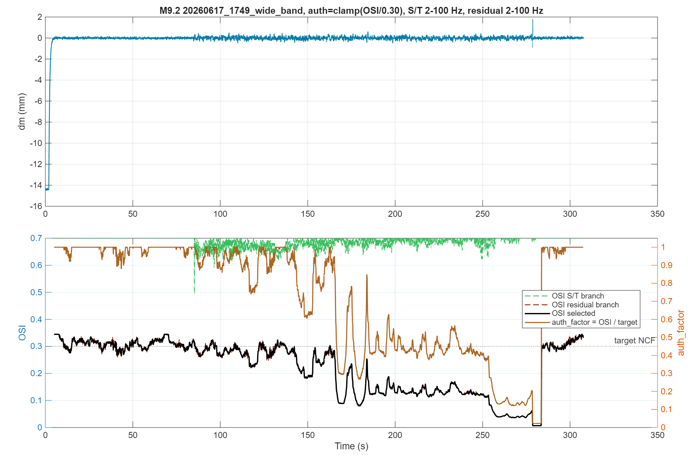
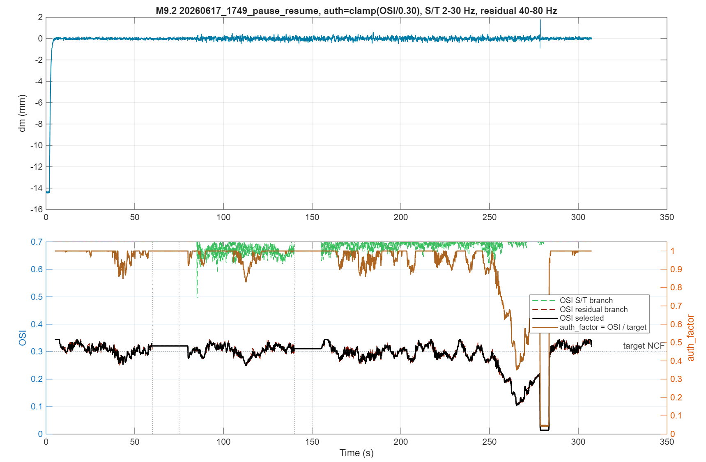

# OSI Method 9.2 direct authority test

Generated by `run_osi_9_2_auth_factor_tests.m`.

Trial law: `auth_factor = clamp(OSI / target_ncf, 0, 1)`.

There is no low/high threshold split, no confirmation counter, no slow recovery, no guarded margin, and no fallback target. The target NCF is required and is `0.3` for these cases.

Result MAT: `osi_9_2_auth_factor_test_result.mat`

## Summary

| Case | Windows | Paused windows | Min OSI | Mean OSI | Min auth_factor | Mean auth_factor | Final auth_factor |
|---|---:|---:|---:|---:|---:|---:|---:|
| 20260617_1731_current_split_band | 16435 | 0 | 0.0044 | 0.2708 | 0.0146 | 0.8938 | 0.9843 |
| 20260617_1731_low_band | 16435 | 0 | 0.0160 | 0.2137 | 0.0535 | 0.6791 | 1.0000 |
| 20260617_1731_wide_band | 16435 | 0 | 0.0046 | 0.2015 | 0.0153 | 0.6646 | 1.0000 |
| 20260617_1731_pause_resume | 16435 | 702 | 0.0044 | 0.2714 | 0.0146 | 0.8957 | 0.9843 |
| 20260617_1749_current_split_band | 6075 | 0 | 0.0124 | 0.2891 | 0.0412 | 0.9324 | 1.0000 |
| 20260617_1749_low_band | 6075 | 0 | 0.0155 | 0.2347 | 0.0517 | 0.7273 | 1.0000 |
| 20260617_1749_wide_band | 6075 | 0 | 0.0068 | 0.2210 | 0.0227 | 0.7210 | 1.0000 |
| 20260617_1749_pause_resume | 6075 | 702 | 0.0124 | 0.2903 | 0.0412 | 0.9337 | 1.0000 |

## Figures

### 20260617_1731_current_split_band

### 20260617_1731_low_band

### 20260617_1731_wide_band

### 20260617_1731_pause_resume

### 20260617_1749_current_split_band

### 20260617_1749_low_band

### 20260617_1749_wide_band

### 20260617_1749_pause_resume

