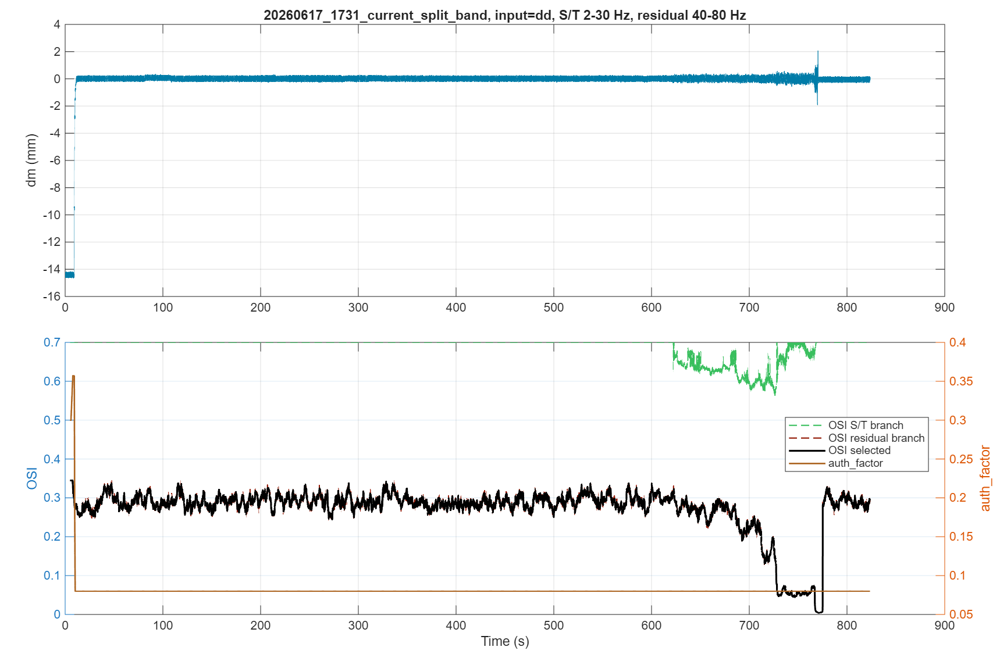
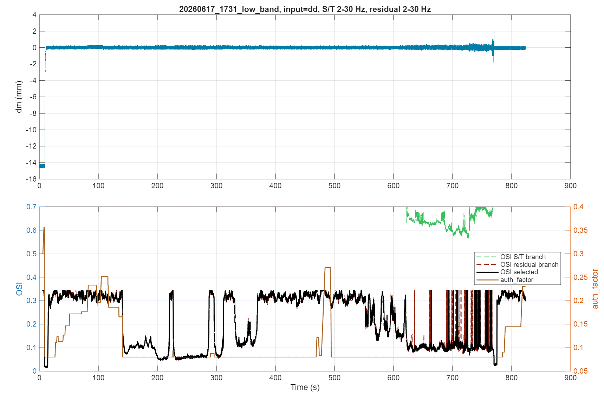
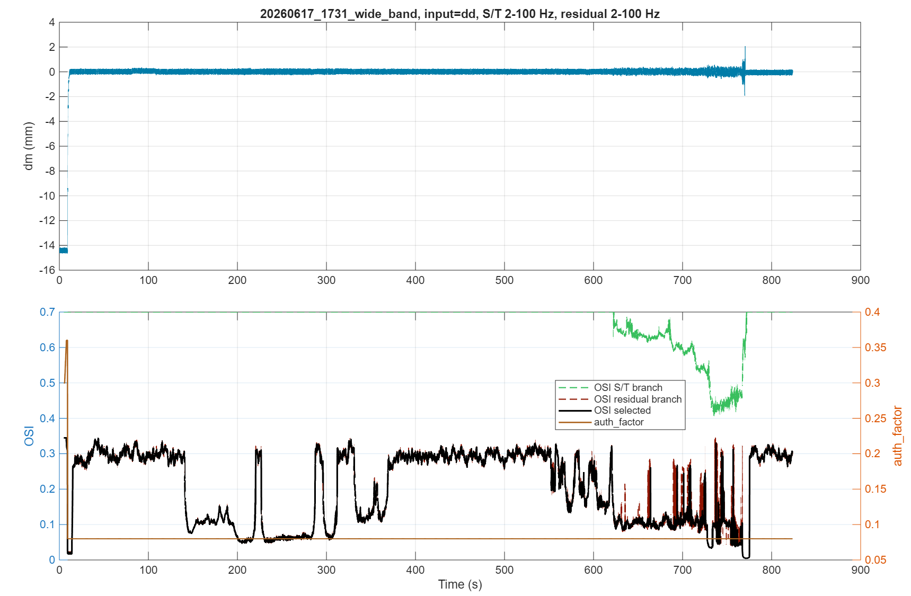
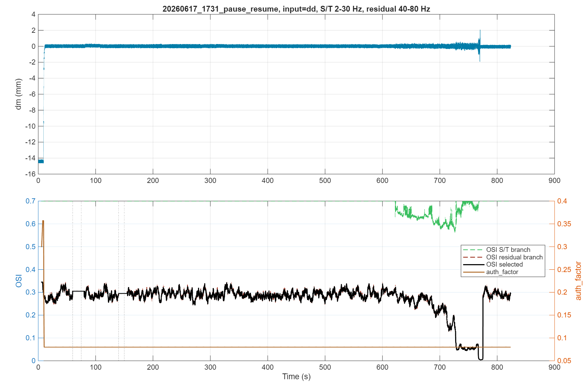
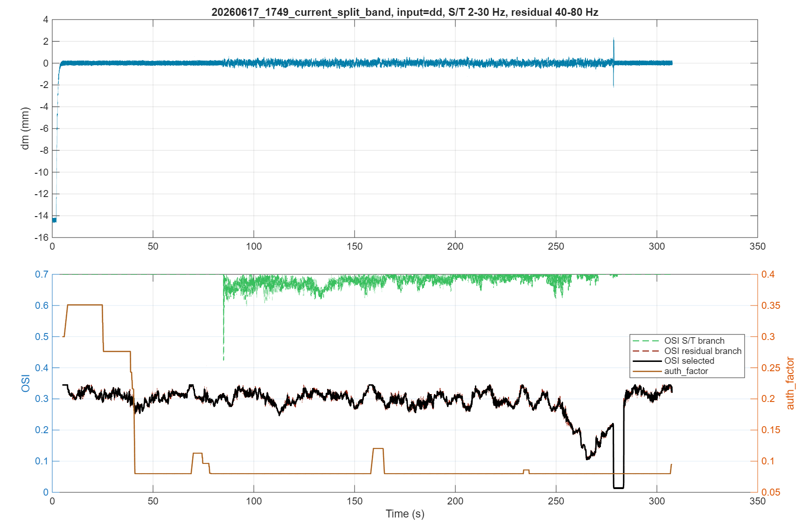
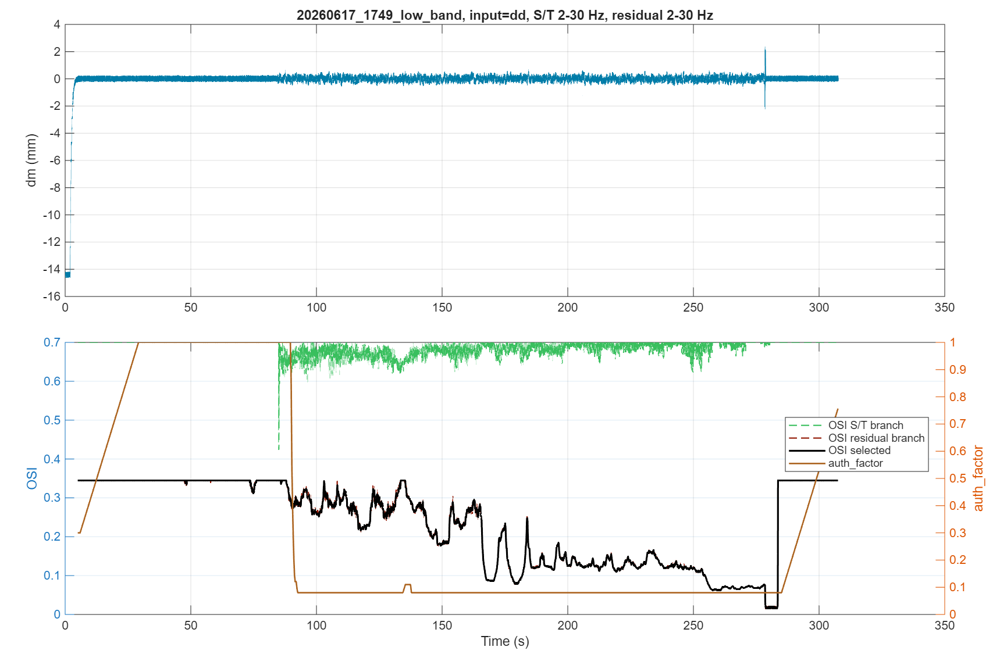
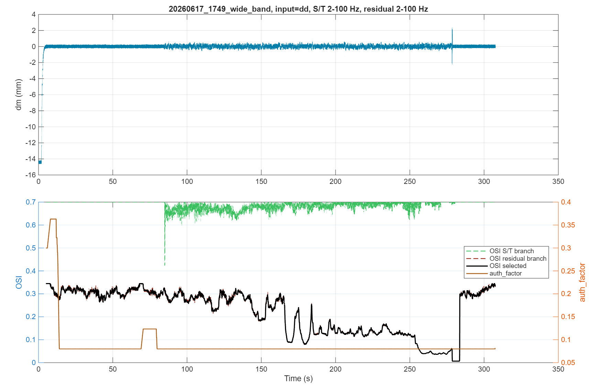
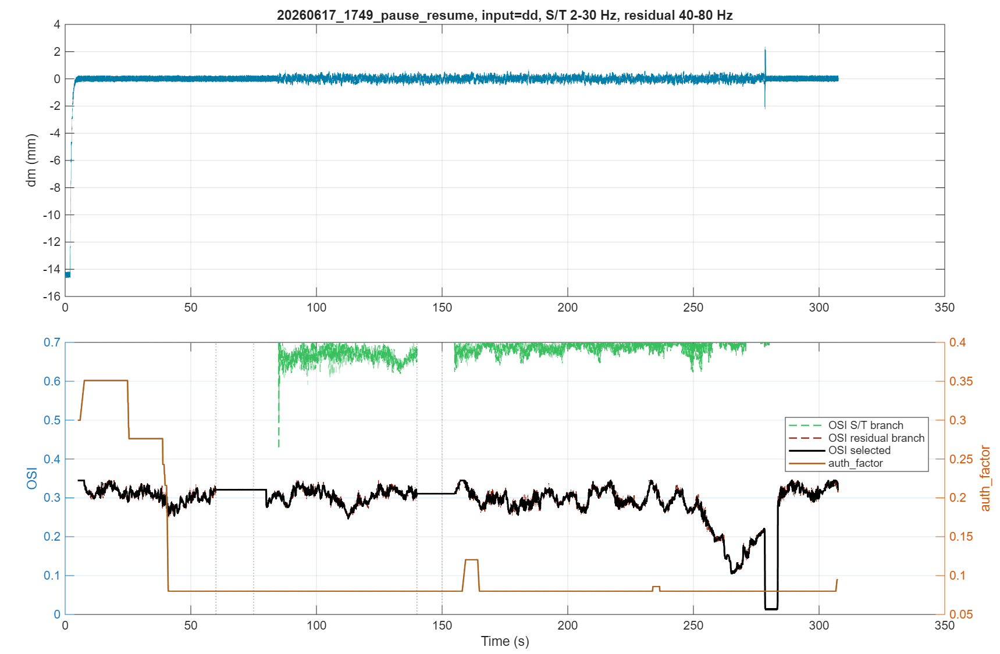

# OSI/auth-factor tests from OSI_tests

Generated by `run_osi_auth_factor_tests_from_osi_tests.m`.

All outputs are kept under `C:\Users\Victus\Desktop\folder_working\a purdue\aa reasearch\Gaurav Setup\ColumnSetup_gaurav\main\research\optimizing_pl\codex\osi_auth_factor_tests`.

Result MAT: `osi_auth_factor_test_result.mat`

## Summary

| Case | Windows | Paused windows | Min OSI | Min auth_factor | Final auth_factor |
|---|---:|---:|---:|---:|---:|
| 20260617_1731_current_split_band | 16435 | 0 | 0.0044 | 0.0800 | 0.0800 |
| 20260617_1731_low_band | 16435 | 0 | 0.0160 | 0.0800 | 0.2300 |
| 20260617_1731_wide_band | 16435 | 0 | 0.0046 | 0.0800 | 0.0800 |
| 20260617_1731_pause_resume | 16435 | 702 | 0.0044 | 0.0800 | 0.0800 |
| 20260617_1749_current_split_band | 6075 | 0 | 0.0124 | 0.0800 | 0.0950 |
| 20260617_1749_low_band | 6075 | 0 | 0.0155 | 0.0800 | 0.7565 |
| 20260617_1749_wide_band | 6075 | 0 | 0.0068 | 0.0800 | 0.0815 |
| 20260617_1749_pause_resume | 6075 | 702 | 0.0124 | 0.0800 | 0.0950 |

## Figures

### 20260617_1731_current_split_band

### 20260617_1731_low_band

### 20260617_1731_wide_band

### 20260617_1731_pause_resume

### 20260617_1749_current_split_band

### 20260617_1749_low_band

### 20260617_1749_wide_band

### 20260617_1749_pause_resume

